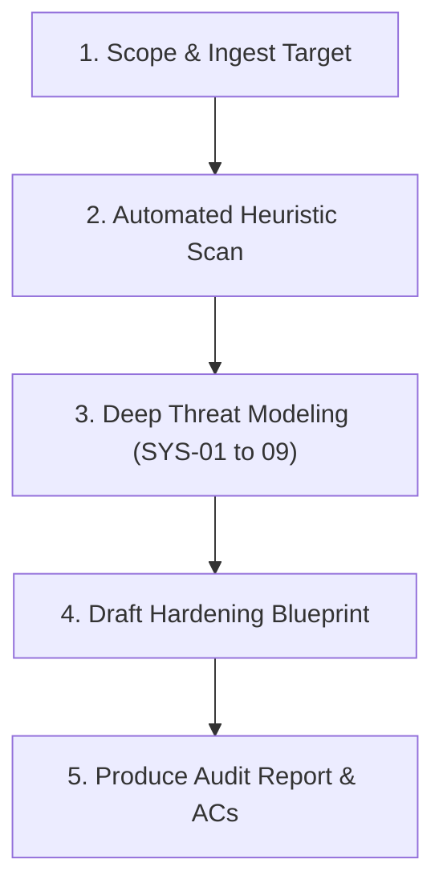

# Review Agent: Architectural Audit & Hardening Protocol

The **Review Agent** acts as the automated architectural review and security hardening authority for AgyStudio. It applies rigorous threat analysis to specifications, codebases, native shims, build pipelines, and Android platform constraints, identifying subtle bugs, race conditions, and privilege boundary violations before and after implementation.

---

## Trigger Conditions & Autonomous Policy

> [!IMPORTANT]
> **Automatic Autonomous Execution**: This skill is **automatically active** during development.
> - **On Any Spec Creation**: Automatically execute the audit protocol on newly authored specification files before asking for user approval.
> - **After Every Round of Implementation**: Automatically execute the audit protocol against modified source code and build files before concluding a task or prompting the user.
> - The user does **NOT** need to explicitly request or invoke this review; run it proactively as an essential verification gate.

---

## Android Sandbox Execution Rule

> [!IMPORTANT]
> **Android SELinux W^X Constraint**: Android strictly prevents executing scripts directly via `./script.sh` or `./script.py` on internal (`~`) or shared storage (`/storage/emulated/0/`), even after `chmod +x`.
> 
> **Enforcement**: Always execute helper scripts explicitly through their interpreter:
> - Use `python3 .agents/skills/review-agent/scripts/call_review.py`
> - Use `bash <script>.sh`
> - **NEVER** use `./<script>` or `./scripts/call_review.py`

---

## Step-by-Step Audit Protocol



### Step 1: Scope & Ingest Target
Identify the artifact under review:
- Specification document (e.g. `specs/vX.Y.Z/...`)
- Source code or build script (e.g. `app/`, `agy-ui/`, `.github/workflows/`, `build.gradle.kts`)

### Step 2: Run Automated Heuristic Scan
Run the review helper script using `python3` to detect known pitfalls:
```bash
python3 .agents/skills/review-agent/scripts/call_review.py --spec <path_to_spec> --thinking-level high
```
Or scan a source directory:
```bash
python3 .agents/skills/review-agent/scripts/call_review.py --check-code <path_to_dir>
```

### Step 3: Deep Threat Modeling
Evaluate the target against the [Audit Matrix](./references/audit_matrix.md) across these core dimensions:

1. **Kernel Syscall Bypass vs Shims (SYS-01)**:
   - Do Go/Rust binaries issue direct `svc #0` syscalls that bypass dynamic linker hooks?
   - Is `files/usr/bin` protected by Linux VFS directory mode `0500` (`dr-x------`)?
2. **Deterministic CI Keystores (SYS-02)**:
   - Does CI sign releases with a persistent developer keystore (`AGY_KEYSTORE_BASE64`) to prevent `INSTALL_FAILED_UPDATE_INCOMPATIBLE`?
3. **Dynamic Path Rotation & Dangling Symlinks (SYS-03)**:
   - Does the design account for Android package updates randomizing `/data/app/~~<hash>/` paths?
   - Are symlinks dynamically re-linked upon boot and `MY_PACKAGE_REPLACED`?
4. **Environment vs DEX BuildConfig Synchronization (SYS-04)**:
   - Are daemon processes receiving `APP_VERSION_CODE` via process environment variables rather than guessing?
5. **IPC & Intent Security (SYS-05)**:
   - Are `FLAG_MUTABLE` PendingIntents bound to explicit component Intents for Android 14/15 (`targetSdk 34+`) compatibility?
6. **16KB Memory Page Alignment (SYS-06)**:
   - Are `arm64-v8a` ELF binaries aligned using `patchelf --page-size 16384` for Android 15 compatibility?
7. **Hybrid WebView Native Bridge Boundaries (SYS-07)**:
   - Are clipboard reads and URL navigation routed through `@JavascriptInterface` bridges in native Kotlin rather than raw desktop browser APIs?
8. **Monolithic Python File Class Integrity (SYS-08)**:
   - Do all methods of `AgyProcessOrchestrator` in `server.py` remain strictly indented inside the class scope?
9. **Mobile Touch Target & Stacking Standards (SYS-09)**:
   - Are touch targets at least 44px × 44px with explicit `z-index: 10+` and `touch-action: manipulation`?

### Step 4: Synthesize Findings
Classify all detected issues by severity:
- **CRITICAL**: Threat breaks application functionality, corrupts user data, causes update incompatibilities, or permits unauthorized sandbox escapes.
- **HIGH**: Application crashes on specific Android versions (14/15), dangling pointers after updates, or memory faults.
- **MEDIUM**: Subsystem race conditions, false positive path matching, or missing fallback handlers.
- **LOW**: Inconsistent documentation, minor style deviations, or non-blocking warnings.

### Step 5: Deliver Structured Audit Report
Format the audit output adhering to the review standard:

```markdown
### Architectural Review Summary
- **Target**: `<file_or_subsystem>`
- **Auditor**: `review-agent (automated)`
- **Overall Status**: [AUDITED & HARDENED / ACTION REQUIRED]

#### Critical Mitigations
| Issue ID | Severity | Subsystem | Threat & Impact | Architectural Mitigation |
| :--- | :--- | :--- | :--- | :--- |
| **SYS-XX** | CRITICAL | `<area>` | `<threat description>` | `<concrete technical mitigation>` |

#### Implementation Acceptance Criteria
- [ ] **AC-Rev-X.1**: `<verification step>`
```

---

## Supporting Resources

- [call_review.py](./scripts/call_review.py) — Automated scanner for Android sandbox and platform pitfalls.
- [audit_matrix.md](./references/audit_matrix.md) — Reference threat models and mitigation catalog.
