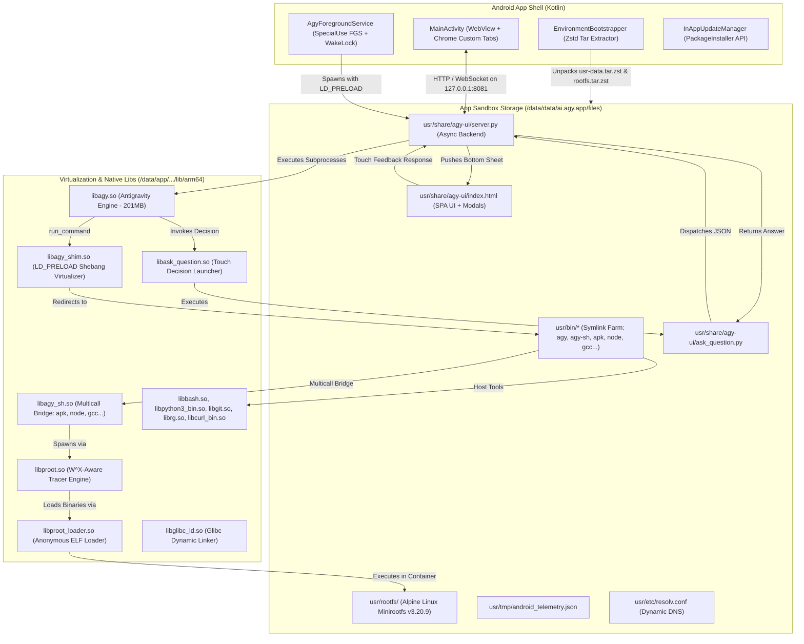

# Antigravity Studio for Android

<p align="center">
  
</p>

<p align="center">
  <strong>The first fully standalone, autonomous AI coding agent & IDE for Android.</strong><br>
  Zero Termux required &bull; Zero root required &bull; Self-contained toolchain &bull; Android 10 to 17+ (API 28–35+)
</p>

<p align="center">
  <a href="https://github.com/MisterMoeGreen/Antigravity-Studio-App/releases/latest"></a>
</p>

---

## Overview

**Antigravity Studio** brings Google DeepMind's autonomous coding engine (**Antigravity**) directly to your Android device in a native, touch-first mobile IDE.

Download a single APK, sign in with Google, and start building — no Termux, no root, no laptop required. The app ships everything you need: a full AI coding agent, built-in developer tools (bash, git, python, ssh), and the ability to install virtually any programming language or compiler on the fly.

What makes it unique: Antigravity Studio is the first app to run real native compilers and JIT runtimes (Node.js, Java, Rust, GCC, Clang, Go) **directly on Android at full native speed** — something normally blocked by Android's security restrictions. It does this transparently, so you just write code and the agent handles the rest.

---

## Key Features

### 🚀 Code in Any Language — Directly on Android
Install and run virtually any programming language or compiler with a single command. Node.js, Java, Python, C/C++, Rust, Go, Clang, PHP — all execute at **full native ARM64 speed**, not through emulation. The agent can install toolchains on demand, or you can install them yourself from the Settings Hub.

### 📦 Built-In Package Manager
Access thousands of packages from Alpine Linux's repository, installable in seconds:
* **From the Settings Hub**: Tap **Settings ⚙ → Packages** to browse installed packages, check disk usage, search for new ones, or use quick-install presets (Node.js, Python, Rust, Java, C/C++, Go, etc.).
* **From the Chat**: Just ask the agent — *"Install Node.js"* or *"I need OpenCV"* — and it finds the right packages, resolves dependencies, and installs them.
* **From Commands**: The agent runs `apk add` directly when it needs a tool, no manual intervention required.

### 💬 Interactive Touch Prompts
When the AI agent needs your input — choosing an architecture, picking between options, or confirming a decision — it presents **native touch dialogs** instead of raw terminal prompts:
* Single-select radio cards and multi-select checkboxes
* Free-form text write-in for custom answers
* Clean bottom-sheet modals designed for mobile screens

### 🧰 Pre-Bundled Developer Toolchain
Everything an AI coding agent needs ships inside the APK — no separate installs:
* **bash 5.3** & **busybox 1.38** — Shell and core UNIX utilities
* **python 3.14** — Full runtime with 80+ compiled extensions
* **git 2.56** — Clone, commit, and push over HTTPS or SSH
* **ripgrep 15.2** — Fast codebase search
* **curl 8.22** — Network requests and API calls
* **ssh 9.9** — Secure remote connections and Git operations

### ⚙️ Settings Hub
A touch-first control panel for managing your development environment:
* **API Keys** — Store service tokens (GitHub, OpenAI, Tavily, etc.) that auto-inject into the agent
* **SSH Keys** — Generate ED25519 or RSA-4096 keys and copy the public key with one tap
* **MCP Servers** — Connect Model Context Protocol servers (local stdio or remote HTTP)
* **Skills & Custom Instructions** — Browse, create, and edit agent behaviors and workspace rules
* **Packages** — Visual package manager for the built-in Alpine subsystem

### 🔋 Runs in the Background
Lock your screen or switch apps — the agent keeps working:
* Foreground service with persistent notification keeps tasks alive
* Battery-aware: the agent can check battery level, charging state, and CPU temperature
* Automatic network handling when switching between Wi-Fi and cellular

### 🔄 Seamless Updates
* **Instant UI updates**: Frontend patches download and apply without reinstalling the app
* **In-app APK updater**: Check for new versions, download, and install — all from within the app

---

## Architecture & How It Works



### Under the Hood

Running real compilers and JIT runtimes on Android is hard — the OS blocks dynamic code execution by design. Antigravity Studio solves this with three native components:

* **Anonymous ELF Loader** (`libproot_loader.so`): Loads binaries into anonymous memory pages that bypass Android's SELinux execution barriers entirely.
* **W^X-Aware PRoot Engine** (`libproot.so`): A user-space virtualization layer that intercepts system calls via `ptrace`, translating paths and enforcing safe execution without kernel modifications.
* **Bionic Shim** (`libagy_shim.so`): An `LD_PRELOAD` hook that rewrites shebangs (`#!/bin/sh`, `#!/usr/bin/env python3`) to point to the bundled toolchain, since Android lacks standard Linux paths.

The app also embeds a lightweight Alpine Linux rootfs (~3.5 MB) that provides the `apk` package manager and its full repository — this is how `apk add nodejs` or `apk add gcc` works on a phone. All 115+ native binaries are 16 KB page-aligned and signed for Android 10–17+ compatibility.

### Cold Boot Workflow
1. **Runtime Extraction**: On first launch (or build update), `EnvironmentBootstrapper` extracts:
   * `usr-data.tar.zst` (~8.5 MB): Python stdlib, git templates, SSL certificates, Web UI, `ask_question.py`, and built-in skills.
   * `rootfs.tar.zst` (~3.5 MB): Alpine Linux `aarch64` minirootfs non-destructively unpacked into `usr/rootfs/`.
2. **Symlink Farm Assembly**: Creates symlinks in `usr/bin/` pointing to the native binaries in `/data/app/.../lib/arm64/`, including `libagy.so`, host toolchain utilities, and multicall bridges (`agy-sh`, `apk`, `pkg`, `node`, `npm`, `npx`, `cargo`, `gcc`, `java`, `ask_question`).
3. **Daemon Initialization**: `AgyForegroundService` acquires a `WakeLock`, selects an available port (`8081` $\to$ `8082` $\to$ `8090` $\to$ ephemeral), and starts `server.py` with `LD_PRELOAD=libagy_shim.so`.
4. **UI Readiness**: `MainActivity` polls `/health` until the backend signals ready, then renders the responsive mobile IDE interface in WebView.

---

## Getting Started

### Installation
1. Download **`AntigravityStudio.apk`** from the [GitHub Releases](https://github.com/MisterMoeGreen/Antigravity-Studio-App/releases) page.
2. Open your device file manager (Files, Solid Explorer, etc.) and tap the downloaded `.apk`.
3. If prompted, allow your browser or file manager to **Install unknown apps**.
4. Tap **Install** and launch **Antigravity Studio**.

### First Launch & Authentication
1. On initial startup, grant the **Notification Permission** (required for background execution).
2. Allow a few seconds for first-time environment and Alpine rootfs initialization.
3. Tap **Sign in with Google**. A browser tab will open for Google authentication.
4. Copy the authorization code, paste it into the chat prompt, and hit send!
5. Select your workspace directory and start coding!

---

## Project Structure

```text
AgyStudio/
├── agystudio.png                         # Application logo
├── app/
│   ├── src/main/
│   │   ├── AndroidManifest.xml           # Permissions, FGS declaration, FileProvider
│   │   ├── cpp/
│   │   │   ├── agy_shim.c                # Bionic C virtualization shim (execve / shebang parser)
│   │   │   ├── agy_sh.c                  # Native multicall toolchain bridge (apk, node, gcc...)
│   │   │   ├── ask_question_launcher.c   # Native ELF launcher for interactive touch modals
│   │   │   ├── proot/                    # W^X-aware PRoot tracer core (talloc, seccomp BPF)
│   │   │   ├── proot_loader/             # Freestanding anonymous ELF loader (mmap/pread64/mprotect)
│   │   │   └── CMakeLists.txt            # Native build script
│   │   ├── java/ai/agy/app/
│   │   │   ├── MainActivity.kt           # WebView container, back-button handling & OAuth
│   │   │   ├── AgyForegroundService.kt   # Foreground service, WakeLock, Dynamic DNS & telemetry
│   │   │   ├── EnvironmentBootstrapper.kt # Cold-boot unpack, rootfs extraction & symlink farm
│   │   │   ├── InAppUpdateManager.kt     # Tier-1 OTA asset updater & Tier-2 APK installer
│   │   │   └── UpdateReceiver.kt         # PackageInstaller broadcast receiver
│   │   ├── assets/
│   │   │   ├── usr-data.tar.zst          # Compressed runtime assets (Python stdlib, web UI, skills)
│   │   │   └── rootfs.tar.zst            # Alpine Linux aarch64 minirootfs (jemalloc, patched musl)
│   │   └── res/                          # Vector launcher icons, styles, and XML configs
├── agy-ui/                               # Web frontend & async Python server source
│   ├── index.html                        # Mobile SPA chat, Settings Hub & Package Manager UI
│   ├── server.py                         # Async process orchestrator, package API & WebSocket dispatcher
│   ├── ask_question.py                   # CLI-to-UI interactive modal bridge
│   ├── default_app_prompt.md             # Mobile system directives, UI navigation & container rules
│   ├── skills/                           # Built-in agent skills
│   │   └── package-manager/SKILL.md      # Auto-seeded Alpine package recipes and execution directives
│   ├── manifest.json                     # PWA standalone application manifest
│   └── sw.js                             # Service Worker offline asset cache
├── scripts/
│   ├── build_shim.sh                     # Compiles and strips libagy_shim.so
│   └── prepare_binaries.sh               # Stages 16KB-aligned ELF binaries & packages assets
├── specs/
│   ├── initial/                          # v1.0.0 Architecture & Core Toolchain specifications
│   ├── 1.1.0/                            # v1.1.0 System Prompts, Dynamic DNS & Telemetry specs
│   ├── v1.2.0/                           # v1.2.0 Interactive Touch Questions & Decision Modals specs
│   ├── v1.3.0/                           # v1.3.0 W^X PRoot Subsystem, Anonymous Loader & Package UI specs
│   ├── OVERVIEW_AND_IMPLEMENTATION_GUIDE.md # Master verification gates & acceptance tests
│   └── IMPLEMENTATION_LOG.md             # Execution audit log across all phases
├── build.gradle.kts                      # Root project Gradle configuration
└── settings.gradle.kts                   # Module settings
```

---

## Building from Source

To compile the APK from source on an Android device (via Termux) or on a Linux desktop:

```bash
# 1. Clone the repository
git clone git@github.com:MisterMoeGreen/Antigravity-Studio-App.git
cd Antigravity-Studio-App

# 2. Stage binaries and generate asset bundles (if modifying core engine or rootfs)
bash scripts/build_shim.sh
bash scripts/prepare_binaries.sh

# 3. Build signed Release APK
bash ./gradlew assembleRelease

# 4. Built APK will be available at:
# app/build/outputs/apk/release/app-release.apk
```

---

## Specifications & Audit Logs

For detailed technical specifications, architectural diagrams, security audits, and verification proofs:
* [v1.4.0 Parallel Session Concurrency & Sidebar Ergonomics](specs/v1.4.0/OVERVIEW_AND_IMPLEMENTATION_GUIDE.md)
* [v1.3.0 W^X PRoot Engine, Anonymous Loader & Package Manager](specs/v1.3.0/OVERVIEW_AND_IMPLEMENTATION_GUIDE.md)
* [v1.2.0 Interactive Decision Modals & Touch Prompts](specs/v1.2.0/OVERVIEW_AND_IMPLEMENTATION_GUIDE.md)
* [v1.1.0 Dynamic DNS, Hardware Telemetry & In-App Updaters](specs/1.1.0/OVERVIEW_AND_IMPLEMENTATION_GUIDE.md)
* [v1.0.0 Core Virtualization, APK Geometry & Host Toolchains](specs/initial/OVERVIEW_AND_IMPLEMENTATION_GUIDE.md)
* [v1.3.0 Implementation & Verification Log](specs/v1.3.0/IMPLEMENTATION_LOG.md)

---

## License & Credits

* **Application Code**: Licensed under the Apache License 2.0.
* **Third-Party Components & Licenses**: Bundled toolchain utilities (`bash`, `git`, `python`, `ripgrep`, `curl`, `busybox`, `glibc`, `proot`, `alpine-linux`, `musl`) retain their respective open-source licenses.
* **Vector Iconography**: Provided by [Font Awesome Free](https://fontawesome.com) under the [CC BY 4.0 License](https://creativecommons.org/licenses/by/4.0/).
* **Full Attributions & Disclaimers**: See [CREDITS.md](CREDITS.md) for complete license notices, upstream acknowledgments, and trademark disclaimers.
