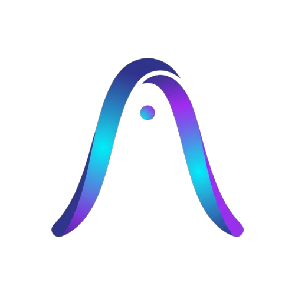
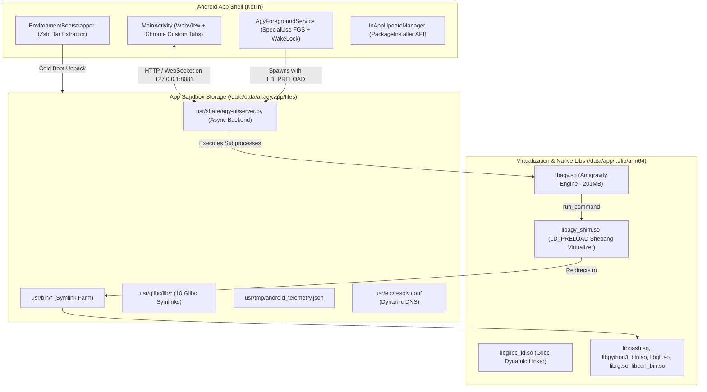

# Antigravity Studio for Android

<p align="center">
  
</p>

<p align="center">
  <strong>The first fully standalone, autonomous AI coding agent & IDE for Android.</strong><br>
  Zero Termux required &bull; Zero root required &bull; Self-contained toolchain &bull; Android 10 to 17+ (API 28–35+)
</p>

<p align="center">
  <a href="https://github.com/MisterMoeGreen/Antigravity-Studio-App/releases/latest"></a>
</p>

---

## Overview

**Antigravity Studio** brings Google DeepMind’s autonomous coding engine (**Antigravity**) directly to your Android device in a native, touch-friendly mobile IDE. 

Traditionally, running developer toolchains or advanced agentic runtimes on Android required complex command-line setups: installing Termux, configuring proot-distros, compiling glibc loaders, and running local background servers manually.

**Antigravity Studio completely eliminates all prerequisites.** It is bundled as a single, self-contained Android APK that installs in seconds and provides:
1. **The Core Antigravity Engine** (`libagy.so` – 201 MB Go/glibc binary) running at full native speed.
2. **A Complete Embedded Developer Toolchain** (`bash`, `git`, `python 3.14`, `ripgrep`, `curl`, `busybox`).
3. **A Modern PWA Interface** rendered in an optimized native `WebView` with Google OAuth, file picker, and keyboard management.
4. **Background Task Durability** powered by an Android Foreground Service with Partial WakeLock.

---

## Key Features

### 🧰 Full Native Toolchain Parity
The agent has full access to the standard development tools required to inspect code, manage git repositories, run Python scripts, and process text files:
* **`bash 5.3` & `busybox 1.38`**: Multi-call shell and coreutils.
* **`python 3.14`**: Full runtime with 80+ pre-compiled C-extensions (including `ssl`, `sqlite3`, `socket`, `ctypes`, and `zstandard`).
* **`git 2.56`**: Complete with `git-remote-https` and OpenSSL CA bundle for seamless cloning and pushing.
* **`ripgrep 15.2` & `curl 8.22`**: Lightning-fast codebase search and network requests.

### ⚡ User-Space Virtualization Shim (`libagy_shim.so`)
Android’s Bionic C library lacks traditional Linux system directories like `/bin/sh` or `/usr/bin/env`, which causes standard scripts with shebang lines to fail. Antigravity Studio includes a custom Bionic preload shim that intercepts:
* `execve` and `execv`
* `posix_spawn` and `posix_spawnp`
* Dynamic shebang (`#!`) parsing

Any execution of `#!/bin/sh`, `#!/bin/bash`, or `#!/usr/bin/env python3` is transparently rewritten on the fly to point to the app’s internal sandbox toolchain.

### 🛡️ 16 KB Page Alignment & Modern Android Security
Antigravity Studio complies with Android’s mandatory **16 KB memory page alignment** requirement for modern and future Android releases (Android 15, 16, 17+). All shared libraries and binaries are extracted to `/data/app/.../lib/arm64/` under the SELinux `apk_data_file` security domain, ensuring zero W^X violations or text relocations across all current and future Android versions.

### 🔋 Background Durability & Hardware Telemetry
* **Partial WakeLock**: Keeps the CPU active during multi-turn agent tasks even if your screen turns off.
* **Foreground Service**: Posts a persistent, sticky notification (`FOREGROUND_SERVICE_TYPE_SPECIAL_USE`) compliant with Android 14+ background policies.
* **Hardware Telemetry Bridge**: Continuously reports battery level, charging state, and CPU temperature to the agent via `usr/tmp/android_telemetry.json`.
* **Atomic Dynamic DNS**: Watches network changes (`Wi-Fi` $\leftrightarrow$ `Cellular`) and automatically updates `usr/etc/resolv.conf` so agent network calls never drop.

### ⚙️ Native Settings Hub & Tooling Integrations
* **API Keys Management**: Securely store and inject third-party service tokens (`GITHUB_TOKEN`, `OPENAI_API_KEY`, etc.) directly into the agent environment.
* **Touch-First SSH Key Manager**: Generate `ED25519` and `RSA-4096` keypairs and copy public keys with one tap for Git repositories.
* **Model Context Protocol (MCP) Hub**: Connect local Python stdio or remote HTTP MCP servers with live health probing and latency diagnostics.
* **Custom Instructions & Skills**: Browse, edit, and create custom agent skills and persistent workspace instructions.

### 🔄 Dual-Tier In-App Updaters
* **Tier-1 (Instant In-App OTA)**: Silently downloads and updates frontend UI assets and server scripts without requiring an app reinstall or restart.
* **Tier-2 (APK Self-Updater)**: On-demand GitHub release queries with side-by-side version comparison (`Current` ➔ `Latest`), in-app progress tracking, and Android `PackageInstaller` session handoff.

---

## Architecture & How It Works



### Cold Boot Workflow
1. **Extraction**: On first launch, `EnvironmentBootstrapper` extracts `usr-data.tar.zst` (8.0 MB compressed archive) into the app's internal files directory.
2. **Symlink Farm Assembly**: Creates symlinks in `usr/bin/` pointing to the executables stored in Android’s native library folder (`/data/app/.../lib/arm64/`).
3. **Daemon Initialization**: `AgyForegroundService` acquires a `WakeLock`, selects an available port (`8081` $\to$ `8082` $\to$ `8090` $\to$ ephemeral), and starts `server.py` with `LD_PRELOAD=libagy_shim.so`.
4. **UI Readiness**: `MainActivity` polls `/health` until the backend signals ready, then loads the responsive IDE interface in WebView.

---

## Getting Started

### Installation
1. Download **`AntigravityStudio.apk`** from the [GitHub Releases](https://github.com/MisterMoeGreen/Antigravity-Studio-App/releases) page.
2. Open your device file manager (Files, Solid Explorer, etc.) and tap the downloaded `.apk`.
3. If prompted, allow your browser or file manager to **Install unknown apps**.
4. Tap **Install** and launch **Antigravity Studio**.

### First Launch & Authentication
1. On initial startup, grant the **Notification Permission** (required for background execution).
2. Allow a few seconds for first-time environment initialization.
3. Tap **Sign in with Google**. A browser tab will open for Google authentication.
4. Copy the authorization code, paste it into the chat prompt, and hit send!
5. Select your workspace directory and start coding!

---

## Project Structure

```text
AgyStudio/
├── agystudio.png                     # Application logo
├── app/
│   ├── src/main/
│   │   ├── AndroidManifest.xml       # Permissions, FGS declaration, FileProvider
│   │   ├── cpp/
│   │   │   ├── agy_shim.c            # C virtualization shim (execve / shebang parser)
│   │   │   └── CMakeLists.txt        # Bionic Clang native build script
│   │   ├── java/ai/agy/app/
│   │   │   ├── MainActivity.kt       # WebView container & OAuth interception
│   │   │   ├── AgyForegroundService.kt # Foreground service, WakeLock & telemetry
│   │   │   ├── EnvironmentBootstrapper.kt # Cold-boot unpack & symlink farm
│   │   │   ├── InAppUpdateManager.kt # Tier-1 OTA & Tier-2 APK installer
│   │   │   └── UpdateReceiver.kt     # PackageInstaller broadcast receiver
│   │   ├── assets/
│   │   │   └── usr-data.tar.zst      # Compressed runtime assets (Python, certs, web UI)
│   │   └── res/                      # Vector launcher icons, styles, and XML configs
├── agy-ui/                           # Web frontend & async Python server source
│   ├── index.html                    # Mobile SPA chat & Settings Hub UI
│   ├── server.py                     # Async process orchestrator & API server
│   ├── default_app_prompt.md         # Mobile system directives & UI navigation
│   ├── manifest.json                 # PWA standalone application manifest
│   └── sw.js                         # Service Worker offline asset cache
├── scripts/
│   ├── build_shim.sh                 # Compiles and strips libagy_shim.so
│   └── prepare_binaries.sh           # Stages 16KB-aligned ELF binaries & packages assets
├── specs/
│   ├── SPEC-01-APK-GEOMETRY-AND-ARCHITECTURE.md
│   ├── SPEC-02-C-VIRTUALIZATION-SHIM-AND-16KB-ALIGNMENT.md
│   ├── SPEC-03-ANDROID-APP-INFRASTRUCTURE-AND-SERVICES.md
│   ├── SPEC-04-NETWORKING-DYNAMIC-DNS-AND-HARDWARE-BRIDGES.md
│   ├── SPEC-05-SECURITY-PERMISSIONS-AND-IN-APP-UPDATES.md
│   ├── OVERVIEW_AND_IMPLEMENTATION_GUIDE.md # Complete criteria gates & acceptance tests
│   └── IMPLEMENTATION_LOG.md         # Execution audit log across all 7 phases
├── build.gradle.kts                  # Root project Gradle configuration
└── settings.gradle.kts               # Module settings
```

---

## Building from Source

To compile the APK from source on an Android device (via Termux) or on a Linux desktop:

```bash
# 1. Clone the repository
git clone git@github.com:MisterMoeGreen/Antigravity-Studio-App.git
cd Antigravity-Studio-App

# 2. Stage binaries and generate usr-data.tar.zst (if modifying core engine)
bash scripts/build_shim.sh
bash scripts/prepare_binaries.sh

# 3. Build signed Release APK
bash ./gradlew assembleRelease

# 4. Built APK will be available at:
# app/build/outputs/apk/release/app-release.apk
```

---

## Specifications & Audit Log

For detailed technical specifications, architectural diagrams, and verification proofs:
* [Overview & Implementation Guide](specs/OVERVIEW_AND_IMPLEMENTATION_GUIDE.md)
* [Full Implementation & Verification Log](specs/IMPLEMENTATION_LOG.md)

---

## License & Credits

* **Application Code**: Licensed under the Apache License 2.0.
* **Third-Party Components & Licenses**: Bundled toolchain utilities (`bash`, `git`, `python`, `ripgrep`, `curl`, `busybox`, `glibc`) retain their respective open-source licenses.
* **Vector Iconography**: Provided by [Font Awesome Free](https://fontawesome.com) under the [CC BY 4.0 License](https://creativecommons.org/licenses/by/4.0/).
* **Full Attributions & Disclaimers**: See [CREDITS.md](CREDITS.md) for complete license notices, upstream acknowledgments, and trademark disclaimers.
