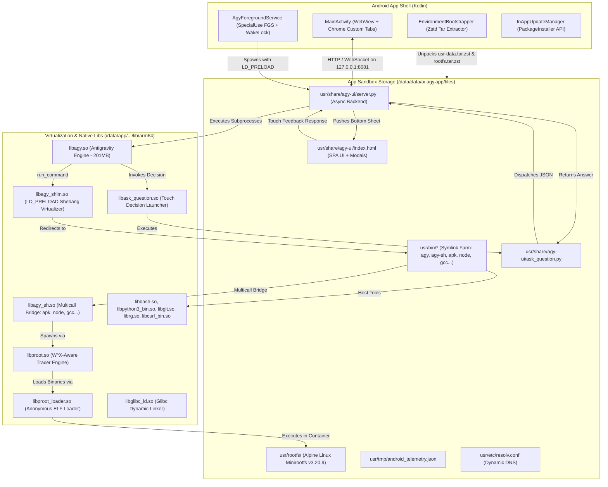

# Antigravity Studio for Android

<p align="center">
  
</p>

<p align="center">
  <strong>The first fully standalone, autonomous AI coding agent & IDE for Android.</strong><br>
  Zero Termux required &bull; Zero root required &bull; Self-contained toolchain &bull; Android 10 to 17+ (API 28–35+)
</p>

<p align="center">
  <a href="https://github.com/MisterMoeGreen/Antigravity-Studio-App/releases/latest"></a>
</p>

---

## Overview

**Antigravity Studio** brings Google DeepMind’s autonomous coding engine (**Antigravity**) directly to your Android device in a native, touch-first mobile IDE. 

Traditionally, running developer toolchains or advanced agentic runtimes on Android required complex command-line setups: installing Termux, configuring proot-distros, compiling glibc loaders, and running local background servers manually. On Android 10+ and modern Android 15/16 devices, strict SELinux `W^X` (Write XOR Execute) policies and 16 KB memory page alignments made running compilers, JIT runtimes (Node.js V8, OpenJDK HotSpot), or dynamic native binaries nearly impossible without root.

**Antigravity Studio completely eliminates all prerequisites.** Bundled as a single, self-contained Android APK, it provides:
1. **The Core Antigravity Engine** (`libagy.so` – 201 MB Go/glibc binary) running at full native speed.
2. **Unconstrained Execution via W^X-Aware PRoot Subsystem** (`libproot.so` + `libproot_loader.so`) allowing dynamic JIT runtimes (Node.js, Java) and native compilers (GCC, Clang, Rust) to run directly on Android.
3. **Embedded Alpine Linux Minirootfs & Dynamic Package Management** with instant `apk add` / `pkg add` access to thousands of packages.
4. **Multicall Toolchain Bridge** (`libagy_sh.so`) transparently bridging `node`, `npm`, `cargo`, `gcc`, `java`, and more into `$PATH`.
5. **Interactive Touch Decision Modals** (`ask_question`) replacing awkward CLI prompts with bottom-sheet touch cards, radio buttons, and checkboxes.
6. **Settings Hub Package Manager UI** with instant package search, developer preset chips, and AI-assisted package installation.
7. **Complete Host Developer Toolchain** (`bash 5.3`, `busybox 1.38`, `python 3.14`, `git 2.56`, `ripgrep 15.2`, `curl 8.22`, `ssh 9.9`).
8. **Modern Mobile SPA Interface** rendered in an optimized native `WebView` with Google OAuth, file picker, and keyboard management.
9. **Background Task Durability** powered by an Android Foreground Service with Partial WakeLock and live hardware telemetry.

---

## Key Features

### 🚀 Unconstrained Execution: W^X-Aware PRoot & Anonymous ELF Loader (v1.3.0)
Modern Android enforces strict Write XOR Execute (`W^X`) memory restrictions:
* Memory pages with executable permissions (`PROT_EXEC`) cannot be writable (`PROT_WRITE`).
* `mmap(PROT_EXEC)` is blocked on all writable file descriptors and non-system filesystems.
* Dynamic binaries cannot be executed from app internal storage or shared storage (`noexec` mount).

Antigravity Studio solves this at the native kernel level:
* **Anonymous ELF Loader (`libproot_loader.so`)**: A freestanding native loader that allocates purely anonymous memory pages with `PROT_READ | PROT_WRITE`, directly copies ELF segments via `pread64`, resolves auxiliary vectors, and converts permissions to `PROT_READ | PROT_EXEC` via `mprotect`. This completely bypasses Android SELinux execution barriers.
* **W^X-Aware PRoot Tracer Engine (`libproot.so`)**: An optimized user-space virtualization engine running via `ptrace` and seccomp BPF filters. Syscalls (`execve`, `mprotect`, `open`, `stat`) are intercepted in user-space to enforce W^X compliance, translate paths, and safely chain execution without kernel modifications.
* **Unrestricted JIT & Compiler Speed**: Native compilers (GCC, Clang, Rustc) and JIT virtual machines (Node.js V8, OpenJDK HotSpot JVM) execute at direct native ARM64 speed.

### 📦 Dynamic Alpine Linux Subsystem & Multicall Toolchain Bridge (v1.3.0)
* **Alpine Linux Minirootfs (`rootfs.tar.zst`)**: A lightweight 3.5 MB Alpine `aarch64` rootfs (v3.20.9) bundled with a zero-trap patched `ld-musl`, `jemalloc` allocator, and transparent OpenJDK memory assertions workaround.
* **On-Demand Package Management (`apk` / `pkg`)**: Install any compiler, runtime, or library on the fly:
  * `apk add --no-cache nodejs npm`
  * `apk add --no-cache gcc musl-dev build-base`
  * `apk add --no-cache openjdk21-jre-headless`
  * `apk add --no-cache rust cargo`
  * `apk add --no-cache php python3 py3-pip clang go ffmpeg`
* **Multicall Toolchain Bridge (`libagy_sh.so`)**: A unified native dispatcher mapped in `usr/bin/` to `apk`, `pkg`, `node`, `nodejs`, `npm`, `npx`, `cargo`, `rustc`, `gcc`, `g++`, `clang`, `clang++`, `make`, `php`, `go`, `java`, and `javac`. Executing `node app.js` or `gcc main.c` transparently routes into the container at native speed.
* **1:1 Path Preservation**: Host storage directories (`/storage/emulated/0/...`, `/data/data/ai.agy.app/files/home`) are seamlessly virtualized and bound into the container, allowing seamless editing and execution across storage boundaries.
* **Non-Interactive TTY Guard**: Prevents background tasks from hanging on interactive prompts when run by the agent.

### 📱 On-Device Package Manager UI & AI Disambiguation (v1.3.0 Phase 6)
* **Settings Hub Package Manager (`#viewPackages`)**:
  * Live package counter badge in the Settings menu.
  * Dedicated full-screen sub-view with smooth sliding transitions and 56px touch header.
  * Storage consumption breakdown banner showing user-installed package footprint vs. base container size.
  * Individual package cards with version info, size breakdown, upgrade, and delete action triggers.
  * One-tap **Update All** button running synchronized repository index updates and package upgrades.
* **Ultra-Fast Alpine DB Parser**:
  * Directly parses `/etc/apk/world` and `/lib/apk/db/installed` in Python in $<3$ ms with zero PRoot subprocess overhead.
  * Recursively aggregates meta-package dependencies (e.g. `build-base`) for accurate size reporting.
* **Security & Concurrency Hardening**:
  * Immutable `PROTECTED_PACKAGES` whitelist (16 core packages including `musl`, `busybox`, `apk-tools`, `libcrypto3`) prevents accidental system corruption.
  * Strict regex package name validation (`^[a-zA-Z0-9][a-zA-Z0-9._+-]{0,127}$`) and direct `argv` execution prevent shell injection.
  * Global async lock (`APK_MUTATION_LOCK`) and `--wait 30` prevent database collisions during concurrent agent CLI turns.
* **Interactive Install Package Modal (`#modalInstallPackage`)**:
  * Touch-first bottom-sheet modal with quick developer preset chips (`Node.js`, `Python 3`, `OpenJDK 21`, `Rust`, `C/C++`, `Go`, `Clang`, `PHP`, `FFmpeg`).
  * Manual package query search box.
* **Automated AI Turn Handoff & Disambiguation**:
  * Natural language requests (e.g., *"Install Node.js"* or *"I need OpenCV"*) seamlessly dispatch to the agent backend.
  * The agent searches the Alpine package index, analyzes candidate dependencies, and presents touch choices directly to the user via the `ask_question` bottom-sheet dialog.

### 💬 Interactive Touch Decision Modals (`ask_question`) (v1.2.0)
* **Touch-First Clarification Bridge**:
  * Replaces awkward terminal prompts and broken auto-skipping headless questions with native Android touch dialogs.
  * Executable bridge `ask_question` (`libask_question.so` $\to$ `usr/share/agy-ui/ask_question.py`) accepts JSON schemas and delivers them over WebSocket to the active UI.
* **Bottom-Sheet Modal Experience**:
  * Single-select radio cards with clear `(Recommended)` visual markers.
  * Multi-select checkboxes for multi-choice architectural decisions.
  * Free-form text write-in field for custom answers.
  * Submit and Skip touch actions.
  * Android Back-Button interception: gracefully cancels or navigates without losing session state.

### 🧰 Full Native Host Toolchain Parity
The agent has full access to the standard development tools required to inspect code, manage git repositories, run Python scripts, and process text files:
* **`bash 5.3` & `busybox 1.38`**: Multi-call shell and coreutils.
* **`python 3.14`**: Full runtime with 80+ pre-compiled C-extensions (including `ssl`, `sqlite3`, `socket`, `ctypes`, and `zstandard`).
* **`git 2.56`**: Complete with `git-remote-https` and OpenSSL CA bundle for seamless cloning and pushing.
* **`ripgrep 15.2` & `curl 8.22`**: Lightning-fast codebase search and network requests.
* **`ssh 9.9` & `ssh-keygen 9.9`**: OpenSSH client binaries for secure remote deployments and Git operations.

### ⚡ User-Space Virtualization Shim (`libagy_shim.so`)
Android’s Bionic C library lacks traditional Linux system directories like `/bin/sh` or `/usr/bin/env`. Antigravity Studio includes a custom Bionic preload shim that intercepts:
* `execve` and `execv`
* `posix_spawn` and `posix_spawnp`
* Dynamic shebang (`#!`) parsing

Any execution of `#!/bin/sh`, `#!/bin/bash`, or `#!/usr/bin/env python3` is transparently rewritten on the fly to point to the internal toolchain.

### 🛡️ 16 KB Page Alignment & Modern Android Security
Antigravity Studio strictly complies with Android’s mandatory **16 KB memory page alignment** requirement for modern and future Android releases (Android 15, 16, 17+). All 115+ shared libraries and native ELF binaries are packaged under the SELinux `apk_data_file` security domain, ensuring zero W^X violations or text relocations across modern ARM64 devices.

### 🔋 Background Durability & Hardware Telemetry
* **Partial WakeLock**: Keeps the CPU active during multi-turn agent tasks even if your screen turns off.
* **Foreground Service**: Posts a persistent, sticky notification (`FOREGROUND_SERVICE_TYPE_SPECIAL_USE`) compliant with Android 14+ background policies.
* **Hardware Telemetry Bridge**: Continuously reports battery level, charging state, and CPU temperature to the agent via `usr/tmp/android_telemetry.json`.
* **Atomic Dynamic DNS**: Watches network changes (`Wi-Fi` $\leftrightarrow$ `Cellular`) and automatically updates `usr/etc/resolv.conf` so agent network calls never drop.

### ⚙️ Native Settings Hub & Tooling Integrations
* **Package Manager**: Browse installed packages, inspect disk footprints, trigger updates, and install new toolchains.
* **API Keys Management**: Securely store and inject third-party service tokens (`GITHUB_TOKEN`, `OPENAI_API_KEY`, `TAVILY_API_KEY`, etc.) directly into the agent environment.
* **Touch-First SSH Key Manager**: Generate `ED25519` and `RSA-4096` keypairs and copy public keys with one tap for Git repositories.
* **Model Context Protocol (MCP) Hub**: Connect local Python/Node stdio or remote HTTP MCP servers with live health probing and latency diagnostics.
* **Custom Instructions & Skills**: Browse, edit, and create custom agent skills and persistent workspace instructions.

### 🔄 Dual-Tier In-App Updaters
* **Tier-1 (Instant In-App OTA)**: Silently downloads and updates frontend UI assets and server scripts without requiring an app reinstall or restart.
* **Tier-2 (APK Self-Updater)**: On-demand GitHub release queries with side-by-side version comparison (`Current` ➔ `Latest`), in-app progress tracking, and Android `PackageInstaller` session handoff.

---

## Architecture & How It Works



### Cold Boot Workflow
1. **Runtime Extraction**: On first launch (or build update), `EnvironmentBootstrapper` extracts:
   * `usr-data.tar.zst` (~8.5 MB): Python stdlib, git templates, SSL certificates, Web UI, `ask_question.py`, and built-in skills.
   * `rootfs.tar.zst` (~3.5 MB): Alpine Linux `aarch64` minirootfs non-destructively unpacked into `usr/rootfs/`.
2. **Symlink Farm Assembly**: Creates symlinks in `usr/bin/` pointing to the native binaries in `/data/app/.../lib/arm64/`, including `libagy.so`, host toolchain utilities, and multicall bridges (`agy-sh`, `apk`, `pkg`, `node`, `npm`, `npx`, `cargo`, `gcc`, `java`, `ask_question`).
3. **Daemon Initialization**: `AgyForegroundService` acquires a `WakeLock`, selects an available port (`8081` $\to$ `8082` $\to$ `8090` $\to$ ephemeral), and starts `server.py` with `LD_PRELOAD=libagy_shim.so`.
4. **UI Readiness**: `MainActivity` polls `/health` until the backend signals ready, then renders the responsive mobile IDE interface in WebView.

---

## Getting Started

### Installation
1. Download **`AntigravityStudio.apk`** from the [GitHub Releases](https://github.com/MisterMoeGreen/Antigravity-Studio-App/releases) page.
2. Open your device file manager (Files, Solid Explorer, etc.) and tap the downloaded `.apk`.
3. If prompted, allow your browser or file manager to **Install unknown apps**.
4. Tap **Install** and launch **Antigravity Studio**.

### First Launch & Authentication
1. On initial startup, grant the **Notification Permission** (required for background execution).
2. Allow a few seconds for first-time environment and Alpine rootfs initialization.
3. Tap **Sign in with Google**. A browser tab will open for Google authentication.
4. Copy the authorization code, paste it into the chat prompt, and hit send!
5. Select your workspace directory and start coding!

---

## Project Structure

```text
AgyStudio/
├── agystudio.png                         # Application logo
├── app/
│   ├── src/main/
│   │   ├── AndroidManifest.xml           # Permissions, FGS declaration, FileProvider
│   │   ├── cpp/
│   │   │   ├── agy_shim.c                # Bionic C virtualization shim (execve / shebang parser)
│   │   │   ├── agy_sh.c                  # Native multicall toolchain bridge (apk, node, gcc...)
│   │   │   ├── ask_question_launcher.c   # Native ELF launcher for interactive touch modals
│   │   │   ├── proot/                    # W^X-aware PRoot tracer core (talloc, seccomp BPF)
│   │   │   ├── proot_loader/             # Freestanding anonymous ELF loader (mmap/pread64/mprotect)
│   │   │   └── CMakeLists.txt            # Native build script
│   │   ├── java/ai/agy/app/
│   │   │   ├── MainActivity.kt           # WebView container, back-button handling & OAuth
│   │   │   ├── AgyForegroundService.kt   # Foreground service, WakeLock, Dynamic DNS & telemetry
│   │   │   ├── EnvironmentBootstrapper.kt # Cold-boot unpack, rootfs extraction & symlink farm
│   │   │   ├── InAppUpdateManager.kt     # Tier-1 OTA asset updater & Tier-2 APK installer
│   │   │   └── UpdateReceiver.kt         # PackageInstaller broadcast receiver
│   │   ├── assets/
│   │   │   ├── usr-data.tar.zst          # Compressed runtime assets (Python stdlib, web UI, skills)
│   │   │   └── rootfs.tar.zst            # Alpine Linux aarch64 minirootfs (jemalloc, patched musl)
│   │   └── res/                          # Vector launcher icons, styles, and XML configs
├── agy-ui/                               # Web frontend & async Python server source
│   ├── index.html                        # Mobile SPA chat, Settings Hub & Package Manager UI
│   ├── server.py                         # Async process orchestrator, package API & WebSocket dispatcher
│   ├── ask_question.py                   # CLI-to-UI interactive modal bridge
│   ├── default_app_prompt.md             # Mobile system directives, UI navigation & container rules
│   ├── skills/                           # Built-in agent skills
│   │   └── package-manager/SKILL.md      # Auto-seeded Alpine package recipes and execution directives
│   ├── manifest.json                     # PWA standalone application manifest
│   └── sw.js                             # Service Worker offline asset cache
├── scripts/
│   ├── build_shim.sh                     # Compiles and strips libagy_shim.so
│   └── prepare_binaries.sh               # Stages 16KB-aligned ELF binaries & packages assets
├── specs/
│   ├── initial/                          # v1.0.0 Architecture & Core Toolchain specifications
│   ├── 1.1.0/                            # v1.1.0 System Prompts, Dynamic DNS & Telemetry specs
│   ├── v1.2.0/                           # v1.2.0 Interactive Touch Questions & Decision Modals specs
│   ├── v1.3.0/                           # v1.3.0 W^X PRoot Subsystem, Anonymous Loader & Package UI specs
│   ├── OVERVIEW_AND_IMPLEMENTATION_GUIDE.md # Master verification gates & acceptance tests
│   └── IMPLEMENTATION_LOG.md             # Execution audit log across all phases
├── build.gradle.kts                      # Root project Gradle configuration
└── settings.gradle.kts                   # Module settings
```

---

## Building from Source

To compile the APK from source on an Android device (via Termux) or on a Linux desktop:

```bash
# 1. Clone the repository
git clone git@github.com:MisterMoeGreen/Antigravity-Studio-App.git
cd Antigravity-Studio-App

# 2. Stage binaries and generate asset bundles (if modifying core engine or rootfs)
bash scripts/build_shim.sh
bash scripts/prepare_binaries.sh

# 3. Build signed Release APK
bash ./gradlew assembleRelease

# 4. Built APK will be available at:
# app/build/outputs/apk/release/app-release.apk
```

---

## Specifications & Audit Logs

For detailed technical specifications, architectural diagrams, security audits, and verification proofs:
* [v1.3.0 W^X PRoot Engine, Anonymous Loader & Package Manager](specs/v1.3.0/OVERVIEW_AND_IMPLEMENTATION_GUIDE.md)
* [v1.2.0 Interactive Decision Modals & Touch Prompts](specs/v1.2.0/OVERVIEW_AND_IMPLEMENTATION_GUIDE.md)
* [v1.1.0 Dynamic DNS, Hardware Telemetry & In-App Updaters](specs/1.1.0/OVERVIEW_AND_IMPLEMENTATION_GUIDE.md)
* [v1.0.0 Core Virtualization, APK Geometry & Host Toolchains](specs/initial/OVERVIEW_AND_IMPLEMENTATION_GUIDE.md)
* [v1.3.0 Implementation & Verification Log](specs/v1.3.0/IMPLEMENTATION_LOG.md)

---

## License & Credits

* **Application Code**: Licensed under the Apache License 2.0.
* **Third-Party Components & Licenses**: Bundled toolchain utilities (`bash`, `git`, `python`, `ripgrep`, `curl`, `busybox`, `glibc`, `proot`, `alpine-linux`, `musl`) retain their respective open-source licenses.
* **Vector Iconography**: Provided by [Font Awesome Free](https://fontawesome.com) under the [CC BY 4.0 License](https://creativecommons.org/licenses/by/4.0/).
* **Full Attributions & Disclaimers**: See [CREDITS.md](CREDITS.md) for complete license notices, upstream acknowledgments, and trademark disclaimers.
