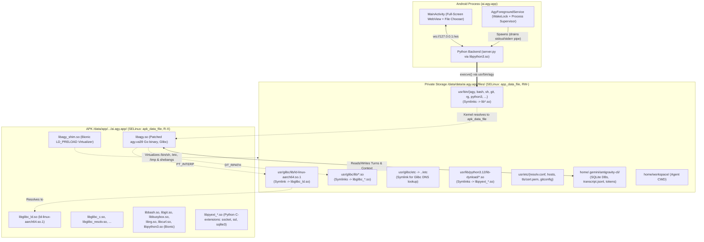

# Specification 01: Architecture & Kernel-Level Execution

## 1. Executive Architecture Overview

The standalone Android application (`ai.agy.app`) hosts the Google Antigravity agent CLI (`agy.va39`) and Antigravity Studio web frontend without requiring Termux, Termux:API, or root access. 

The application runs on standard AOSP/Android devices targeting **`targetSdkVersion 35`** (Android 10 through Android 17+ / API 29–35+).



---

## 2. Kernel SELinux W^X Enforcement & Mitigation

### The Constraint
Starting in Android 10 (API 29), SELinux policy `untrusted_app_all.te` strictly forbids execution of files within the application's writable data directory (`/data/data/<pkg>/`):
```selinux
# Executing directly from app_data_file returns EACCES (Permission Denied)
neverallow untrusted_app_all { file_type -apk_data_file -app_data_file }:file exec_mod;
```
This restriction applies **both to `execve()` and to `dlopen()` / `mmap(..., PROT_EXEC)`**. Therefore, neither executables (`agy`, `bash`, `git`) nor shared dynamic modules (such as Python's compiled C-extensions in `lib-dynload/*.so`) can be executed or loaded if they reside on `app_data_file`.

### The Symlink-Farm Solution
The Android kernel permits execution of native libraries residing in `/data/app/.../lib/arm64/` which carry the SELinux context `u:object_r:apk_data_file:s0`:
```selinux
allow untrusted_app apk_data_file:file { r_file_perms execute execute_no_trans map };
```

1. **All ELF Binaries and `.so` Modules** (`libagy.so`, `libbash.so`, `libgit.so`, `libpython3_bin.so`, and all `libpyext_*.so` Python extensions) reside in `context.applicationInfo.nativeLibraryDir` (`apk_data_file`).
2. When `execve()` or `dlopen()` is called on a path such as `/data/data/ai.agy.app/files/usr/bin/agy` or `files/usr/lib/python3.12/lib-dynload/_socket.so`, the Linux VFS kernel routine `do_open_execat` follows the symlink (`LOOKUP_FOLLOW`) to the target inode in `nativeLibraryDir`.
3. Because the target inode belongs to `apk_data_file`, **the kernel and dynamic linker allow execution natively without SELinux violations under targetSdk 35**.

---

## 3. Coexistence of Glibc & Android Bionic

Standard Termux packages (`python3.12`, `bash`, `busybox`, `git`, `rg`, `curl`) are compiled against **Android Bionic** (`PT_INTERP: /system/bin/linker64`). Only `agy.va39` (`libagy.so`) is compiled against **GNU C Library** (`PT_INTERP: .../ld-linux-aarch64.so.1`).

### Linker Isolation Protocol:
1. **Never export `$usr/glibc/lib` into `LD_LIBRARY_PATH`**. Keep `LD_LIBRARY_PATH="$usr/lib:$nativeDir"` strictly for Bionic libraries so Bionic binaries never link against Glibc's `libc.so.6`.
2. **Use `patchelf --force-rpath` on `libagy.so`**: Embed `DT_RPATH` (via `--force-rpath`, which applies transitively to all child libraries, unlike `DT_RUNPATH`) on `libagy.so` pointing to `/data/data/ai.agy.app/files/usr/glibc/lib`. Glibc's `ld-linux-aarch64.so.1` will locate all its Glibc dependencies via `DT_RPATH` without polluting the environment of Bionic processes.
3. **Compile `libagy_shim.so` as a Bionic library**: Using Termux's native Clang / NDK Clang.
4. **Sanitize `LD_PRELOAD` at the Glibc Boundary**: Inside `libagy_shim.so`'s `execve()` hook, when the target binary is `libagy.so` (or `usr/bin/agy`), `LD_PRELOAD` is stripped from `envp` so Glibc's dynamic linker never attempts to load a Bionic library.

---

## 4. The 10-Character Package ID Geometry (`ai.agy.app`)

### String Length Alignment
Official Termux precompiled packages (`bash`, `git`, `python`, `curl`, `busybox`, `ripgrep`, `glibc`) have hardcoded prefix paths:
```text
/data/data/com.termux/files/usr    (Exactly 31 bytes)
```
By establishing the application ID as **`ai.agy.app`** (exactly 10 ASCII characters):
```text
/data/data/ai.agy.app/files/usr    (Exactly 31 bytes)
```

### In-Place Binary Patching
Because byte lengths are identical, a raw byte substitution does not modify ELF string table sizes, section offsets, or program headers. Our build pipeline uses an exact byte patcher in Python that enforces byte-length invariance:
```python
old_bytes = b"/data/data/com.termux"
new_bytes = b"/data/data/ai.agy.app"
assert len(old_bytes) == len(new_bytes) == 21
```

---

## 5. ABI & Android 15/16 16KB Page Alignment

1. **Target ABI**: `arm64-v8a` strictly.
2. **16 KB Page Alignment**: Starting in Android 15 (targetSdk 35), Google supports 16 KB kernel page sizes. `patchelf` is invoked with `--page-size 16384` to prevent segment alignment faults on newer Pixel and Tensor devices.
3. **`useLegacyPackaging = true`**: Mandatory in `build.gradle.kts` under `packaging.jniLibs`. Forces the Android Package Manager to extract all `lib*.so` files to the physical filesystem in `/data/app/.../lib/arm64/` with executable permissions.
