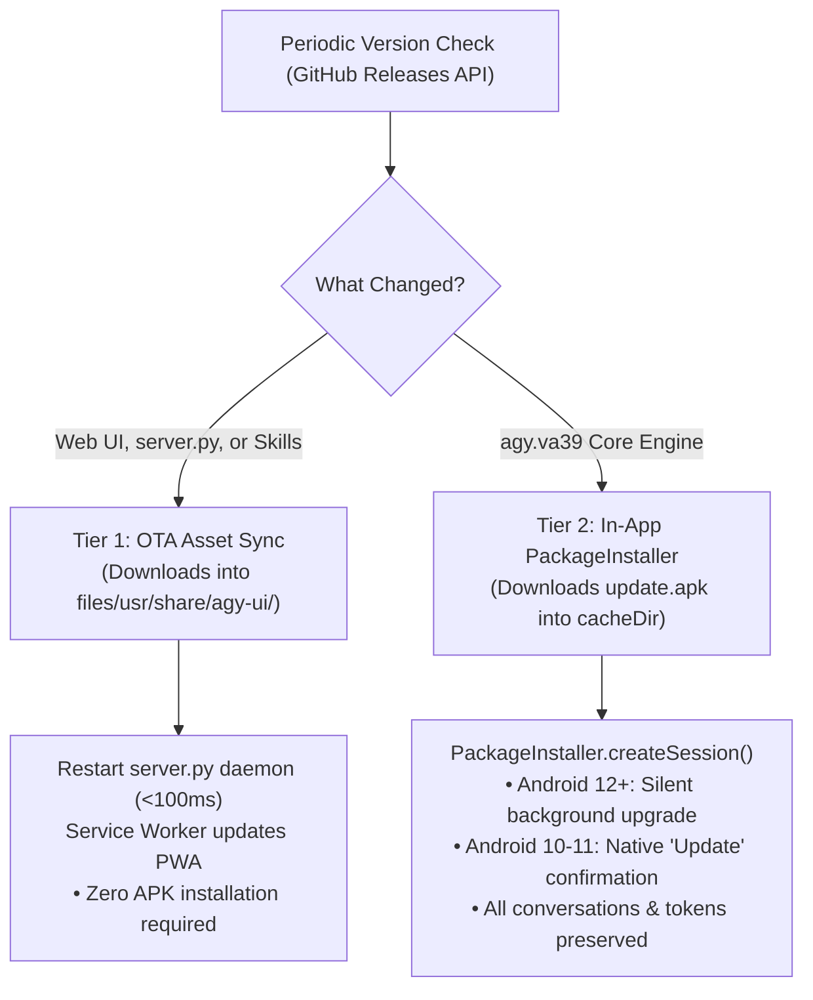

# Specification 06: Authentication & In-App Update Engine

## 1. Google OAuth 2.0 In-App Authentication

### The Embedded WebView Constraint (`Error 403: disallowed_useragent`)
Google's OAuth 2.0 servers actively detect and reject embedded WebViews (`android.webkit.WebView`) to prevent clickjacking and credential interception. Attempting to load Google sign-in inside the `WebView` results in `Error 403: disallowed_useragent`.

### The Chrome Custom Tabs Solution (`androidx.browser:browser`)
We implement Google OAuth via **Chrome Custom Tabs**:
1. When `agy` starts without an authenticated token (`~/.gemini/antigravity-cli/antigravity-oauth-token`), it starts a local loopback HTTP server (e.g. `http://127.0.0.1:<oauth_port>/oauth2callback`) and outputs the authentication URL:
   ```text
   https://accounts.google.com/o/oauth2/v2/auth?...
   ```
2. The orchestrator captures this URL and sends an `{ "type": "oauth_url", "url": "..." }` message over WebSocket to `MainActivity`.
3. `MainActivity` launches Chrome Custom Tabs:
   ```kotlin
   val customTabsIntent = CustomTabsIntent.Builder()
       .setShowTitle(true)
       .build()
   customTabsIntent.launchUrl(this, Uri.parse(oauthUrl))
   ```
4. **Zero-Friction Sign-In**: Because Chrome Custom Tabs run in the user's primary browser security context:
   - Google OAuth permits the login flow.
   - The user's active Google account on the Android device is already signed in; the user taps **Continue as [Name]** with one tap.
5. The Google OAuth consent page redirects to `http://127.0.0.1:<oauth_port>/oauth2callback?code=...`.
6. The `agy` process receives the auth code, exchanges it for credentials, writes `antigravity-oauth-token`, and shuts down its loopback listener.
7. The Custom Tab automatically closes and focus returns to Antigravity Studio.

---

## 2. In-App Update System

Updates are categorized into two tiers to minimize APK installations:



---

## 3. Tier 1: Over-The-Air (OTA) UI & Server Sync

Because `index.html`, `sw.js`, and `server.py` are interpreted files in `/data/data/ai.agy.app/files/usr/share/agy-ui/`, they can be updated on-the-fly without an APK re-install:
1. `server.py` queries `https://api.github.com/repos/MisterMoeGreen/Antigravity-Studio-App/releases/latest`.
2. If `ui_version` is newer, it downloads updated `index.html` and `server.py` to temporary files.
3. It performs an atomic replace in `usr/share/agy-ui/`.
4. The service restarts the Python process in `< 150 ms`, and the browser PWA updates automatically via the Service Worker cache bust.

---

## 4. Tier 2: Self-Updating APK Engine (`PackageInstaller`)

When the core binary `agy.va39` is updated, the app performs an in-place self-upgrade using the Android `PackageInstaller` API.

### Implementation (`app/src/main/java/ai/agy/app/InAppUpdateManager.kt`)

```kotlin
package ai.agy.app

import android.app.PendingIntent
import android.content.Context
import android.content.Intent
import android.content.pm.PackageInstaller
import android.os.Build
import kotlinx.coroutines.Dispatchers
import kotlinx.coroutines.withContext
import java.io.File
import java.io.FileInputStream
import java.net.URL

object InAppUpdateManager {

    suspend fun downloadAndInstall(context: Context, apkDownloadUrl: String, onProgress: (Int) -> Unit) = withContext(Dispatchers.IO) {
        val destFile = File(context.cacheDir, "update.apk")
        if (destFile.exists()) destFile.delete()

        // 1. Download APK with progress tracking
        val connection = URL(apkDownloadUrl).openConnection()
        val totalLength = connection.contentLength
        connection.getInputStream().use { input ->
            destFile.outputStream().use { output ->
                val buffer = ByteArray(8192)
                var bytesRead: Int
                var downloaded = 0
                while (input.read(buffer).also { bytesRead = it } != -1) {
                    output.write(buffer, 0, bytesRead)
                    downloaded += bytesRead
                    if (totalLength > 0) {
                        onProgress((downloaded * 100) / totalLength)
                    }
                }
            }
        }

        // 2. Commit PackageInstaller Session
        val packageInstaller = context.packageManager.packageInstaller
        val params = PackageInstaller.SessionParams(PackageInstaller.SessionParams.MODE_FULL_INSTALL).apply {
            setAppPackageName(context.packageName)
            if (Build.VERSION.SDK_INT >= Build.VERSION_CODES.S) {
                // Allows silent, unattended update on Android 12+ without popups
                setRequireUserAction(PackageInstaller.SessionParams.USER_ACTION_NOT_REQUIRED)
            }
        }

        val sessionId = packageInstaller.createSession(params)
        val session = packageInstaller.openSession(sessionId)

        session.use { activeSession ->
            FileInputStream(destFile).use { inStream ->
                activeSession.openWrite("package", 0, destFile.length()).use { outStream ->
                    inStream.copyTo(outStream)
                    activeSession.fsync(outStream)
                }
            }

            val intent = Intent(context, UpdateReceiver::class.java)
            val pendingIntent = PendingIntent.getBroadcast(
                context,
                sessionId,
                intent,
                PendingIntent.FLAG_UPDATE_CURRENT or PendingIntent.FLAG_MUTABLE
            )

            activeSession.commit(pendingIntent.intentSender)
        }
    }
}
```

### Update Receiver (`app/src/main/java/ai/agy/app/UpdateReceiver.kt`)

Handles `STATUS_PENDING_USER_ACTION` when the OS requires explicit user confirmation (e.g. before silent install permissions are granted):

```kotlin
package ai.agy.app

import android.content.BroadcastReceiver
import android.content.Context
import android.content.Intent
import android.content.pm.PackageInstaller
import android.os.Build

class UpdateReceiver : BroadcastReceiver() {
    override fun onReceive(context: Context, intent: Intent) {
        when (intent.getIntExtra(PackageInstaller.EXTRA_STATUS, PackageInstaller.STATUS_FAILURE)) {
            PackageInstaller.STATUS_PENDING_USER_ACTION -> {
                val confirmIntent = if (Build.VERSION.SDK_INT >= Build.VERSION_CODES.TIRAMISU) {
                    intent.getParcelableExtra(Intent.EXTRA_INTENT, Intent::class.java)
                } else {
                    @Suppress("DEPRECATION")
                    intent.getParcelableExtra(Intent.EXTRA_INTENT)
                }
                confirmIntent?.let {
                    it.addFlags(Intent.FLAG_ACTIVITY_NEW_TASK)
                    context.startActivity(it)
                }
            }
            PackageInstaller.STATUS_SUCCESS -> {
                val restartIntent = Intent(context, MainActivity::class.java).apply {
                    addFlags(Intent.FLAG_ACTIVITY_NEW_TASK or Intent.FLAG_ACTIVITY_CLEAR_TOP)
                }
                context.startActivity(restartIntent)
            }
        }
    }
}
```
