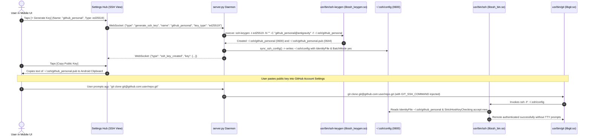

# Specification 02: SSH Key Management & OpenSSH Runtime Integration

## 1. Overview & Problem Statement

To interact with remote code repositories (e.g., GitHub, GitLab, Bitbucket) or deploy code to remote servers, developers and autonomous agents rely on SSH keys. 

Currently, `git clone git@github.com:...` fails inside the app sandbox because standard Android does not bundle the OpenSSH suite (`ssh`, `ssh-keygen`). Furthermore:
1. In a mobile IDE without an interactive TTY, standard OpenSSH connection attempts prompt for host key verification (`Are you sure you want to continue connecting (yes/no/[fingerprint])?`), causing background clone/pull commands to deadlock.
2. When users create custom-named SSH keys (e.g., `github_work`), standard OpenSSH ignores them by default, failing authentication unless configured via `IdentityFile`.
3. Android Bionic's `getpwuid(getuid())->pw_dir` resolves to `/data` instead of the application home, requiring explicit configuration routing.
4. Users have no graphical way to generate, view, copy, or export SSH public keys to add to their GitHub accounts.

### Core Objectives:
1. **Bundle OpenSSH Client Toolchain**: Package `ssh` and `ssh-keygen` as 16KB-page-aligned Bionic shared executables in `jniLibs/` and expose them via the `usr/bin/` symlink farm.
2. **Non-Interactive SSH Config & Automated Key Routing**: Generate and maintain a hardened `~/.ssh/config` file (`0600`) with `BatchMode yes`, `StrictHostKeyChecking accept-new`, and dynamic `IdentityFile` entries for all managed keys.
3. **`GIT_SSH_COMMAND` Environmental Injection**: Direct Git to use the sandboxed OpenSSH binary with explicit config file loading, bypassing Bionic `pw_dir` path resolution mismatches.
4. **In-App Key Generation & Management**: Enable generation of standard key types (`ed25519`, `rsa-4096`, `ecdsa`), validate against reserved filenames, provide one-tap public key clipboard copying, export public key files to `/sdcard/Download/`, and enforce strict POSIX permissions (`0700` for `~/.ssh/`, `0600` for private keys, private keys never exposed to UI).

---

## 2. Architecture & Sandbox Execution Flow



---

## 3. Toolchain Staging & Symlink Topology

### Binary Mapping (`scripts/prepare_binaries.sh`):
* `ssh` $\rightarrow$ `app/src/main/jniLibs/arm64-v8a/libssh_bin.so`
* `ssh-keygen` $\rightarrow$ `app/src/main/jniLibs/arm64-v8a/libssh_keygen.so`
* All transitive shared libraries (`libcrypto.so.3`, `libz.so`, `libldns.so`, `libandroid-support.so`) must be staged into `jniLibs/arm64-v8a/` with 16KB page alignment (`patchelf --page-size 16384`) and mapped in `.symlinks.manifest`.

### Symlink Assembly ([`EnvironmentBootstrapper.kt`](file:///data/data/com.termux/files/home/storage/shared/Documents/AgyStudio/app/src/main/java/ai/agy/app/EnvironmentBootstrapper.kt)):
```kotlin
private val BIN_SYMLINKS = mapOf(
    // ... existing binaries ...
    "ssh" to "libssh_bin.so",
    "ssh-keygen" to "libssh_keygen.so"
)
```

### Filesystem Permissions:
* `~/.ssh/` directory: `0700` (`rwx------`) on internal storage (`app_data_file`). Private keys must NEVER be stored on `/storage/emulated/0/` as FAT32/FUSE mounts do not support POSIX `0600`.
* `~/.ssh/<name>` private key: `0600` (`rw-------`).
* `~/.ssh/<name>.pub` public key: `0644` (`rw-r--r--`).
* `~/.ssh/config` file: `0600` (`rw-------`).

---

## 4. Backend Service Implementation (`server.py`)

### Non-Interactive `~/.ssh/config` Synchronization
Whenever SSH keys are created or deleted, `server.py` synchronizes `~/.ssh/config` to ensure seamless key resolution and prevent terminal deadlocks:

```python
def sync_ssh_config() -> None:
    ssh_dir = Path.home() / ".ssh"
    ssh_dir.mkdir(mode=0o700, exist_ok=True)
    os.chmod(str(ssh_dir), 0o700)
    
    config_file = ssh_dir / "config"
    lines = [
        "# Auto-generated by Antigravity Studio",
        "Host *",
        "    BatchMode yes",
        "    StrictHostKeyChecking accept-new",
        f"    UserKnownHostsFile {ssh_dir}/known_hosts",
        "    ServerAliveInterval 30",
        "    ServerAliveCountMax 3",
        "    IdentitiesOnly yes",
    ]
    
    for pub in sorted(ssh_dir.glob("*.pub")):
        priv = pub.with_suffix("")
        if priv.is_file() and priv.name not in RESERVED_SSH_NAMES:
            lines.append(f"    IdentityFile {priv.resolve()}")
            
    atomic_write_secure(str(config_file), "\n".join(lines) + "\n", mode=0o600)
```

### Process Environment Injection
In `server.py`, inject `GIT_SSH_COMMAND` into `proc_env` for `agy` and all subprocesses:
```python
proc_env["GIT_SSH_COMMAND"] = (
    f"{USR_DIR}/bin/ssh -F {HOME_DIR}/.ssh/config"
)
```

### Hardened Key Generation & Name Validation
```python
RESERVED_SSH_NAMES = {
    "config", "known_hosts", "known_hosts.old",
    "authorized_keys", "authorized_keys2", "environment", "rc"
}
KEY_NAME_RE = re.compile(r"^[a-zA-Z0-9_-]{1,64}$")

async def generate_ssh_key(name: str, key_type: str, overwrite: bool = False) -> dict:
    if not KEY_NAME_RE.match(name) or name.lower() in RESERVED_SSH_NAMES:
        raise ValueError(f"Invalid or reserved SSH key name: '{name}'")

    ssh_dir = Path.home() / ".ssh"
    ssh_dir.mkdir(mode=0o700, exist_ok=True)
    os.chmod(str(ssh_dir), 0o700)

    priv_path = ssh_dir / name
    pub_path = ssh_dir / f"{name}.pub"

    if (priv_path.exists() or pub_path.exists()) and not overwrite:
        raise FileExistsError(f"SSH key '{name}' already exists")

    kt = key_type.lower()
    if kt == "ed25519":
        type_args = ["-t", "ed25519"]
    elif kt in ("rsa-4096", "rsa"):
        type_args = ["-t", "rsa", "-b", "4096"]
    elif kt == "ecdsa":
        type_args = ["-t", "ecdsa", "-b", "384"]
    else:
        raise ValueError(f"Unsupported key_type: {key_type}")

    if priv_path.exists():
        priv_path.unlink()
    if pub_path.exists():
        pub_path.unlink()

    cmd = ["ssh-keygen", *type_args, "-N", "", "-C", f"{name}@antigravity", "-f", str(priv_path)]
    proc = await asyncio.create_subprocess_exec(
        *cmd, stdout=asyncio.subprocess.PIPE, stderr=asyncio.subprocess.PIPE
    )
    _, stderr = await asyncio.wait_for(proc.communicate(), timeout=15.0)
    if proc.returncode != 0:
        raise RuntimeError(f"ssh-keygen failed: {stderr.decode('utf-8', 'replace')}")

    os.chmod(str(priv_path), 0o600)
    os.chmod(str(pub_path), 0o644)
    sync_ssh_config()
    return await get_ssh_key_metadata(name)
```

### Safe Public Key Export (`export_ssh_key`)
When exporting `<name>.pub` to `/storage/emulated/0/Download/`, handle potential Android Scoped Storage conflicts:
```python
def export_ssh_key(name: str) -> str:
    if not KEY_NAME_RE.match(name) or name.lower() in RESERVED_SSH_NAMES:
        raise ValueError("Invalid key name")
    pub_path = Path.home() / ".ssh" / f"{name}.pub"
    if not pub_path.exists():
        raise FileNotFoundError(f"Key {name}.pub does not exist")

    download_dir = Path("/storage/emulated/0/Download")
    download_dir.mkdir(parents=True, exist_ok=True)
    dest = download_dir / f"{name}.pub"

    try:
        if dest.exists():
            dest.unlink()
        dest.write_text(pub_path.read_text(encoding="utf-8"), encoding="utf-8")
        return str(dest)
    except PermissionError:
        # Fallback if prior installation owns the file
        timestamp = int(time.time())
        fallback = download_dir / f"{name}_{timestamp}.pub"
        fallback.write_text(pub_path.read_text(encoding="utf-8"), encoding="utf-8")
        return str(fallback)
```

---

## 5. Acceptance Criteria

- [ ] **AC-2.1: OpenSSH Binaries Packaging & Alignment**
  - Verify `libssh_bin.so` and `libssh_keygen.so` are staged in `jniLibs/arm64-v8a/`, 16KB-page-aligned (`patchelf --page-size 16384`), contain zero `/data/data/com.termux` references, and execute `ssh -V`:
    ```bash
    test -f app/src/main/jniLibs/arm64-v8a/libssh_bin.so && \
    test -f app/src/main/jniLibs/arm64-v8a/libssh_keygen.so && \
    ! grep -aq "com.termux" app/src/main/jniLibs/arm64-v8a/libssh_bin.so && \
    ssh -V 2>&1 | grep -qi "OpenSSH"
    ```
- [ ] **AC-2.2: Symlink Farm Integration**
  - Verify `EnvironmentBootstrapper` creates `usr/bin/ssh` and `usr/bin/ssh-keygen` pointing to native libraries.
- [ ] **AC-2.3: In-App Key Generation & Permissions**
  - Verify `ed25519` and `rsa-4096` key generation creates private keys with `0600` permissions and public keys with `0644`.
- [ ] **AC-2.4: Zero Private Key Exposure**
  - Verify API and WebSocket payloads never include private key content under any circumstances.
- [ ] **AC-2.5: Public Key Clipboard & Export Verification**
  - Verify public key can be copied to Android clipboard and safely exported to `/sdcard/Download/`.
- [ ] **AC-2.6: Non-Interactive SSH Config & Multi-Key Routing**
  - Verify `sync_ssh_config()` generates `~/.ssh/config` (`0600`) with `BatchMode yes`, `StrictHostKeyChecking accept-new`, and `IdentityFile` entries for all keys in `~/.ssh/`.
