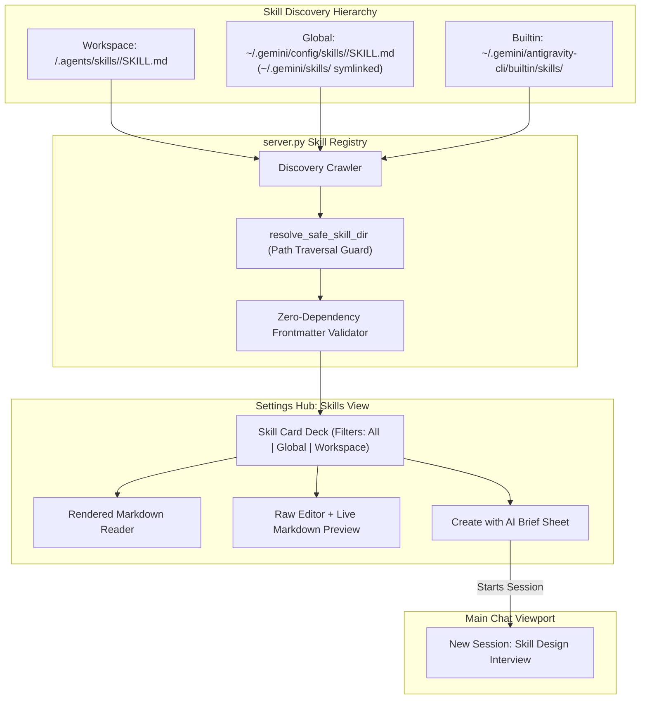

# Specification 04: Skills Discovery, Authoring & AI-Assisted Workflows

## 1. Overview & Problem Statement

Skills are modular packages of knowledge and multi-step procedures that teach Antigravity how to perform specialized workflows (e.g., database migrations, Docker builds, API integrations). They are loaded via **progressive disclosure**: the model only inlines their `name` and `description` initially, reading full instructions only when the workflow is triggered.

Currently, creating or editing skills requires manual file editing via raw terminal commands. Users need a visual, mobile-optimized interface to browse, read, edit, and create skills both manually and via conversational AI pair-programming.

Furthermore:
1. Client-supplied filesystem paths must be strictly validated to prevent directory traversal attacks or accidental `rm -rf` of user workspaces.
2. Android's embedded Python runtime lacks external third-party packages like `PyYAML` out of the box, requiring an autonomous zero-dependency frontmatter parsing engine.
3. The model must be instructed in skill generation that helper scripts must be run via explicit interpreters (`bash`, `python3`) due to Android SELinux `noexec` restrictions.

### Core Objectives:
1. **Multi-Scope Discovery**: Discover and categorize skills across **Global** (`~/.gemini/config/skills/`), **Workspace** (`<workspace>/.agents/skills/`), and **Built-in** locations (with `~/.gemini/skills` symlinked to `~/.gemini/config/skills`).
2. **Zero-Dependency Frontmatter Validation**: Implement an autonomous frontmatter parser in `server.py` supporting standard YAML keys, quoted strings, and multiline blocks (`>-`, `|`) without requiring `PyYAML`. Validate kebab-case `name` and minimum 20-character `description`.
3. **Strict Path Containment**: Ensure all read, write, and delete operations resolve to safe, canonical child directories of configured skill roots.
4. **Dual-Mode Authoring & AI Pair Programming**: Provide both a manual Markdown editor with live preview and AI-driven creation/editing flows (`✨ Create with AI` & `✨ Edit with AI`) that initiate conversational interview turns.

---

## 2. Architecture & File Hierarchy



---

## 3. Skill Anatomy & Validation Specification

Every skill directory must contain a primary instruction file named **`SKILL.md`**.

```markdown
---
name: specialized-task-name
description: >-
  Use this skill when the user asks to perform XYZ. Explains what the skill
  does and when the model should activate it.
---

# Specialized Task Name

Step-by-step instructions for the agent...
```

### Validation Rules (Client & Server):
1. **Fenced YAML Frontmatter**: Must start on line 1 with `---` and contain a closing `---`.
2. **`name` Field**: Required, lowercase alphanumeric with hyphens (`^[a-z0-9]+(?:-[a-z0-9]+)*$`).
3. **`description` Field**: Required, non-empty, minimum 20 characters, describing **what** it does and **when** to use it.
4. **Body Content**: Must contain actionable markdown text after the frontmatter.

---

## 4. Backend Engine Implementation (`server.py`)

### Zero-Dependency YAML Frontmatter Parser
```python
SKILL_NAME_RE = re.compile(r"^[a-z0-9]+(?:-[a-z0-9]+)*$")

def parse_skill_frontmatter(content: str) -> tuple[dict[str, str], str]:
    normalized = content.replace("\r\n", "\n")
    match = re.match(r"^---\n(.*?)\n---\n(.*)$", normalized, re.DOTALL)
    if not match:
        raise ValueError("SKILL.md must begin with fenced YAML frontmatter (---)")
    raw_yaml, body = match.group(1), match.group(2).strip()

    fm: dict[str, str] = {}
    try:
        import yaml  # Use PyYAML if installed
        loaded = yaml.safe_load(raw_yaml)
        if isinstance(loaded, dict):
            fm = {str(k): str(v).strip() for k, v in loaded.items() if v is not None}
    except ImportError:
        # RFC-compliant fallback parser supporting key: value and >- / | multiline blocks
        current_key = None
        block_mode = None
        block_lines = []
        for line in raw_yaml.split("\n"):
            if current_key and (line.startswith("  ") or not line.strip()):
                block_lines.append(line.strip())
                continue
            elif current_key:
                joiner = " " if block_mode == ">-" else "\n"
                fm[current_key] = joiner.join(l for l in block_lines if l).strip()
                current_key, block_mode, block_lines = None, None, []
            m = re.match(r"^([a-zA-Z0-9_-]+)\s*:\s*(.*)$", line)
            if m:
                k, v = m.group(1), m.group(2).strip()
                if v in (">-", ">", "|", "|-"):
                    current_key, block_mode, block_lines = k, v, []
                else:
                    fm[k] = v.strip("\"'")
        if current_key:
            joiner = " " if block_mode == ">-" else "\n"
            fm[current_key] = joiner.join(l for l in block_lines if l).strip()

    name = fm.get("name", "")
    desc = fm.get("description", "")
    if not isinstance(name, str) or not SKILL_NAME_RE.match(name):
        raise ValueError("Frontmatter 'name' is required and must be lowercase kebab-case (a-z0-9-)")
    if not isinstance(desc, str) or len(desc) < 20:
        raise ValueError("Frontmatter 'description' is required and must be at least 20 characters")
    if not body:
        raise ValueError("SKILL.md must contain markdown instructions after frontmatter")
    return {"name": name, "description": desc}, body
```

### Strict Canonical Path Containment Guard
```python
def resolve_safe_skill_dir(target_path: str, allowed_roots: list[str]) -> str:
    real_target = os.path.realpath(target_path)
    if os.path.basename(real_target) == "SKILL.md":
        real_target = os.path.dirname(real_target)

    for root in allowed_roots:
        real_root = os.path.realpath(root)
        if os.path.dirname(real_target) == real_root and real_target != real_root:
            skill_slug = os.path.basename(real_target)
            if SKILL_NAME_RE.match(skill_slug):
                return real_target
    raise PermissionError(f"Path '{target_path}' is outside allowed mutable skill directories")
```

---

## 5. Workflows & AI Interaction Flow

### A. Manual Creation / Editing:
1. User opens **`+ New Skill`** $\rightarrow$ **`Create Manually`**.
2. Selects Target Scope (`Global` or `Workspace`).
3. Enters Skill Name.
4. Editor pre-populates standard template.
5. User switches between **Edit (Raw Markdown)** and **Live Preview** tabs.
6. Validation badge updates live (e.g., `Valid Skill` or `Missing description in frontmatter`).
7. Tapping **Save** persists the directory and `SKILL.md` after passing `resolve_safe_skill_dir()`.

### B. "Create with AI" Flow:
1. User taps **`+ New Skill`** $\rightarrow$ **`✨ Create with AI`**.
2. Lightweight modal collects:
   - **Skill Name**: (e.g. `flutter-release-build`)
   - **What should the skill do?**: (e.g. `Builds signed release AABs and updates version in pubspec.yaml`)
   - **When should the agent use it?**: (e.g. `When user asks to compile or release Flutter app`)
   - **Scope**: `Workspace` (default) or `Global`.
3. Tapping **"Start AI Session"**:
   - Closes Settings Hub and switches to Main Chat.
   - Creates a new session via `new_session`.
   - Sends initial turn prompt:
     ```text
     The user wants to create a new Antigravity skill:
     - Name: {name}
     - Purpose: {what}
     - Trigger Condition: {when}
     - Target Path: {path}

     Frontmatter Requirements:
     - Must start with fenced YAML (`---`) with `name: {name}` (kebab-case) and `description` (>= 20 characters explaining what it does and when to activate it).
     - Android Sandbox Rule: If the skill includes helper scripts, always instruct the agent to run them via `bash <script>` or `python3 <script>`, never `./<script>` (due to Android SELinux W^X restrictions).

     Please design the complete SKILL.md. If any parameters, scripts, or edge cases are unclear, interview the user first. Once aligned, create the skill directory and write SKILL.md.
     ```

### C. "Edit with AI" Flow:
1. On any skill card, user taps **`✨ Edit with AI`**.
2. Settings Hub closes and a new session starts with:
   ```text
   The user wants to edit this skill: {skill_file_path}.
   Study the existing SKILL.md and associated files in detail, then ask the user how they would like to modify it.
   ```

---

## 6. Backend Endpoints (`server.py`)

* `GET /api/skills`: Returns array of all discovered skills with metadata (`name`, `description`, `scope`, `path`, `is_builtin`).
* `GET /api/skills/content?path=...`: Validates path containment and returns raw text of `SKILL.md`.
* `POST /api/skills/save`: Validates frontmatter, validates target path via `resolve_safe_skill_dir()`, creates directory, and writes `SKILL.md`.
* `DELETE /api/skills?path=...`: Validates target path via `resolve_safe_skill_dir()` and removes user/workspace skill directory (strictly rejects attempts to delete builtin skills or parent directories).

---

## 7. Acceptance Criteria

- [ ] **AC-4.1: Multi-Scope Skill Crawler**
  - Verify `server.py` discovers skills across Global (`~/.gemini/config/skills/`), Workspace (`<workspace>/.agents/skills/`), and Built-in locations.
- [ ] **AC-4.2: Zero-Dependency Frontmatter Validation Engine**
  - Verify frontmatter validator functions cleanly on vanilla Python 3.14 without requiring `yaml`, rejects malformed YAML, invalid names, and descriptions `< 20` characters.
- [ ] **AC-4.3: Manual Authoring & Live Preview**
  - Verify raw markdown editing renders accurate preview and saves to disk cleanly.
- [ ] **AC-4.4: AI Creation Handoff Flow**
  - Verify `Create with AI` form dispatches a new chat session with pre-filled design instructions and Android sandbox execution rules.
- [ ] **AC-4.5: AI Editing Handoff Flow**
  - Verify `Edit with AI` dispatches a session pointing to the specific skill path for agent inspection.
- [ ] **AC-4.6: Strict Path Traversal Protection**
  - Verify `DELETE /api/skills` and `GET /api/skills/content` reject `../../` and paths outside allowed mutable skill roots.
