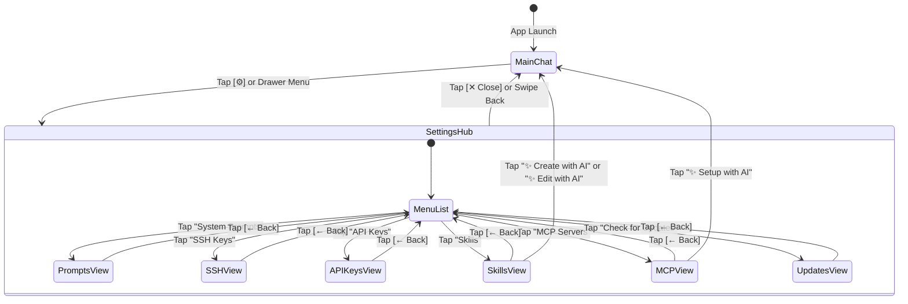

# Specification 06: Settings Hub & Mobile Sub-View Architecture

## 1. Overview & Problem Statement

Mobile screens present strict spatial constraints. Cramming complex configurations (Markdown editors, SSH key tables, API tokens, MCP settings) into the main chat viewport or small floating popups results in unreadable text, keyboard overlaps, and accidental touches.

To maintain a professional, distraction-free IDE experience, Antigravity Studio adopts a **Mobile-First Stacked SPA Architecture**:
1. The **Chat Viewport** remains clean and optimized for touch interactions.
2. A single entry point opens the **Settings & Agent Hub**.
3. Each capability runs in a **Dedicated Full-Page Sub-View** with native-feeling horizontal slide transitions, sticky headers, and full vertical scrolling.
4. **On-Demand Update Checks**: Instead of automatically checking for updates on app startup and interrupting the user, the Settings Hub includes an on-demand **"Check for Updates"** control, giving the user full agency over updates.

---

## 2. Navigation Architecture & View Stack



---

## 3. Entry Points

1. **Top Bar Header**:
   * Icon: Font Awesome Free `sliders` or `gear` (`#btnOpenSettings`).
   * Placed to the left of the `[+] New Session` button in the top bar.
2. **Left Navigation Drawer (`#sessionDrawer`)**:
   * A dedicated row labeled **`Settings & Hub`** positioned prominently in the drawer menu.

---

## 4. Sub-View Specifications & Wireframes

### A. Navigation Shell (Common Layout for All Sub-Views)
Every sub-view inherits a standardized mobile frame:
```
┌────────────────────────────────────────────────────────┐
│ [← Back]                 [Title]             [Action]  │  <-- 56px Sticky Top Bar
├────────────────────────────────────────────────────────┤
│                                                        │
│                  Scrollable Content Body               │
│                                                        │
└────────────────────────────────────────────────────────┘
```
* **Back Button**: Returns to the Settings Hub root menu.
* **Title**: Centered, semibold 16px.
* **Action Button**: Primary action (e.g. `[Save]`, `[+ Generate]`, `[+ Add]`).

---

### B. System Prompts View
* **Header**: `[← Back]` | `System Prompts` | `[Save]` (active on dirty edits).
* **Segmented Tabs**:
  * `[ App Directives (Read-Only) ]` — Shows the built-in mobile rules, sandbox paths, and App UI guide.
  * `[ User Custom Prompt ]` — User's personal prompt.
* **Editor Controls**: Sub-tabs for `[ Edit (Markdown) ]` and `[ Preview ]`.
* **Footer**: Live character count and estimated token consumption.

---

### C. SSH Keys View
* **Header**: `[← Back]` | `SSH Keys` | `[+ Generate]`.
* **Key Card Component**:
  * Key Name (e.g., `github_personal`) + Key Type Badge (`ED25519` or `RSA-4096`).
  * Fingerprint: `SHA256:7uK8...abc123`.
  * Date Created.
  * Action Row:
    * `[📋 Copy Public Key]`: Copies `.pub` content and displays toast notification.
    * `[⬇️ Export]`: Saves public key to `/sdcard/Download/<name>.pub`.
    * `[🗑️ Delete]`: Confirmation modal before permanent deletion.
* **Generate Modal Sheet**:
  * Name input field.
  * Type radio selector (`ED25519` pre-selected by default).
  * Action buttons: `Cancel` and `Generate`.

---

### D. API Keys View
* **Header**: `[← Back]` | `API Keys` | `[+ Add Key]`.
* **Key Card Component**:
  * Key Name (e.g., `GITHUB_TOKEN`, `TAVILY_API_KEY`).
  * Masked Token Value: `ghp_••••••••••••3a9b`.
  * Description label.
  * Action Row: `[📋 Copy]` and `[🗑️ Delete]`.
* **Add Key Modal Sheet**:
  * Preset quick-select chips: `[GITHUB_TOKEN]`, `[OPENAI_API_KEY]`, `[TAVILY_API_KEY]`, `[HUGGINGFACE_TOKEN]`.
  * Key Name input (autocompleted from presets or custom).
  * Key Value input (masked password field with toggle eye icon).
  * Description field.

---

### E. Skills View & AI Workflow
* **Header**: `[← Back]` | `Skills` | `[+ New Skill]`.
* **Filter Segment**: `[ All ]` | `[ Global ]` | `[ Workspace ]`.
* **Skill Card Component**:
  * Skill Name + Scope Badge (`Global` / `Workspace` / `Builtin`).
  * Description preview (clamped to 2 lines).
  * Actions: `[📖 Read]`, `[✏️ Edit]`, `[✨ AI Edit]`, `[🗑️ Delete]`.
* **Read Modal**: Full-screen rendered markdown with clean mobile typography.
* **Manual Edit View**: Raw editor pre-filled with YAML frontmatter template and live preview.
* **AI Creation Flow (`✨ Create with AI`)**:
  * Opens lightweight 3-field brief sheet: Name, Purpose, Trigger condition.
  * Tapping **Start AI Session**: Closes Settings Hub, switches to Chat Viewport, spawns a new session, and streams the design prompt to the agent.

---

### F. MCP Servers View
* **Header**: `[← Back]` | `MCP Servers` | `[+ Add Server]`.
* **Server Card Component**:
  * Status Dot: Green (Enabled/Online) or Gray (Disabled).
  * Server Name + Transport Badge (`HTTP` / `Stdio`).
  * Target URL or Command.
  * Controls: Toggle switch (Enable/Disable), `[Re-auth]`, `[🗑️ Delete]`.
* **Add Server Modal**:
  * Choice: `Manual Setup` or `✨ Setup with AI`.
  * Manual Setup: Type toggle (`HTTP` vs. `Stdio`), URL/command, Header/Env table.

---

### G. Check for Updates View (On-Demand System Update)

Rather than checking for and prompting updates automatically on app startup, the Settings Hub includes an on-demand update inspection card.

* **Header**: `[← Back]` | `Software Updates` | *(no action)*.
* **Current Version Card**:
  * App Name & Logo.
  * Installed Version: `v1.1.0 (Build 5)`.
  * Runtime Engine: `Antigravity CLI (glibc)`.
* **Action Row**:
  * Button: `[🔍 Check for Updates]` (`#btnCheckUpdates`).
* **Interactive State Displays**:
  1. **Idle**: *"Your app is managed manually. Tap Check for Updates to query latest releases."*
  2. **Checking**: Spinner icon with text *"Querying GitHub releases for updates..."*.
  3. **Up-to-Date**: Green check badge with text *"Antigravity Studio is up to date (v1.1.0)."*.
  4. **Update Available**:
     - Accent notification card displaying `New Version: vX.Y.Z`.
     - Changelog snippet / Release notes.
     - Button: `[⬇️ Download & Install Update]` (`#btnInstallUpdate`).
     - Live progress bar (`0% - 100%`) streaming progress via Android `PackageInstaller`.
* **Android Native Integration**:
  - `MainActivity.kt`: Disables the automatic startup coroutine `InAppUpdateManager.checkForUpdates()`.
  - Exposes an explicit `@JavascriptInterface fun triggerUpdateCheck(force: Boolean)` on `AndroidAppInterface` (or via WebSocket `{"type": "check_for_updates", "force": true}`) so user taps immediately trigger a fresh check bypassing 24-hour throttling.

---

## 5. Mobile Ergonomics & Visual Standards

1. **Touch Targets**: All buttons, cards, and toggles adhere to a minimum 44x44px touch target area.
2. **Smooth Transitions**: Horizontal slide transitions powered by CSS `transform: translateX(...)` with hardware acceleration (`will-change: transform`).
3. **Typography & Icons**: Strict use of local Font Awesome Free SVG icons (zero emojis) and responsive system typography.
4. **Theme Adaptation**: Flawlessly inherits dark/light/system theme tokens.

---

## 6. Acceptance Criteria

- [ ] **AC-6.1: SPA Sub-View Stack & Transitions**
  - Verify Settings Hub and sub-views open and close smoothly with zero chat layout distortion.
- [ ] **AC-6.2: System Prompts Editor & Live Preview**
  - Verify raw markdown editing and preview tab render accurately on mobile screens.
- [ ] **AC-6.3: SSH Key Card Actions & Modal**
  - Verify key generation modal, public key copying, and file export function correctly.
- [ ] **AC-6.4: API Key Masking & Presets**
  - Verify API key cards display masked strings and preset chips autocomplete key names.
- [ ] **AC-6.5: Skills Filter & Reader**
  - Verify skills list filters across Global/Workspace scopes and rendered preview opens cleanly.
- [ ] **AC-6.6: AI Handoff Transitions**
  - Verify `✨ Create with AI`, `✨ Edit with AI`, and `✨ Setup with AI` seamlessly return to chat and initiate active turns.
- [ ] **AC-6.7: On-Demand "Check for Updates" in Settings Hub**
  - Verify Settings Hub contains on-demand "Check for Updates" control, disables automatic background startup popups, reports accurate version state, and initiates download upon user confirmation.
