# Master Overview & Implementation Guide: Antigravity Studio v1.1.0

> **Project**: Antigravity Studio Standalone Android Application  
> **Release Target**: `v1.1.0` (Agentic Workflows & Credential Infrastructure)  
> **Package ID**: `ai.agy.app` (10-character geometry)  
> **Target Architecture**: `arm64-v8a` | **SDK**: `35` (Android 15 / 16 / 17+)  
> **Branch**: `v1.1.0`  
> **Review Status**: Architecturally audited and hardened by **Gemini 4 Argon**

---

## 1. Specification Index & Architecture Map

This implementation guide coordinates the six technical specifications in [`specs/1.1.0/`](.):

```
specs/1.1.0/
├── 01-system-prompts.md      # Mobile touch directives (no terminal), SELinux interpreter rules & user instructions
├── 02-ssh-and-credentials.md # OpenSSH binary staging, non-interactive ~/.ssh/config, GIT_SSH_COMMAND & key export
├── 03-api-keys-and-env.md    # Protected api_keys.json, system env denylist, proc_env injection & api_keys_manifest.md
├── 04-skills-management.md   # Skills crawler, zero-dependency frontmatter validator, path containment & AI handoff
├── 05-mcp-management.md      # Built-in agy mcp CLI wrappers, fast mcp_config.json listing, HTTP auth & Stdio sandbox env
└── 06-hub-and-views-ui.md    # Settings Hub SPA view stack, animations, cards, modals & touch UX
```

Execution tracking and step-by-step verification entries are recorded in:
* [`IMPLEMENTATION_LOG.md`](IMPLEMENTATION_LOG.md)

---

## 2. Hardened Architecture & Data Flow

```mermaid
sequenceDiagram
    autonumber
    actor User as Mobile User
    participant Act as MainActivity (WebView PWA)
    participant Hub as Settings Hub (SPA Sub-Views)
    participant Srv as server.py (Async Daemon)
    participant OpenSSH as OpenSSH Runtime (libssh_bin.so)
    participant Agy as Antigravity Engine (libagy.so)
    participant MCP as MCP Servers (HTTP / Stdio)

    User->>Act: Taps [⚙] in Top Bar
    Act->>Hub: Slides in Settings Hub Menu
    
    rect rgb(20, 25, 35)
        Note over User,Hub: Credential & Prompt Setup
        User->>Hub: Adds API Key (GITHUB_TOKEN) & Generates SSH Key (ed25519)
        Hub->>Srv: Saves to api_keys.json (0600) & invokes ssh-keygen
        Srv->>Srv: Generates ~/.ssh/config (0600) with BatchMode yes & IdentityFile
        Srv->>Srv: Syncs ~/.gemini/config/rules/api_keys_manifest.md (0600)
        User->>Hub: Saves User Custom Prompt
        Hub->>Srv: Saves to ~/.gemini/config/rules/user_instructions.md (0600)
    end

    rect rgb(25, 30, 45)
        Note over User,Agy: Agentic Turn Execution
        User->>Act: Prompts Agent: "Clone repo, search issues, use tools"
        Srv->>Srv: Injects api_keys.json & GIT_SSH_COMMAND into proc_env
        Srv->>Agy: Spawns agy (discovers GEMINI.md, user_instructions.md & api_keys_manifest.md)
        Agy->>OpenSSH: Git invokes ssh -F ~/.ssh/config (resolves custom keys without TTY prompt)
        Agy->>MCP: Discovers & calls tools via ~/.gemini/config/mcp_config.json
        Agy-->>Srv: Streams results & tokens over NDJSON (scrubbed with redact_secrets_from_text)
        Srv-->>Act: Real-time broadcast to Chat Viewport without credential leakage
    end
```



---

## 3. Argon Architectural Review: Critical Mitigations

| Issue ID | Subsystem | Severity | Argon Review Mitigation |
| :--- | :--- | :--- | :--- |
| **M-01** | **Terminal Delegation & Interpreter Rule** | **HIGH** | Default `GEMINI.md` instructs LLM that user has no terminal, requiring commands to be run via `run_command` and mandating explicit interpreters (`bash`, `python3`) due to Android SELinux `W^X` restrictions. |
| **M-02** | **Secret Leaks & Env Overwrite** | **CRITICAL** | Raw API keys are injected directly into `proc_env` and never inlined into LLM system prompts; a system variable denylist (`LD_PRELOAD`, `PATH`, etc.) prevents sandbox hijacking; `api_keys_manifest.md` is synchronized once; output streams are scrubbed. |
| **M-03** | **SSH TTY Deadlocks & Custom Key Routing** | **FATAL** | OpenSSH client and keygen are packaged into `libssh_bin.so`/`libssh_keygen.so` with 16KB alignment; `~/.ssh/config` (`0600`) enforces `BatchMode yes`, `StrictHostKeyChecking accept-new`, and dynamic `IdentityFile` entries; `GIT_SSH_COMMAND` injects `-F ~/.ssh/config`. |
| **M-04** | **Private Key Exposure & Scoped Storage** | **CRITICAL** | Web view and WebSocket APIs strictly expose public key files (`*.pub`) and fingerprints; private keys are locked to POSIX `0600` on internal storage; export to `/sdcard/Download/` handles scoped storage permissions. |
| **M-05** | **Zero-Dependency Skills Parser & Path Traversal** | **HIGH** | Frontmatter parser strictly verifies YAML boundary fences, lowercase kebab `name:`, and 20-char `description:` without requiring external `PyYAML`; `resolve_safe_skill_dir()` restricts CRUD strictly to child directories. |
| **M-06** | **MCP Transports & UI Freezing** | **HIGH** | Explicitly passes `--transport http` vs `--transport stdio` in `agy mcp add`; `mcp_config.json` is read directly in Python (`< 1ms`) with masked headers/env for fast UI rendering, while `agy mcp list` runs asynchronously with an 8s timeout. |
| **M-07** | **Mobile UI Clutter** | **HIGH** | Settings Hub uses a stacked single-page application (SPA) architecture with horizontal slide transitions, isolating complex editors from the chat view. |

---

## 4. Agent Implementation & Progress Tracking Protocol

1. **Gating Rule**: An autonomous agent must never mark a criterion `[x]` unless its **Verification Gate** shell command exits with code `0`.
2. **Atomic Verification**: After completing each task:
   - Run the exact verification command.
   - If it passes, flip `[ ]` to `[x]` in both this guide and [`IMPLEMENTATION_LOG.md`](IMPLEMENTATION_LOG.md).
   - If it fails, diagnose and self-heal before proceeding.
3. **Audit Log Update**: Append a completed entry to the Step Execution Ledger in [`IMPLEMENTATION_LOG.md`](IMPLEMENTATION_LOG.md).

---

## 5. Command-Verified Acceptance Criteria Checklist

### Phase 1: Basic System Prompts & Mobile Alignment
- [ ] **AC-1.1: Default App Prompt Packaging & Seeding**
  - Verify `default_app_prompt.md` is bundled in assets and seeded to `~/.gemini/config/GEMINI.md` on boot.
  - **Verification Gate**:
    ```bash
    test -f ~/.gemini/config/GEMINI.md && grep -q 'Mobile Environment Directives' ~/.gemini/config/GEMINI.md
    ```
- [ ] **AC-1.2: No-Terminal & Execution Directives Verification**
  - Verify `GEMINI.md` contains strict rules against asking users to run terminal commands, enforces explicit script interpreters (`bash`, `python3`), and includes prompt-injection isolation guards.
  - **Verification Gate**:
    ```bash
    grep -q 'NEVER instruct or ask the user to run terminal commands' ~/.gemini/config/GEMINI.md && \
    grep -q 'SELinux Execution' ~/.gemini/config/GEMINI.md
    ```
- [ ] **AC-1.3: User Prompt Storage & Persistence**
  - Verify user custom instructions persist at `~/.gemini/config/rules/user_instructions.md` with `0600` permissions.
  - **Verification Gate**:
    ```bash
    python3 -c '
    import os
    p = os.path.expanduser("~/.gemini/config/rules/user_instructions.md")
    if os.path.exists(p):
        assert oct(os.stat(p).st_mode & 0o777) == "0o600", "user_instructions.md must be 0600"
    print("User instructions gate PASSED")
    '
    ```

### Phase 2: OpenSSH Toolchain Staging & SSH Key Management
- [ ] **AC-2.1: OpenSSH Binaries Staged in `jniLibs` & Alignment**
  - Verify `libssh_bin.so` and `libssh_keygen.so` are staged in `jniLibs/arm64-v8a/` with 16KB alignment and zero `com.termux` strings.
  - **Verification Gate**:
    ```bash
    test -f app/src/main/jniLibs/arm64-v8a/libssh_bin.so && \
    test -f app/src/main/jniLibs/arm64-v8a/libssh_keygen.so && \
    ! grep -aq "com.termux" app/src/main/jniLibs/arm64-v8a/libssh_bin.so
    ```
- [ ] **AC-2.2: Bootstrapper SSH Symlink Assembly**
  - Verify `EnvironmentBootstrapper.kt` maps `usr/bin/ssh` and `usr/bin/ssh-keygen`.
  - **Verification Gate**:
    ```bash
    grep -q '"ssh" to "libssh_bin.so"' app/src/main/java/ai/agy/app/EnvironmentBootstrapper.kt && \
    grep -q '"ssh-keygen" to "libssh_keygen.so"' app/src/main/java/ai/agy/app/EnvironmentBootstrapper.kt
    ```
- [ ] **AC-2.3: In-App SSH Key Generation & Permissions**
  - Verify key generation produces `0600` private keys, valid `*.pub` public keys in `~/.ssh/`, and synchronizes `~/.ssh/config`.
  - **Verification Gate**:
    ```bash
    python3 -c '
    import subprocess, os
    d = os.path.expanduser("~/.ssh")
    os.makedirs(d, mode=0o700, exist_ok=True)
    f = os.path.join(d, "test_ed25519")
    if os.path.exists(f): os.remove(f)
    if os.path.exists(f + ".pub"): os.remove(f + ".pub")
    subprocess.run(["ssh-keygen", "-t", "ed25519", "-N", "", "-f", f], check=True)
    assert os.path.exists(f + ".pub")
    mode = oct(os.stat(f).st_mode & 0o777)
    assert mode == "0o600", f"Unexpected mode {mode}"
    os.remove(f); os.remove(f + ".pub")
    print("SSH generation gate PASSED")
    '
    ```

### Phase 3: API Key & Process Environment Management
- [ ] **AC-3.1: Protected Storage (`api_keys.json`)**
  - Verify `api_keys.json` is maintained at `~/.gemini/config/api_keys.json` with `0600` permissions.
  - **Verification Gate**:
    ```bash
    python3 -c '
    import os, json
    p = os.path.expanduser("~/.gemini/config/api_keys.json")
    if not os.path.exists(p):
        with open(p, "w") as f: json.dump({"version": 1, "keys": {}}, f)
        os.chmod(p, 0o600)
    assert oct(os.stat(p).st_mode & 0o777) == "0o600"
    print("API keys storage gate PASSED")
    '
    ```
- [ ] **AC-3.2: Process Environment Variable Injection & Denylist**
  - Verify `server.py` injects stored API keys into `proc_env` and enforces `PROTECTED_ENV_NAMES`.
  - **Verification Gate**:
    ```bash
    grep -q 'PROTECTED_ENV_NAMES' /data/data/ai.agy.app/files/usr/share/agy-ui/server.py
    ```
- [ ] **AC-3.3: LLM Context Inventory Manifest Synchronization**
  - Verify `~/.gemini/config/rules/api_keys_manifest.md` is maintained without exposing raw secrets.
  - **Verification Gate**:
    ```bash
    grep -q 'api_keys_manifest.md' /data/data/ai.agy.app/files/usr/share/agy-ui/server.py
    ```

### Phase 4: Skills Discovery, Authoring & AI Workflows
- [ ] **AC-4.1: Skill Discovery Registry**
  - Verify `server.py` scans Global (`~/.gemini/config/skills/`), Workspace, and Builtin skills.
  - **Verification Gate**:
    ```bash
    grep -q 'discover_skills' /data/data/ai.agy.app/files/usr/share/agy-ui/server.py
    ```
- [ ] **AC-4.2: Zero-Dependency Frontmatter Validation Engine**
  - Verify frontmatter validator enforces lowercase kebab `name` and minimum 20-character `description` without requiring `yaml`.
  - **Verification Gate**:
    ```bash
    python3 -c '
    import re
    content = "---\nname: test-skill\ndescription: Use this skill when testing custom workflows in the app.\n---\n# Body\n"
    match = re.match(r"^---\n(.*?)\n---\n(.*)$", content, re.DOTALL)
    assert match, "Invalid fences"
    raw_yaml, body = match.group(1), match.group(2).strip()
    fm = {}
    for line in raw_yaml.splitlines():
        if ":" in line:
            k, v = line.split(":", 1)
            fm[k.strip()] = v.strip().strip("\"'").strip(">-").strip()
    assert fm.get("name") == "test-skill"
    assert len(fm.get("description", "")) >= 20, "Description must be >= 20 chars"
    print("Frontmatter validation gate PASSED")
    '
    ```
- [ ] **AC-4.3: AI Creation & Editing Turn Handlers**
  - Verify `server.py` dispatches conversational sessions for `Create with AI` and `Edit with AI`.
  - **Verification Gate**:
    ```bash
    grep -q 'create_skill_prompt' /data/data/ai.agy.app/files/usr/share/agy-ui/server.py || \
    grep -q 'edit_skill_prompt' /data/data/ai.agy.app/files/usr/share/agy-ui/server.py
    ```

### Phase 5: Model Context Protocol (MCP) Server Integration
- [ ] **AC-5.1: Native `agy mcp` Command Integration with Explicit Transports**
  - Verify `server.py` invokes `agy mcp add` with explicit `--transport http` or `--transport stdio`.
  - **Verification Gate**:
    ```bash
    grep -q '\-\-transport' /data/data/ai.agy.app/files/usr/share/agy-ui/server.py
    ```
- [ ] **AC-5.2: Streamable HTTP Header Auth & 0600 Config Permissions**
  - Verify `mcp_config.json` exists with `0600` permissions and valid JSON structure.
  - **Verification Gate**:
    ```bash
    python3 -c '
    import json, os
    p = os.path.expanduser("~/.gemini/config/mcp_config.json")
    if not os.path.exists(p):
        with open(p, "w") as f: json.dump({"mcpServers": {}}, f)
        os.chmod(p, 0o600)
    assert oct(os.stat(p).st_mode & 0o777) == "0o600", "mcp_config.json must be 0600"
    data = json.load(open(p))
    assert "mcpServers" in data and isinstance(data["mcpServers"], dict)
    print("MCP config gate PASSED")
    '
    ```

### Phase 6: Mobile Settings Hub & SPA Sub-View Architecture
- [ ] **AC-6.1: Top Bar & Drawer Settings Entry Points**
  - Verify `#btnOpenSettings` exists in `index.html` top bar and drawer.
  - **Verification Gate**:
    ```bash
    grep -q 'btnOpenSettings' /data/data/ai.agy.app/files/usr/share/agy-ui/index.html
    ```
- [ ] **AC-6.2: Settings Hub Root Menu & Sub-View Containers**
  - Verify sub-view containers exist for Prompts, SSH, API Keys, Skills, and MCP.
  - **Verification Gate**:
    ```bash
    for v in viewPrompts viewSSH viewApiKeys viewSkills viewMCP; do
      grep -q "id=\"$v\"" /data/data/ai.agy.app/files/usr/share/agy-ui/index.html || exit 1
    done
    ```
- [ ] **AC-6.3: Vector Iconography Standards**
  - Verify all new icons use Font Awesome Free SVGs and zero emojis exist in settings code.
  - **Verification Gate**:
    ```bash
    ! grep -P "[\x{1F300}-\x{1F9FF}]" /data/data/ai.agy.app/files/usr/share/agy-ui/index.html | grep -q 'view'
    ```

### Phase 7: Packaging, Build Verification & Acceptance Gate
- [ ] **AC-7.1: Gradle Compilation & Version Bump**
  - Bump to `versionCode 5` and `versionName "1.1.0"` in `app/build.gradle.kts`.
  - **Verification Gate**:
    ```bash
    grep -q 'versionName = "1.1.0"' app/build.gradle.kts && ./gradlew assembleRelease
    ```
- [ ] **AC-7.2: Asset Bundle Update (`usr-data.tar.zst`)**
  - Verify updated `index.html`, `server.py`, and `default_app_prompt.md` are archived.
  - **Verification Gate**:
    ```bash
    test -f app/src/main/assets/usr-data.tar.zst
    ```
- [ ] **AC-7.3: End-to-End Release APK Verification**
  - Verify output APK size is under 110 MB with valid v2/v3 signatures.
  - **Verification Gate**:
    ```bash
    APK=$(ls app/build/outputs/apk/release/*.apk | head -n1) && test -f "$APK" && test $(stat -c%s "$APK" 2>/dev/null || stat -f%z "$APK") -lt 115343360
    ```
