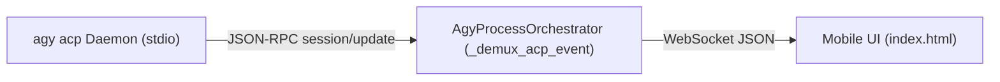

# Module 02: ACP Event Streaming & Frontend UI Bridge

## 1. Event Normalization & Demuxing Pipeline

In the legacy architecture, `server.py` parsed polymorphic NDJSON lines from `agy --output-format stream-json` using heuristics and regex to detect when thoughts ended, when tool arguments finished streaming, and when the turn completed.

In v1.8.0, the persistent ACP connection delivers typed **JSON-RPC 2.0 notifications** (`session/update`). `AgyProcessOrchestrator` translates these into existing frontend WebSocket messages, preserving complete backward compatibility with `agy-ui/index.html`.



---

## 2. Event Translation Mapping

| ACP Notification (`sessionUpdate`) | Translated Frontend Event (`type`) | Purpose & Payload Mapping |
| :--- | :--- | :--- |
| **`agent_message_chunk`** | `content_block_delta` | Streams markdown response text chunks (`content.text`). |
| **`agent_thought_chunk`** | `thought_delta` | Streams model thinking / reasoning tokens (`content.text`). |
| **`tool_call`** | `tool_use` | Signals tool start (`toolCallId`, `name`, `args`, `status: "in_progress"`). |
| **`tool_call_update`** | `tool_result` | Delivers completed tool output (`toolCallId`, `status: "completed"`, `rawOutput.output`). |
| **`available_commands_update`** | `available_commands` | Updates slash command and skill auto-complete suggestions. |
| **`session_info_update`** | `session_title_updated` | Automatically renames the session tab with AI-generated title (`title`). |
| **`config_option_update`** | `config_updated` | Syncs current model, effort, and mode to UI controls. |
| **`user_message_chunk`** | `user_message_echo` | Confirms user prompt delivery to the session history. |

---

## 3. Detailed Event Schemas & Fixtures

### 3.1 Streaming Assistant Text Chunk
```json
{
  "jsonrpc": "2.0",
  "method": "session/update",
  "params": {
    "sessionId": "deb25aad-8028-4d55-aba6-7ed3988f1b03",
    "update": {
      "sessionUpdate": "agent_message_chunk",
      "content": {
        "type": "text",
        "text": "Hello! I can help you with that."
      }
    }
  }
}
```

### 3.2 Tool Invocation & Output
* **Tool Start (`tool_call`)**:
```json
{
  "jsonrpc": "2.0",
  "method": "session/update",
  "params": {
    "sessionId": "deb25aad-8028-4d55-aba6-7ed3988f1b03",
    "update": {
      "sessionUpdate": "tool_call",
      "toolCallId": "call_571469",
      "name": "run_command",
      "args": {
        "CommandLine": "git status",
        "toolSummary": "Check git status"
      },
      "status": "in_progress",
      "kind": "execute"
    }
  }
}
```

* **Tool Result (`tool_call_update`)**:
```json
{
  "jsonrpc": "2.0",
  "method": "session/update",
  "params": {
    "sessionId": "deb25aad-8028-4d55-aba6-7ed3988f1b03",
    "update": {
      "sessionUpdate": "tool_call_update",
      "toolCallId": "call_571469",
      "status": "completed",
      "rawOutput": {
        "output": "On branch v1.8.0\nnothing to commit, working tree clean"
      }
    }
  }
}
```

### 3.3 Slash Commands & Available Commands
When a session is created or prompt begins, ACP automatically scans installed customizations and skills, publishing them via `available_commands_update`:

```json
{
  "jsonrpc": "2.0",
  "method": "session/update",
  "params": {
    "sessionId": "deb25aad-8028-4d55-aba6-7ed3988f1b03",
    "update": {
      "sessionUpdate": "available_commands_update",
      "availableCommands": [
        { "name": "goal", "description": "Run until the goal is finished." },
        { "name": "compact", "description": "Compact conversation history." },
        { "name": "argon-agent", "description": "Security auditing specialist." },
        { "name": "skoda-control", "description": "Škoda vehicle remote control." }
      ]
    }
  }
}
```

---

## 4. Turn Cancellation & Touch Control Flow

### 4.1 Decision: Classic Stop-First Mode (Option 2)
Following UX review for mobile touchscreens, Antigravity Studio v1.8.0 standardizes on **Classic Stop-First Mode**:
* **Mobile Touch Ergonomics**: While generation is active, the chat input bar is locked/disabled and the action button displays exclusively as **■ (Stop)**. This prevents accidental partial-message submissions or touch-keyboard layout conflicts while the viewport is actively streaming markdown or tool results.
* **Stop Action Flow**:
  1. The user taps **■ (Stop)**.
  2. The frontend sends WebSocket message `{ "type": "abort_generation", "conversation_id": "<id>" }`.
  3. `server.py` issues a clean, one-way JSON-RPC notification to the ACP daemon:
     ```json
     {
       "jsonrpc": "2.0",
       "method": "session/cancel",
       "params": {
         "sessionId": "<sessionId>"
       }
     }
     ```
  4. The daemon immediately halts generation and returns `stopReason: "cancelled"`.
  5. The UI unlocks the prompt bar and restores the **Send** button, allowing the user to type their correction or next instruction.

### 4.2 Spontaneous Daemon Turns & Background Task Lifecycle
When tools run long-running background tasks (e.g. `run_command` tasks) or when background processes finish, the ACP daemon triggers reactive execution wakeups.
* **Server-Initiated Spontaneous Turns**: When background tasks complete, `agy acp` automatically issues `session/update` notifications even when no explicit `session/prompt` call is pending.
* `server.py` detects these spontaneous updates, allocates an asynchronous turn card (`turn-bg-...`), broadcasts `turn_start`, and streams the agent's progress report to the active UI.
* Upon completion, the turn is cleanly finalized with `turn_complete` and returns the session state to `idle`.

### 4.3 Tool Execution Status States
Tool cards in the UI map the following statuses:
* **`completed` / `done` / `success`**: Status badge `Done` (green check).
* **`failed` / `error`**: Status badge `Failed` (red/orange cross).
* **`running` / `in_progress`**: Status badge `Running` (amber bolt).
* **`cancelled`**: Status badge `Cancelled` (grey).
When a turn completes, any remaining `running` tool pills are automatically finalized to prevent lingering `Running` states.
