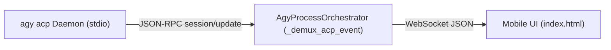

# Module 02: ACP Event Streaming & Frontend UI Bridge

## 1. Event Normalization & Demuxing Pipeline

In the legacy architecture, `server.py` parsed polymorphic NDJSON lines from `agy --output-format stream-json` using heuristics and regex to detect when thoughts ended, when tool arguments finished streaming, and when the turn completed.

In v1.8.0, the persistent ACP connection delivers typed **JSON-RPC 2.0 notifications** (`session/update`). `AgyProcessOrchestrator` translates these into existing frontend WebSocket messages, preserving complete backward compatibility with `agy-ui/index.html`.



---

## 2. Event Translation Mapping

| ACP Notification (`sessionUpdate`) | Translated Frontend Event (`type`) | Purpose & Payload Mapping |
| :--- | :--- | :--- |
| **`agent_message_chunk`** | `content_block_delta` | Streams markdown response text chunks (`content.text`). |
| **`agent_thought_chunk`** | `thought_delta` | Streams model thinking / reasoning tokens (`content.text`). |
| **`tool_call`** | `tool_use` | Signals tool start (`toolCallId`, `name`, `args`, `status: "in_progress"`). |
| **`tool_call_update`** | `tool_result` | Delivers completed tool output (`toolCallId`, `status: "completed"`, `rawOutput.output`). |
| **`available_commands_update`** | `available_commands` | Updates slash command and skill auto-complete suggestions. |
| **`session_info_update`** | `session_title_updated` | Automatically renames the session tab with AI-generated title (`title`). |
| **`config_option_update`** | `config_updated` | Syncs current model, effort, and mode to UI controls. |
| **`user_message_chunk`** | `user_message_echo` | Confirms user prompt delivery to the session history. |

---

## 3. Detailed Event Schemas & Fixtures

### 3.1 Streaming Assistant Text Chunk
```json
{
  "jsonrpc": "2.0",
  "method": "session/update",
  "params": {
    "sessionId": "deb25aad-8028-4d55-aba6-7ed3988f1b03",
    "update": {
      "sessionUpdate": "agent_message_chunk",
      "content": {
        "type": "text",
        "text": "Hello! I can help you with that."
      }
    }
  }
}
```

### 3.2 Tool Invocation & Output
* **Tool Start (`tool_call`)**:
```json
{
  "jsonrpc": "2.0",
  "method": "session/update",
  "params": {
    "sessionId": "deb25aad-8028-4d55-aba6-7ed3988f1b03",
    "update": {
      "sessionUpdate": "tool_call",
      "toolCallId": "call_571469",
      "name": "run_command",
      "args": {
        "CommandLine": "git status",
        "toolSummary": "Check git status"
      },
      "status": "in_progress",
      "kind": "execute"
    }
  }
}
```

* **Tool Result (`tool_call_update`)**:
```json
{
  "jsonrpc": "2.0",
  "method": "session/update",
  "params": {
    "sessionId": "deb25aad-8028-4d55-aba6-7ed3988f1b03",
    "update": {
      "sessionUpdate": "tool_call_update",
      "toolCallId": "call_571469",
      "status": "completed",
      "rawOutput": {
        "output": "On branch v1.8.0\nnothing to commit, working tree clean"
      }
    }
  }
}
```

### 3.3 Slash Commands & Available Commands
When a session is created or prompt begins, ACP automatically scans installed customizations and skills, publishing them via `available_commands_update`:

```json
{
  "jsonrpc": "2.0",
  "method": "session/update",
  "params": {
    "sessionId": "deb25aad-8028-4d55-aba6-7ed3988f1b03",
    "update": {
      "sessionUpdate": "available_commands_update",
      "availableCommands": [
        { "name": "goal", "description": "Run until the goal is finished." },
        { "name": "compact", "description": "Compact conversation history." },
        { "name": "argon-agent", "description": "Security auditing specialist." },
        { "name": "skoda-control", "description": "Škoda vehicle remote control." }
      ]
    }
  }
}
```

---

## 4. Mid-Turn Steering & Dynamic Interruption

### 4.1 Native Mid-Turn Prompt Steering
In `agy -p`, the prompt input field was locked while generation was in progress. 

Under `agy acp`, a user can type a redirection message into the chat bar while the model is actively thinking or executing tools. Sending `session/prompt` mid-turn:
1. Causes the ACP server to immediately finish or halt the preceding turn with `stopReason: "end_turn"` or `"interrupted"`.
2. Evaluates the new prompt payload in the same continuous session context.
3. Redirects agent action without dropping state or tearing down sockets.

### 4.2 Graceful Turn Cancellation (`session/cancel`)
When the user taps the **"Stop"** button on the mobile screen:
* In the legacy architecture, `server.py` had to find and send OS signals (`SIGINT`/`SIGTERM`) to the child process.
* In v1.8.0, `server.py` sends a one-way JSON-RPC **notification** (no `id`):

```json
{
  "jsonrpc": "2.0",
  "method": "session/cancel",
  "params": {
    "sessionId": "deb25aad-8028-4d55-aba6-7ed3988f1b03"
  }
}
```

The active prompt RPC responds with:
```json
{
  "jsonrpc": "2.0",
  "id": 3,
  "result": {
    "stopReason": "cancelled"
  }
}
```
Generation stops instantaneously. The background daemon remains running, hot, and immediately ready for the next prompt.
