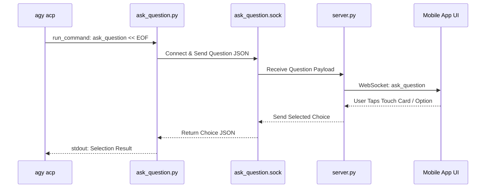

# Module 03: Authentication, Host Tooling & Local Container Integration

## 1. Authentication Architecture

### 1.1 The Headless Android Environment Challenge
When calling ACP's native JSON-RPC method `authenticate` with `methodId: "oauth-personal"` on Android, the engine attempts to trigger `xdg-open` or a local graphical display. Because Antigravity Studio operates in a headless Linux container environment, ACP returns error code `-32603`:

```
"No browser is available here (no graphical display is available to open a browser). Run `agy acp --login` in a terminal on this machine, then retry; or use a Gemini API key."
```

### 1.2 The PTY Bridge for Google OAuth
To deliver a 100% seamless touch experience without requiring the user to open a terminal, Antigravity Studio v1.8.0 uses dedicated Google OAuth:

* **Google OAuth Flow (Exclusive Authentication Path)**:
  * Antigravity Studio operates purely via Google OAuth (`oauth-personal`). API key authentication is not supported.
  * When unauthenticated, `server.py` spawns `agy acp --login` (or `agy --login`) inside an isolated pseudo-terminal PTY (`openpty()`).
  * The orchestrator regex-captures the Google OAuth URL emitted on stdout:
    `https://accounts.google.com/o/oauth2/auth?...`
  * `server.py` broadcasts an `open_external_url` message over WebSocket.
  * `MainActivity.kt` opens the OAuth URL in a native Chrome Custom Tab.
  * Once the user approves, they paste the authorization code into the mobile dialog.
  * `submit_auth_code(code)` writes the code + `\r\n` directly to the PTY master descriptor.
  * The token is safely saved to `/data/data/ai.agy.app/files/home/.gemini/antigravity-oauth-token`, and the persistent ACP daemon initializes.

---

## 2. Interactive Mobile Decision Bridge (`ask_question`)

Antigravity Studio provides an interactive mobile bottom-sheet dialog with radio cards, checkboxes, and write-in fields whenever the model requires user clarification.

### 2.1 UNIX Socket IPC Preservation
The interactive decision flow uses a dedicated UNIX domain socket:
`/data/data/ai.agy.app/files/home/.gemini/antigravity-cli/ask_question.sock`



* Because `agy acp` executes tools (`run_command`) directly in the container environment, `ask_question << 'EOF'` works seamlessly with **zero changes** to the socket protocol, client bridge, or UI bottom-sheets.

---

## 3. Alpine Linux Subsystem & Toolchain Integration

### 3.1 Execution Environment & POSIX Bridge
* Tools executed by the agent (`run_command`, `read_file`, `write_file`) execute directly through the integrated Alpine Linux container subsystem (PRoot + Anonymous ELF Loader).
* **Package Management (`apk`)**: Fully accessible to the agent. Packages installed via `apk add` (e.g. `nodejs`, `python3`, `git`, `clang`, `rust`) persist across sessions in the container rootfs.
* Common binaries (`/usr/bin/python3`, `/usr/bin/node`, `/usr/bin/npm`, `/usr/bin/git`) remain bridged directly into `$PATH`.

### 3.2 Custom Skills & MCP Server Auto-Discovery
* **Custom Skills**: Reside in `/data/data/ai.agy.app/files/home/.gemini/config/skills/` (and builtin skills). During `session/prompt`, ACP automatically scans these directories and registers all skills in the `available_commands_update` notification.
* **MCP Servers**: Configured in `/data/data/ai.agy.app/files/home/.gemini/antigravity-cli/mcp/`. ACP discovers and exposes tools from all enabled MCP servers (such as `github-mcp` or custom stdio servers) out of the box.

---

## 4. AST Scope Integrity & Pre-Build Gate Enforcement

[`scripts/verify_architectural_invariants.py`](file:///storage/emulated/0/Documents/AgyStudio/scripts/verify_architectural_invariants.py) validates the AST of `AgyProcessOrchestrator` before every build.

To satisfy the AST invariant, `server.py` retains all required method signatures on `AgyProcessOrchestrator`:
* `__init__`
* `execute_turn`: Dispatches user prompt to persistent ACP session.
* `abort_turn`: Dispatches `session/cancel` notification to ACP.
* `trigger_in_app_login`: Starts PTY OAuth runner.
* `submit_auth_code`: Passes OAuth code to PTY runner.
* `_on_auth_success`: Re-connects ACP daemon upon login.
* `_cleanup_auth`: Tears down temporary auth PTY.
* `_secure_oauth_token`: Sets safe 0600 file permissions on ext4 storage.
* `_consume_stdout_stream`: Reads JSON-RPC lines from ACP stdio.
* `_consume_stderr_stream`: Logs ACP diagnostic output.
* `_demux_json_event`: Routes ACP JSON-RPC messages and notifications.
