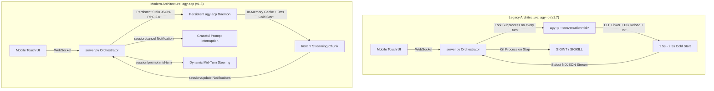

# Antigravity Studio v1.8.0 — ACP Architecture & Migration Overview

## Executive Summary
This document provides the high-level architecture, motivation, and migration roadmap for **Antigravity Studio v1.8.0**. 

The core architectural milestone of v1.8.0 is transitioning the internal execution engine from one-shot CLI batch spawning (`agy -p` with `--output-format stream-json`) to a persistent, event-driven **Agent Client Protocol (`agy acp`)** daemon.

This transition eliminates turn startup latency, establishes robust JSON-RPC 2.0 typing, enables native mid-turn prompt steering, unlocks prompt token caching across turns, and preserves 100% feature parity with existing mobile touch dialogs, multi-session tabs, authentication flows, skills, MCPs, and Alpine Linux packages.

---

## 1. System Requirements & Baseline Constraints

* **Minimum Engine Requirement**: `agy >= 1.5.1`.
  * *Rationale*: Version `1.5.1` resolves ACP prompt cancellation race conditions, fixes out-of-order `session/update` delivery, and expands model access to all account models across ACP clients.
* **Architecture Integrity Gate (ARGON-08)**:
  * [`scripts/verify_architectural_invariants.py`](file:///storage/emulated/0/Documents/AgyStudio/scripts/verify_architectural_invariants.py) enforces that all methods of `AgyProcessOrchestrator` in `server.py` remain strictly indented inside the class body.
* **Zero-Assumption Binary Fixtures (ARGON-09)**:
  * All JSON-RPC schemas and protocol payloads have been empirically validated on-device against `agy acp` running on Android ARM64 and captured in test fixtures.

---

## 2. Comparison: `agy -p` (Batch) vs. `agy acp` (Persistent Daemon)

| Operational Characteristic | Legacy Architecture (`agy -p`) | Modern Architecture (`agy acp`) |
| :--- | :--- | :--- |
| **Process Lifecycle** | Spawns a new native OS process for every user message. | Single long-lived daemon running in the background. |
| **Startup Latency** | 1,500ms – 2,500ms ELF cold-start + config parse per turn. | **0ms** (persistent connection ready instantly). |
| **Prompt Token Caching** | Low/inconsistent cache reuse across process exits. | **High cache reuse** (e.g. 11,300+ cached tokens retained). |
| **Mid-Turn Dynamic Steering** | Impossible (turn must be killed or run to finish). | Supported natively via subsequent `session/prompt` calls. |
| **Turn Cancellation** | Requires abrupt OS signals (`SIGINT`/`SIGTERM`/`SIGKILL`). | Clean `session/cancel` JSON-RPC notification. |
| **Protocol Format** | Unstructured stdout NDJSON scraping with heuristic regex. | Standard JSON-RPC 2.0 with explicit request IDs & types. |
| **Model & Mode Switching** | Requires restarting the CLI with different command flags. | Dynamic in-flight reconfiguration via `session/set_config_option`. |
| **Multi-Session Handling** | Multiplexes multiple CLI process subprocesses. | Single daemon multiplexes sessions via `sessionId` routing. |

---

## 3. High-Level Architecture & Component Map

The v1.8.0 system consists of 3 synchronized layers:

1. **Frontend WebView Client (`agy-ui/index.html`)**:
   * Communicates with `server.py` over local WebSocket (`ws://127.0.0.1:8081`).
   * Renders streaming assistant markdown, thought disclosures, tool invocations, and interactive bottom-sheet decision prompts.
   * Auto-populates slash commands and skills from ACP `available_commands_update`.
   * Sends dynamic model, thinking effort, and mode changes without session restarts.

2. **Backend Daemon & Bridge (`agy-ui/server.py`)**:
   * Manages the persistent `agy acp` background process over asynchronous stdin/stdout pipes.
   * Maintains `AgyProcessOrchestrator` AST integrity while translating ACP JSON-RPC notifications (`session/update`) into frontend WebSocket events (`step_update`, `content_block_delta`, `tool_use`).
   * Manages Google OAuth via background PTY runner (`agy acp --login`) and API key auth via ACP `authenticate`.
   * Houses the `/data/data/ai.agy.app/files/home/.gemini/antigravity-cli/ask_question.sock` domain socket for interactive touch bottom-sheets.

3. **Alpine Linux Native Engine & Storage**:
   * Standalone `agy` ARM64 binary located at `/data/data/ai.agy.app/files/usr/opt/agy/agy` launched via `libagy_launcher.so`.
   * Alpine Linux subsystem providing containerized developer packages (`apk`, `node`, `python3`, `git`, `ssh`).
   * SQLite metadata persistence in `conversation_summaries.db`.

---

## 4. Specification Directory Structure

The v1.8.0 specification suite is partitioned into 3 functional modules:

* [`01-acp-daemon-and-session-orchestration.md`](file:///storage/emulated/0/Documents/AgyStudio/specs/1.8.0/01-acp-daemon-and-session-orchestration.md)
  * Daemon lifecycle, concurrency model, session creation, session loading/resuming, and model/effort configuration.
* [`02-acp-event-stream-and-ui-bridge.md`](file:///storage/emulated/0/Documents/AgyStudio/specs/1.8.0/02-acp-event-stream-and-ui-bridge.md)
  * Event translation pipeline, streaming tokens, tool call tracking, mid-turn steering, cancellation, and permission gates.
* [`03-authentication-subsystem-and-tooling.md`](file:///storage/emulated/0/Documents/AgyStudio/specs/1.8.0/03-authentication-subsystem-and-tooling.md)
  * Headless authentication handling, Chrome Custom Tabs OAuth bridge, API key auth, MCP server discovery, skill invocation, and Alpine container packages.
