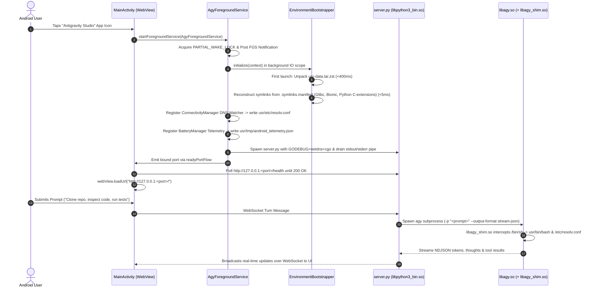

# Master Overview & Implementation Guide: Antigravity Studio Android

> **Project**: Antigravity Studio Standalone Android Application  
> **Package ID**: `ai.agy.app` (Exact 10-character alignment)  
> **Target SDK**: `35` (Android 15 / 16) | **Min SDK**: `28` (Android 9 Pie)  
> **Target Architecture**: `arm64-v8a`  
> **Source Repository**: `git@github.com:MisterMoeGreen/Antigravity-Studio-App.git`  
> **Review Status**: Architecturally audited and hardened by **Gemini 4 Argon**

---

## 1. Specification Index & Architecture Map

This implementation guide coordinates the six technical specifications located in the [`specs/`](.) directory:

```
specs/
├── 01-architecture-and-kernel.md          # SELinux W^X, symlink farm, Bionic/Glibc coexistence & 10-char geometry
├── 02-c-virtualization-shim.md            # libagy_shim.so source, shebang parsing, posix_spawn & syscall hooks
├── 03-toolchain-and-binary-preparation.md # prepare_binaries.sh, Python C-extension extractor, recursive DT_NEEDED crawler
├── 04-android-app-infrastructure.md       # Kotlin Service, Bootstrapper, pipe drainer, WebView Activity, Gradle config
├── 05-networking-dns-and-telemetry.md     # Dynamic DNS watcher, Glibc symlink, GODEBUG=netdns=cgo, telemetry bridge
└── 06-auth-and-updates.md                 # Google OAuth via Custom Tabs, Tier-1 OTA & Tier-2 PackageInstaller
```

---

## 2. Hardened Architecture & Data Flow



---

## 3. Argon Architectural Review: 10 Critical Mitigations

| Issue ID | Subsystem | Severity | Argon Review Mitigation |
| :--- | :--- | :--- | :--- |
| **C-01** | **Linker Collision** | **FATAL** | `libagy_shim.so` is compiled with Bionic Clang. `$usr/glibc/lib` is excluded from `LD_LIBRARY_PATH`. `libagy.so` locates its dependencies via embedded `DT_RPATH` (`patchelf --force-rpath`). `libagy_shim.so` strips `LD_PRELOAD` when execve-ing `libagy.so`. |
| **C-02** | **Python C-Extension W^X** | **FATAL** | `prepare_binaries.sh` moves all `lib-dynload/*.so` out of app storage into `jniLibs/arm64-v8a/libpyext_*.so` (`apk_data_file`). `EnvironmentBootstrapper` reconstructs symlinks at boot via `.symlinks.manifest`. |
| **C-03** | **Kernel Shebang (`#!`) Bypass** | **HIGH** | `libagy_shim.so` inspects executable files for `#!` in user-space before `real_execve()`, translating `/usr/bin/env` or `/bin/bash` before the kernel's `binfmt_script` sees them. |
| **C-04** | **Go Raw Syscalls & Glibc DNS** | **HIGH** | Set `GODEBUG=netdns=cgo` to force Go runtime to use Glibc's resolver. Create `usr/glibc/etc -> ../etc` symlink so Termux Glibc finds `resolv.conf`. Export `SSL_CERT_FILE` and `TMPDIR`. |
| **C-05** | **Missing Transitive Libs** | **FATAL** | Automated recursive `DT_NEEDED` crawler in `prepare_binaries.sh` packages all transitive Bionic dependencies (`libreadline`, `libncursesw`, `libpcre2-8`, `libiconv`, `libnghttp2`, `libssh2`) into `jniLibs`. |
| **C-06** | **Process Pipe Deadlock** | **HIGH** | `AgyForegroundService` spawns an asynchronous coroutine that drains the daemon's redirected stdout/stderr pipe to logcat and `usr/tmp/server.log`, preventing 64KB kernel buffer freezes. |
| **C-07** | **Startup Race & UI Freeze** | **HIGH** | `EnvironmentBootstrapper` runs asynchronously on `Dispatchers.IO`. Port publishing uses `readyPortFlow: StateFlow<Int?>` so `MainActivity` awaits initialization without freezing the main thread. |
| **C-08** | **Git Subcommand Mismatch** | **HIGH** | `EnvironmentBootstrapper` creates `usr/libexec/git-core/{git-remote-https, git-remote-http, git}` symlinks so `git clone https://...` succeeds. |
| **C-09** | **Android 14/15 FGS Rules** | **HIGH** | Calls `startForeground(..., FOREGROUND_SERVICE_TYPE_SPECIAL_USE)` on API 34+. Unregisters network callbacks and battery receivers in `onDestroy()`. |
| **C-10** | **PackageInstaller Stalls** | **MEDIUM** | `UpdateReceiver` explicitly handles `STATUS_PENDING_USER_ACTION` to launch the system confirmation sheet if unattended install permission is pending, and is registered in `AndroidManifest.xml`. |

---

## 4. Step-by-Step Implementation Roadmap

### Phase 1: Project Scaffolding & Directory Setup
1. Initialize the Android Studio Gradle project structure inside `~/storage/shared/Documents/AgyStudio`:
   ```
   AgyStudio/
   ├── app/
   │   ├── build.gradle.kts
   │   └── src/main/
   │       ├── AndroidManifest.xml
   │       ├── cpp/
   │       │   └── agy_shim.c
   │       ├── jniLibs/arm64-v8a/
   │       ├── assets/
   │       └── java/ai/agy/app/
   ├── build.gradle.kts
   ├── settings.gradle.kts
   ├── gradle.properties
   └── scripts/
       └── prepare_binaries.sh
   ```
2. Configure `app/build.gradle.kts` with `applicationId = "ai.agy.app"` and `packaging.jniLibs.useLegacyPackaging = true` (see [Specification 04](04-android-app-infrastructure.md)).

### Phase 2: C Virtualization Shim & Binary Staging
1. Write `app/src/main/cpp/agy_shim.c` with the complete path redirection hooks (see [Specification 02](02-c-virtualization-shim.md)).
2. Write and execute `scripts/prepare_binaries.sh` (see [Specification 03](03-toolchain-and-binary-preparation.md)):
   - Compiles Bionic `libagy_shim.so`.
   - Patches `agy.va39` `PT_INTERP` and `RPATH` using `patchelf --page-size 16384 --force-rpath`.
   - Copies and renames glibc libraries (`libglibc_*.so`).
   - Relocates all Python C-extensions (`lib-dynload/*.so`) into `jniLibs/arm64-v8a/libpyext_*.so`.
   - Runs recursive `DT_NEEDED` crawler for all transitive Bionic libraries.
   - Executes exact byte-length binary string replacement (`com.termux` $\rightarrow$ `ai.agy.app`).
   - Generates `.symlinks.manifest` and archives non-ELF assets into `app/src/main/assets/usr-data.tar.zst`.

### Phase 3: Android Kotlin Services & UI Bridge
1. Implement `EnvironmentBootstrapper.kt` (see [Specification 04](04-android-app-infrastructure.md)):
   - Decompresses `usr-data.tar.zst` on cold boot using `ZstdInputStream` and Apache Commons Compress.
   - Reconstructs the complete symlink farm from `.symlinks.manifest`.
   - Sets up `usr/glibc/etc -> ../etc`, `usr/libexec/git-core`, `hosts`, and git configs.
2. Implement `AgyForegroundService.kt` (see [Specification 04](04-android-app-infrastructure.md) & [Specification 05](05-networking-dns-and-telemetry.md)):
   - Handles the Android `PARTIAL_WAKE_LOCK`.
   - Drains process pipes in background coroutines.
   - Runs `pickAvailablePort()` and publishes the active port via `readyPortFlow`.
   - Synchronizes dynamic DNS via `ConnectivityManager`.
   - Bridges hardware battery & thermal state into `android_telemetry.json`.
3. Implement `MainActivity.kt` (see [Specification 04](04-android-app-infrastructure.md)):
   - Awaits `readyPortFlow` and loads the full-screen `WebView`.
   - Implements `WebChromeClient.onShowFileChooser()` for multi-modal file uploads.
   - Intercepts Google OAuth URLs and hands off to Chrome Custom Tabs.

### Phase 4: Authentication & Self-Updating Engine
1. Integrate `InAppUpdateManager.kt` and `UpdateReceiver.kt` (see [Specification 06](06-auth-and-updates.md)):
   - Handles background downloading of `update.apk`.
   - Commits `PackageInstaller` sessions with user-action fallback.
2. Wire up the Tier-1 OTA asset updater in `server.py` to allow live UI refreshes without APK reinstallation.

### Phase 5: Build, Test & Release
1. Build the release APK:
   ```bash
   ./gradlew assembleRelease
   ```
2. Verify package contents:
   ```bash
   unzip -l app/build/outputs/apk/release/app-release-unsigned.apk | grep "lib/arm64-v8a"
   ```
3. Sign the APK using `apksigner`.

---

## 5. Verification & Testing Matrix

| Test Case | Verification Command / Action | Expected Result |
| :--- | :--- | :--- |
| **SELinux W^X Compliance** | Launch app on Android 14/15 physical device | Zero `avc: denied { execute }` errors in logcat; `agy` starts cleanly. |
| **Glibc Interpreter Resolution** | Monitor logcat during boot | `libglibc_ld.so` successfully resolves `libagy.so` without `ENOENT`. |
| **Bionic/Glibc Coexistence** | Verify `python3` and `agy` run simultaneously | Zero `SIGSEGV` or TLS register collisions. |
| **Python C-Extension Loading** | In python3: `import socket, ssl, sqlite3, zlib` | All modules import cleanly from `apk_data_file` symlinks. |
| **Shebang Resolution** | Execute `./script.py` with `#!/usr/bin/env python3` | Runs without `ENOENT`. |
| **Shell Parity (`run_command`)** | In UI prompt: `Run 'git --version && python3 --version && ls -la'` | Full bash execution succeeds with exit code 0; returns tool results. |
| **DNS Resolution** | Disconnect Wi-Fi $\rightarrow$ Connect Cellular | `usr/etc/resolv.conf` updates instantly; agent queries Google API without lag. |
| **Port Collision Avoidance** | Start Termux `agy-web start` (:8081), then launch Standalone App | Standalone App detects occupied 8081, binds to 8082, and connects WebView smoothly. |
| **OAuth Login** | First run without credentials | Chrome Custom Tab launches, user selects Google account, token saves to `~/.gemini/antigravity-cli/antigravity-oauth-token`. |
| **Background Persistence** | Submit long turn, turn off screen for 5 minutes | `AgyForegroundService` wake-lock keeps turn running; completion notification fires. |
