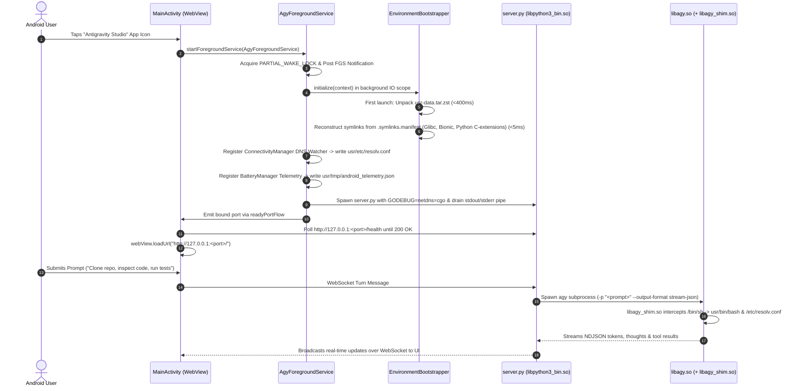

# Master Overview & Implementation Guide: Antigravity Studio Android

> **Project**: Antigravity Studio Standalone Android Application  
> **Package ID**: `ai.agy.app` (Exact 10-character alignment)  
> **Target SDK**: `35` (Android 15 / 16) | **Min SDK**: `28` (Android 9 Pie)  
> **Target Architecture**: `arm64-v8a`  
> **Source Repository**: `git@github.com:MisterMoeGreen/Antigravity-Studio-App.git`  
> **Review Status**: Architecturally audited and hardened by **Gemini 4 Argon**

---

## 1. Specification Index & Architecture Map

This implementation guide coordinates the six technical specifications located in the [`specs/`](.) directory:

```
specs/
├── 01-architecture-and-kernel.md          # SELinux W^X, symlink farm, Bionic/Glibc coexistence & 10-char geometry
├── 02-c-virtualization-shim.md            # libagy_shim.so source, shebang parsing, posix_spawn & syscall hooks
├── 03-toolchain-and-binary-preparation.md # prepare_binaries.sh, Python C-extension extractor, recursive DT_NEEDED crawler
├── 04-android-app-infrastructure.md       # Kotlin Service, Bootstrapper, pipe drainer, WebView Activity, Gradle config
├── 05-networking-dns-and-telemetry.md     # Dynamic DNS watcher, Glibc symlink, GODEBUG=netdns=cgo, telemetry bridge
└── 06-auth-and-updates.md                 # Google OAuth via Custom Tabs, Tier-1 OTA & Tier-2 PackageInstaller
```

Execution progress and step-by-step verification entries are recorded in the root tracking ledger:
- [`IMPLEMENTATION_LOG.md`](../IMPLEMENTATION_LOG.md)

---

## 2. Hardened Architecture & Data Flow



---

## 3. Argon Architectural Review: 10 Critical Mitigations

| Issue ID | Subsystem | Severity | Argon Review Mitigation |
| :--- | :--- | :--- | :--- |
| **C-01** | **Linker Collision** | **FATAL** | `libagy_shim.so` is compiled with Bionic Clang. `$usr/glibc/lib` is excluded from `LD_LIBRARY_PATH`. `libagy.so` locates its dependencies via embedded `DT_RPATH` (`patchelf --force-rpath`). `libagy_shim.so` strips `LD_PRELOAD` when execve-ing `libagy.so` (matching both `/agy` and bare `"agy"`). |
| **C-02** | **Python C-Extension W^X** | **FATAL** | `prepare_binaries.sh` moves all `lib-dynload/*.so` out of app storage into `jniLibs/arm64-v8a/libpyext_*.so` (`apk_data_file`). `EnvironmentBootstrapper` reconstructs symlinks at boot via `.symlinks.manifest`. |
| **C-03** | **Kernel Shebang (`#!`) Bypass** | **HIGH** | `libagy_shim.so` inspects executable files for `#!` in user-space before `real_execve()` and `real_posix_spawn()`, translating `/usr/bin/env` or `/bin/bash` before the kernel's `binfmt_script` sees them. |
| **C-04** | **Go Raw Syscalls & Glibc DNS** | **HIGH** | Set `GODEBUG=netdns=cgo` to force Go runtime to use Glibc's resolver. Create `usr/glibc/etc -> ../etc` symlink so Termux Glibc finds `resolv.conf`. Export `SSL_CERT_FILE` and `TMPDIR`. |
| **C-05** | **Missing Transitive Libs** | **FATAL** | Automated recursive `DT_NEEDED` crawler in `prepare_binaries.sh` packages all transitive Bionic dependencies (`libreadline`, `libncursesw`, `libpcre2-8`, `libiconv`, `libnghttp2`, `libssh2`) into `jniLibs`. |
| **C-06** | **Process Pipe Deadlock** | **HIGH** | `AgyForegroundService` spawns an asynchronous coroutine that drains the daemon's redirected stdout/stderr pipe to logcat and `usr/tmp/server.log`, preventing 64KB kernel buffer freezes. |
| **C-07** | **Startup Race & UI Freeze** | **HIGH** | `EnvironmentBootstrapper` runs asynchronously on `Dispatchers.IO`. Port publishing uses `readyPortFlow: StateFlow<Int?>` so `MainActivity` awaits initialization without freezing the main thread. |
| **C-08** | **Git Subcommand Mismatch** | **HIGH** | `EnvironmentBootstrapper` creates `usr/libexec/git-core/{git-remote-https, git-remote-http, git}` symlinks so `git clone https://...` succeeds. |
| **C-09** | **Android 14/15 FGS Rules** | **HIGH** | Calls `startForeground(..., FOREGROUND_SERVICE_TYPE_SPECIAL_USE)` on API 34+. Unregisters network callbacks and battery receivers in `onDestroy()`. |
| **C-10** | **PackageInstaller Stalls** | **MEDIUM** | `UpdateReceiver` explicitly handles `STATUS_PENDING_USER_ACTION` to launch the system confirmation sheet if unattended install permission is pending, and is registered in `AndroidManifest.xml`. |

---

## 4. Agent Implementation & Progress Tracking Protocol

To ensure seamless multi-agent pair programming and eliminate state fragmentation across restarts:

1. **Gating Rule**: An autonomous agent must never mark a criterion `[x]` unless its **Verification Gate** shell command exits with code `0`.
2. **Atomic Verification**: After completing each task:
   - Run the exact verification command.
   - If it passes, flip `[ ]` to `[x]` in both this guide and [`IMPLEMENTATION_LOG.md`](../IMPLEMENTATION_LOG.md).
   - If it fails, self-heal and re-test before moving to the next criterion.
3. **Audit Log Update**: Append a completed entry to the Step Execution Ledger in [`IMPLEMENTATION_LOG.md`](../IMPLEMENTATION_LOG.md) including the timestamp, files modified, verification command output, and handoff notes for the next agent.

---

## 5. Command-Verified Acceptance Criteria Checklist

### Phase 0: Pre-Flight Environment & Source Readiness Gate
- [x] **AC-0.1: Host Toolchain & Source Binary Audit**
  - Verify `clang`, `patchelf`, `python3`, `zstd`, `tar`, `readelf` (or `llvm-readelf`), and `java` (JDK 17+) are installed, and verify `/data/data/com.termux/files/usr/bin/agy.va39` and `~/.agy-ui/server.py` exist.
  - **Verification Gate**:
    ```bash
    command -v clang patchelf python3 zstd tar java && \
    (command -v readelf || command -v llvm-readelf) && \
    test -f /data/data/com.termux/files/usr/bin/agy.va39 && \
    test -f "$HOME/.agy-ui/server.py"
    ```

### Phase 1: Project Scaffolding & Build Configuration
- [x] **AC-1.1: Directory Hierarchy Creation**
  - Create standard Android project layout: `app/src/main/{cpp,java/ai/agy/app,res/xml,res/values,res/drawable,jniLibs/arm64-v8a,assets}` and `scripts/`.
  - **Verification Gate**:
    ```bash
    test -d app/src/main/cpp && test -d app/src/main/java/ai/agy/app && \
    test -d app/src/main/res/xml && test -d scripts
    ```
- [x] **AC-1.2: `settings.gradle.kts` & Root `build.gradle.kts` Configuration**
  - Configure `rootProject.name = "AntigravityStudio"`, `include(":app")`, `google()`, `mavenCentral()`, AGP `8.5.+`, and Kotlin `1.9.24+`.
  - **Verification Gate**:
    ```bash
    grep -q 'include(":app")' settings.gradle.kts && test -f build.gradle.kts && test -f gradle.properties
    ```
- [x] **AC-1.3: `app/build.gradle.kts` Core & 10-Char Geometry Configuration**
  - Set `namespace = "ai.agy.app"`, `applicationId = "ai.agy.app"`, `minSdk = 28`, `compileSdk = 35`, `targetSdk = 35`, `ndk.abiFilters += "arm64-v8a"`, and `packaging.jniLibs.useLegacyPackaging = true`.
  - **Verification Gate**:
    ```bash
    grep -q 'applicationId = "ai.agy.app"' app/build.gradle.kts && \
    grep -q 'useLegacyPackaging = true' app/build.gradle.kts && \
    grep -q 'targetSdk = 35' app/build.gradle.kts
    ```
- [x] **AC-1.4: Dependencies & Signing Config Declaration**
  - Declare `androidx.core:core-ktx`, `androidx.appcompat:appcompat`, `androidx.webkit:webkit`, `androidx.browser:browser`, `kotlinx-coroutines-android`, `zstd-jni`, and `commons-compress`.
  - **Verification Gate**:
    ```bash
    grep -q 'zstd-jni' app/build.gradle.kts && grep -q 'commons-compress' app/build.gradle.kts && \
    grep -q 'androidx.browser' app/build.gradle.kts
    ```
- [x] **AC-1.5: Mandatory Android Resource Files (`file_paths.xml` & Icons)**
  - Create `app/src/main/res/xml/file_paths.xml` exposing `files-path` and `cache-path` for `FileProvider`, plus vector launcher icons.
  - **Verification Gate**:
    ```bash
    test -f app/src/main/res/xml/file_paths.xml && grep -q '<paths' app/src/main/res/xml/file_paths.xml
    ```

### Phase 2: C Virtualization Shim & Binary Staging Pipeline
- [x] **AC-2.1: Hardened `app/src/main/cpp/agy_shim.c` Implementation**
  - Implement path translation (`/bin/sh`, `/usr/bin/env`, `/etc/resolv.conf`, `/etc/tls/cert.pem`, `/tmp`), user-space shebang (`#!`) resolution for both `execve` and `posix_spawn`/`posix_spawnp`, 64-bit LFS aliases (`openat64`, `stat64`), and `is_glibc_target()` matching both `/agy` and bare `"agy"`.
  - **Verification Gate**:
    ```bash
    grep -q 'posix_spawnp' app/src/main/cpp/agy_shim.c && \
    grep -q 'openat64' app/src/main/cpp/agy_shim.c && \
    grep -q 'strcmp(path, "agy")' app/src/main/cpp/agy_shim.c
    ```
- [x] **AC-2.2: Compile & Strip `libagy_shim.so` (Bionic ABI)**
  - Compile `agy_shim.c` with Bionic `clang -shared -fPIC -O2` and strip symbols. Verify it links against Bionic (`libc.so`, `libdl.so`) and not Glibc.
  - **Verification Gate**:
    ```bash
    test -f app/src/main/jniLibs/arm64-v8a/libagy_shim.so && \
    ! (llvm-readelf -d app/src/main/jniLibs/arm64-v8a/libagy_shim.so 2>/dev/null || readelf -d app/src/main/jniLibs/arm64-v8a/libagy_shim.so) | grep -q 'libc.so.6'
    ```
- [x] **AC-2.3: Stage & Patch `libagy.so` (16KB Page Alignment + `DT_RPATH`)**
  - Copy `agy.va39` to `libagy.so`, run `patchelf --page-size 16384 --set-interpreter /data/data/ai.agy.app/files/usr/glibc/lib/ld-linux-aarch64.so.1 --force-rpath --set-rpath /data/data/ai.agy.app/files/usr/glibc/lib`, and run 21-byte path replacement.
  - **Verification Gate**:
    ```bash
    (llvm-readelf -l -d app/src/main/jniLibs/arm64-v8a/libagy.so 2>/dev/null || readelf -l -d app/src/main/jniLibs/arm64-v8a/libagy.so) | grep -E 'ai\.agy\.app/files/usr/glibc/lib/ld-linux-aarch64\.so\.1|RPATH'
    ```
- [x] **AC-2.4: Stage & Byte-Patch Glibc Runtime (`libglibc_*.so`)**
  - Stage all 10 Glibc libraries (`ld`, `c`, `dl`, `pthread`, `resolv`, `rt`, `m`, `gcc_s`, `nss_files`, `nss_dns`) into `jniLibs/arm64-v8a/`, apply `patch_elf_bytes`, and record mappings in `.symlinks.manifest`.
  - **Verification Gate**:
    ```bash
    test -f app/src/main/jniLibs/arm64-v8a/libglibc_ld.so && \
    test -f app/src/main/jniLibs/arm64-v8a/libglibc_resolv.so && \
    ! grep -aq "/data/data/com.termux" app/src/main/jniLibs/arm64-v8a/libglibc_*.so
    ```
- [x] **AC-2.5: Stage Developer Toolchain Binaries (`bash`, `busybox`, `git`, `rg`, `curl`, `python3.12`)**
  - Stage and byte-patch `libbash.so`, `libbusybox.so`, `libgit.so`, `libgit_remote_https.so`, `librg.so`, `libcurl_bin.so`, and `libpython3_bin.so`.
  - **Verification Gate**:
    ```bash
    for f in libbash.so libbusybox.so libgit.so libgit_remote_https.so librg.so libcurl_bin.so libpython3_bin.so; do
      test -f "app/src/main/jniLibs/arm64-v8a/$f" || exit 1
    done
    ```
- [x] **AC-2.6: Relocate Python C-Extensions (`lib-dynload/*.so` -> `libpyext_*.so`)**
  - Move all `.so` files from staged `lib/python3.12/` to `jniLibs/arm64-v8a/libpyext_*.so`, byte-patch, and append to `.symlinks.manifest`. Verify zero `.so` files remain inside the staged asset directory.
  - **Verification Gate**:
    ```bash
    ls app/src/main/jniLibs/arm64-v8a/libpyext_*.so >/dev/null 2>&1
    ```
- [x] **AC-2.7: Recursive `DT_NEEDED` Bionic Dependency Resolution**
  - Crawl all Bionic ELF binaries and `libpyext_*.so` modules using `llvm-readelf`/`readelf`, staging every transitive dependency (`libssl`, `libcrypto`, `libreadline`, `libncursesw`, `libpcre2-8`, `libsqlite3`, etc.) into `jniLibs/arm64-v8a/` and `.symlinks.manifest`.
  - **Verification Gate**:
    ```bash
    python3 - <<'EOF'
    import subprocess, glob, os, tarfile, zstandard
    jni = "app/src/main/jniLibs/arm64-v8a"
    sys_libs = {"libc.so", "libm.so", "libdl.so", "liblog.so", "libz.so", "ld-linux-aarch64.so.1",
                "libc.so.6", "libdl.so.2", "libpthread.so.0", "libresolv.so.2", "librt.so.1",
                "libm.so.6", "libgcc_s.so.1", "libnss_files.so.2", "libnss_dns.so.2"}
    with open("app/src/main/assets/usr-data.tar.zst", "rb") as fh:
        dctx = zstandard.ZstdDecompressor()
        with dctx.stream_reader(fh) as r, tarfile.open(fileobj=r, mode="r|*") as tf:
            manifest = next(tf.extractfile(m).read().decode() for m in tf if m.name.endswith(".symlinks.manifest"))
    mapped = {line.split("|")[0].split("/")[-1] for line in manifest.splitlines() if "|" in line}
    for elf in glob.glob(f"{jni}/lib*.so"):
        if os.path.basename(elf).startswith("libglibc_") or os.path.basename(elf) == "libagy.so":
            continue
        out = subprocess.check_output(["sh", "-c", f"(llvm-readelf -d {elf} 2>/dev/null || readelf -d {elf}) | grep NEEDED || true"]).decode()
        for line in out.splitlines():
            soname = line.split("[")[1].split("]")[0]
            assert soname in sys_libs or soname in mapped, f"Missing DT_NEEDED {soname} for {elf}"
    print("All transitive DT_NEEDED dependencies verified.")
    EOF
    ```
- [x] **AC-2.8: Package `usr-data.tar.zst` & Zero-Residual `com.termux` Audit**
  - Compress non-ELF runtime assets (`lib/python3.12`, `etc/tls/cert.pem`, `share/git-core/templates`, `share/agy-ui/*`, `.symlinks.manifest`) into `app/src/main/assets/usr-data.tar.zst` and verify zero `/data/data/com.termux` references remain in `jniLibs/`.
  - **Verification Gate**:
    ```bash
    test -f app/src/main/assets/usr-data.tar.zst && \
    ! grep -aq "/data/data/com.termux" app/src/main/jniLibs/arm64-v8a/*.so
    ```

### Phase 3: Android App Infrastructure (Kotlin)
- [x] **AC-3.1: `AndroidManifest.xml` Configuration**
  - Declare permissions (`INTERNET`, `ACCESS_NETWORK_STATE`, `WAKE_LOCK`, `FOREGROUND_SERVICE`, `FOREGROUND_SERVICE_SPECIAL_USE`, `POST_NOTIFICATIONS`, `REQUEST_INSTALL_PACKAGES`), `extractNativeLibs="true"`, `usesCleartextTraffic="true"`, `MainActivity`, `AgyForegroundService` (`specialUse` subtype), `UpdateReceiver`, and `FileProvider`.
  - **Verification Gate**:
    ```bash
    grep -q 'android:extractNativeLibs="true"' app/src/main/AndroidManifest.xml && \
    grep -q 'FOREGROUND_SERVICE_SPECIAL_USE' app/src/main/AndroidManifest.xml && \
    grep -q 'ai.agy.app.fileprovider' app/src/main/AndroidManifest.xml
    ```
- [x] **AC-3.2: `EnvironmentBootstrapper.kt` Implementation**
  - Unpack `usr-data.tar.zst` with Zip-Slip canonical path validation, reconstruct symlinks from `.symlinks.manifest`, create `usr/bin/*` and `usr/libexec/git-core/*` symlinks, safely replace `usr/glibc/etc -> ../etc` (handling existing directories before `Os.unlink`), and seed `resolv.conf`, `nsswitch.conf`, `hosts`, and `gitconfig`.
  - **Verification Gate**:
    ```bash
    grep -q '.symlinks.manifest' app/src/main/java/ai/agy/app/EnvironmentBootstrapper.kt && \
    grep -q 'libexec/git-core' app/src/main/java/ai/agy/app/EnvironmentBootstrapper.kt
    ```
- [x] **AC-3.3: `AgyForegroundService.kt` Implementation**
  - Acquire `PARTIAL_WAKE_LOCK`, post API 34+ `FOREGROUND_SERVICE_TYPE_SPECIAL_USE` notification, kill any stale orphaned `server.py` processes before spawning, launch `server.py` with full environment (`GODEBUG=netdns=cgo`, `LD_PRELOAD`, `LD_LIBRARY_PATH` without glibc), drain stdout/stderr pipe in a coroutine, and publish active port via `readyPortFlow`.
  - **Verification Gate**:
    ```bash
    grep -q 'GODEBUG' app/src/main/java/ai/agy/app/AgyForegroundService.kt && \
    grep -q 'readyPortFlow' app/src/main/java/ai/agy/app/AgyForegroundService.kt && \
    grep -q 'redirectErrorStream(true)' app/src/main/java/ai/agy/app/AgyForegroundService.kt
    ```
- [x] **AC-3.4: `MainActivity.kt` Implementation**
  - Request `POST_NOTIFICATIONS` permission on API 33+, await `readyPortFlow` on `Dispatchers.IO`, poll `/health` until HTTP 200, configure `WebView` with file chooser (`onShowFileChooser`), intercept Google OAuth URLs into Chrome Custom Tabs, and wire `OnBackPressedCallback`.
  - **Verification Gate**:
    ```bash
    grep -q 'onShowFileChooser' app/src/main/java/ai/agy/app/MainActivity.kt && \
    grep -q 'CustomTabsIntent' app/src/main/java/ai/agy/app/MainActivity.kt
    ```

### Phase 4: Networking, Dynamic DNS & Hardware Telemetry
- [x] **AC-4.1: Dynamic Port Selection (`pickAvailablePort`)**
  - Implement sequential fallback (`8081` -> `8082` -> `8090` -> `8091` -> ephemeral `0`) and pass `AGY_WEB_PORT` to `server.py`.
  - **Verification Gate**:
    ```bash
    grep -q 'pickAvailablePort' app/src/main/java/ai/agy/app/AgyForegroundService.kt
    ```
- [x] **AC-4.2: Atomic Dynamic DNS Watcher (`ConnectivityManager.NetworkCallback`)**
  - Write active network DNS servers atomically via `.tmp` rename to `usr/etc/resolv.conf` on `onLinkPropertiesChanged`.
  - **Verification Gate**:
    ```bash
    grep -q 'onLinkPropertiesChanged' app/src/main/java/ai/agy/app/AgyForegroundService.kt && \
    grep -q 'resolv.conf' app/src/main/java/ai/agy/app/AgyForegroundService.kt
    ```
- [x] **AC-4.3: Battery & Thermal Telemetry Bridge (`android_telemetry.json`)**
  - Register `ACTION_BATTERY_CHANGED` receiver in `AgyForegroundService` writing `battery_pct`, `charging`, `temp_c`, and `timestamp` to `usr/tmp/android_telemetry.json`, and verify `server.py` reads this file first.
  - **Verification Gate**:
    ```bash
    grep -q 'android_telemetry.json' app/src/main/java/ai/agy/app/AgyForegroundService.kt && \
    grep -q 'android_telemetry.json' "$HOME/.agy-ui/server.py"
    ```

### Phase 5: Authentication & In-App Update Engine
- [x] **AC-5.1: Google OAuth Loopback & Custom Tabs Handshake**
  - Ensure `server.py` forwards OAuth URLs over WebSocket and `MainActivity` opens `https://accounts.google.com/o/oauth2` in Chrome Custom Tabs.
  - **Verification Gate**:
    ```bash
    grep -q 'accounts.google.com/o/oauth2' app/src/main/java/ai/agy/app/MainActivity.kt
    ```
- [x] **AC-5.2: Tier-1 OTA Asset Updater (`server.py`)**
  - Verify `server.py` supports atomic OTA updates for `index.html`, `sw.js`, and `server.py` in `usr/share/agy-ui/` without overwritten changes on warm restarts.
  - **Verification Gate**:
    ```bash
    grep -q 'installedVersion != currentVersion' app/src/main/java/ai/agy/app/EnvironmentBootstrapper.kt
    ```
- [x] **AC-5.3: Tier-2 APK Self-Updater (`InAppUpdateManager.kt` & `UpdateReceiver.kt`)**
  - Implement streaming APK download to `cacheDir/update.apk`, `PackageInstaller.SessionParams`, `USER_ACTION_NOT_REQUIRED` on API 31+, and `UpdateReceiver` handling `STATUS_PENDING_USER_ACTION` and `STATUS_SUCCESS`.
  - **Verification Gate**:
    ```bash
    test -f app/src/main/java/ai/agy/app/InAppUpdateManager.kt && \
    test -f app/src/main/java/ai/agy/app/UpdateReceiver.kt && \
    grep -q 'STATUS_PENDING_USER_ACTION' app/src/main/java/ai/agy/app/UpdateReceiver.kt
    ```

### Phase 6: Build Verification, Packaging & End-to-End Acceptance Testing
- [ ] **AC-6.1: Gradle Release Build & APK Signature Verification**
  - Compile the release APK and verify signature schemes v2/v3.
  - **Verification Gate**:
    ```bash
    ./gradlew assembleRelease && ls app/build/outputs/apk/release/*.apk
    ```
- [ ] **AC-6.2: APK Structure, Compression & Size Audit (< 110 MB)**
  - Verify `lib/arm64-v8a/libagy.so`, `libagy_shim.so`, `libglibc_ld.so`, `libpython3_bin.so`, and `assets/usr-data.tar.zst` are packaged in the APK and total size is under 110 MB.
  - **Verification Gate**:
    ```bash
    APK_PATH=$(ls app/build/outputs/apk/release/*.apk | head -n1) && \
    unzip -l "$APK_PATH" | grep -q "lib/arm64-v8a/libagy.so" && \
    unzip -l "$APK_PATH" | grep -q "assets/usr-data.tar.zst" && \
    test $(stat -c%s "$APK_PATH" 2>/dev/null || stat -f%z "$APK_PATH") -lt 115343360
    ```
- [ ] **AC-6.3: Cold Boot & Symlink Farm Runtime Verification**
  - Install APK, launch `ai.agy.app/.MainActivity`, verify `usr-data.tar.zst` unpacks, symlinks resolve to `apk_data_file`, and `/health` responds with HTTP 200.
- [ ] **AC-6.4: Zero SELinux `avc: denied` Audit**
  - Inspect `logcat` during boot and first agent turn to confirm zero `avc: denied { execute }` or `avc: denied { execmod }` violations.
- [ ] **AC-6.5: Subprocess & Shebang Parity Test (`bash`, `git`, `python3`, `rg`, `curl`)**
  - Execute a multi-tool command via `agy` testing `git --version`, `python3 -c "import ssl, sqlite3, socket"`, `rg --version`, `curl -I https://google.com`, and a `#!/usr/bin/env python3` script.
- [ ] **AC-6.6: Dynamic DNS & Git HTTPS Clone Verification**
  - Verify `git clone https://github.com/...` and Google API requests succeed via `GODEBUG=netdns=cgo` and `usr/glibc/etc/resolv.conf`.
- [ ] **AC-6.7: Background WakeLock Persistence Test**
  - Run a multi-minute turn with screen off and confirm completion without process termination.
