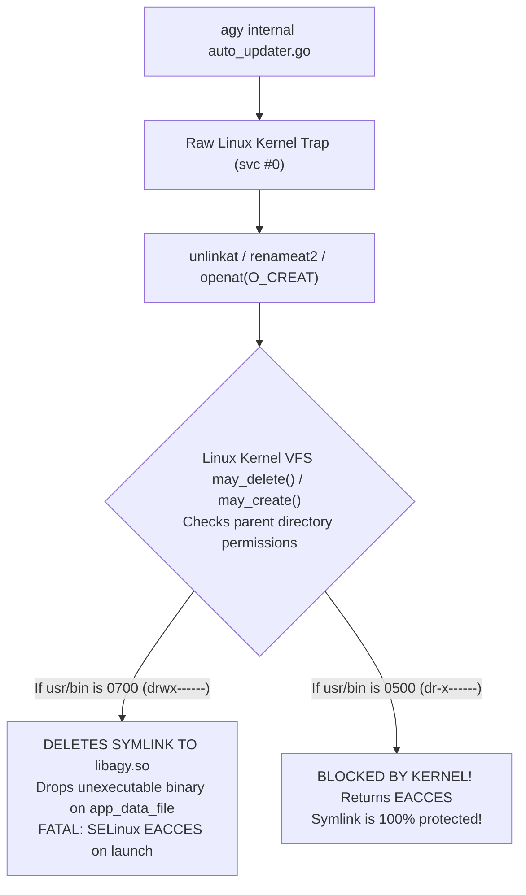

# Specification 02: Binary Self-Update Shielding & VFS Kernel Locking (v1.0.4)

## 1. Threat Analysis: The Go Self-Updater Hazard & Argon Audit

Google's Antigravity CLI binary (`agy.va39` / `libagy.so`) includes an internal self-updating background worker (`auto_updater.go`). On standard Termux installations, this worker queries Google/Termux repositories, downloads a new binary, and replaces `/data/data/com.termux/files/usr/bin/agy` in-place.

### Argon Audit Finding (ARGON-01):
1. **Direct `svc #0` Bypass**: On `linux/arm64`, Go's runtime executes `unlinkat`, `renameat2`, and `openat` via direct kernel assembly traps (`svc #0`), completely bypassing dynamic linker `LD_PRELOAD` hooks.
2. **Linker Boundary**: `libagy_shim.so` (Bionic) is stripped before entering `libagy.so` (Glibc) to prevent dynamic linker collisions, meaning `libagy_shim.so` is not even present in `libagy.so`'s address space.



---

## 2. Kernel-Enforced VFS Directory Locking (`0500`)

In the Linux kernel (`fs/namei.c`: `may_delete()` and `may_create()`), unlinking or renaming over a directory entry checks write permissions on the **parent directory**, not the file itself. 

Because Android applications run as an unprivileged UID (`u0_aXXX`) without `CAP_DAC_OVERRIDE`, the kernel strictly enforces directory permission mode bits even against the directory owner!

### Implementation in `AgyForegroundService.kt`:
```kotlin
fun reconcileSymlinkFarmAndLock(context: Context) {
    val filesDir = context.filesDir
    val usrBinDir = File(filesDir, "usr/bin")
    val localBinDir = File(filesDir, "home/.local/bin").apply { mkdirs() }
    val nativeLibDir = File(context.applicationInfo.nativeLibraryDir)

    usrBinDir.mkdirs()
    // 1. Temporarily unlock usr/bin (0700) so we can replace dangling symlinks after an APK upgrade
    android.system.Os.chmod(usrBinDir.absolutePath, 0b111_000_000)

    val symlinkMap = mapOf(
        "agy" to "libagy.so",
        "agy.va39" to "libagy.so",
        "bash" to "libbash.so",
        "sh" to "libbash.so",
        "git" to "libgit.so",
        "python3" to "libpython3_bin.so"
    )

    for ((binName, soName) in symlinkMap) {
        val targetSo = File(nativeLibDir, soName)
        val linkFile = File(usrBinDir, binName)
        try {
            // Unconditionally unlink first: File.exists() returns false on dangling symlinks!
            android.system.Os.unlink(linkFile.absolutePath)
        } catch (_: Exception) {}
        android.system.Os.symlink(targetSo.absolutePath, linkFile.absolutePath)
    }

    // 2. Lock usr/bin to 0500 (dr-x------): kernel VFS blocks raw Go SVC #0 unlinkat/renameat2!
    android.system.Os.chmod(usrBinDir.absolutePath, 0b101_000_000)
}
```

### User Script Safety:
We add `/data/data/ai.agy.app/files/home/.local/bin` (`0700`) to `PATH` *after* `usr/bin`, and export `PYTHONUSERBASE`:
```kotlin
env["PATH"] = "$usr/bin:$home/.local/bin:/system/bin"
env["PYTHONUSERBASE"] = "$home/.local"
```
This ensures tools like `pip install --user` can install executable scripts without requiring write access to `usr/bin`.

---

## 3. Hardened Virtualization Shim Syscall Hooks (`agy_shim.c`)

For Bionic processes (such as `python3`, `bash`, and sub-tools), `libagy_shim.so` hooks all filesystem mutation syscalls including `renameat2`, using path prefix matching to avoid false positives on user project directories:

```c
#define _GNU_SOURCE
#include <dlfcn.h>
#include <errno.h>
#include <fcntl.h>
#include <limits.h>
#include <stdarg.h>
#include <stdio.h>
#include <string.h>
#include <unistd.h>

static int is_protected_target(int dirfd, const char* path) {
    if (!path) return 0;

    // Fast filter on protected basenames
    const char* base = strrchr(path, '/');
    const char* name = base ? (base + 1) : path;
    if (strcmp(name, "agy") != 0 &&
        strcmp(name, "agy.va39") != 0 &&
        strcmp(name, "libagy.so") != 0 &&
        strncmp(name, ".agy", 4) != 0 &&
        strncmp(name, "agy.tmp", 7) != 0) {
        return 0;
    }

    // Resolve full path using dirfd if relative
    char full_path[PATH_MAX];
    if (path[0] == '/') {
        snprintf(full_path, sizeof(full_path), "%s", path);
    } else {
        if (dirfd == AT_FDCWD) {
            if (!getcwd(full_path, sizeof(full_path))) return 1;
        } else {
            char fd_link[64];
            snprintf(fd_link, sizeof(fd_link), "/proc/self/fd/%d", dirfd);
            ssize_t r = readlink(fd_link, full_path, sizeof(full_path) - 1);
            if (r < 0) return 1;
            full_path[r] = '\0';
        }
        size_t cur = strlen(full_path);
        snprintf(full_path + cur, sizeof(full_path) - cur, "/%s", path);
    }

    // Strictly protect system bin/lib directories (avoid false positives on workspace folders)
    if (strstr(full_path, "/files/usr/bin/") != NULL ||
        strstr(full_path, "/files/usr/lib/") != NULL ||
        strstr(full_path, "/lib/arm64/") != NULL) {
        return 1;
    }
    return 0;
}

int unlink(const char* pathname) {
    if (is_protected_target(AT_FDCWD, pathname)) {
        errno = EROFS;
        return -1;
    }
    int (*real_unlink)(const char*) = dlsym(RTLD_NEXT, "unlink");
    return real_unlink(pathname);
}

int unlinkat(int dirfd, const char* pathname, int flags) {
    if (is_protected_target(dirfd, pathname)) {
        errno = EROFS;
        return -1;
    }
    int (*real_unlinkat)(int, const char*, int) = dlsym(RTLD_NEXT, "unlinkat");
    return real_unlinkat(dirfd, pathname, flags);
}

int rename(const char* oldpath, const char* newpath) {
    if (is_protected_target(AT_FDCWD, oldpath) || is_protected_target(AT_FDCWD, newpath)) {
        errno = EROFS;
        return -1;
    }
    int (*real_rename)(const char*, const char*) = dlsym(RTLD_NEXT, "rename");
    return real_rename(oldpath, newpath);
}

int renameat(int olddirfd, const char* oldpath, int newdirfd, const char* newpath) {
    if (is_protected_target(olddirfd, oldpath) || is_protected_target(newdirfd, newpath)) {
        errno = EROFS;
        return -1;
    }
    int (*real_renameat)(int, const char*, int, const char*) = dlsym(RTLD_NEXT, "renameat");
    return real_renameat(olddirfd, oldpath, newdirfd, newpath);
}

int renameat2(int olddirfd, const char* oldpath, int newdirfd, const char* newpath, unsigned int flags) {
    if (is_protected_target(olddirfd, oldpath) || is_protected_target(newdirfd, newpath)) {
        errno = EROFS;
        return -1;
    }
    int (*real_renameat2)(int, const char*, int, const char*, unsigned int) = dlsym(RTLD_NEXT, "renameat2");
    return real_renameat2(olddirfd, oldpath, newdirfd, newpath, flags);
}

int openat(int dirfd, const char* pathname, int flags, ...) {
    mode_t mode = 0;
    if (flags & (O_CREAT | O_TMPFILE)) {
        va_list ap;
        va_start(ap, flags);
        mode = (mode_t)va_arg(ap, int);
        va_end(ap);
    }
    if ((flags & (O_WRONLY | O_RDWR | O_CREAT | O_TRUNC | O_APPEND)) &&
        is_protected_target(dirfd, pathname)) {
        errno = EROFS;
        return -1;
    }
    int (*real_openat)(int, const char*, int, mode_t) = dlsym(RTLD_NEXT, "openat");
    return real_openat(dirfd, pathname, flags, mode);
}
```

---

## 4. Verification Gates

### Verification Gate AC-2.1: Virtualization Shim Protection
```bash
grep -q "renameat2" app/src/main/cpp/agy_shim.c && \
grep -q "is_protected_target" app/src/main/cpp/agy_shim.c && \
grep -q "EROFS" app/src/main/cpp/agy_shim.c
```

### Verification Gate AC-2.2: VFS `0500` Directory Mode Lock & Environment
```bash
grep -q '0b101_000_000' app/src/main/java/ai/agy/app/AgyForegroundService.kt && \
grep -q 'AGY_DISABLE_AUTO_UPDATE' app/src/main/java/ai/agy/app/AgyForegroundService.kt
```
