# Specification 01: Interactive Question Architecture & Bridge Lifecycle

> **Project**: Antigravity Studio Standalone Android Application  
> **Release Target**: `v1.2.0` (Interactive Questions & Touch Decision Modals)  
> **Package ID**: `ai.agy.app` (10-character geometry)  
> **Target Architecture**: `arm64-v8a` | **SDK**: `35` (Android 15 / 16 / 17+)  
> **Branch**: `v1.2.0`  
> **Review Status**: **ARCHITECTURALLY AUDITED & HARDENED BY GEMINI 4 ARGON (100% Mitigations Integrated)**

---

## 1. Problem Statement & Root Cause

In native terminal environments (e.g. running the `agy` CLI interactively in a desktop shell or Termux), the agent runtime features an interactive decision-prompting tool: `ask_question`. When the model calls this tool, `agy`'s Bubble Tea TUI (`AskQuestionModel` in `third_party/jetski/cli/model/ask_question.go`) renders an interactive terminal menu allowing the user to navigate with arrow keys, toggle checkboxes, type a write-in response, and hit Enter.

However, in **Antigravity Studio for Android**, invoking `ask_question` results in an instantaneous failure:
1. **Headless Execution**: `server.py` invokes `agy` in non-interactive print mode:
   ```bash
   agy --dangerously-skip-permissions --output-format stream-json --model <model> -p "<prompt>"
   ```
2. **Autonomous Skip in Print Mode**: Inside `agy.va39`'s internal Go engine (`third_party/jetski/cli/store/store.go`), `IsPrintMode()` evaluates to `true`. When a turn step requests an interactive question, `checkStepForAskQuestion` detects that no interactive TTY is connected and immediately invokes:
   ```go
   store.skippedResponses() -> "Created At: ...\nCompleted At: ...\nA1: User Skipped"
   ```
   This generates a synthetic skip response in **~17 milliseconds**.
3. **No UI Interception**: The mobile app client does not intercept or display any dialog to capture touch selections. The model receives "User Skipped" and immediately assumes the user bypassed the choice.

---

## 2. Core Objectives

1. **Synchronous Tool Suspension**: Provide a mechanism where an agent's request for user clarification blocks execution and suspends the turn until the user makes a touch selection or explicitly taps Skip.
2. **Interactive Question Bridge**: Deploy a lightweight, asynchronous bridge in `server.py` and a helper executable (`usr/share/agy-ui/ask_question.py`) that coordinates between the agent subprocess, WebSocket event bus, and mobile frontend.
3. **Touch-First Mobile Dialog**: Present questions as an ergonomic Android bottom-sheet modal with radio card options, multi-select checkboxes, `(Recommended)` highlight badges, custom write-in input, and touch buttons ($\ge 48\text{px}$).
4. **Timeout & Recovery Safety**: Protect against orphaned processes with a deterministic timeout (default 300s), session interruption handling (Stop button), and Android system Back-button integration.

---

## 3. High-Level Architecture & Lifecycle Flow

```mermaid
sequenceDiagram
    autonumber
    actor User as Mobile User
    participant Act as MainActivity (WebView PWA)
    participant Srv as server.py (Async Daemon)
    participant Brg as ask_question.py (Bridge Tool)
    participant Agy as Antigravity Engine (libagy.so)

    Agy->>Brg: Invokes python3 ask_question.py '{"questions": [...]}'
    Brg->>Srv: HTTP POST /api/question/ask
    Srv->>Srv: Generates question_id & creates asyncio.Future
    Srv-->>Act: WebSocket broadcast {"type": "ask_question", "data": ...}
    Act->>Act: Opens #modalAskQuestion (Bottom Sheet with smooth slide-up)
    
    rect rgb(20, 25, 35)
        Note over User,Act: Mobile User Decision
        User->>Act: Taps option card (Radio or Checkbox) OR types custom input
        User->>Act: Taps "Submit" (or "Skip")
    end

    Act->>Srv: HTTP POST /api/question/respond {question_id, response, skipped}
    Srv->>Srv: Resolves asyncio.Future with user answers
    Srv-->>Brg: Returns HTTP 200 JSON {status: "ok", answer: "A1: Option A"}
    Brg-->>Agy: Prints formatted answer to stdout & exits 0
    Agy->>Agy: Feeds real user choice back into model context
    Agy-->>Srv: Continues next turn steps based on user decision
    Srv-->>Act: Streams tokens & updates to chat viewport
```



---

## 4. Lifecycle States & Edge Case Mitigations

| Edge Case | Failure Mode | Architectural Mitigation |
| :--- | :--- | :--- |
| **User Abandons App** | Tool blocks indefinitely waiting for response | `server.py` enforces a 300-second (5 min) `asyncio.wait_for` timeout. On expiry, it resolves with `"A1: User Timed Out"` and closes modal. |
| **Native Tool Collision** | LLM invokes built-in `ask_question` tool declaration directly | Explicit negative system prompt directive in `default_app_prompt.md` and `SKILL.md` strictly forbids calling the built-in tool, directing all question prompts through `ask_question.py`. |
| **Client Disconnect** | Tool killed by agent timeout or shell interruption | `POST /api/question/ask` `finally:` handler catches `asyncio.CancelledError`, cancels pending future, and broadcasts `dismiss_question`. |
| **Session Switch / Stop** | User switches workspace or taps Stop button | `/api/stop` and session switch cancel all futures in `_pending_questions`, resolving with `"A1: User Aborted"` and broadcasting `dismiss_question`. |
| **Android Back Pressed** | App closes or navigation pops unexpectedly | `window.handleAndroidBack` intercepts back press when question modal is active, treating it as an explicit "Skip" rather than exiting app. |
| **Multiple Questions** | Payload contains array of multiple questions | Modal presents questions sequentially as a paginated wizard with "Next" / "Submit" progression and per-question answer mapping. |
| **Malformed JSON Args** | Agent passes unescaped quotes or invalid question string | Bridge parses arguments with schema fallback and stdin support; returns structured diagnostic error rather than crashing subprocess. |

---

## 5. Security & Isolation Directives

1. **Localhost Isolation**: The question API endpoints (`/api/question/ask` and `/api/question/respond`) listen strictly on `127.0.0.1` and reject any external interface traffic.
2. **Session Key Validation**: Requests to `/api/question/respond` must present a matching `question_id` generated cryptographically by `server.py`.
3. **Write-in Sanitization**: Free-form text entered in the write-in field is sanitized against prompt injection patterns before being returned to the model.
