# Master Overview & Implementation Guide: Antigravity Studio v1.2.0

> **Project**: Antigravity Studio Standalone Android Application  
> **Release Target**: `v1.2.0` (Interactive Questions & Touch Decision Modals)  
> **Package ID**: `ai.agy.app` (10-character geometry)  
> **Target Architecture**: `arm64-v8a` | **SDK**: `35` (Android 15 / 16 / 17+)  
> **Branch**: `v1.2.0`  
> **Review Status**: Architecturally audited and hardened for mobile execution

---

## 1. Executive Summary & Goals

In `v1.1.0` through `v1.1.2`, Antigravity Studio established full credential and settings infrastructure (API keys, OpenSSH keypairs, skills crawler, and MCP integration).

However, during active agent turns, models frequently need to clarify project specifications, verify architectural choices, or resolve ambiguous options. In command-line environments, `agy` utilizes `ask_question`. In the mobile Android environment, running `agy` in headless print mode (`-p`) causes `ask_question` to instantaneously auto-skip (`A1: User Skipped` in 17ms) without presenting choices to the user.

**Release `v1.2.0` introduces the Interactive Question & Decision Modal Subsystem**:
1. **Interactive Question Bridge**: An asynchronous REST API in `server.py` that pauses the calling tool process via `asyncio.Future` until the user acts.
2. **Bridge Client Executable**: Staged executable `usr/share/agy-ui/ask_question.py` supporting CLI argument parsing and standardized output formatting.
3. **Touch-First Bottom Sheet UI**: Responsive mobile modal in `index.html` featuring single-select radio cards, multi-select checkboxes, `(Recommended)` default pill styling, custom write-in fallback, and touch targets ($\ge 48\text{px}$).
4. **Android Back Interception**: Graceful back-button handling in `MainActivity.kt` and PWA layer preventing accidental app exit while a question is pending.
5. **System Directives Alignment**: Full system prompt guidance in `default_app_prompt.md` and seeded `SKILL.md` teaching the agent how to solicit user decisions interactively.

---

## 2. Specification Index & Architecture Map

This implementation guide coordinates the four technical specifications in [`specs/v1.2.0/`](.):

```text
specs/v1.2.0/
├── 01-interactive-question-architecture.md # Root cause, lifecycle flow, suspension mechanics & edge case mitigations
├── 02-backend-api-and-bridge-protocol.md   # REST contracts (/api/question/ask, /respond), WebSocket frames, and ask_question.py
├── 03-mobile-touch-ui-and-dialogs.md       # #modalAskQuestion bottom sheet, card styles, recommendation badges & Back button
├── 04-agent-tool-integration-and-directives.md # Skill YAML frontmatter, execution syntax, and default_app_prompt.md updates
├── OVERVIEW_AND_IMPLEMENTATION_GUIDE.md    # Master roadmap, mitigations table, and command-verified criteria
└── IMPLEMENTATION_LOG.md                   # Quick-resume state header, tracking checklist, and execution ledger
```

---

## 3. Hardened Architecture & Sequence Flow

```mermaid
sequenceDiagram
    autonumber
    actor User as Mobile User
    participant Act as MainActivity (WebView PWA)
    participant Srv as server.py (Async Daemon)
    participant Brg as ask_question.py (Bridge Client)
    participant Agy as Antigravity Engine (libagy.so)

    Agy->>Brg: Invokes python3 usr/share/agy-ui/ask_question.py '{"questions":...}'
    Brg->>Srv: HTTP POST /api/question/ask
    Srv->>Srv: Allocates question_id & registers asyncio.Future
    Srv-->>Act: WebSocket broadcast {"type": "ask_question", "question_id": ...}
    Act->>Act: Slides up #modalAskQuestion with option cards
    
    rect rgb(20, 25, 35)
        Note over User,Act: Mobile User Decision
        User->>Act: Taps radio/checkbox card OR enters write-in response
        User->>Act: Taps "Submit" (or "Skip")
    end

    Act->>Srv: HTTP POST /api/question/respond {question_id, answers, skipped}
    Srv->>Srv: Resolves asyncio.Future with selected answers
    Srv-->>Brg: Returns HTTP 200 JSON with formatted_output
    Brg-->>Agy: Prints output to stdout and exits 0
    Agy->>Agy: Incorporates user decision into model context
    Agy-->>Srv: Continues next turn steps
    Srv-->>Act: Streams results to chat viewport
```



---

## 4. Architectural Review: Argon Mitigations (M-01 through M-14)

Following an architectural review by **Gemini 4 Argon** (`argon-subagent`), 14 mitigations were identified and integrated into the `v1.2.0` specification:

| ID | Focus Area | Severity | Problem Summary | Architectural Mitigation |
| :--- | :--- | :--- | :--- | :--- |
| **M-01** | **Path Resolution** | **CRITICAL** | Relative path `python3 usr/share/...` fails if CWD is a user workspace directory. | Stage `ask_question.py` at `/data/data/ai.agy.app/files/usr/share/agy-ui/ask_question.py`, symlink to `usr/bin/ask_question` on `$PATH`. |
| **M-02** | **HTTP Error Handling** | **CRITICAL** | `urllib.request` raises `HTTPError` on 408 timeout, crashing client unhandled. | Backend returns HTTP 200 with `status: "timeout"`; client wraps `urlopen` in `try...except HTTPError`. |
| **M-03** | **AST Gate Bug** | **CRITICAL** | `AC-2.1` gate checked `n.names[0].name in (...)`, which fails for `import urllib.request`. | Gate checks `alias.name.split('.')[0]` and inspects `ImportFrom` nodes. |
| **M-04** | **Tool Collision** | **CRITICAL** | Built-in `ask_question` tool in `libagy.so` auto-skips in headless print mode (`-p`). | Add strict negative directive in system prompt and `SKILL.md`: NEVER invoke built-in tool; use `run_command` with `ask_question`. |
| **M-05** | **Schema Ambiguity** | **HIGH** | Flat `answers: [str]` cannot distinguish multi-select answers for one question vs multiple questions. | Structured `responses: [{"question_index": 0, "selected": [...], "write_in": "..."}]`; join multi-selections with commas. |
| **M-06** | **Timestamp Alignment** | **HIGH** | Output formatting lacked consistent UTC ISO 8601 timestamps matching CLI tools. | Client formats `Created At:` and `Completed At:` directly using `time.gmtime()`. |
| **M-07** | **Shell Escaping** | **HIGH** | Single quotes in JSON args break bash command execution. | Support `sys.stdin` reading in `ask_question.py` and document heredoc (`<< 'EOF'`) syntax in system directives. |
| **M-08** | **Disconnect Cleanup** | **HIGH** | If client disconnects or aborts, question future remains hanging in `server.py`. | Use `finally:` block in `/api/question/ask` to pop future and broadcast `dismiss_question`. |
| **M-09** | **Keyboard Occlusion** | **HIGH** | Mobile soft keyboard covers custom write-in textarea on Android. | Move write-in input inside scrollable card container and call `scrollIntoView({ behavior: 'smooth', block: 'center' })` on focus. |
| **M-10** | **Session Reset** | **HIGH** | Switching workspaces or stopping turn leaves active question futures hanging. | `/api/stop` and session switches cancel active question futures with `"A1: User Aborted"`. |
| **M-11** | **Key Normalization** | **MEDIUM** | Mismatches between `snake_case` and `camelCase` keys in questions payload. | Bridge accepts `is_multi_select` / `isMultiSelect`, `question` / `title`, and `options` / `choices`. |
| **M-12** | **Safe Area Insets** | **MEDIUM** | Android 15/16 edge-to-edge mode obscures bottom sheet action buttons. | Add `padding-bottom: calc(12px + env(safe-area-inset-bottom, 0px))` to modal container. |
| **M-13** | **Wizard Progression** | **MEDIUM** | Multi-question payloads require step-by-step navigation. | Bottom sheet shows "Next" until final question, then "Submit". |
| **M-14** | **Frame Deduplication** | **LOW** | WebSocket reconnect might duplicate modal rendering. | Track `activeQuestionId` and guard against re-rendering identical question IDs. |

---

## 5. Agent Implementation & Progress Tracking Protocol

1. **Gating Rule**: An autonomous agent must never mark a criterion `[x]` unless its **Verification Gate** shell command exits with code `0`.
2. **Atomic Verification**: After completing each task:
   - Run the exact verification command.
   - If it passes, flip `[ ]` to `[x]` in both this guide and [`IMPLEMENTATION_LOG.md`](IMPLEMENTATION_LOG.md).
   - If it fails, diagnose and self-heal before proceeding.
3. **Audit Log Update**: Append a completed entry to the Step Execution Ledger in [`IMPLEMENTATION_LOG.md`](IMPLEMENTATION_LOG.md).

---

## 6. Command-Verified Acceptance Criteria Checklist

### Phase 1: Backend Question API & Concurrency Manager
- [x] **AC-1.1: Question Bridge Endpoints in `server.py`**
  - Verify `/api/question/ask`, `/api/question/respond`, and `/api/question/pending` are registered in `server.py`.
  - **Verification Gate**:
    ```bash
    python3 -c '
    import sys; sys.path.insert(0, "agy-ui")
    with open("agy-ui/server.py") as f: content = f.read()
    assert "/api/question/ask" in content, "Missing /api/question/ask"
    assert "/api/question/respond" in content, "Missing /api/question/respond"
    assert "_pending_questions" in content, "Missing _pending_questions future map"
    print("AC-1.1 PASSED")
    '
    ```

- [x] **AC-1.2: Future Lifecycle & Timeout Handling**
  - Verify `server.py` handles timeouts, cancellations on turn abort, and secret redaction.
  - **Verification Gate**:
    ```bash
    python3 -c '
    with open("agy-ui/server.py") as f: content = f.read()
    assert "asyncio.wait_for" in content and "timeout" in content, "Missing future timeout handling"
    assert "dismiss_question" in content, "Missing question dismissal broadcast"
    print("AC-1.2 PASSED")
    '
    ```

### Phase 2: Bridge Client Executable
- [x] **AC-2.1: `ask_question.py` Staged & Executable**
  - Verify `agy-ui/ask_question.py` exists, is syntax-valid, and uses zero external dependencies.
  - **Verification Gate**:
    ```bash
    python3 -m py_compile agy-ui/ask_question.py && \
    python3 -c '
    import ast
    with open("agy-ui/ask_question.py") as f: tree = ast.parse(f.read())
    allowed = {"sys", "os", "json", "urllib", "time"}
    for n in ast.walk(tree):
        if isinstance(n, ast.Import):
            for alias in n.names:
                assert alias.name.split(".")[0] in allowed, f"Disallowed module {alias.name}"
        elif isinstance(n, ast.ImportFrom):
            assert n.module.split(".")[0] in allowed, f"Disallowed module {n.module}"
    print("AC-2.1 PASSED")
    '
    ```

- [x] **AC-2.2: Standardized Formatting Output**
  - Verify `ask_question.py` properly formats `Created At`, `Completed At`, and `A1: ...` responses.
  - **Verification Gate**:
    ```bash
    python3 -c '
    with open("agy-ui/ask_question.py") as f: content = f.read()
    assert "Created At:" in content and "Completed At:" in content, "Missing timestamp formatting"
    assert "A1:" in content, "Missing answer prefix formatting"
    print("AC-2.2 PASSED")
    '
    ```

### Phase 3: Mobile Touch Bottom-Sheet UI & Interactions
- [x] **AC-3.1: Modal Bottom Sheet Container in `index.html`**
  - Verify `#modalAskQuestion`, option card container, write-in input, and actions exist.
  - **Verification Gate**:
    ```bash
    python3 -c '
    with open("agy-ui/index.html") as f: content = f.read()
    for el in ["modalAskQuestion", "questionOptionsContainer", "questionWriteInInput", "btnQuestionSubmit", "btnQuestionSkip"]:
        assert f"id=\"{el}\"" in content, f"Missing element {el}"
    print("AC-3.1 PASSED")
    '
    ```

- [x] **AC-3.2: Touch Targets & Recommendation Badges**
  - Verify option cards adhere to $\ge 48\text{px}$ minimum height and recommendation badge styles exist.
  - **Verification Gate**:
    ```bash
    grep -q 'badge-rec' agy-ui/index.html && \
    grep -q 'min-height:' agy-ui/index.html
    ```

- [x] **AC-3.3: Back Button Interception**
  - Verify `window.handleAndroidBack` handles `#modalAskQuestion` cleanly.
  - **Verification Gate**:
    ```bash
    python3 -c '
    with open("agy-ui/index.html") as f: content = f.read()
    assert "modalAskQuestion" in content and "handleAndroidBack" in content, "Missing back handler integration"
    print("AC-3.3 PASSED")
    '
    ```

### Phase 4: System Directives & Skill Seeding
- [x] **AC-4.1: Mobile Directive Section 7 in `default_app_prompt.md`**
  - Verify Section 7 on Interactive Decision Prompts exists in `default_app_prompt.md`.
  - **Verification Gate**:
    ```bash
    grep -q 'Interactive Decision Prompts' agy-ui/default_app_prompt.md
    ```

- [x] **AC-4.2: Skill Frontmatter & Definition**
  - Verify `ask-question` skill frontmatter passes zero-dependency YAML validator.
  - **Verification Gate**:
    ```bash
    test -f agy-ui/skills/ask-question/SKILL.md && \
    python3 -c '
    import re
    with open("agy-ui/skills/ask-question/SKILL.md") as f: content = f.read()
    m = re.match(r"^---\n(.*?)\n---", content, re.DOTALL)
    assert m, "Invalid frontmatter fences"
    assert "name: ask-question" in m.group(1), "Invalid name"
    assert len(re.search(r"description:\s*(.+)", m.group(1)).group(1).strip()) >= 20, "Description < 20 chars"
    print("AC-4.2 PASSED")
    '
    ```

### Phase 5: Build Verification, Version Bump & Asset Packaging
- [x] **AC-5.1: Version Bump to v1.2.0**
  - Verify `VERSION_NAME=1.2.0` and `VERSION_CODE=10` in `version.properties` and `app/build.gradle.kts`.
  - **Verification Gate**:
    ```bash
    grep -q 'VERSION_NAME=1.2.0' version.properties && \
    grep -q 'VERSION_CODE=10' version.properties
    ```

- [x] **AC-5.2: Asset Bundle Packaging (`usr-data.tar.zst`)**
  - Verify `prepare_binaries.sh` stages `ask_question.py` and regenerates `usr-data.tar.zst`.
  - **Verification Gate**:
    ```bash
    tar --zstd -tf app/src/main/assets/usr-data.tar.zst | grep -q 'share/agy-ui/ask_question.py'
    ```

### Phase 6: End-to-End Release Build Verification
- [x] **AC-6.1: Gradle Release APK Build**
  - Verify clean Gradle build producing a signed Release APK under 110 MB.
  - **Verification Gate**:
    ```bash
    bash ./gradlew assembleRelease && \
    APK=$(ls app/build/outputs/apk/release/*.apk | head -n1) && \
    test -f "$APK" && test $(stat -c%s "$APK" 2>/dev/null || stat -f%z "$APK") -lt 115343360
    ```
