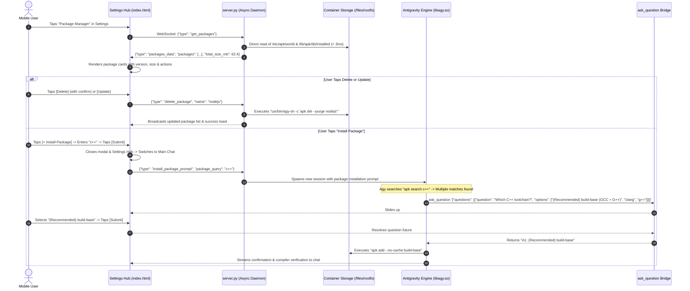

# Specification 06: On-Device Package Manager UI & Interactive Install Handoff

> **Release Target**: `v1.3.0` (Native W^X-Aware PRoot Subsystem)  
> **Components**: Settings Hub Package UI, Fast Alpine DB Parser, and AI Disambiguation Bridge  
> **Target SDK**: `35` (Android 15 / 16 / 17+) | **Architecture**: `arm64-v8a`  
> **Integration Baseline**: Built upon v1.2.0 Touch Modals & v1.3.0 W^X PRoot Engine  

---

## 1. Overview & Problem Statement

In `v1.3.0`, Antigravity Studio introduced the **W^X-Aware PRoot Subsystem and Alpine Linux Minirootfs**, granting the agent unconstrained on-device capability to install arbitrary compilers, runtimes, and tools via `apk add`.

However, the user experience currently lacks a visual management interface for these packages:
1. **Zero Visibility**: Users cannot see which packages are currently installed in the container, how much internal storage they consume, or what versions are active without asking the agent in chat.
2. **No Manual Lifecycle Controls**: Removing or updating packages requires launching a conversational agent turn rather than providing direct, one-tap UI actions.
3. **Vague Intent Friction**: When a user wants a toolchain (e.g., "I need C++" or "Install Python"), command-line package names are often nuanced (`g++`, `build-base`, `clang`, `python3`, `py3-pip`). The system needs a guided installation flow that uses the v1.2.0 interactive question bridge to clarify intent before running `apk add`.

**Specification 06 defines the On-Device Package Manager UI**:
* A new **Package Manager** sub-view in the Settings Hub.
* Fast, zero-overhead direct parsing of Alpine's database (`/etc/apk/world` and `/lib/apk/db/installed`) in `< 3ms`.
* Per-package cards displaying name, version, description, and size in MB, with direct **Delete** and **Update** actions.
* Top action controls to **Update All Packages** and **Install New Package**.
* An **Install Package** touch sheet modal linked to an automated AI turn handoff that leverages `ask_question` for intelligent package candidate disambiguation.

---

## 2. Architecture & Data Flow



---

## 3. UI Wireframes & Mobile Ergonomics

### A. Settings Hub Menu Item
In `#settingsHubMenuList`, a dedicated navigation card positioned after "MCP Servers":
* **Icon**: Font Awesome Free `box` SVG.
* **Title**: `Package Manager`.
* **Subtitle**: `Alpine Linux container packages & runtimes`.
* **Right Accessory**: Live count badge (e.g. `2 pkgs` or `62 MB`) + chevron `›`.

---

### B. Package Manager Sub-View Layout (`#viewPackages`)

```
┌────────────────────────────────────────────────────────┐
│ [← Back]              Package Manager         [+ Add]  │  <-- 56px Sticky Header
├────────────────────────────────────────────────────────┤
│ ┌────────────────────────────────────────────────────┐ │
│ │  Container Storage: 62.4 MB  •  2 Packages         │ │  <-- Storage Summary Card
│ └────────────────────────────────────────────────────┘ │
│                                                        │
│ ┌───────────────────────┐    ┌───────────────────────┐ │
│ │  [⬆️ Update All]      │    │  [+ Install Package]  │ │  <-- Top Action Bar
│ └───────────────────────┘    └───────────────────────┘ │
│                                                        │
│ USER INSTALLED PACKAGES                                │
│ ┌────────────────────────────────────────────────────┐ │
│ │  nodejs                          v20.15.1-r0 • 42MB│ │
│ │  JavaScript runtime built on Google V8 engine       │ │
│ │  ────────────────────────────────────────────────  │ │
│ │  [🔄 Update]                           [🗑️ Delete] │ │  <-- Package Card
│ └────────────────────────────────────────────────────┘ │
│ ┌────────────────────────────────────────────────────┐ │
│ │  npm                               v10.8.2-r0 • 20MB│ │
│ │  Package manager for the JavaScript programming ...│ │
│ │  ────────────────────────────────────────────────  │ │
│ │  [🔄 Update]                           [🗑️ Delete] │ │
│ └────────────────────────────────────────────────────┘ │
└────────────────────────────────────────────────────────┘
```

1. **Header Actions**:
   * Left: `[← Back]` returns to Settings Hub root menu.
   * Right: `[+ Add]` triggers the Install Package sheet.
2. **Top Action Bar**:
   * **`[⬆️ Update All]` (`#btnUpdateAllPackages`)**: Runs `apk update && apk upgrade` across all packages with a live progress indicator.
   * **`[+ Install Package]` (`#btnOpenInstallPackageModal`)**: Opens the package installation modal.
3. **Package Cards**:
   * **Header Row**: Package name (bold 15px) + Version badge (`v20.15.1-r0`) + Size badge (`42.4 MB`).
   * **Description**: Clamped to 2 lines of text from package metadata.
   * **Action Buttons**:
     * `[🔄 Update]`: Upgrades the single package (`apk add --upgrade <name>`).
     * `[🗑️ Delete]`: Prompts a confirmation bottom sheet, then removes the package (`apk del --purge <name>`).
4. **Touch Ergonomics**:
   * Minimum touch target $\ge 44\text{px}$ on all buttons.
   * Native slide transitions matching existing Settings Hub views.

---

### C. Install Package Modal Sheet (`#modalInstallPackage`)

```
┌────────────────────────────────────────────────────────┐
│ Install Package                                [✕]    │
├────────────────────────────────────────────────────────┤
│ What package do you want to install?                   │
│ ┌────────────────────────────────────────────────────┐ │
│ │ e.g. nodejs, rust, openjdk21, ffmpeg, clang...     │ │
│ └────────────────────────────────────────────────────┘ │
│                                                        │
│ Quick Presets:                                         │
│ [Node.js]  [Python 3]  [OpenJDK 21]  [Rust]  [GCC]     │
│ [Go]       [Clang]     [PHP]         [FFmpeg]          │
│                                                        │
│ ┌───────────────────────┐    ┌───────────────────────┐ │
│ │ [ Cancel ]            │    │ [ Install Package ]   │ │
│ └───────────────────────┘    └───────────────────────┘ │
└────────────────────────────────────────────────────────┘
```

* **Prompt Label**: *"What package do you want to install?"*
* **Text Input (`#inputPackageName`)**: Focused automatically with touch keyboard support.
* **Preset Chips**: One-tap quick selection for popular developer runtimes (`nodejs`, `python3`, `openjdk21-jre-headless`, `rust`, `gcc musl-dev`, `go`, `clang`, `php`).
* **Submit Action (`#btnConfirmInstallPackage`)**: Initiates the AI session handoff.

---

## 4. Backend Engine & Zero-Overhead Package Reader

### A. High-Speed DB Parser (`server.py`)
To ensure the Settings Hub loads instantaneously without waking the PRoot tracer or incurring process execution latency:
* **Explicit Packages**: Read `/data/data/ai.agy.app/files/rootfs/etc/apk/world`.
  Filter out default Alpine base system packages:
  `BASE_PACKAGES = {"alpine-baselayout", "alpine-keys", "apk-tools", "busybox", "libc-utils"}`.
* **Package Metadata Index**: Single-pass parse of `/data/data/ai.agy.app/files/rootfs/lib/apk/db/installed`.
  Format is key-value blocks separated by blank lines:
  - `P:<name>`: Package name.
  - `V:<version>`: Installed version string.
  - `I:<bytes>`: Installed size in bytes (converted to `round(bytes / (1024 * 1024), 1)` MB).
  - `T:<description>`: Short package description.
  - `U:<url>`: Upstream URL.
* **Performance**: Direct Python file I/O completes in **$< 3\text{ms}$** on ARM64 flash storage.

---

### B. Mutation Execution Engine
Package mutation commands run asynchronously inside the container via `usr/bin/agy-sh`:

| Action | Executed Container Command |
| :--- | :--- |
| **Delete Package** | `/data/data/ai.agy.app/files/usr/bin/agy-sh -c "apk del --purge <name>"` |
| **Upgrade Package** | `/data/data/ai.agy.app/files/usr/bin/agy-sh -c "apk add --upgrade <name>"` |
| **Upgrade All** | `/data/data/ai.agy.app/files/usr/bin/agy-sh -c "apk update && apk upgrade"` |

---

### C. WebSocket Protocol Frame Contracts

```json
// 1. Client Requests Package List
{"type": "get_packages"}

// 2. Server Returns Installed Packages
{
  "type": "packages_data",
  "packages": [
    {
      "name": "nodejs",
      "version": "20.15.1-r0",
      "size_mb": 42.5,
      "description": "JavaScript runtime built on Google V8 engine",
      "url": "https://nodejs.org/"
    }
  ],
  "total_size_mb": 42.5
}

// 3. Client Requests Package Deletion
{"type": "delete_package", "name": "nodejs"}

// 4. Client Requests Single Upgrade
{"type": "upgrade_package", "name": "nodejs"}

// 5. Client Requests Upgrade All
{"type": "upgrade_all_packages"}

// 6. Client Initiates Package Install Handoff
{"type": "install_package_prompt", "package_query": "c++"}
```

---

## 5. Agent Disambiguation Protocol (v1.2.0 Synergy)

When the user submits a package query via the install modal, `server.py` resets the conversational session and dispatches a structured system turn to the agent:

```text
The user wants to install the package: "{package_query}" in the Antigravity Studio Alpine Linux container.

Environment Directives:
- Subsystem: Alpine Linux aarch64 (PRoot container with W^X anonymous ELF loader).
- Package Manager: `apk` (uses `apk add --no-cache <package>`).
- Search Tool: `apk search <term>`.

Instructions:
1. Exact Match Check:
   If "{package_query}" unambiguously identifies a valid Alpine package (e.g., `nodejs`, `python3`, `rust`, `git`, `ffmpeg`, `go`):
   - Immediately execute `apk add --no-cache {package_query}` via `run_command`.
   - Run a quick smoke verification (e.g. `<binary> --version`).
   - Confirm successful installation and installed version to the user.

2. Ambiguous Query Disambiguation (CRITICAL):
   If "{package_query}" is ambiguous, a general category, or could correspond to multiple package candidates (e.g., "c++", "postgres", "java", "opencv", "linter", or a keyword search):
   - First, run `apk search <term>` via `run_command` to discover valid candidate packages.
   - Present the candidate packages to the user using the interactive question tool:
     ask_question << 'EOF'
     {
       "questions": [
         {
           "question": "Which package would you like to install?",
           "options": [
             "(Recommended) <package_1> - <brief description>",
             "<package_2> - <brief description>",
             "<package_3> - <brief description>"
           ],
           "is_multi_select": false
         }
       ],
       "toolAction": "Selecting package to install",
       "toolSummary": "Package disambiguation"
     }
     EOF
   - Once the user makes their selection from the touch bottom-sheet, install the chosen package using `apk add --no-cache <selected>` and run a quick verification.
```

---

## 6. Acceptance Criteria & Verification Checklist

- [ ] **AC-6.1: Fast Alpine Package DB Parser & API Endpoint**
  - Verify `server.py` implements `get_installed_packages()` by directly reading `/etc/apk/world` and `/lib/apk/db/installed`, correctly calculating size in MB and filtering base packages.
  - **Verification Gate**:
    ```bash
    python3 -c '
    import sys; sys.path.insert(0, "agy-ui")
    from server import get_installed_packages
    res = get_installed_packages()
    assert "packages" in res and "total_size_mb" in res
    assert isinstance(res["packages"], list)
    print("AC-6.1 PASSED: Package parser returned", len(res["packages"]), "packages")
    '
    ```

- [ ] **AC-6.2: Package Mutation Handlers (`delete`, `upgrade`, `upgrade_all`)**
  - Verify WebSocket message routing for `delete_package`, `upgrade_package`, and `upgrade_all_packages` executes `apk` via `usr/bin/agy-sh`.
  - **Verification Gate**:
    ```bash
    grep -q 'delete_package' agy-ui/server.py && \
    grep -q 'upgrade_package' agy-ui/server.py && \
    grep -q 'upgrade_all_packages' agy-ui/server.py
    ```

- [ ] **AC-6.3: Package Manager SPA Sub-View in `index.html`**
  - Verify `#viewPackages`, `#btnOpenSettingsPackages`, `#btnUpdateAllPackages`, and package card template exist with Font Awesome vector SVGs.
  - **Verification Gate**:
    ```bash
    grep -q 'id="viewPackages"' agy-ui/index.html && \
    grep -q 'btnOpenSettingsPackages' agy-ui/index.html && \
    grep -q 'btnUpdateAllPackages' agy-ui/index.html
    ```

- [ ] **AC-6.4: Install Package Modal Sheet & Touch Ergonomics**
  - Verify `#modalInstallPackage`, `#inputPackageName`, `#btnConfirmInstallPackage`, and preset chips are defined with mobile safe-area paddings.
  - **Verification Gate**:
    ```bash
    grep -q 'id="modalInstallPackage"' agy-ui/index.html && \
    grep -q 'inputPackageName' agy-ui/index.html && \
    grep -q 'btnConfirmInstallPackage' agy-ui/index.html
    ```

- [ ] **AC-6.5: AI Turn Handoff & Disambiguation Prompt**
  - Verify `server.py` handles `install_package_prompt` by creating a new session with the package disambiguation prompt referencing `ask_question`.
  - **Verification Gate**:
    ```bash
    grep -q 'install_package_prompt' agy-ui/server.py && \
    grep -q 'ask_question' agy-ui/server.py
    ```
