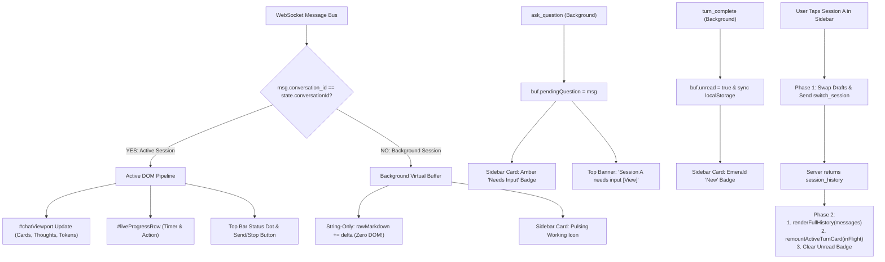

# Specification 02: Frontend Session State & Virtual Buffers

> **Project**: Antigravity Studio Standalone Android Application  
> **Release Target**: `v1.4.0` (Parallel Session Concurrency & Background Execution)  
> **Package ID**: `ai.agy.app` (10-character geometry)  
> **Target Architecture**: `arm64-v8a` | **SDK**: `35` (Android 15 / 16 / 17+)  
> **Branch**: `v1.4.0`  
> **Review Status**: **ARCHITECTURALLY AUDITED & HARDENED BY GEMINI 4 ARGON (`ARGON-V14-10`, `ARGON-V14-11`, `ARGON-V14-15`, `ARGON-V14-17`)**

---

## 1. Problem Statement & Root Cause

In [`agy-ui/index.html`](file:///data/data/com.termux/files/home/storage/shared/Documents/AgyStudio/agy-ui/index.html), client-side state is tied to a single active viewport:

```javascript
const state = {
  conversationId: null,
  activeTurns: new Map(), // Single global map of active DOM turn objects
  isRunning: false,
};
```

When a turn is running in Session A and the user switches to Session B:

1. **DOM Clobbering**:
   The handler for `case 'session_history':` clears `state.activeTurns` and populates `#chatViewport` with Session B's messages.
2. **Spurious Cross-Session Card Insertion**:
   Incoming tokens from Session A invoke `ensureAssistantTurnCard(turnId)`, which creates a card directly inside `#chatViewport` (rendering Session B!).
3. **Session Switch Race Condition (`ARGON-V14-10`)**:
   If an in-flight card is mounted immediately on session card tap, the arrival of `session_history` 25ms later calls `renderFullHistory()` and resets `#chatViewport.innerHTML = ''`, erasing the newly mounted card.
4. **Off-Screen CPU Waste (`ARGON-V14-17`)**:
   Calling Markdown parsing (`marked.parse`) on every background token drains mobile battery and causes stuttering in the actively viewed session.

---

## 2. Core Objectives

1. **Virtual Session State Store (`sessionBuffers`)**:
   Decouple turn processing and message buffering from the active DOM. Each conversation maintains an isolated memory buffer containing active turn data, streaming text, thought traces, tool states, and draft inputs.
2. **Deterministic 2-Phase Session Switch (`ARGON-V14-10`)**:
   - **Phase 1 (Immediate UI Focus)**: Update pointer, swap draft inputs, and request transcript over WebSocket.
   - **Phase 2 (History Render & Re-Mount)**: In `case 'session_history'`, render canonical history first, then re-mount any in-flight turn card from `sessionBuffers`.
3. **String-Only Off-Screen Buffering (`ARGON-V14-17`)**:
   When `msg.conversation_id !== state.conversationId`, perform $O(1)$ string concatenation only (`turnRecord.rawMarkdown += delta`). Perform zero DOM work or Markdown parsing until the session is mounted.
4. **Background Question Routing (`ARGON-V14-11`)**:
   Route interactive questions from background sessions to an amber **"Needs Input"** badge and non-intrusive top banner rather than popping modal dialogs over unrelated sessions.

---

## 3. Client State Architecture & Data Structures



### 3.1 `SessionVirtualState` Interface

```javascript
/**
 * @typedef {Object} TurnVirtualRecord
 * @property {string} turnId
 * @property {string} model
 * @property {string} rawMarkdown
 * @property {string} rawThoughts
 * @property {Array<Object>} toolCalls
 * @property {number} startTime
 * @property {boolean} finalized
 */

/**
 * @typedef {Object} SessionVirtualState
 * @property {string} conversationId
 * @property {Map<string, TurnVirtualRecord>} activeTurns
 * @property {boolean} isRunning
 * @property {boolean} waitingInput
 * @property {Object|null} pendingQuestion
 * @property {string} currentAction
 * @property {number} startTime
 * @property {boolean} unread
 * @property {string} draftPrompt
 * @property {Array<Object>} draftAttachments
 * @property {string} activeUserPrompt
 * @property {Array<Object>} activeUserAttachments
 */
```

---

## 4. Deterministic 2-Phase Session Switch Protocol

```javascript
// Phase 1: Invoked on session card tap in drawer
function initiateSessionSwitch(newCid) {
  if (newCid === state.conversationId) {
    closeOverlays();
    return;
  }

  // 1. Preserve current draft prompt & attachments
  if (state.conversationId) {
    const curBuf = getOrCreateSessionBuffer(state.conversationId);
    curBuf.draftPrompt = promptInput.value;
    curBuf.draftAttachments = [...state.pendingAttachments];
  }

  // 2. Set new active conversation
  state.conversationId = newCid;
  const targetBuf = getOrCreateSessionBuffer(newCid);

  // 3. Clear unread state
  if (targetBuf.unread) {
    targetBuf.unread = false;
    syncUnreadToStorage();
    renderSessionDrawerList();
  }

  // 4. Restore target session's draft prompt & attachments
  promptInput.value = targetBuf.draftPrompt || '';
  state.pendingAttachments = [...(targetBuf.draftAttachments || [])];
  renderAttachmentBar();
  autoResizePrompt();

  // 5. Update header and controls immediately for snappy feel
  syncHeaderAndControlsForSession(targetBuf);

  // 6. Request canonical transcript from server
  closeOverlays();
  sendWs({ type: 'switch_session', conversation_id: newCid });
}

// Phase 2: Invoked inside ws.onmessage for case 'session_history':
function handleSessionHistoryPayload(msg) {
  const cid = msg.conversation_id;
  if (cid !== state.conversationId) return; // Discard stale frames

  const targetBuf = getOrCreateSessionBuffer(cid);

  // 1. Render base transcript into #chatViewport
  renderFullHistory(msg.messages || []);

  // 2. Re-mount active in-flight turn if still running
  if (targetBuf.isRunning) {
    // If user's prompt is not yet committed in SQLite history, prepend it
    if (targetBuf.activeUserPrompt && !lastHistoryMatches(msg.messages, targetBuf.activeUserPrompt)) {
      appendUserBubble(targetBuf.activeUserPrompt, targetBuf.activeUserAttachments);
    }
    for (const [turnId, turnRecord] of targetBuf.activeTurns.entries()) {
      if (!turnRecord.finalized) {
        remountActiveTurnCard(turnRecord);
      }
    }
    scrollToBottom(true);
  }

  // 3. If there is a pending interactive question for this session, open modal
  if (targetBuf.pendingQuestion) {
    openInteractiveQuestionModal(targetBuf.pendingQuestion);
  }
}
```

---

## 5. In-Flight Turn Re-Mounting

```javascript
function remountActiveTurnCard(turnRecord) {
  const card = ensureAssistantTurnCard(
    turnRecord.turnId,
    turnRecord.model,
    state.conversationId
  );
  if (!card) return;

  if (turnRecord.rawThoughts) {
    card.rawThoughts = turnRecord.rawThoughts;
    if (card.thoughtContent) card.thoughtContent.textContent = turnRecord.rawThoughts;
    if (card.thoughtDetails) card.thoughtDetails.style.display = 'block';
  }

  if (Array.isArray(turnRecord.toolCalls)) {
    for (const tc of turnRecord.toolCalls) {
      upsertTurnToolDOM(card, tc);
    }
  }

  if (turnRecord.rawMarkdown) {
    card.rawMarkdown = turnRecord.rawMarkdown;
    card.mdBody.innerHTML = renderMarkdown(turnRecord.rawMarkdown);
  }
}
```
