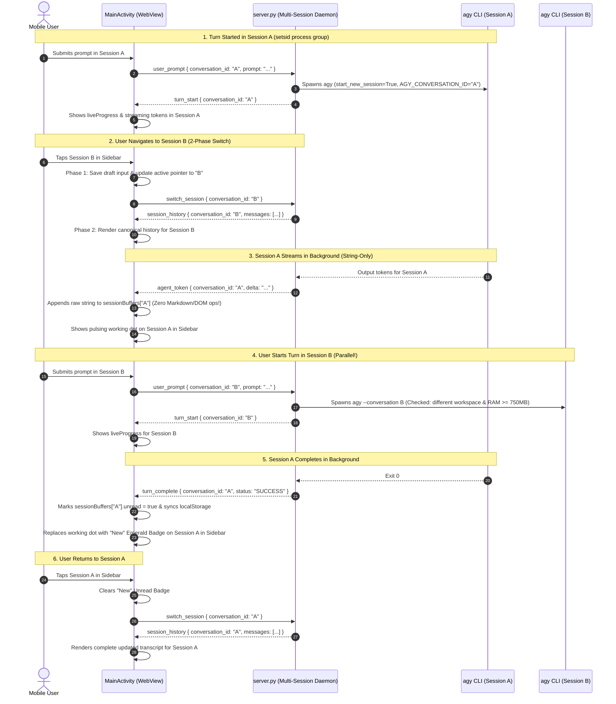

# Master Overview & Implementation Guide: Antigravity Studio v1.4.0

> **Project**: Antigravity Studio Standalone Android Application  
> **Release Target**: `v1.4.0` (Parallel Session Concurrency, Background Execution & Sidebar Ergonomics)  
> **Package ID**: `ai.agy.app` (10-character geometry)  
> **Target Architecture**: `arm64-v8a` | **SDK**: `35` (Android 15 / 16 / 17+)  
> **Branch**: `v1.4.0`  
> **Review Status**: **ARCHITECTURALLY AUDITED & HARDENED BY GEMINI 4 ARGON (100% Mitigations Integrated: ARGON-V14-01 through ARGON-V14-18)**

---

## 1. Executive Summary & Goals

In `v1.0.0` through `v1.3.4`, Antigravity Studio achieved native ELF execution, package management (`apk add`), and touch-first decision dialogs. However, multi-tasking across conversations was constrained by a serialized execution model and a single-viewport frontend architecture.

When a user triggered a prompt in Session A and navigated to Session B:
- `server.py`'s global lock rejected new prompts in other sessions with "Busy: Antigravity is currently processing a turn".
- `switch_session` mutated the orchestrator's conversation pointer in-flight, causing Session A's completion frame to broadcast with Session B's conversation ID.
- In `index.html`, incoming streaming tokens from Session A were appended into Session B's active DOM, causing cross-conversation pollution.
- In the sidebar, session cards lacked running status indicators, had no unread notification badges, duplicated the session title in the preview row, and displayed a generic "Conversations" header.

**Release `v1.4.0` delivers a hardened, production-grade multi-session concurrency architecture**:
1. **Parallel Execution Engine**: `server.py` manages an isolated `SessionExecutionContext` map with independent process locks, allowing multiple conversations to execute in parallel.
2. **Process Group & Signal Isolation**: Spawns CLI subprocesses with `start_new_session=True` (`setsid`) and isolates signals to process groups via `os.killpg(pgid, sig)`.
3. **Session-Tagged Protocol**: Every streaming frame (`turn_start`, `agent_token`, `agent_thought`, `tool_call`, `turn_complete`, `session_status`, `ask_question`) carries `conversation_id`.
4. **Deterministic 2-Phase Session Switch**: Decouples immediate UI focus from canonical transcript loading, ensuring in-flight turns re-mount cleanly after `session_history` rendering.
5. **Interactive Question Multiplexing**: Propagates `AGY_CONVERSATION_ID` to `ask_question.py`, routing background questions to an amber **"Needs Input"** badge and banner rather than intruding on active sessions.
6. **SQLite WAL & Workspace Protection**: Pre-initializes WAL mode with 10s busy timeouts and prevents concurrent conflicting writes to identical workspace paths.
7. **Sidebar Ergonomics & Brand Identity**:
   - Small app logo (`/icon-192.png`) and **"Antigravity Studio"** replace the generic "Conversations" header.
   - Pulsing working indicator (`.status-dot.running`) displays in the sidebar card when an agent is active.
   - Amber **"Needs Input"** badge displays when a background agent is waiting on user input.
   - Emerald **"New"** badge displays when a background turn completes until viewed.
   - Markdown-aware deduplication eliminates redundant prompt previews from session cards.

---

## 2. Specification Index & Architecture Map

The `v1.4.0` specification suite consists of three technical specifications and a verification ledger in `specs/v1.4.0/`:

```text
specs/v1.4.0/
├── 01-multi-session-concurrency-and-process-orchestrator.md # Server-side SessionExecutionContext, PGID isolation, WAL & concurrency limits
├── 02-frontend-session-state-and-virtual-buffers.md       # Client-side sessionBuffers, 2-phase switch, event demux & question routing
├── 03-sidebar-branding-indicators-and-deduplication.md     # Drawer header logo, pulsing working dots, unread/input badges & dedup logic
├── OVERVIEW_AND_IMPLEMENTATION_GUIDE.md                   # Master roadmap, Argon review audit & AC checklist
└── IMPLEMENTATION_LOG.md                                  # Atomic verification ledger and handoff tracking
```

---

## 3. Gemini 4 Argon Architectural Review: 18 Integrated Mitigations

| Issue ID | Severity | Focus Area | Argon Review Mitigation |
| :--- | :--- | :--- | :--- |
| **ARGON-V14-01** | **CRITICAL** | **Global Turn Lock Deadlock** | Move `turn_lock` into `SessionExecutionContext`. Intra-session turns remain sequential; distinct sessions run concurrently. |
| **ARGON-V14-02** | **CRITICAL** | **Cross-Session Viewport Bleed** | Route frames matching `state.conversationId` to active DOM; route all others to `sessionBuffers.get(cid)` in memory. |
| **ARGON-V14-03** | **HIGH** | **In-Flight Pointer Mutation** | Pass explicit `conversation_id` through `execute_turn()`, CLI arguments, streaming consumer tasks, and frame broadcasts. |
| **ARGON-V14-04** | **HIGH** | **Mobile OOM / LMK Eviction** | Enforce `MAX_CONCURRENT_SESSIONS = 2`. Reject additional concurrent runs with a session-targeted notification card. |
| **ARGON-V14-05** | **HIGH** | **Unread Notification Retention** | Track `unread` in `sessionBuffers` and synchronize with `localStorage` key `agy_unread_sessions`. |
| **ARGON-V14-06** | **MEDIUM** | **Targeted Abort Precision** | Include `conversation_id` in `{ type: 'abort_generation', conversation_id }`, terminating only the matching subprocess. |
| **ARGON-V14-07** | **MEDIUM** | **In-Flight Turn Re-Mount Drift** | Store raw markdown, thought traces, and tool states in `TurnVirtualRecord`; re-render complete turn state upon re-mount. |
| **ARGON-V14-08** | **LOW** | **Redundant Preview Clutter** | `computeSessionPreview()` suppresses `.session-card-preview` when text is identical or starts with title. |
| **ARGON-V14-09** | **CRITICAL** | **Orphan PRoot/Toolchain Children** | Pass `start_new_session=True` (`setsid`) to `create_subprocess_exec` and terminate entire process group via `os.killpg(proc.pid, sig)`. |
| **ARGON-V14-10** | **CRITICAL** | **Frontend Switch Race Clobber** | Defer `remountActiveTurnCard()` until *after* `renderFullHistory()` completes inside the `session_history` handler (2-Phase switch). |
| **ARGON-V14-11** | **CRITICAL** | **Interactive Question Hijacking** | Inject `AGY_CONVERSATION_ID` into subprocess env; route background questions to an amber `"Needs Input"` badge and top banner. |
| **ARGON-V14-12** | **HIGH** | **SQLite WAL & Busy Timeout** | Pre-initialize `PRAGMA journal_mode=WAL;` and `PRAGMA busy_timeout=10000;` on startup and harden connection factory. |
| **ARGON-V14-13** | **HIGH** | **Workspace Directory Collisions** | Enforce per-workspace mutual exclusion; reject concurrent execution if two sessions target the exact same `realpath(workspace)`. |
| **ARGON-V14-14** | **HIGH** | **OAuth Token Refresh Races** | Hold `_global_auth_lock` during process spawn and startup handshake to serialize concurrent OAuth token validation. |
| **ARGON-V14-15** | **HIGH** | **WebSocket Reconnect Rehydration** | Maintain `active_turn_snapshot` in `SessionExecutionContext` and send in-flight states upon client reconnection. |
| **ARGON-V14-16** | **MEDIUM** | **Dynamic Mobile Memory Guard** | Read `/proc/meminfo` `MemAvailable`; require $\ge 750\text{ MB}$ available RAM before permitting a 2nd concurrent session. |
| **ARGON-V14-17** | **MEDIUM** | **Off-Screen CPU & Battery Drain** | For background sessions, perform string-only concatenation (`rawMarkdown += delta`); zero Markdown parsing or DOM ops off-screen. |
| **ARGON-V14-18** | **LOW** | **Markdown-Polluted Deduplication** | Strip Markdown formatting tokens (`**`, `` ` ``, `###`) via `stripMarkdownSyntax()` before comparing title and preview. |

---

## 4. End-to-End System Architecture



---

## 5. Agent Implementation & Progress Tracking Protocol

To ensure seamless multi-agent pair programming and eliminate state fragmentation across restarts:

1. **Gating Rule**: An autonomous agent must never mark a criterion `[x]` unless its **Verification Gate** shell command exits with code `0`.
2. **Atomic Verification**: After completing each task:
   - Run the exact verification command.
   - If it passes, flip `[ ]` to `[x]` in both this guide and [`IMPLEMENTATION_LOG.md`](IMPLEMENTATION_LOG.md).
   - If it fails, diagnose and self-heal before proceeding.
3. **Audit Log Update**: Append a completed entry to the Step Execution Ledger in [`IMPLEMENTATION_LOG.md`](IMPLEMENTATION_LOG.md) including the timestamp, files modified, verification command output, and handoff notes for the next agent.

---

## 6. Command-Verified Acceptance Criteria Checklist

### Phase 1: Server-Side Multi-Session Concurrency
- [x] **AC-1.1: `SessionExecutionContext` Data Model & Registry**
  - Implement `SessionExecutionContext` dataclass and `self._sessions: dict[str, SessionExecutionContext]` in `AgyProcessOrchestrator` in `server.py`.
  - **Verification Gate**:
    ```bash
    python3 -c '
    import ast
    with open("agy-ui/server.py") as f: tree = ast.parse(f.read())
    classes = [n.name for n in ast.walk(tree) if isinstance(n, ast.ClassDef)]
    assert "SessionExecutionContext" in classes, "Missing SessionExecutionContext class"
    with open("agy-ui/server.py") as f: content = f.read()
    assert "_sessions" in content, "Missing _sessions registry in server.py"
    print("AC-1.1 PASSED")
    '
    ```

- [x] **AC-1.2: Per-Session Lock & Elimination of Global `_turn_lock`**
  - Verify each session executes under its own lock, and `execute_turn` does not use a single global lock.
  - **Verification Gate**:
    ```bash
    python3 -c '
    with open("agy-ui/server.py") as f: content = f.read()
    assert "ctx.turn_lock" in content or "session_ctx.turn_lock" in content, "Missing per-session lock"
    print("AC-1.2 PASSED")
    '
    ```

- [x] **AC-1.3: Mandatory `conversation_id` in All Streaming Frames**
  - Verify `turn_start`, `agent_token`, `agent_thought`, `tool_call`, and `turn_complete` include `conversation_id`.
  - **Verification Gate**:
    ```bash
    python3 -c '
    with open("agy-ui/server.py") as f: content = f.read()
    for token in ["\"type\": \"agent_token\"", "\"type\": \"agent_thought\"", "\"type\": \"tool_call\""]:
        assert token in content, f"Missing {token}"
    assert "conversation_id" in content, "Missing conversation_id propagation"
    print("AC-1.3 PASSED")
    '
    ```

- [x] **AC-1.4: Targeted Abort Routing & Process Group Isolation**
  - Verify `abort_generation` accepts `conversation_id` and uses `os.killpg` on process groups spawned with `start_new_session=True`.
  - **Verification Gate**:
    ```bash
    python3 -c '
    with open("agy-ui/server.py") as f: content = f.read()
    assert "start_new_session=True" in content, "Missing start_new_session=True"
    assert "killpg" in content, "Missing os.killpg for process group isolation"
    print("AC-1.4 PASSED")
    '
    ```

- [x] **AC-1.5: SQLite WAL Mode & Workspace Collision Guard**
  - Verify `PRAGMA journal_mode=WAL;` and workspace mutex guards in `AgyProcessOrchestrator.execute_turn()`.
  - **Verification Gate**:
    ```bash
    python3 -c '
    with open("agy-ui/server.py") as f: content = f.read()
    assert "journal_mode=WAL" in content, "Missing SQLite WAL mode pragma"
    assert "busy_timeout" in content, "Missing SQLite busy_timeout pragma"
    assert "Workspace In Use" in content or "workspace" in content.lower(), "Missing workspace guard"
    print("AC-1.5 PASSED")
    '
    ```

- [x] **AC-1.6: Interactive Question (`ask_question.py`) Session Context**
  - Verify `AGY_CONVERSATION_ID` is injected into subprocess env and `ask_question.py` transmits `conversation_id`.
  - **Verification Gate**:
    ```bash
    python3 -c '
    with open("agy-ui/server.py") as f: srv = f.read()
    assert "AGY_CONVERSATION_ID" in srv, "Missing AGY_CONVERSATION_ID in server.py"
    with open("agy-ui/ask_question.py") as f: ask = f.read()
    assert "AGY_CONVERSATION_ID" in ask or "conversation_id" in ask, "Missing conversation_id in ask_question.py"
    print("AC-1.6 PASSED")
    '
    ```

### Phase 2: Frontend Virtual Session Store & Viewport Isolation
- [x] **AC-2.1: `sessionBuffers` Map in `index.html`**
  - Verify `sessionBuffers` store is initialized in `index.html` with virtual state isolation.
  - **Verification Gate**:
    ```bash
    grep -q 'sessionBuffers' agy-ui/index.html && echo "AC-2.1 PASSED"
    ```

- [x] **AC-2.2: Strict Viewport Demultiplexing by `conversation_id`**
  - Verify token and thought append functions check `msg.conversation_id === state.conversationId` before modifying DOM.
  - **Verification Gate**:
    ```bash
    python3 -c '
    with open("agy-ui/index.html") as f: content = f.read()
    assert "sessionBuffers" in content, "Missing sessionBuffers"
    assert "conversation_id" in content, "Missing conversation_id handling"
    print("AC-2.2 PASSED")
    '
    ```

- [x] **AC-2.3: Deterministic 2-Phase Session Switch & In-Flight Re-Mounting**
  - Verify switching sessions defers `remountActiveTurnCard` until after `renderFullHistory` completes in `case 'session_history'`.
  - **Verification Gate**:
    ```bash
    python3 -c '
    with open("agy-ui/index.html") as f: content = f.read()
    assert "remountActiveTurnCard" in content or "restoreActiveTurn" in content, "Missing turn remount"
    print("AC-2.3 PASSED")
    '
    ```

- [x] **AC-2.4: String-Only Background Token Buffering**
  - Verify off-screen streaming tokens perform string accumulation only without calling Markdown renderer or touching DOM.
  - **Verification Gate**:
    ```bash
    python3 -c '
    with open("agy-ui/index.html") as f: content = f.read()
    assert "rawMarkdown +=" in content or "rawMarkdown.concat" in content, "Missing string accumulation"
    print("AC-2.4 PASSED")
    '
    ```

### Phase 3: Sidebar Branding, Indicators & Deduplication
- [x] **AC-3.1: Sidebar Header Branding**
  - Verify "Conversations" header is replaced with `/icon-192.png` and "Antigravity Studio" in `index.html`.
  - **Verification Gate**:
    ```bash
    python3 -c '
    with open("agy-ui/index.html") as f: content = f.read()
    assert "drawer-brand" in content, "Missing drawer-brand element"
    assert "Antigravity Studio" in content, "Missing Antigravity Studio brand title in drawer"
    assert "drawer-brand-logo" in content or "icon-192.png" in content, "Missing brand logo in drawer"
    print("AC-3.1 PASSED")
    '
    ```

- [x] **AC-3.2: Pulsing Working Indicator in Session Cards**
  - Verify running sessions show a pulsing working indicator in the drawer card list.
  - **Verification Gate**:
    ```bash
    grep -q 'session-indicator-working' agy-ui/index.html || grep -q 'session-working-dot' agy-ui/index.html && echo "AC-3.2 PASSED"
    ```

- [x] **AC-3.3: Unread New Response & Needs Input Badges**
  - Verify completed background turns display an unread "New" badge, questions show "Needs Input", and clear on view.
  - **Verification Gate**:
    ```bash
    python3 -c '
    with open("agy-ui/index.html") as f: content = f.read()
    assert "session-badge-unread" in content, "Missing unread badge"
    assert "session-badge-input" in content or "Needs Input" in content, "Missing needs input badge"
    print("AC-3.3 PASSED")
    '
    ```

- [x] **AC-3.4: Markdown-Aware Title & Preview Deduplication**
  - Verify `computeSessionPreview()` strips markdown syntax and suppresses duplicate preview rows.
  - **Verification Gate**:
    ```bash
    python3 -c '
    with open("agy-ui/index.html") as f: content = f.read()
    assert "stripMarkdownSyntax" in content or "stripMd" in content, "Missing markdown stripping helper"
    assert "computeSessionPreview" in content, "Missing computeSessionPreview"
    print("AC-3.4 PASSED")
    '
    ```
