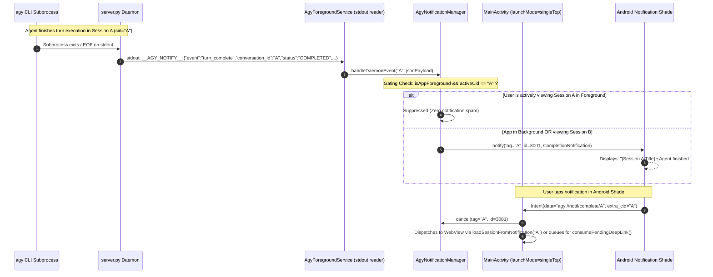

# Specification 01: Session Completion Notifications & Deep-Link Navigation

> **Project**: Antigravity Studio Standalone Android Application  
> **Release Target**: `v1.5.0` (Native Notification Subsystem & Live Progress Tracking)  
> **Package ID**: `ai.agy.app` (10-character geometry)  
> **Target Architecture**: `arm64-v8a` | **SDK**: `35` (Android 10+ / API 29 through Android 15+)  
> **Branch**: `v1.5.0`  
> **Review Status**: **ARCHITECTURALLY AUDITED & HARDENED BY GEMINI 4 ARGON (`ARGON-V15-01`, `ARGON-V15-05`, `ARGON-V15-07`, `ARGON-V15-09`)**

---

## 1. Problem Statement & Operational Context

In `v1.4.0`, Antigravity Studio introduced parallel multi-session execution (`SessionExecutionContext` with independent process locks, process-group isolation, and virtual frontend session buffers). While users can run parallel agent turns across conversations, the user experience suffers from critical notification visibility and lifecycle gaps:

1. **Zero Awareness When App is Backgrounded**:
   When a user initiates an agent turn in Session A and switches to another Android application (e.g., Slack, Chrome, WhatsApp) or turns off the screen, the agent continues running via `AgyForegroundService`. However, once the agent completes the turn, the app provides no system notification.
2. **Missing Inactive Session Awareness**:
   When a user is actively interacting with Session B in the foreground, and an agent finishes in background Session A, the user receives no notification that Session A has finished.
3. **Disruptive Spam if Foreground Session is Notified**:
   If an agent finishes while the user is actively viewing that exact session in the foreground, posting a system notification is disruptive, noisy, and redundant.
4. **WebView Suspension & Cold-Start Eviction (`ARGON-V15-01`, `ARGON-V15-07`)**:
   If notification dispatch relies solely on WebView JavaScript (`@JavascriptInterface`), background Chromium process freezing or OS activity eviction will drop completion alerts entirely. Furthermore, tapping a notification after `MainActivity` has been evicted drops the deep link if JavaScript evaluates before the WebView finishes loading the page.

---

## 2. Core Objectives

1. **Intelligent Completion Gating**:
   A completion notification MUST be dispatched when an agent turn finishes IF AND ONLY IF the session is **not currently active and loaded in the foreground UI**:
   - App in background $\implies$ Notification dispatched for **any** completed session.
   - App in foreground, but viewing a different session (or settings/drawer) $\implies$ Notification dispatched for the completed session.
   - App in foreground and user is actively viewing that specific completed session $\implies$ Notification **suppressed** (zero notification clutter).
2. **Multi-Session Isolation (One Notification Per Session)**:
   Parallel sessions must never overwrite or collide with each other's completion notifications. Each session maintains its own tagged notification in the Android notification shade (`tag = conversation_id, id = NOTIF_ID_COMPLETION`).
3. **Daemon-Driven Telemetry Bridge (`ARGON-V15-01`)**:
   `server.py` emits structured `__AGY_NOTIFY__:` JSON records to stdout. `AgyForegroundService` intercepts these records in its stdout reader loop and delivers completions directly to `AgyNotificationManager`, guaranteeing notification delivery even if `MainActivity` or WebView is suspended or destroyed.
4. **Rich & Sanitized Notification Content (`ARGON-V15-09`)**:
   - **Small Icon**: Compliant monochrome white vector `@drawable/ic_stat_agy` (avoids adaptive icon crash/white-square bug).
   - **Title**: Session Name / Conversation Title (e.g., `"Refactor Auth Service"` or fallback `"Session 8f1b2c"`).
   - **Content Heading**: `"Agent finished"` (or `"Agent encountered an error"` on failure).
   - **Body Preview**: First clean snippet of the agent's response, sanitized via a pre-bounded (2,000 char) regex filter that replaces code blocks with `[code]` placeholders and eliminates Markdown syntax.
5. **Cold-Start & Warm-Start Deep-Link Queue (`ARGON-V15-07`)**:
   `MainActivity` uses `android:launchMode="singleTop"` and maintains `pendingDeepLinkConversationId`. Tapping a notification brings Antigravity Studio to the foreground, switches the UI directly to that session, and clears **only** that session's completion notification.
6. **Suppression on User Abort (`ARGON-V15-05`)**:
   If a turn terminates because the user tapped "Stop" (or `status == "INTERRUPTED"`), completion notifications are strictly suppressed.
7. **Stale Completion Auto-Clear (`ARGON-V15-07`)**:
   When the user navigates to Session A via the in-app drawer, any existing completion notification for Session A is automatically cleared from the notification tray.

---

## 3. Architecture & Data Flow



---

## 4. Technical Specifications

### 4.1 Notification Channel Configuration

The completion notification channel is created during application startup in `AgyNotificationManager`:

```kotlin
const val CHANNEL_ID_COMPLETION = "agy_completion_channel"
const val NOTIF_ID_COMPLETION = 3001

fun createCompletionChannel(context: Context) {
    if (Build.VERSION.SDK_INT >= Build.VERSION_CODES.O) {
        val channel = NotificationChannel(
            CHANNEL_ID_COMPLETION,
            "Agent Turn Completion",
            NotificationManager.IMPORTANCE_DEFAULT // Generates sound & heads-up notification
        ).apply {
            description = "Alerts when an AI agent finishes a turn in the background or an inactive session"
            enableLights(true)
            lightColor = Color.rgb(0, 163, 255)
            enableVibration(true)
            setShowBadge(true)
        }
        val nm = context.getSystemService(NotificationManager::class.java)
        nm.createNotificationChannel(channel)
    }
}
```

### 4.2 Foreground & Active Viewport State Tracker

```kotlin
object AgyNotificationManager {
    @Volatile var isAppForeground: Boolean = false
    @Volatile var activeConversationId: String? = null
    @Volatile var pendingDeepLinkConversationId: String? = null

    fun onActiveSessionChanged(context: Context, conversationId: String?) {
        val normalized = conversationId?.trim()?.ifEmpty { null }
        activeConversationId = normalized
        if (normalized != null && isAppForeground) {
            // ARGON-V15-07: Automatically clear stale completion notification when user views session
            clearCompletionNotification(context, normalized)
        }
    }

    fun shouldSendCompletionNotification(conversationId: String): Boolean {
        return !(isAppForeground && activeConversationId == conversationId)
    }
}
```

### 4.3 Notification Content Builder & Session Tagging

Each session's notification is uniquely isolated using Android's native `notify(tag, id, notification)` API:
- `tag`: `conversationId`
- `id`: `NOTIF_ID_COMPLETION` (`3001`)
- `data`: Canonical URI `Uri.parse("agy://notif/complete/${Uri.encode(conversationId)}")` to prevent `PendingIntent` caching collisions (`ARGON-V15-08`).

```kotlin
fun postCompletionNotification(
    context: Context,
    conversationId: String,
    sessionTitle: String,
    rawPreview: String,
    turnStatus: String = "COMPLETED"
) {
    val wasAbortedByUser: Boolean
    synchronized(stateLock) {
        val state = sessionStates[conversationId]
        wasAbortedByUser = state?.abortedByUser == true
        state?.isRunning = false
        state?.isPinned = false
        state?.abortedByUser = false
        state?.lastSignature = ""
        val nm = context.getSystemService(NotificationManager::class.java)
        nm?.cancel(conversationId, NOTIF_ID_LIVE_PROGRESS)
    }

    // ARGON-V15-05: Suppress completion notification if aborted by user or interrupted
    if (wasAbortedByUser || turnStatus.equals("INTERRUPTED", ignoreCase = true)) {
        return
    }

    if (!shouldSendCompletionNotification(conversationId) || !hasNotificationPermission(context)) {
        return
    }

    val nm = context.getSystemService(NotificationManager::class.java) ?: return
    val cleanPreview = sanitizeMarkdownPreview(rawPreview)
    val displayTitle = sessionTitle.trim().ifEmpty { "Session ${conversationId.take(6)}" }
    val statusHeading = if (turnStatus.equals("ERROR", ignoreCase = true)) {
        "Agent encountered an error"
    } else {
        "Agent finished"
    }

    val clickIntent = Intent(context, MainActivity::class.java).apply {
        action = ACTION_OPEN_SESSION
        data = Uri.parse("agy://notif/complete/${Uri.encode(conversationId)}")
        flags = Intent.FLAG_ACTIVITY_SINGLE_TOP or Intent.FLAG_ACTIVITY_CLEAR_TOP
        putExtra(EXTRA_CONVERSATION_ID, conversationId)
    }
    val contentPendingIntent = PendingIntent.getActivity(
        context,
        0,
        clickIntent,
        PendingIntent.FLAG_IMMUTABLE or PendingIntent.FLAG_UPDATE_CURRENT
    )

    val bodyText = cleanPreview.ifEmpty {
        if (turnStatus.equals("ERROR", ignoreCase = true)) "Turn terminated with an error."
        else "Turn execution completed."
    }

    val notification = NotificationCompat.Builder(context, CHANNEL_ID_COMPLETION)
        .setSmallIcon(R.drawable.ic_stat_agy) // ARGON-V15-09: Compliant monochrome vector
        .setContentTitle(displayTitle)
        .setContentText("$statusHeading • $bodyText")
        .setStyle(
            NotificationCompat.BigTextStyle()
                .setBigContentTitle(displayTitle)
                .setSummaryText(statusHeading)
                .bigText(bodyText)
        )
        .setContentIntent(contentPendingIntent)
        .setAutoCancel(true)
        .setOnlyAlertOnce(false)
        .setPriority(NotificationCompat.PRIORITY_DEFAULT)
        .setCategory(NotificationCompat.CATEGORY_MESSAGE)
        .build()

    try {
        nm.notify(conversationId, NOTIF_ID_COMPLETION, notification)
    } catch (e: SecurityException) {
        Log.w(TAG, "POST_NOTIFICATIONS not granted: ${e.message}")
    }
}
```

### 4.4 Deep-Link Handling & Queue in `MainActivity` (`ARGON-V15-07`)

```kotlin
private fun captureDeepLinkIntent(intent: Intent?) {
    val cid = intent?.getStringExtra(AgyNotificationManager.EXTRA_CONVERSATION_ID)
        ?.trim()
        ?.takeIf { it.isNotEmpty() }
        ?: return
    AgyNotificationManager.clearCompletionNotification(this, cid)
    AgyNotificationManager.pendingDeepLinkConversationId = cid
    intent.removeExtra(AgyNotificationManager.EXTRA_CONVERSATION_ID)
}

private fun dispatchPendingDeepLinkToWebView() {
    val cid = AgyNotificationManager.pendingDeepLinkConversationId ?: return
    val quotedCid = org.json.JSONObject.quote(cid)
    runOnUiThread {
        webView.evaluateJavascript(
            "(function(){ if (window.loadSessionFromNotification) { window.loadSessionFromNotification($quotedCid); return true; } return false; })();"
        ) { result ->
            if (result?.trim()?.equals("true", ignoreCase = true) == true) {
                if (AgyNotificationManager.pendingDeepLinkConversationId == cid) {
                    AgyNotificationManager.pendingDeepLinkConversationId = null
                }
            }
        }
    }
}
```

### 4.5 Pre-Bounded, ReDoS-Safe Markdown Preview Sanitization (`ARGON-V15-09`)

```kotlin
fun sanitizeMarkdownPreview(markdown: String): String {
    if (markdown.isBlank()) return ""
    // 1. Pre-bound input to 2,000 chars to guarantee O(1) regex execution time
    var text = markdown.take(2000).trim()
    // 2. Replace closed and unclosed fenced code blocks with concise placeholder
    text = text.replace(Regex("```[\\s\\S]*?```"), " [code] ")
    text = text.replace(Regex("```[\\s\\S]*$"), " [code] ")
    // 3. Strip Markdown links [label](url) -> label, images  -> ""
    text = text.replace(Regex("!\\[[^\\]]*]\\([^)]*\\)"), "")
    text = text.replace(Regex("\\[([^\\]]+)]\\([^)]*\\)"), "$1")
    // 4. Strip inline code, headers, blockquotes, and emphasis markers
    text = text.replace(Regex("`([^`]+)`"), "$1")
    text = text.replace(Regex("(?m)^#{1,6}\\s+"), "")
    text = text.replace(Regex("(?m)^>\\s?"), "")
    text = text.replace(Regex("(\\*\\*|__|\\*|_|~~)"), "")
    // 5. Collapse whitespace
    text = text.replace(Regex("\\s+"), " ").trim()
    // 6. Clean word-boundary truncation at 180 chars
    if (text.length > 180) {
        val sub = text.substring(0, 180)
        val lastSpace = sub.lastIndexOf(' ')
        text = if (lastSpace > 130) "${sub.substring(0, lastSpace)}…" else "$sub…"
    }
    return text
}
```

---

## 5. Verification & Acceptance Criteria

- **AC-1.1**: Background completion triggers system notification via daemon stdout bridge (`ARGON-V15-01`).
- **AC-1.2**: Inactive session completion while app is foregrounded triggers system notification.
- **AC-1.3**: Active session completion while viewing in foreground strictly suppresses system notification.
- **AC-1.4**: Multiple parallel sessions maintain distinct notifications in tray (`tag = cid`).
- **AC-1.5**: Tapping notification opens app, navigates to target session via warm/cold-start queue, and clears ONLY that session's notification (`ARGON-V15-07`).
- **AC-1.6**: User-initiated Stop or INTERRUPTED turn suppresses completion alert (`ARGON-V15-05`).
- **AC-1.7**: Navigating to session via drawer clears any existing completion notification (`ARGON-V15-07`).
- **AC-1.8**: Small icon renders cleanly with monochrome vector drawable on Android 10–15 (`ARGON-V15-09`).
