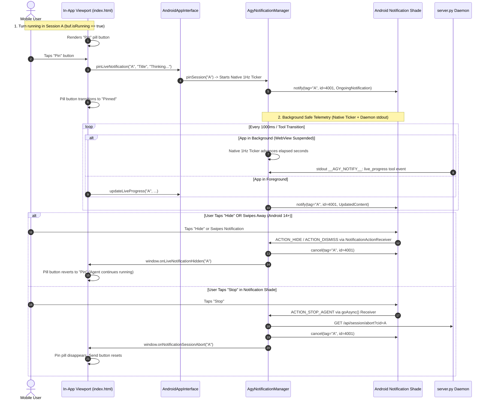

# Specification 02: Live Progress Notification & In-Session Pill Button

> **Project**: Antigravity Studio Standalone Android Application  
> **Release Target**: `v1.5.0` (Native Notification Subsystem & Live Progress Tracking)  
> **Package ID**: `ai.agy.app` (10-character geometry)  
> **Target Architecture**: `arm64-v8a` | **SDK**: `35` (Android 10+ / API 29 through Android 15+)  
> **Branch**: `v1.5.0`  
> **Review Status**: **ARCHITECTURALLY AUDITED & HARDENED BY GEMINI 4 ARGON (`ARGON-V15-01`, `ARGON-V15-02`, `ARGON-V15-03`, `ARGON-V15-04`, `ARGON-V15-06`, `ARGON-V15-10`)**

---

## 1. Problem Statement & Operational Context

When an agent executes an extensive turn involving deep multi-step reasoning, builds, or file operations, the user frequently switches to other apps or sessions. In previous releases, live progress was confined entirely to an in-DOM pill inside the active chat viewport (`#liveProgressRow`).

Adversarial audit by Gemini 4 Argon identified critical failure modes in the initial live notification specification:
1. **Background WebView Timer Freezing (`ARGON-V15-01`)**:
   When the user leaves the app, Android throttles JavaScript timers (`setInterval`). Without a native background ticker, the live notification's elapsed time freezes on screen.
2. **Zombie Live Notification Race (`ARGON-V15-02`)**:
   `updateLiveProgress` runs asynchronously on the `JavaBridge` background thread, while turn completion and "Stop" actions run on the main or I/O thread. If an in-flight progress update finishes constructing a `Notification` object right after `nm.cancel()` has executed, the live notification is re-posted and remains stuck on screen forever.
3. **Android 14+ (API 34/35) Swipe-Dismissal Desync (`ARGON-V15-04`)**:
   On Android 14 and 15, ongoing notifications are swipeable by users. Without `.setDeleteIntent()`, swiping away a live notification leaves `isPinned` true, causing the notification to zombie-respawn within 1 second.
4. **BroadcastReceiver Death During Background Abort (`ARGON-V15-06`)**:
   Tapping "Stop" executes inside `NotificationActionReceiver.onReceive()`. Without `val pendingResult = goAsync()`, Android's process freezer can terminate the receiver before the local HTTP abort request reaches `server.py`.
5. **False Pin State Under Missing Permission (`ARGON-V15-10`)**:
   On Android 13+, tapping "Pin" without granted `POST_NOTIFICATIONS` permission must not highlight the in-app button as pinned; instead, it must trigger the runtime permission prompt.

---

## 2. Core Objectives

1. **In-Session Pin Pill Button**:
   - Render a dedicated pill button inside the session view.
   - **Strict Visibility Rule**: Displayed **ONLY** when an agent is currently running in that session (`buf.isRunning == true`). When the agent completes, errors, or is aborted, the button immediately disappears.
   - **Interaction States**:
     - *Unpinned State*: Displays "Pin" with pin icon; tapping it verifies notification permissions, pins the live notification, and transitions to the *Pinned* state.
     - *Pinned State*: Displays "Pinned" with active cyan highlighting; tapping it unpins (cancels) the notification.
2. **Live Telemetry & Native 1Hz Ticker (`ARGON-V15-01`)**:
   - Native Kotlin coroutine ticker runs in `AgyNotificationManager` while any session is pinned, advancing the elapsed duration in integer seconds (`14s`, `1m 24s`) without requiring the WebView to stay awake.
   - Telemetry includes Status, Elapsed Time, Last Tool Call, and Total Tool Calls.
3. **Anti-Zombie Synchronization (`ARGON-V15-02`)**:
   - `dispatchLiveNotificationLocked` checks that `state.isRunning && state.isPinned` holds under a synchronized lock at the exact moment of `nm.notify()`.
4. **State-Aware Boundary & Trailing-Edge Throttling (`ARGON-V15-03`)**:
   - State signature changes (tool call, status) update immediately ($250\text{ ms}$ minimum floor).
   - Elapsed timer updates are throttled to $1000\text{ ms}$ to eliminate notification shade jitter and CPU drain.
5. **Interactive Notification Action Buttons**:
   - **"Hide" Action**: Clears the live notification from the system shade without interrupting the agent. Handled via `ACTION_HIDE_LIVE_NOTIFICATION` and Android 14+ `ACTION_DISMISS_LIVE_NOTIFICATION` (`ARGON-V15-04`). Reverts in-app button to "Pin".
   - **"Stop" Action**: Immediately aborts the agent execution via `goAsync()` HTTP GET `/api/session/abort?cid=...` (`ARGON-V15-06`, `ARGON-V15-08`) and dismisses the notification.
6. **Multi-Session Isolation**:
   - Multiple parallel running sessions can each have their own pinned live notification (`tag = conversation_id, id = NOTIF_ID_LIVE_PROGRESS`).

---

## 3. Architecture & Interaction Flow



---

## 4. Technical Specifications

### 4.1 In-App UI Pin Button & State Binding (`index.html`)

#### HTML Layout Inside `#liveProgressRow`
```html
<div class="live-progress-row" id="liveProgressRow" style="display: none;">
  <div class="live-progress-pill">
    <div class="live-progress-icon-wrap">
      <div class="live-spinner"></div>
    </div>
    <div class="live-progress-body">
      <span class="live-progress-action">Thinking...</span>
      <span class="live-progress-timer">0.0s</span>
    </div>
    <button class="live-pin-btn" id="btnPinLiveNotif" title="Pin live progress to notifications" aria-label="Pin live progress notification">
      <svg class="fa-icon pin-icon" viewBox="0 0 384 512" aria-hidden="true" focusable="false">
        <path fill="currentColor" d="M32 32C32 14.3 46.3 0 64 0L320 0c17.7 0 32 14.3 32 32s-14.3 32-32 32l-11 0 0 142.1c28.2 40 43 87.7 43 136.6 0 10.1-4.7 19.6-12.8 25.6s-18.4 7.9-28.2 5.1L224 340.8l0 107.2c0 17.7-14.3 32-32 32s-32-14.3-32-32l0-107.2L63 371.4c-9.8 2.8-20.1 .9-28.2-5.1S22 350.8 22 340.7c0-48.9 14.8-96.6 43-136.6L65 64 54 64C36.3 64 22 49.7 22 32z"/>
      </svg>
      <span class="pin-text">Pin</span>
    </button>
  </div>
</div>
```

#### JavaScript Interaction & Android 13+ Permission Gating (`ARGON-V15-10`)
```javascript
function updatePinButtonState(isPinned) {
  const btn = document.getElementById('btnPinLiveNotif');
  if (!btn) return;
  const textSpan = btn.querySelector('.pin-text');
  if (isPinned) {
    btn.classList.add('pinned');
    if (textSpan) textSpan.textContent = 'Pinned';
    btn.title = 'Unpin live progress notification';
  } else {
    btn.classList.remove('pinned');
    if (textSpan) textSpan.textContent = 'Pin';
    btn.title = 'Pin live progress to notifications';
  }
}

// Click handler
btnPinLiveNotif.addEventListener('click', (e) => {
  e.stopPropagation();
  const cid = state.conversationId;
  const buf = cid ? state.sessionBuffers.get(cid) : null;
  if (!cid || !buf || !buf.isRunning || !window.AndroidApp) return;

  if (buf.isPinned) {
    window.AndroidApp.unpinLiveNotification(cid);
    buf.isPinned = false;
    updatePinButtonState(false);
  } else {
    const title = getSessionTitle(cid) || 'Active Session';
    const status = buf.lastStatusText || 'Thinking...';
    // ARGON-V15-10: pinLiveNotification returns false if permission not granted
    const pinnedOk = window.AndroidApp.pinLiveNotification(cid, title, status);
    buf.isPinned = Boolean(pinnedOk);
    updatePinButtonState(buf.isPinned);
  }
});
```

### 4.2 Native Notification Builder with Swipe-Dismissal (`ARGON-V15-04`)

```kotlin
val pendingFlags = PendingIntent.FLAG_IMMUTABLE or PendingIntent.FLAG_UPDATE_CURRENT

val openIntent = Intent(context, MainActivity::class.java).apply {
    action = ACTION_OPEN_SESSION
    data = Uri.parse("agy://notif/open/${Uri.encode(cid)}")
    flags = Intent.FLAG_ACTIVITY_SINGLE_TOP or Intent.FLAG_ACTIVITY_CLEAR_TOP
    putExtra(EXTRA_CONVERSATION_ID, cid)
}
val openPendingIntent = PendingIntent.getActivity(context, 0, openIntent, pendingFlags)

val hideIntent = Intent(context, NotificationActionReceiver::class.java).apply {
    action = ACTION_HIDE_LIVE_NOTIFICATION
    data = Uri.parse("agy://notif/hide/${Uri.encode(cid)}")
    putExtra(EXTRA_CONVERSATION_ID, cid)
}
val hidePendingIntent = PendingIntent.getBroadcast(context, 0, hideIntent, pendingFlags)

// ARGON-V15-04: Android 14+ swipe dismissal sync
val dismissIntent = Intent(context, NotificationActionReceiver::class.java).apply {
    action = ACTION_DISMISS_LIVE_NOTIFICATION
    data = Uri.parse("agy://notif/dismiss/${Uri.encode(cid)}")
    putExtra(EXTRA_CONVERSATION_ID, cid)
}
val dismissPendingIntent = PendingIntent.getBroadcast(context, 0, dismissIntent, pendingFlags)

val stopIntent = Intent(context, NotificationActionReceiver::class.java).apply {
    action = ACTION_STOP_AGENT
    data = Uri.parse("agy://notif/stop/${Uri.encode(cid)}")
    putExtra(EXTRA_CONVERSATION_ID, cid)
}
val stopPendingIntent = PendingIntent.getBroadcast(context, 0, stopIntent, pendingFlags)

val notification = NotificationCompat.Builder(context, CHANNEL_ID_PROGRESS)
    .setSmallIcon(R.drawable.ic_stat_agy) // ARGON-V15-09: Monochrome white vector
    .setContentTitle("$displayTitle • Running")
    .setContentText(contentLine)
    .setStyle(
        NotificationCompat.BigTextStyle()
            .setBigContentTitle("$displayTitle • Live Progress")
            .setSummaryText(formattedTime)
            .bigText(bigTextContent)
    )
    .setContentIntent(openPendingIntent)
    .setDeleteIntent(dismissPendingIntent)
    .addAction(
        NotificationCompat.Action.Builder(
            android.R.drawable.ic_menu_close_clear_cancel,
            "Hide",
            hidePendingIntent
        ).build()
    )
    .addAction(
        NotificationCompat.Action.Builder(
            android.R.drawable.ic_delete,
            "Stop",
            stopPendingIntent
        ).build()
    )
    .setOngoing(true)
    .setOnlyAlertOnce(true)
    .setPriority(NotificationCompat.PRIORITY_LOW)
    .setCategory(NotificationCompat.CATEGORY_PROGRESS)
    .build()
```

### 4.3 Native 1Hz Ticker Implementation (`ARGON-V15-01`)

```kotlin
private fun ensureTickerRunning(appContext: Context) {
    if (tickerJob?.isActive == true) return
    tickerJob = managerScope.launch {
        while (isActive) {
            delay(1000L)
            var anyPinned = false
            synchronized(stateLock) {
                val nowRealtime = SystemClock.elapsedRealtime()
                for (state in sessionStates.values) {
                    if (state.isRunning && state.isPinned) {
                        anyPinned = true
                        state.elapsedSeconds =
                            ((nowRealtime - state.startElapsedRealtimeMs).coerceAtLeast(0L)) / 1000.0
                        dispatchLiveNotificationLocked(appContext, state, force = false)
                    }
                }
            }
            if (!anyPinned) break
        }
    }
}
```

### 4.4 `NotificationActionReceiver` with `goAsync()` (`ARGON-V15-06`)

```kotlin
class NotificationActionReceiver : BroadcastReceiver() {
    override fun onReceive(context: Context, intent: Intent) {
        val cid = intent.getStringExtra(AgyNotificationManager.EXTRA_CONVERSATION_ID)
            ?.trim()
            ?.takeIf { it.isNotEmpty() }
            ?: return

        when (intent.action) {
            AgyNotificationManager.ACTION_HIDE_LIVE_NOTIFICATION,
            AgyNotificationManager.ACTION_DISMISS_LIVE_NOTIFICATION -> {
                Log.i("AgyNotifReceiver", "Live notification hidden/dismissed for session $cid")
                AgyNotificationManager.unpinSession(context, cid)
                MainActivity.notifyLiveNotificationHidden(cid)
            }
            AgyNotificationManager.ACTION_STOP_AGENT -> {
                Log.i("AgyNotifReceiver", "Stop requested from notification for session $cid")
                // ARGON-V15-06: Keep process alive until abort completes
                val pendingResult = goAsync()
                AgyNotificationManager.requestSessionAbort(context, cid) {
                    try {
                        pendingResult.finish()
                    } catch (_: Exception) {}
                }
            }
        }
    }
}
```

---

## 5. Verification & Acceptance Criteria

- **AC-2.1**: Pin button is visible strictly when `buf.isRunning == true` in that session.
- **AC-2.2**: Tapping pin button generates ongoing notification with Status, Elapsed Time, Last Tool, and Total Calls.
- **AC-2.3**: Elapsed time advances smoothly even when the app is in the background via native 1Hz ticker (`ARGON-V15-01`).
- **AC-2.4**: Tapping "Hide" dismisses notification from tray without interrupting agent, and UI button reverts to unpinned state.
- **AC-2.5**: Swiping away ongoing notification on Android 14+ unpins session and prevents zombie respawn (`ARGON-V15-04`).
- **AC-2.6**: Tapping "Stop" immediately aborts the agent turn via `goAsync()` and dismisses the notification (`ARGON-V15-06`).
- **AC-2.7**: Turn completion automatically clears live notification and suppresses zombie re-post (`ARGON-V15-02`).
- **AC-2.8**: Multiple parallel running sessions can each have their own live notification pinned concurrently.
