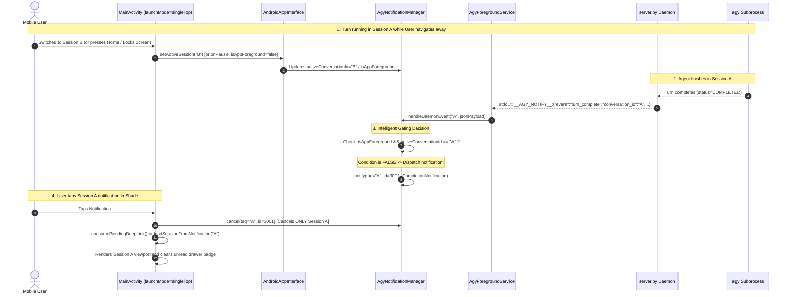
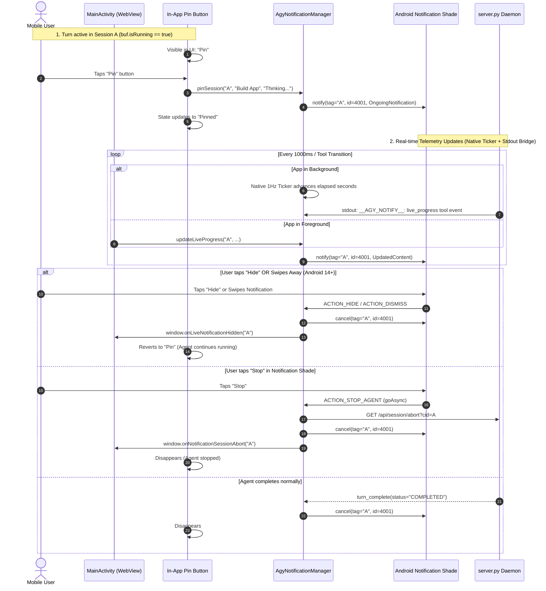

# Master Overview & Implementation Guide: Antigravity Studio v1.5.0

> **Project**: Antigravity Studio Standalone Android Application  
> **Release Target**: `v1.5.0` (Native Notification Subsystem, Live Progress Tracking & Deep Linking)  
> **Package ID**: `ai.agy.app` (10-character geometry)  
> **Target Architecture**: `arm64-v8a` | **SDK**: `35` (Android 10+ / API 29 through Android 15+)  
> **Branch**: `v1.5.0`  
> **Review Status**: **ARCHITECTURALLY AUDITED & HARDENED BY GEMINI 4 ARGON (100% Mitigations Integrated: ARGON-V15-01 through ARGON-V15-10)**

---

## 1. Executive Summary & Goals

In `v1.4.0`, Antigravity Studio established a robust parallel execution architecture (`SessionExecutionContext` with independent process locks, process-group signal isolation, and virtual frontend buffers). However, as multi-tasking across parallel sessions became standard, users encountered a fundamental usability limitation: **the lack of OS-level visibility and control outside the active viewport**.

When an agent executes a complex, long-running coding turn:
- If the user leaves the app or switches tasks, there is zero indication when the agent finishes.
- If the user switches sessions within the app, they only discover completion if they open the sidebar drawer to look for a badge.
- If the agent is running in the background, the user has no way to monitor ongoing progress (elapsed time, active tool, tool call count) without keeping the session pinned on screen.
- If the agent runs into a runaway loop or error while in the background, the user cannot easily stop it from the notification shade.

**Release `v1.5.0` delivers an audited, hardened native notification subsystem**:
1. **Intelligent Session Completion Notifications (Feature 1)**:
   - Automatically dispatched when an agent finishes if the app is in the background OR if the user is viewing a different session.
   - Intelligently suppressed when the completed session is actively viewed in the foreground UI.
   - Shows session title, "Agent finished" (or error status), and a clean markdown-sanitized response preview snippet.
   - Supports parallel sessions: exactly one isolated notification per session (`tag = conversation_id, id = NOTIF_ID_COMPLETION`).
   - Clicking a completion notification brings AgyStudio to the foreground, switches the UI directly to that session via a cold/warm-start queue, and dismisses **only** that session's notification.
2. **In-Session Live Progress Pin Button (Feature 2)**:
   - Ergonomic pill button displayed within the session view **strictly** when an agent is currently running.
   - Instantly pins an ongoing live progress notification to the Android notification shade.
   - Real-time live status synchronization: Status (Thinking, Running tool, Generating response), Elapsed Time via a native 1Hz background ticker, Last Tool Call, Total Tool Calls.
   - Multiple parallel sessions can be independently pinned, each with its own live notification.
   - Includes two interactive notification action buttons:
     - **Hide**: Clears notification from tray without stopping the agent; button in app reverts to unpinned state so it can be re-pinned anytime.
     - **Stop**: Immediately aborts the agent turn for that specific session and dismisses the notification via `goAsync()`.
   - Automatically cleans up and clears the notification the moment the agent finishes.
3. **Universal Android 10+ (API 29+) Compatibility**:
   - Fully compatible across Android 10, 11, 12, 13, 14, and 15+.
   - Adheres to Android 13+ (`POST_NOTIFICATIONS`) runtime permissions, Android 14+ swipe-dismissal `deleteIntent` handling, Android 12+ `FLAG_IMMUTABLE` PendingIntent requirements, and Android 8+ Notification Channels.

---

## 2. Specification Index & Architecture Map

The `v1.5.0` specification suite consists of three modular technical specifications, a master overview guide, and a verification handoff log in `specs/v1.5.0/`:

```text
specs/v1.5.0/
├── 01-session-completion-notifications.md       # Background/inactive completion alerts, deep linking, suppression rules & preview sanitization
├── 02-live-progress-notification-and-pill-button.md # In-session pill button, live shade telemetry, Hide & Stop action buttons & cleanup
├── 03-native-notification-subsystem-and-bridge.md  # Kotlin AgyNotificationManager, NotificationActionReceiver, bridge APIs & server abort endpoint
├── OVERVIEW_AND_IMPLEMENTATION_GUIDE.md         # Master roadmap, end-to-end sequence diagrams, Argon audit mitigations & AC checklist
└── IMPLEMENTATION_LOG.md                        # Verification ledger and autonomous agent handoff tracking
```

---

## 3. Gemini 4 Argon Architectural Review: 10 Integrated Mitigations

| Issue ID | Severity | Focus Area | Argon Review Mitigation |
| :--- | :--- | :--- | :--- |
| **ARGON-V15-01** | **CRITICAL** | **Background WebView Eviction** | Bridge `server.py` stdout `__AGY_NOTIFY__:` stream to `AgyForegroundService` and run a native 1Hz coroutine ticker in `AgyNotificationManager`. |
| **ARGON-V15-02** | **CRITICAL** | **Zombie Notification Race** | Thread-safe `SessionLiveState` lock verifying `isRunning && isPinned` at the exact moment of `nm.notify()`. |
| **ARGON-V15-03** | **HIGH** | **Dropped Tool Transitions** | State-aware boundary check ($250\text{ ms}$) + $1000\text{ ms}$ timer throttle ensuring tool transitions are never dropped. |
| **ARGON-V15-04** | **HIGH** | **Android 14+ Swipe Dismissal** | Attach `.setDeleteIntent()` pointing to `ACTION_DISMISS_LIVE_NOTIFICATION` to prevent zombie respawning on Android 14/15. |
| **ARGON-V15-05** | **HIGH** | **False Completion on Stop** | Flag `abortedByUser = true` and suppress completion notification if turn was manually stopped or `status == "INTERRUPTED"`. |
| **ARGON-V15-06** | **HIGH** | **Receiver Background Freeze** | Use `val pendingResult = goAsync()` in `NotificationActionReceiver` during loopback abort calls. |
| **ARGON-V15-07** | **HIGH** | **Cold-Start Deep Link Drop** | Set `android:launchMode="singleTop"`, queue deep link in `pendingDeepLinkConversationId`, and clear stale notifications on drawer navigation. |
| **ARGON-V15-08** | **CRITICAL** | **`websockets` Body Crash** | Use `GET /api/session/abort?cid=...` with `X-Auth-Token` header, bypassing the lack of `request.body` in `process_request`. |
| **ARGON-V15-09** | **MEDIUM** | **Small Icon & Markdown ReDoS** | Add monochrome vector `@drawable/ic_stat_agy` and pre-bound Markdown sanitizer to 2,000 characters. |
| **ARGON-V15-10** | **MEDIUM** | **Android 13+ False Pin State** | Return boolean from `pinLiveNotification()` and trigger runtime permission request if permission is denied. |

---

## 4. End-to-End System Architecture

### 4.1 Completion Notification Flow (`ARGON-V15-01`, `ARGON-V15-07`)



### 4.2 Live Progress Notification Flow (`ARGON-V15-01` to `ARGON-V15-06`)



---

## 5. Master Acceptance Criteria Checklist

### Phase 1: Native Android Notification Subsystem (`ai.agy.app`)
- [ ] **AC-1.1**: `AgyNotificationManager` initializes `CHANNEL_ID_COMPLETION` (Default importance) and `CHANNEL_ID_PROGRESS` (Low importance).
- [ ] **AC-1.2**: `MainActivity` lifecycle updates `AgyNotificationManager.isAppForeground` on `onResume()` and `onPause()`.
- [ ] **AC-1.3**: `AndroidAppInterface` exposes `@JavascriptInterface` bridge methods for session tracking, completion posting, and live progress updating.
- [ ] **AC-1.4**: `NotificationActionReceiver` handles `ACTION_HIDE_LIVE_NOTIFICATION`, `ACTION_DISMISS_LIVE_NOTIFICATION`, and `ACTION_STOP_AGENT` using `goAsync()` (`ARGON-V15-06`).
- [ ] **AC-1.5**: `MainActivity` deep-link queue clears only the tapped session's completion notification and switches WebView to that session (`ARGON-V15-07`).

### Phase 2: Session Completion Notifications (Feature 1)
- [ ] **AC-2.1**: Agent finishing while app is in background dispatches completion notification via daemon stdout bridge (`ARGON-V15-01`).
- [ ] **AC-2.2**: Agent finishing in an inactive session while app is foregrounded dispatches completion notification.
- [ ] **AC-2.3**: Agent finishing in the actively viewed foreground session strictly suppresses completion notification.
- [ ] **AC-2.4**: Multiple parallel sessions each maintain distinct, isolated completion notifications in the tray.
- [ ] **AC-2.5**: Tapping completion notification opens app directly into that session and clears only that notification.
- [ ] **AC-2.6**: User-initiated Stop or INTERRUPTED turn suppresses completion alert (`ARGON-V15-05`).

### Phase 3: Live Progress Notification & In-Session Pill Button (Feature 2)
- [ ] **AC-3.1**: In-app pin button is visible if and only if an agent is currently running in that session (`buf.isRunning == true`).
- [ ] **AC-3.2**: Tapping pin button generates an ongoing live progress notification in the shade showing Status, Elapsed Time, Last Tool, and Call Count.
- [ ] **AC-3.3**: Elapsed time advances smoothly via native 1Hz coroutine ticker even when WebView is suspended (`ARGON-V15-01`).
- [ ] **AC-3.4**: Multiple parallel sessions can each have their own live notification pinned concurrently.
- [ ] **AC-3.5**: Tapping "Hide" dismisses notification from tray without interrupting the agent, and in-app button reverts to unpinned state.
- [ ] **AC-3.6**: Swiping away ongoing notification on Android 14+ unpins session and prevents zombie respawn (`ARGON-V15-04`).
- [ ] **AC-3.7**: Tapping "Stop" immediately interrupts the agent turn for that session and dismisses the notification (`ARGON-V15-06`).
- [ ] **AC-3.8**: Completing, erroring, or aborting the turn automatically cleans up and clears the live progress notification.

### Phase 4: Server Daemon & Abort Route Integration
- [ ] **AC-4.1**: `server.py` exposes `GET /api/session/abort?cid=...` endpoint to receive direct native abort requests with `X-Auth-Token` (`ARGON-V15-08`).
- [ ] **AC-4.2**: Direct abort endpoint halts the specific session's process group (`killpg`) within 2 seconds.
- [ ] **AC-4.3**: End-to-end verification passing across all supported Android versions $\ge 10$ (API 29+).

---

## 6. Implementation Roadmap & File Changes

```text
Files to be modified / created:
1. app/src/main/res/drawable/ic_stat_agy.xml                # NEW: Monochrome vector small icon (ARGON-V15-09)
2. app/src/main/java/ai/agy/app/AgyNotificationManager.kt   # NEW: Native notification manager & state coordinator (ARGON-V15-05)
3. app/src/main/java/ai/agy/app/NotificationActionReceiver.kt # NEW: BroadcastReceiver for Hide, Dismiss & Stop (ARGON-V15-06)
4. app/src/main/java/ai/agy/app/MainActivity.kt            # MODIFIED: singleTop, deep-link queue & bridge methods (ARGON-V15-07, 10)
5. app/src/main/java/ai/agy/app/AgyForegroundService.kt     # MODIFIED: Stdout reader bridge for __AGY_NOTIFY__: lines (ARGON-V15-01)
6. app/src/main/AndroidManifest.xml                        # MODIFIED: singleTop & NotificationActionReceiver registration
7. agy-ui/server.py                                        # MODIFIED: GET /api/session/abort & __AGY_NOTIFY__: events (ARGON-V15-01, 08)
8. agy-ui/index.html                                       # MODIFIED: Pin button, permission check & deep-link consumption (ARGON-V15-10)
```
