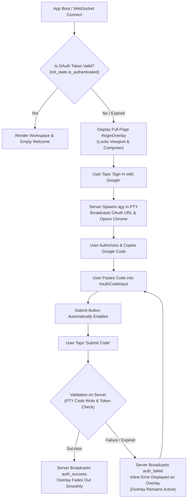

# Specification 01: Full-Page Google Authentication Overlay & UX Redesign

> **Target Release**: `v1.6.1`  
> **Subsystem**: Frontend Presentation Layer & Touch Interaction (`agy-ui/index.html`)  
> **Component**: Dedicated Authentication Screen Overlay (`#loginOverlay`)  
> **Status**: **DRAFT SPECIFICATION FOR ARGON REVIEW**

---

## 1. Problem Statement & Motivation

In previous versions of Antigravity Studio (up through `v1.6.0`), Google OAuth authentication was treated as a reactive in-band chat conversation event:
1. When opening the app without an authenticated token, the user was presented with an empty chat interface with starter chips.
2. The user had to enter an arbitrary prompt first.
3. The backend detected the absence of an OAuth token, spawned an interactive PTY subprocess, and injected an agent message into the chat transcript saying:  
   *"Google Sign-In Required: Click here to sign in with Google... Paste the code directly into the chat prompt below and send it."*
4. **Critical Failure in v1.6.0**: When the user sent a prompt, `setInitializingControlsState(true)` disabled the composer (`promptInput.disabled = true`, `btnSend.disabled = true`). As a result, when the user returned from Google with the authorization code, **the entire composer was locked in readonly mode**, completely preventing the user from pasting or submitting the code.
5. Even without the lock bug, requiring users to initiate an artificial prompt before learning that sign-in is required is non-standard, confusing, and pollutes the conversation transcript with ephemeral authentication chatter.

---

## 2. Architectural Architecture & UI Redesign

In `v1.6.1`, the in-band chat authentication flow is entirely replaced by a **dedicated, high-z-index, full-page modal overlay (`#loginOverlay`)**.



---

## 3. DOM & Visual Specifications

### 3.1 Overlay Placement & Layer Hierarchy
The overlay is attached directly under `.app-shell` and covers 100% of the viewport:
```html
<div class="auth-page-overlay" id="loginOverlay" style="display: none;">
  <div class="auth-card">
    <div class="auth-logo-badge">
      
    </div>
    
    <div class="auth-header">
      <h2 class="auth-title">Google Sign-In Required</h2>
      <p class="auth-subtitle" id="authSubtitle">
        Sign in with your Google account to connect Antigravity CLI and unlock full AI capabilities.
      </p>
    </div>

    <!-- Inline Status / Error Alert Banner -->
    <div class="auth-alert" id="authAlert" style="display: none;">
      <span class="auth-alert-icon" id="authAlertIcon">⚠️</span>
      <span class="auth-alert-msg" id="authAlertMsg"></span>
    </div>

    <!-- Action 1: Sign in with Google Button -->
    <div class="auth-action-block">
      <button type="button" class="btn-auth-google" id="btnLoginGoogle">
        <svg class="google-icon" viewBox="0 0 24 24" width="20" height="20">
          <path fill="#4285F4" d="M23.745 12.27c0-.7-.06-1.4-.19-2.07H12v4.51h6.6c-.29 1.52-1.14 2.82-2.4 3.68v3.05h3.88c2.27-2.09 3.665-5.17 3.665-9.17z"/>
          <path fill="#34A853" d="M12 24c3.24 0 5.95-1.08 7.93-2.91l-3.88-3.05c-1.08.72-2.45 1.16-4.05 1.16-3.12 0-5.77-2.1-6.72-4.93H1.25v3.15C3.26 21.36 7.34 24 12 24z"/>
          <path fill="#FBBC05" d="M5.28 14.27c-.25-.72-.38-1.49-.38-2.27s.13-1.55.38-2.27V6.58H1.25C.45 8.18 0 9.99 0 12s.45 3.82 1.25 5.42l4.03-3.15z"/>
          <path fill="#EA4335" d="M12 4.75c1.77 0 3.35.61 4.6 1.8l3.42-3.42C17.95 1.19 15.24 0 12 0 7.34 0 3.26 2.64 1.25 6.58l4.03 3.15c.95-2.83 3.6-4.98 6.72-4.98z"/>
        </svg>
        <span id="labelLoginGoogle">Sign In with Google</span>
      </button>
      <div class="auth-hint" id="authUrlHint" style="display: none;">
        <span>Browser didn't open?</span>
        <a href="#" id="linkDirectAuth" target="_blank" rel="noopener">Open sign-in link manually</a>
      </div>
    </div>

    <!-- Action 2 & 3: Authorization Code Input & Submit -->
    <div class="auth-input-group">
      <label class="auth-input-label" for="authCodeInput">Authorization Code</label>
      <div class="auth-input-wrap">
        <input 
          type="text" 
          id="authCodeInput" 
          class="auth-text-input" 
          placeholder="Paste authorization code here" 
          autocomplete="off" 
          autocorrect="off" 
          autocapitalize="off" 
          spellcheck="false" 
        />
        <button type="button" class="btn-input-paste" id="btnPasteAuthCode" title="Paste from clipboard">
          Paste
        </button>
      </div>
      <span class="auth-input-help">Google displays this code in your browser after signing in.</span>
    </div>

    <button type="button" class="btn-auth-submit" id="btnSubmitAuthCode" disabled>
      <span class="submit-spinner" id="authSubmitSpinner" style="display: none;"></span>
      <span id="labelSubmitAuth">Confirm & Finish Sign-In</span>
    </button>
  </div>
</div>
```

### 3.2 Mobile-First Touch Styling (Alpine/PRoot Compatible)
```css
.auth-page-overlay {
  position: fixed;
  inset: 0;
  z-index: 9999;
  background: rgba(8, 11, 18, 0.94);
  backdrop-filter: blur(14px);
  -webkit-backdrop-filter: blur(14px);
  display: flex;
  align-items: center;
  justify-content: center;
  padding: 20px;
  box-sizing: border-box;
  animation: fadeIn 0.25s ease-out;
}

.auth-card {
  width: 100%;
  max-width: 420px;
  background: var(--bg-surface, #141824);
  border: 1px solid var(--border-color, rgba(255, 255, 255, 0.1));
  border-radius: 20px;
  padding: 24px 20px;
  box-shadow: 0 16px 40px rgba(0, 0, 0, 0.65);
  display: flex;
  flex-direction: column;
  gap: 18px;
  box-sizing: border-box;
}

.auth-logo-badge {
  width: 56px;
  height: 56px;
  border-radius: 16px;
  background: #090d16;
  border: 1px solid rgba(255, 255, 255, 0.12);
  display: flex;
  align-items: center;
  justify-content: center;
  margin: 0 auto;
}

.btn-auth-google {
  display: flex;
  align-items: center;
  justify-content: center;
  gap: 12px;
  width: 100%;
  height: 48px;
  background: #ffffff;
  color: #1f2937;
  font-weight: 600;
  font-size: 0.95rem;
  border-radius: 12px;
  border: none;
  cursor: pointer;
  transition: transform 0.1s ease, filter 0.15s ease;
}

.btn-auth-submit {
  display: flex;
  align-items: center;
  justify-content: center;
  gap: 8px;
  width: 100%;
  height: 46px;
  background: var(--accent-primary, #6366f1);
  color: #ffffff;
  font-weight: 600;
  font-size: 0.92rem;
  border-radius: 12px;
  border: none;
  cursor: pointer;
  transition: opacity 0.2s ease, transform 0.1s ease;
}

.btn-auth-submit:disabled {
  opacity: 0.4;
  cursor: not-allowed;
  filter: grayscale(0.5);
}
```

---

## 4. Frontend Event Handling & Reactive Lifecycle

### 4.1 Overlay State Manager
A dedicated JavaScript controller `authOverlay` coordinates the modal state:
```javascript
const authOverlay = {
  el: document.getElementById('loginOverlay'),
  btnGoogle: document.getElementById('btnLoginGoogle'),
  labelGoogle: document.getElementById('labelLoginGoogle'),
  inputCode: document.getElementById('authCodeInput'),
  btnPaste: document.getElementById('btnPasteAuthCode'),
  btnSubmit: document.getElementById('btnSubmitAuthCode'),
  labelSubmit: document.getElementById('labelSubmitAuth'),
  spinnerSubmit: document.getElementById('authSubmitSpinner'),
  alertBox: document.getElementById('authAlert'),
  alertMsg: document.getElementById('authAlertMsg'),
  alertIcon: document.getElementById('authAlertIcon'),
  urlHint: document.getElementById('authUrlHint'),
  linkDirect: document.getElementById('linkDirectAuth'),

  show(reason = 'required') {
    this.el.style.display = 'flex';
    this.resetState();
    if (reason === 'expired') {
      this.showAlert('Your Google session has expired. Please sign in again.', 'warning');
    }
  },

  hide() {
    this.el.style.display = 'none';
    this.resetState();
  },

  resetState() {
    this.inputCode.value = '';
    this.btnSubmit.disabled = true;
    this.btnGoogle.disabled = false;
    this.labelGoogle.textContent = 'Sign In with Google';
    this.labelSubmit.textContent = 'Confirm & Finish Sign-In';
    this.spinnerSubmit.style.display = 'none';
    this.alertBox.style.display = 'none';
    this.urlHint.style.display = 'none';
  },

  showAlert(message, type = 'error') {
    this.alertBox.style.display = 'flex';
    this.alertBox.className = `auth-alert ${type}`;
    this.alertIcon.textContent = type === 'warning' ? '⚠️' : (type === 'success' ? '✅' : '❌');
    this.alertMsg.textContent = message;
  },

  setSubmitting(isSubmitting) {
    this.inputCode.disabled = isSubmitting;
    this.btnSubmit.disabled = isSubmitting || !this.inputCode.value.trim();
    this.btnGoogle.disabled = isSubmitting;
    this.spinnerSubmit.style.display = isSubmitting ? 'inline-block' : 'none';
    this.labelSubmit.textContent = isSubmitting ? 'Verifying Code...' : 'Confirm & Finish Sign-In';
  }
};
```

### 4.2 Interaction Rules & Validation
1. **Input Trimming & Enablement**:
   - As the user types or pastes into `#authCodeInput`, a clean string is stripped of leading/trailing whitespace and URL parameters (e.g. `code=...`).
   - `#btnSubmitAuthCode` is strictly enabled when `cleanCode.length > 0`.
2. **Clipboard Paste Shortcut**:
   - Tapping `#btnPasteAuthCode` reads the clipboard via `navigator.clipboard.readText()`. If granted, it populates the field and immediately enables `#btnSubmitAuthCode`.
3. **Submission**:
   - Tapping `#btnSubmitAuthCode` calls `authOverlay.setSubmitting(true)` and sends:
     ```json
     { "type": "submit_auth_code", "code": "<clean_code>" }
     ```
4. **Resolution**:
   - On receipt of `auth_success`:
     - Show success checkmark in alert area: *"Sign-In Confirmed! Setting up runtime..."*
     - Fade out overlay after 500ms.
     - Re-enable composer controls (`setInitializingControlsState(false)`).
   - On receipt of `auth_failed`:
     - `authOverlay.setSubmitting(false)`.
     - Show inline error: `msg.error` or *"Invalid or expired code. Please try signing in again."*
     - The overlay **never closes** on error.

---

## 5. Session Expiry & Mid-Session Interception

If the backend encounters an authentication failure at any point (e.g. during turn execution, quota polling, or model discovery):
1. **Zero Chat Pollution**: The orchestrator must **NOT** append markdown auth blocks into `#chatViewport`.
2. **Immediate Overlay Trigger**: The backend immediately broadcasts:
   ```json
   { "type": "auth_required", "reason": "expired" }
   ```
3. **Frontend Interception**:
   - The frontend immediately calls `authOverlay.show('expired')`.
   - Any ongoing live progress bar is stopped (`stopLiveProgress()`).
   - The user remains in their current context with their prompt and transcript intact, while the overlay handles the credential renewal.
