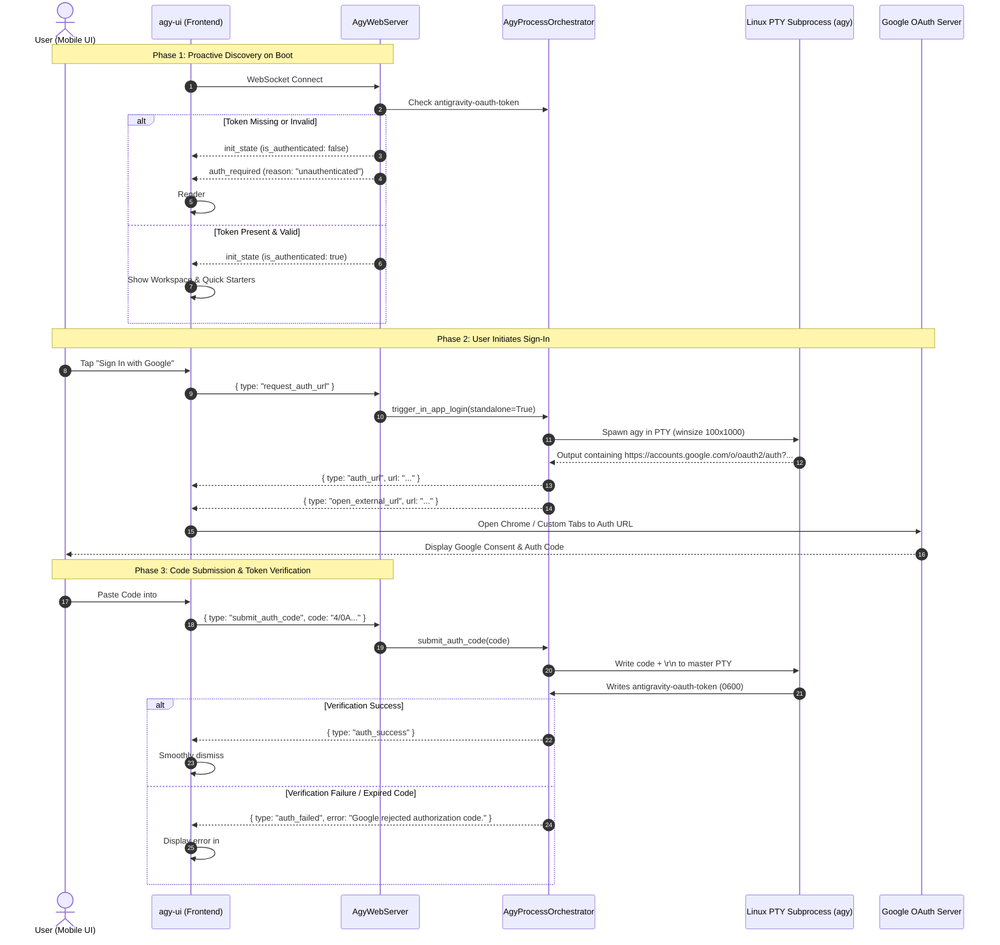

# Specification 02: Backend Auth Orchestration, Standalone PTY & Expiry Interception

> **Target Release**: `v1.6.1`  
> **Subsystem**: Backend Process Orchestrator & Server Protocol (`agy-ui/server.py`)  
> **Component**: Standalone PTY Authentication Engine & Zero-Pollution Interceptor  
> **Status**: **DRAFT SPECIFICATION FOR ARGON REVIEW**

---

## 1. Problem Statement & Motivation

In `v1.6.0`, the authentication backend suffered from three architectural entanglements:
1. **Coupling to Active Turns**: `trigger_in_app_login()` required an active `turn_id` and conversation context. It emitted conversational tokens (`agent_token`) into the chat transcript stream, resulting in messy auth links stored inside persistent JSONL/SQLite logs.
2. **Missing Proactive Auth Discovery**: On cold start or WebSocket connection, `server.py` did not evaluate whether a valid OAuth token was on disk. It waited until the user attempted an execution before triggering an auth flow.
3. **PTY Resource Leaks & Concurrency Hazards**: If a user opened the login URL and navigated away without submitting a code, the PTY master/slave descriptors and child CLI process remained in memory indefinitely or until an arbitrary timeout occurred.

---

## 2. Architectural Design



---

## 3. Protocol & Message Specifications

### 3.1 Extended `init_state` Payload
When a client connects, `init_state` explicitly reports authentication status:
```json
{
  "type": "init_state",
  "is_authenticated": false,
  "default_workspace": "/storage/emulated/0/Documents",
  "config": {
    "conversation_id": null,
    "model": "gemini-2.5-pro",
    "workspace": "/storage/emulated/0/Documents"
  },
  "sessions": []
}
```

### 3.2 Standalone Auth Request: `request_auth_url`
Client initiates Google OAuth flow without needing a dummy chat message:
- **Client Request**:
  ```json
  { "type": "request_auth_url" }
  ```
- **Server Broadcasts**:
  ```json
  {
    "type": "auth_url",
    "url": "https://accounts.google.com/o/oauth2/auth?client_id=...&response_type=code"
  }
  ```
  Followed by:
  ```json
  {
    "type": "open_external_url",
    "url": "https://accounts.google.com/o/oauth2/auth?client_id=...&response_type=code"
  }
  ```

### 3.3 Authorization Code Submission: `submit_auth_code`
- **Client Request**:
  ```json
  {
    "type": "submit_auth_code",
    "code": "4/0Axxxxxxxxxxxxxxxxxxxxxxxxxxxxxxxxxxxx"
  }
  ```
- **Server Response on Success**:
  ```json
  {
    "type": "auth_success"
  }
  ```
- **Server Response on Failure**:
  ```json
  {
    "type": "auth_failed",
    "error": "Google rejected the authorization code (expired or already used). Please try again."
  }
  ```

---

## 4. Token Validation & Expiry Interceptor

### 4.1 Synchronous Token Verification Helper
A dedicated helper `is_oauth_token_valid()` evaluates the physical token file on disk:
```python
def is_oauth_token_valid() -> bool:
    token_file = GEMINI_DIR / "antigravity-oauth-token"
    if not token_file.exists():
        return False
    try:
        st = token_file.stat()
        if st.st_size < 50:
            return False
        data = json.loads(token_file.read_text(encoding="utf-8"))
        if not (data.get("token") or data.get("access_token")):
            return False
        # If expiry timestamp exists, verify it has not elapsed
        if "expires_at" in data:
            if float(data["expires_at"]) < time.time():
                return False
        return True
    except Exception:
        return False
```

### 4.2 Mid-Session Interceptor in `execute_turn()`
When `execute_turn()` detects authentication failure indicators from `agy` CLI stderr or stdout:
1. **Suppression**: Do **NOT** invoke `self.broadcast({"type": "agent_token", ...})`.
2. **Context Suspension**: Save `self._pending_auth_prompt = prompt` and `self._pending_auth_attachments = attachments`.
3. **Overlay Broadcast**:
   ```python
   await self.broadcast({
       "type": "auth_required",
       "reason": "expired"
   })
   ```
4. **Turn Finalization**: Finalize the current turn snapshot with status `"AUTH_REQUIRED"` (preventing UI spinner locks) without appending error bubbles into the user's transcript.
5. **Seamless Re-execution**: Upon receipt of `auth_success`, the orchestrator automatically re-executes `self._pending_auth_prompt` on the active conversation.

---

## 5. PTY Process Lifecycle & Resource Hardening

1. **Watchdog Timeout**:
   - If an auth process spawned by `trigger_in_app_login()` does not receive an auth code within **120 seconds**, the PTY master is closed and `proc.terminate()` is called to prevent resource leaks.
2. **Mutex Protection (`self._auth_lock`)**:
   - An `asyncio.Lock()` ensures that multiple rapid taps on "Sign In with Google" do not spawn concurrent conflicting PTY processes.
3. **Atomic File Permissions**:
   - As soon as `antigravity-oauth-token` is written by `agy`, permissions are enforced to `0600` (`-rw-------`), and any insecure copies on shared storage (`/storage/emulated/0/...`) are proactively purged.
