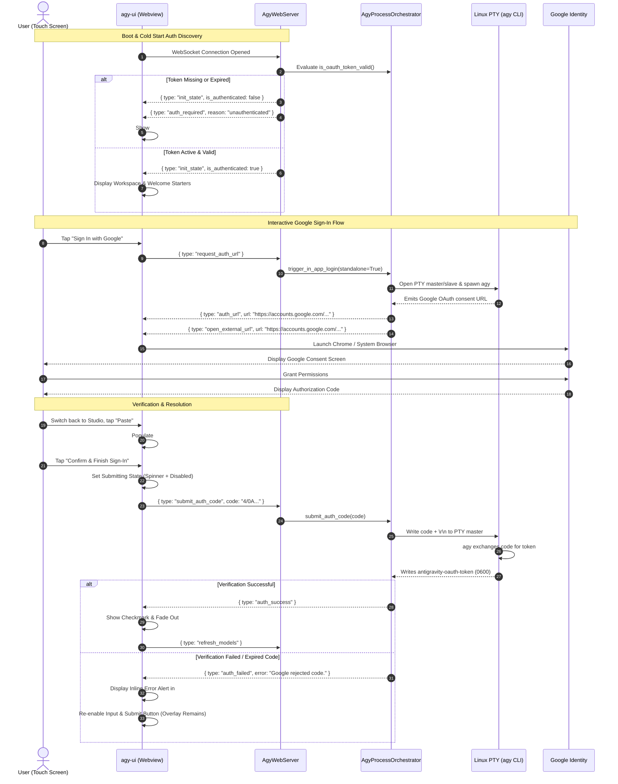

# Master Overview & Implementation Guide: Antigravity Studio v1.6.1

> **Project**: Antigravity Studio Standalone Android Application  
> **Release Target**: `v1.6.1` (Dedicated Google Auth Page Overlay & Zero-Pollution Expiry Interception)  
> **Package ID**: `ai.agy.app` (10-character geometry)  
> **Target Architecture**: `arm64-v8a` | **SDK**: `35` (Android 10+ / API 29 through Android 15+)  
> **Status**: **DRAFT FOR ARGON ARCHITECTURAL AUDIT**

---

## 1. Executive Summary & Core Objectives

In Antigravity Studio `v1.6.0`, locking composer controls during draft initialization (`setInitializingControlsState(true)`) introduced a critical regression: **Google login became completely disabled**. When the agent prompted the user to sign in, the prompt input box was disabled and readonly, preventing users from pasting and submitting the Google OAuth authorization code.

Furthermore, requiring users to submit an artificial chat prompt on a brand-new installation just to trigger the sign-in prompt is confusing, anti-pattern UX, and litters the conversation history with one-time authentication messages.

**Release `v1.6.1` completely overhauls authentication with four primary objectives**:
1. **Dedicated Full-Page Authentication Overlay (`#loginOverlay`)**:
   - When launching the app without an authenticated Google session, a clean, modal overlay covers the entire screen immediately.
   - Displays:
     1. **"Sign In with Google"** button to launch OAuth consent in the user's browser.
     2. **Code input field** with an integrated "Paste" button to paste the code.
     3. **"Confirm & Finish Sign-In"** button, strictly enabled only when a code is entered.
   - The overlay disappears **only** upon successful verification; if an error occurs, an inline alert displays the error and the overlay remains active.
2. **Zero-Pollution Mid-Session Expiry Interception**:
   - If a session expires or credentials become invalid while working in the app, Antigravity Studio does **not** append chat messages into the conversation.
   - Instead, the full-page overlay immediately appears with an expiry notification banner (*"Your session has expired. Please sign in again."*).
   - Once re-authenticated, the overlay dismisses and the user's pending turn or conversation resumes seamlessly.
3. **Decoupled Standalone Backend Authentication**:
   - `AgyWebServer` and `AgyProcessOrchestrator` introduce a standalone `{ type: "request_auth_url" }` WebSocket endpoint that spawns the CLI PTY without requiring an active conversation or turn snapshot.
   - Real-time token existence and validity are validated on connection and reported via `init_state.is_authenticated`.
4. **Security & Process Hardening**:
   - PTY subprocesses are protected by a 120-second watchdog timer to eliminate zombie processes.
   - Concurrent auth requests are serialized via `asyncio.Lock`.
   - Credentials written to disk (`antigravity-oauth-token`) are strictly enforced to `0600` permissions on ext4 internal storage.

---

## 2. Specification Index

The `v1.6.1` specification suite consists of two modular technical specifications and this master guide in `specs/v1.6.1/`:

```text
specs/v1.6.1/
├── 01-full-page-google-auth-overlay.md            # Frontend UI layout, DOM structure, touch interactions, paste helper, and validation states
├── 02-backend-auth-orchestration-and-pty.md       # Standalone PTY lifecycle, WebSocket endpoints, token validation, and expiry interception
└── OVERVIEW_AND_IMPLEMENTATION_GUIDE.md           # Master roadmap, end-to-end architecture, threat modeling, and acceptance criteria
```

---

## 3. End-to-End System Sequence Diagram



---

## 4. Implementation Acceptance Criteria (AC)

- [ ] **AC-1.6.1.1 (Cold Start Discovery)**: On app launch without `antigravity-oauth-token`, `#loginOverlay` is rendered over the entire screen, preventing any chat interaction until authenticated.
- [ ] **AC-1.6.1.2 (One-Tap OAuth Launch)**: Tapping "Sign In with Google" sends `{ type: "request_auth_url" }`, spawns `agy` in a non-chat PTY, and opens the OAuth consent URL via the Android system browser.
- [ ] **AC-1.6.1.3 (Clipboard Paste & Real-time Validation)**: The code input field provides a dedicated "Paste" button. The Submit button is disabled when the field is empty and enables immediately when characters are entered.
- [ ] **AC-1.6.1.4 (Overlay Persistence on Error)**: If code verification fails or times out, an inline error banner displays the cause in the overlay. The overlay **never** dismisses until verification succeeds.
- [ ] **AC-1.6.1.5 (Clean Dismissal on Success)**: Upon receiving `auth_success`, `#loginOverlay` shows a success indicator and smoothly fades out, revealing the workspace.
- [ ] **AC-1.6.1.6 (Zero Chat Transcript Pollution)**: No `agent_token` messages, sign-in links, or authorization prompts are ever written to the conversation history or SQLite databases.
- [ ] **AC-1.6.1.7 (Mid-Session Expiry Interception)**: If authentication fails during an ongoing conversation (e.g. token expired), the server emits `{ type: "auth_required", reason: "expired" }`, and the overlay immediately surfaces with an expiry warning without corrupting the chat.
- [ ] **AC-1.6.1.8 (PTY Leak & Concurrency Protection)**: Abandoned PTY login processes are cleaned up after 120 seconds. Multiple taps on "Sign In with Google" are protected by an `asyncio.Lock` mutex.

---

## 5. Gemini 4 Argon Architectural Review & Security Hardening

- **Auditor**: `argon-agent (high-reasoning)`
- **Overall Status**: **AUDITED & HARDENED (6 Architectural Mitigations Integrated)**

### Critical Mitigations Matrix
| Issue ID | Severity | Subsystem | Threat & Impact | Architectural Mitigation |
| :--- | :--- | :--- | :--- | :--- |
| **ARGON-V161-01** | CRITICAL | Frontend Composer | `setInitializingControlsState(true)` disabled `promptInput` during initial draft prompt, locking code pasting entirely. | Decouple authentication from the chat composer. The full-page overlay `#loginOverlay` operates completely independent of `promptInput` with its own dedicated `#authCodeInput`. |
| **ARGON-V161-02** | HIGH | PTY Process Lifecycle | Abandoned Google sign-in attempts leak slave/master file descriptors and orphan child `agy` CLI processes. | Implement a strict 120-second watchdog timer in `trigger_in_app_login()`. Always close `slave` in parent immediately after spawn, and guarantee `master` descriptor closure in a `finally:` block. |
| **ARGON-V161-03** | HIGH | Concurrency / Race | Rapid successive taps on "Sign In with Google" could spawn concurrent PTY instances competing for terminal raw mode. | Enforce an `asyncio.Lock` (`_auth_lock`) around `trigger_in_app_login()`. If an auth session is already generating a URL, return the cached URL or await completion. |
| **ARGON-V161-04** | MEDIUM | IPC & Intent Security | Opening arbitrary URLs emitted by external processes could trigger intent hijacking or unsupported schemes. | Validate captured URL strictly against `^https://accounts\.google\.com/o/oauth2/auth\?` before emitting `open_external_url` to the Android native bridge or browser. |
| **ARGON-V161-05** | MEDIUM | Code Sanitization | Users frequently copy the entire redirect URL (`https://.../?code=4/0A...`) rather than isolating the raw authorization code string. | Implement robust code sanitization in both JavaScript and Python (`urllib.parse.unquote(re.search(r"[?&]code=([^&\s]+)", raw))`) before submitting to the PTY. |
| **ARGON-V161-06** | LOW | Credential Sanitization | Auth tokens or raw codes could leak into chat logs or debug prints during error handling. | Ensure error reporting in `auth_failed` emits only categorized high-level error strings without echoing raw code fragments or credentials. |

