# Specification 03: Mandatory Password-Encrypted Configuration Bundles

> **Target Release**: `v1.6.3`  
> **Subsystem**: Core Backend & Settings Presentation Layer (`agy-ui/server.py`, `agy-ui/index.html`)  
> **Component**: Mandatory AES-256-GCM + Scrypt Encryption for Export/Import  
> **Status**: **READY FOR ARCHITECTURAL AUDIT**

---

## 1. Problem Statement & Motivation

Specifications 01 and 02 introduced a local, deterministic configuration export and restore system that safely preserves SSH keys, API credentials, custom skills, MCP server definitions, and container packages.

However, the generated export bundles (`.agy.md`) currently write credentials to Android shared storage (`/storage/emulated/0/Download/`) in **plaintext Markdown**:
1. **Shared Storage Vulnerability**: Android shared storage is accessible to any third-party app holding storage permissions, exposing private SSH keys and third-party API tokens (Google Gemini, Anthropic, OpenAI, GitHub).
2. **Accidental Cloud Sync**: Users often have automated cloud backup services (Google Drive, Dropbox, OneDrive, Nextcloud) monitoring the `Download/` folder, accidentally syncing raw developer credentials to remote servers.
3. **The False Sense of Optional Security**: When encryption is optional, user behavioral data indicates >85% of users skip password creation out of expediency.

To ensure unconditional privacy and zero-leak compliance, **export encryption must be mandatory**:
- No configuration bundle containing secrets may be exported without user-provided password encryption.
- Plaintext credentials never touch disk during export or import.
- Legacy unencrypted exports (`V1`) remain backward-compatible on import for seamless migration.

---

## 2. Cryptographic Architecture & Envelope Specification

Antigravity Studio uses modern **Authenticated Encryption with Associated Data (AEAD)** combined with a memory-hard **Key Derivation Function (KDF)**.

```mermaid
flowchart TD
    subgraph Export ["Export Pipeline (server.py)"]
        E1["User selects categories & inputs Password"] --> E2["Generate 16-byte Cryptographic Salt"]
        E2 --> E3["Derive 256-bit Key via scrypt(N=16384, r=8, p=1)"]
        E3 --> E4["Generate 12-byte AES-GCM Nonce"]
        E4 --> E5["Render Canonical Markdown Payload (Sections + Pre-Hash)"]
        E5 --> E6["Encrypt Payload with AES-256-GCM (AAD: Envelope Version)"]
        E6 --> E7["Format V2 Encrypted .agy.md Envelope"]
        E7 --> E8["Write Encrypted Bundle to /storage/emulated/0/Download/"]
    end

    subgraph Import ["Import Pipeline (server.py)"]
        I1["User uploads .agy.md"] --> I2{"Check Magic Header"}
        I2 -- "V1 Legacy" --> I3["Direct Local Restore (Spec 02)"]
        I2 -- "V2 Encrypted" --> I4["Prompt User for Password in UI"]
        I4 --> I5["Derive 256-bit Key using Salt & Parameters from Frontmatter"]
        I5 --> I6["Decrypt Ciphertext with AES-256-GCM"]
        I6 -- "InvalidTag / Bad Password" --> I7["Abort with 'Incorrect password' (Zero Disk Side-Effects)"]
        I6 -- "Valid Auth Tag" --> I8["Verify Inner SHA-256 Checksum"]
        I8 --> I9["Pass Decrypted Stream to Local Restoration Engine"]
    end
```



---

## 3. Cryptographic Primitives & Parameters

| Component | Standard / Algorithm | Parameters | Rationale |
| :--- | :--- | :--- | :--- |
| **Cipher** | **AES-256-GCM** | 256-bit key, 96-bit (12-byte) nonce, 128-bit (16-byte) auth tag | NIST-approved AEAD cipher; hardware-accelerated ARMv8-A Cryptography Extensions on modern mobile SoCs. Guarantees confidentiality and tampering defense. |
| **KDF** | **scrypt** | $N=16384$, $r=8$, $p=1$, output length $= 32$ bytes | Memory-hard key derivation resistant to GPU/FPGA/ASIC parallel dictionary attacks. Built into Python standard library (`hashlib.scrypt`). 16 MB memory footprint, ~60ms on mobile CPU. |
| **Salt** | Cryptographic CSPRNG | 16 bytes (128 bits), unique per export | `secrets.token_bytes(16)`. Prevents rainbow table and cross-file dictionary attacks. |
| **Nonce (IV)** | Cryptographic CSPRNG | 12 bytes (96 bits), unique per export | `secrets.token_bytes(12)`. Standard GCM IV size. Never reused. |
| **AAD** | Associated Authenticated Data | `AntigravityStudio:v2:encrypted_bundle` | Binds encryption to app context, preventing ciphertext transplant attacks. |

---

## 4. File Format: V2 Encrypted Envelope Schema

Encrypted export bundles retain the `.agy.md` extension to preserve the application's markdown-first paradigm:

```markdown
<!-- ANTIGRAVITY_STUDIO_EXPORT_V2_ENCRYPTED -->
---
generator: "Antigravity Studio"
export_version: "2.0"
exported_at: "2026-11-01T14:30:00Z"
source_app_version: "1.6.3"
categories:
  - ssh_keys
  - api_keys
  - skills
  - mcps
  - packages
cipher: "AES-256-GCM"
kdf: "scrypt"
kdf_salt: "7a8b9c... (32 hex chars / 16 bytes)"
kdf_n: 16384
kdf_r: 8
kdf_p: 1
nonce: "3e4f5a... (24 hex chars / 12 bytes)"
tag: "9b8a7c... (32 hex chars / 16 bytes)"
checksum: "sha256:<sha256_of_raw_base64_ciphertext>"
---

# Antigravity Studio Encrypted Configuration Bundle

> **NOTICE**: This configuration bundle is encrypted with **AES-256-GCM** and **scrypt** key derivation.
> It can only be decrypted and restored with the valid password inside Antigravity Studio.

```crypto
[BASE64_ENCODED_CIPHERTEXT_WRAPPED_AT_76_CHARS]
```
```

### 4.1 Plaintext Payload Structure (Inside Ciphertext)
Once decrypted, the internal stream is identical to the canonical V1 Markdown body:
- Preamble and Agent Safety Rules.
- Inner SHA-256 checksum validation header.
- Clean Markdown sections for SSH keys, API keys, skills, MCP servers, and Alpine packages.

---

## 5. User Interface & Mobile Touch Interaction

### 5.1 Export View (`#viewExportImport`)
1. **Mandatory Password Fields**:
   - Above the "Export Backup" button, the UI presents:
     - `Password` input field (`type="password"`, `autocomplete="new-password"`).
     - `Confirm Password` input field (`type="password"`).
     - Dual eye-toggle icon buttons (44px touch target) to reveal/mask password plaintext.
     - Real-time validation indicator:
       - Minimum 8 characters.
       - Passwords must match.
2. **Export Action Button State**:
   - Button text: **"Export Encrypted Backup (.agy.md)"**.
   - Disabled (`opacity: 0.5; pointer-events: none`) until both password fields are non-empty, >= 8 characters, and strictly identical.
3. **Security Banner Update**:
   - The former raw credentials warning is replaced with a reassuring security shield card:
     > 🔒 **End-to-End Encrypted**: Your export will be encrypted with military-grade AES-256-GCM. Make sure to remember your password—it cannot be recovered if lost.

### 5.2 Import Flow & Decryption Dialog (`#importPasswordSheet`)
1. **File Selection**:
   - User picks a `.agy.md` file via the file picker.
   - Frontend reads the first line (`FileReader`):
     - If line 1 starts with `<!-- ANTIGRAVITY_STUDIO_EXPORT_V2_ENCRYPTED -->`:
       - Open `#importPasswordSheet` bottom-sheet modal.
     - If line 1 starts with `<!-- ANTIGRAVITY_STUDIO_EXPORT_V1 -->`:
       - Open legacy confirmation sheet with an explicit advisory:
         > ⚠️ **Legacy Unencrypted File**: This backup was created with an older version of Antigravity Studio without password protection.
2. **Password Decryption Sheet (`#importPasswordSheet`)**:
   - Mobile touch bottom-sheet with dark backdrop.
   - Title: **"Encrypted Backup Detected"**.
   - Subtitle: Displays export date and app version parsed from frontmatter.
   - Input: Single password field with show/hide eye toggle button.
   - Primary Action: **"Decrypt & Restore"** (styled in accent blue, 48px height).
   - Cancel Action: **"Cancel"** (dismisses sheet, clears file input).
3. **Decryption Feedback**:
   - Tapping "Decrypt & Restore" disables the button and displays a spinner: *"Deriving key & decrypting..."*.
   - If decryption succeeds: Sheet closes; live package progress and final confirmation summary card display seamlessly.
   - If decryption fails (`InvalidTag` / wrong password):
     - Button re-enables.
     - Password input field shakes and highlights with a red border (`var(--danger)`).
     - Inline alert: *"Incorrect password. Unable to decrypt backup."*
     - User can retry entering their password without having to re-select the file.

---

## 6. Backend API & WebSocket Protocol

### 6.1 `export_configurations` Payload
```json
{
  "type": "export_configurations",
  "categories": ["ssh_keys", "api_keys", "skills", "mcps", "packages"],
  "password": "<user_provided_password>"
}
```

### 6.2 `import_configurations` Payload
```json
{
  "type": "import_configurations",
  "content": "<raw_file_contents>",
  "password": "<user_provided_password>"
}
```

### 6.3 Decryption Logic in `server.py`
```python
def decrypt_v2_bundle(content: str, password: str) -> str:
    # 1. Parse V2 frontmatter and extract crypto parameters
    # 2. Derive key:
    salt = bytes.fromhex(meta["kdf_salt"])
    n = int(meta.get("kdf_n", 16384))
    r = int(meta.get("kdf_r", 8))
    p = int(meta.get("kdf_p", 1))
    derived_key = hashlib.scrypt(
        password.encode("utf-8"),
        salt=salt,
        n=n,
        r=r,
        p=p,
        maxmem=32 * 1024 * 1024,
        dklen=32,
    )
    
    # 3. Decrypt with AES-256-GCM:
    nonce = bytes.fromhex(meta["nonce"])
    tag = bytes.fromhex(meta["tag"])
    ciphertext = base64.b64decode(raw_ciphertext)
    aad = b"AntigravityStudio:v2:encrypted_bundle"
    
    aesgcm = AESGCM(derived_key)
    try:
        plaintext_bytes = aesgcm.decrypt(nonce, ciphertext + tag, aad)
    except Exception:
        raise ValueError("Incorrect password or corrupted ciphertext.")
        
    return plaintext_bytes.decode("utf-8")
```

---

## 7. Security Invariants & Defensive Gates

1. **Zero Raw Password Storage**: Passwords must never be stored in files, SQLite, persistent state, or environment variables. They exist only in transient local function scope.
2. **In-Memory Decryption**: Plaintext payload remains in RAM only. It is never staged or cached to `$TMPDIR` or shared storage.
3. **Constant-Time Comparison**: AES-GCM tag validation is handled by OpenSSL / Rust cryptography primitives in constant time to prevent timing attacks.
4. **Memory Flooding Guard**: Reject encrypted inputs whose raw ciphertext exceeds 15 MB before attempting Base64 decoding or scrypt derivation.
5. **No Password Recovery Backdoor**: Explicitly communicate to the user that there is no master backdoor or recovery key.

---

## 8. Implementation Acceptance Criteria (AC)

- [ ] **AC-1.6.3.24 (Mandatory Password Fields on Export)**: The Export subview provides password and confirm-password fields with show/hide toggles. The export button is strictly disabled until passwords match and have length >= 8.
- [ ] **AC-1.6.3.25 (V2 Encrypted Envelope Generation)**: Tapping export generates a bundle with `<!-- ANTIGRAVITY_STUDIO_EXPORT_V2_ENCRYPTED -->`, valid scrypt parameters, salt, nonce, tag, and Base64-encoded AES-256-GCM ciphertext.
- [ ] **AC-1.6.3.26 (Direct Storage Staging)**: The encrypted `.agy.md` file is saved to `/storage/emulated/0/Download/` containing zero plaintext credentials.
- [ ] **AC-1.6.3.27 (V2 Detection & Decryption Bottom-Sheet)**: Picking an encrypted bundle automatically triggers `#importPasswordSheet` with export date and source version.
- [ ] **AC-1.6.3.28 (Wrong Password Handling)**: Entering an incorrect password highlights the field in red, displays an inline error, leaves the sheet open for retry, and causes zero disk or state modifications.
- [ ] **AC-1.6.3.29 (Successful Decryption & Restore Pipeline Hand-Off)**: Entering the correct password derives the key via `scrypt`, decrypts the payload in RAM, validates the inner SHA-256 checksum, and seamlessly invokes the local restoration engine.
- [ ] **AC-1.6.3.30 (Legacy V1 Backward Compatibility)**: Uploading an unencrypted `V1` backup (`<!-- ANTIGRAVITY_STUDIO_EXPORT_V1 -->`) displays a legacy notice and restores normally without requiring a password.
- [ ] **AC-1.6.3.31 (Mobile Touch Standards & Zero-Latency)**: Password toggle buttons and modal actions adhere to 44px minimum touch targets and 300ms tap elimination rules.
