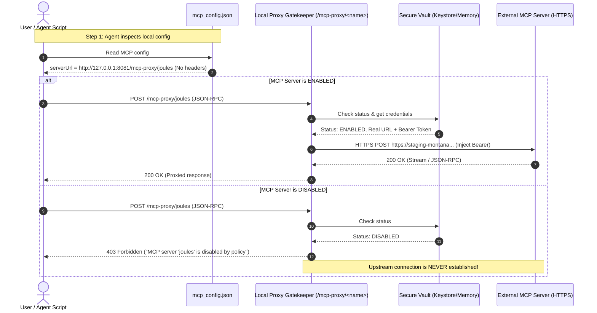

# Module 01: MCP Loopback Proxy & Hard Disabling Architecture

## 1. Vulnerability Analysis & Motivation

In Antigravity Studio v1.8.0 and earlier, disabling a Model Context Protocol (MCP) server inside **Settings → MCP Servers** executes `agy mcp disable <name>`. This merely writes `"disabled": true` to the configuration entry in `~/.gemini/config/mcp_config.json`:

```json
{
  "mcpServers": {
    "joules": {
      "disabled": true,
      "serverUrl": "https://staging-montana-mig.joulesapp.de/mcp",
      "headers": {
        "Authorization": "Bearer sec_eyJhbGciOi..."
      }
    }
  }
}
```

### The Bypass Mechanism
1. While the `agy acp` daemon omits disabled MCP tools from its registered tool list, the agent has access to `run_command` and `read_file`.
2. The agent reads `mcp_config.json` directly from the filesystem.
3. The agent extracts the plaintext `serverUrl` and authentication headers (`Authorization: Bearer ...`).
4. The agent writes a custom Python script or `curl` command executing against the external server over standard internet access.
5. **Outcome**: The user's explicit policy directive to disable the integration is completely subverted.

---

## 2. Loopback Proxy Architecture (Option A)

To enforce hard disabling, all HTTP MCP communication is mediated through a local reverse proxy gatekeeper running inside the backend process (`server.py`) at `127.0.0.1:8081`.



---

## 3. Data Segregation & Redaction Model

### 3.1 Public Configuration (`~/.gemini/config/mcp_config.json`)
The on-disk configuration exposed to the agent and workspace commands contains **only safe loopback references**:

```json
{
  "mcpServers": {
    "joules": {
      "disabled": false,
      "serverUrl": "http://127.0.0.1:8081/mcp-proxy/joules"
    },
    "internal_tool": {
      "command": "python3",
      "args": ["/data/data/ai.agy.app/files/home/.gemini/scripts/internal_tool.py"]
    }
  }
}
```

* **No Secret Headers**: The `headers` object is completely removed from `mcp_config.json`.
* **No Real URLs**: External domains (`*.joulesapp.de`, `api.github.com`, etc.) are hidden behind the local proxy route.
* **No Secret Environment Variables**: For stdio servers, sensitive environment keys (`API_KEY`, `TOKEN`) are not written to public JSON.

### 3.2 Secure Proxy Store (App Private Storage)
The mapping between proxy endpoints and real targets is held in secure app-private storage (`mcp_vault.json` in `/data/data/ai.agy.app/databases/` or encrypted via Android Keystore):

```json
{
  "joules": {
    "enabled": true,
    "transport": "http",
    "upstreamUrl": "https://staging-montana-mig.joulesapp.de/mcp",
    "headers": {
      "Authorization": "Bearer sec_eyJhbGciOi...",
      "X-Custom-Tenant": "montana-mig"
    },
    "created_at": 1792320000
  }
}
```

---

## 4. Gatekeeper Route & Enforcement Logic

### 4.1 HTTP Route Specification: `/mcp-proxy/{server_name}`
The route `/mcp-proxy/{server_name}` in `server.py` handles all HTTP methods (POST, GET, SSE streaming):

```python
async def handle_mcp_proxy(request: web.Request) -> web.Response:
    server_name = request.match_info["server_name"]
    vault = get_mcp_vault()
    server_meta = vault.get(server_name)

    if not server_meta:
        return web.json_response(
            {"error": f"MCP server '{server_name}' not found in proxy configuration"},
            status=404,
        )

    # HARD DISABLING ENFORCEMENT GATE
    if not server_meta.get("enabled", True):
        logger.warning("Blocked outbound request to disabled MCP: %s", server_name)
        return web.json_response(
            {
                "jsonrpc": "2.0",
                "error": {
                    "code": -32000,
                    "message": f"MCP Server '{server_name}' is disabled by user policy.",
                },
            },
            status=403,
        )

    upstream_url = server_meta["upstreamUrl"]

    # ARGON-V19-01: SSRF & Loopback Target Prevention Gate
    parsed_target = urllib.parse.urlparse(upstream_url)
    if parsed_target.hostname in ("127.0.0.1", "localhost", "::1", "0.0.0.0") or (
        parsed_target.port and parsed_target.port in (PORT, 8081, 8089)
    ):
        logger.error("SSRF attempt blocked in MCP proxy: target %s", upstream_url)
        return web.json_response(
            {"error": "Security violation: MCP upstream target cannot resolve to loopback."},
            status=400,
        )
    headers = dict(request.headers)
    headers.pop("Host", None)
    headers.pop("Content-Length", None)
    
    # In-Flight Secret Injection
    vault_headers = server_meta.get("headers", {})
    for hk, hv in vault_headers.items():
        headers[hk] = hv

    headers["User-Agent"] = f"AntigravityStudio/{APP_VERSION} (MCP-Proxy)"

    body = await request.read()
    timeout = aiohttp.ClientTimeout(total=60.0)

    try:
        async with aiohttp.ClientSession(timeout=timeout) as session:
            async with session.request(
                request.method,
                upstream_url,
                headers=headers,
                data=body,
                allow_redirects=True,
            ) as resp:
                resp_headers = dict(resp.headers)
                resp_headers.pop("Transfer-Encoding", None)
                resp_headers.pop("Content-Encoding", None)

                # Support SSE streaming (text/event-stream)
                if "text/event-stream" in resp_headers.get("Content-Type", ""):
                    stream_resp = web.StreamResponse(
                        status=resp.status, headers=resp_headers
                    )
                    await stream_resp.prepare(request)
                    async for chunk in resp.content.iter_any():
                        await stream_resp.write(chunk)
                    return stream_resp

                data = await resp.read()
                return web.Response(
                    status=resp.status,
                    body=data,
                    headers=resp_headers,
                )
    except Exception as exc:
        logger.error("MCP upstream connection failed for %s: %s", server_name, exc)
        return web.json_response(
            {"error": f"Upstream MCP communication error: {exc}"},
            status=502,
        )
```

### 4.2 Stdio MCP Neutralization
When a stdio-based MCP (local script / process) is disabled:
1. `server.py` updates `mcp_config.json` replacing the `command` field with `/bin/false`.
2. The target script file (if located in `~/.gemini/scripts/`) has its POSIX permissions set to `0000` (`chmod 000`) or is moved to a quarantine subdirectory.
3. If an agent attempts to execute the command directly via `run_command`, it exits immediately with return code `1`.

---

## 5. Configuration Export & Import (`.agy.md`) Integration

The mandatory password-encrypted `.agy.md` backup system (v1.6.3 Spec 03) must continue to back up and restore MCP servers seamlessly without compromising security.

### 5.1 Export Phase (`generate_config_export_bundle`)
When the user triggers **Settings → Export & Import → Export Configuration**:
1. The export engine reconciles `mcp_config.json` with the secure `mcp_vault`.
2. For each server, it extracts the **real upstream target**:
   * If the server uses the loopback proxy, the export engine swaps `serverUrl: http://127.0.0.1:8081/mcp-proxy/<name>` back to its original `upstreamUrl` and re-attaches the real `headers`.
3. The canonical JSON is assembled into `## Section: MCP Servers`:
   ```markdown
   ## Section: MCP Servers

   Merge the following entries into `mcpServers` in `~/.gemini/config/mcp_config.json`:

   ```json
   {
     "joules": {
       "serverUrl": "https://staging-montana-mig.joulesapp.de/mcp",
       "headers": {
         "Authorization": "Bearer sec_eyJhbGciOi..."
       },
       "disabled": false
     }
   }
   ```
   ```
4. The entire markdown bundle is encrypted with the user's mandatory password using Scrypt + AES-256-GCM and written to `/storage/emulated/0/Download/`.
5. **Security Guarantee**: Unencrypted credentials never touch disk in the workspace; they only exist inside the encrypted `.agy.md` envelope.

### 5.2 Import Phase (`restore_configurations_bundle`)
When restoring a configuration bundle:
1. The user provides the decryption password.
2. The engine decrypts the `.agy.md` bundle in memory and extracts `## Section: MCP Servers`.
3. For each imported MCP server:
   * **Real Credentials to Vault**: The original `serverUrl` and `headers` are saved to the app's secure private vault.
   * **Sanitized Proxy to Workspace**: The entry in `~/.gemini/config/mcp_config.json` is written with `serverUrl: "http://127.0.0.1:8081/mcp-proxy/<name>"` and `headers: {}`.
   * **Preserve State**: If marked `"disabled": true` in the backup, the vault flags `enabled: false`.
4. Backward Compatibility: Backups created in v1.6.3 / v1.8.0 containing raw URLs and headers import seamlessly and are automatically upgraded into the loopback proxy architecture.

---

## 6. Implementation Acceptance Criteria

- [ ] **AC-MCP-01**: Toggling an MCP server to "disabled" in Settings immediately causes requests to `http://127.0.0.1:8081/mcp-proxy/<name>` to return HTTP `403 Forbidden`.
- [ ] **AC-MCP-02**: `~/.gemini/config/mcp_config.json` contains strictly `http://127.0.0.1:8081/mcp-proxy/<name>` endpoints; zero remote URLs or auth tokens exist in the file.
- [ ] **AC-MCP-03**: Direct Python scripts or curl commands calling the local proxy route for a disabled MCP receive JSON-RPC error `-32000` with code `403`.
- [ ] **AC-MCP-04**: Configuration export produces a valid encrypted `.agy.md` bundle containing the real upstream URLs and headers.
- [ ] **AC-MCP-05**: Configuration import successfully ingests legacy v1.6.3/v1.8.0 MCP definitions and migrates them into the proxy vault with zero manual intervention.
