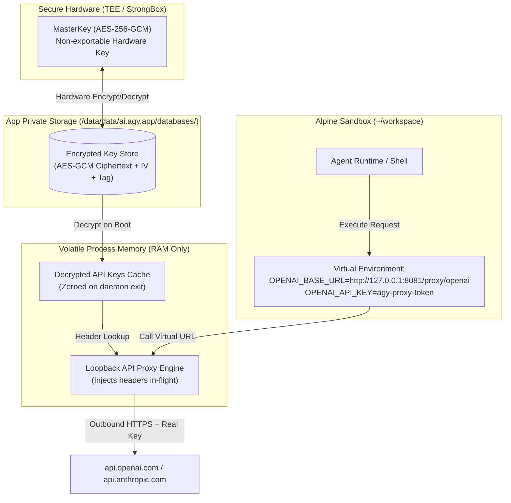
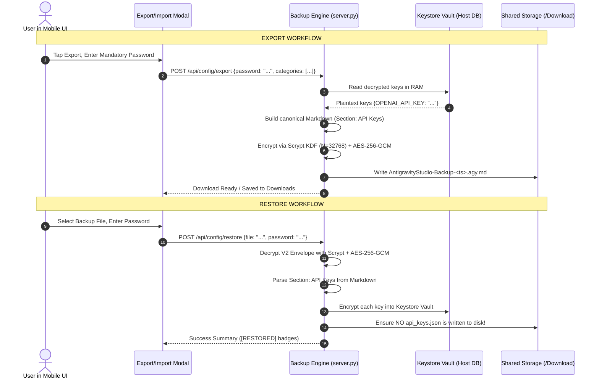

# Module 02: Android Keystore Vault & API Key Reverse Proxy Pattern

## 1. Vulnerability Analysis & Motivation

In Antigravity Studio v1.8.0, user API keys (e.g. `OPENAI_API_KEY`, `ANTHROPIC_API_KEY`, `TAVILY_API_KEY`, `GITHUB_TOKEN`) are managed as follows:
1. Keys are stored in plaintext JSON at `/data/data/ai.agy.app/files/home/.gemini/config/api_keys.json`.
2. `server.py` generates `/data/data/ai.agy.app/files/home/.gemini/config/rules/api_keys_manifest.md` advertising all active keys to the agent.
3. Upon spawning the `agy acp` daemon, `server.py` iterates `get_active_api_keys()` and injects raw credentials directly into `os.environ` (`proc_env[ak_k] = ak_v`).

### The Attack Vectors
* **Malicious Package Post-Install Scripts**: An untrusted package (`npm install <pkg>` or `pip install <pkg>`) executed in the terminal can read `~/.gemini/config/api_keys.json` or dump `os.environ` to exfiltrate keys.
* **Indirect Prompt Injection**: A malicious website or repository README analyzed by the agent can trick the LLM into printing its process environment or reading `api_keys.json`.
* **Shared Storage Leakage**: If permissions are accidentally widened on the user's home directory, background apps can inspect active keys.

---

## 2. Android Keystore Hardware Vault Architecture

To protect credentials at rest, Antigravity Studio integrates the hardware-backed **Android Keystore System** (`AndroidKeyStore` provider via Google Jetpack `androidx.security.crypto`).



### 2.1 Hardware Master Key Generation
In the Android host application (`ai.agy.app`), a hardware-backed master key is provisioned:

```kotlin
// ARCH-V19-03: Graceful StrongBox -> Standard TEE Fallback
val masterKey = try {
    MasterKey.Builder(context)
        .setKeyScheme(MasterKey.KeyScheme.AES256_GCM)
        .setUserAuthenticationRequired(false)
        .setRequestStrongBoxed(true)
        .build()
} catch (e: Exception) {
    // Fall back to standard hardware TEE if dedicated StrongBox chip is unavailable
    MasterKey.Builder(context)
        .setKeyScheme(MasterKey.KeyScheme.AES256_GCM)
        .setUserAuthenticationRequired(false)
        .setRequestStrongBoxed(false)
        .build()
}
```

* **Non-Exportability Invariant**: Private key material never leaves the TEE/StrongBox hardware boundary.
* **Ciphertext Storage**: Each credential is encrypted using AES-256-GCM with a unique 12-byte initialization vector (IV) and a 128-bit authentication tag. Ciphertexts are persisted in the app-private SQLite database outside `/files/home/`.
* **Same-UID Memory Protection**: In Android, PRoot subshells and `server.py` run under the same Linux UID (`ai.agy.app`). To prevent child processes or compromised scripts from inspecting `/proc/<server_pid>/mem`, `server.py` executes `prctl(PR_SET_DUMPABLE, 0)` immediately upon startup via `ctypes`:
  ```python
  import ctypes
  libc = ctypes.CDLL(None)
  PR_SET_DUMPABLE = 4
  libc.prctl(PR_SET_DUMPABLE, 0, 0, 0, 0)
  ```
* **Environment Scrubbing**: When `server.py` spawns child shells or `agy acp`, all internal IPC secrets and vault credentials are explicitly pruned from child process environments.

---

## 3. The Reverse Proxy Pattern for Agent & Commands

Rather than exposing raw secrets to the agent process environment, outbound traffic routes through a local reverse proxy.

### 3.1 Eliminating Plaintext Files
1. `~/.gemini/config/api_keys.json` is **deleted** from disk.
2. `~/.gemini/config/rules/api_keys_manifest.md` is updated to only announce available virtual proxy providers without exposing secret values:
   ```markdown
   # Available AI Provider Proxies
   The following AI services are routed through the secure local proxy:
   - OpenAI: `http://127.0.0.1:8081/proxy/openai/v1`
   - Anthropic: `http://127.0.0.1:8081/proxy/anthropic/v1`
   - Gemini: `http://127.0.0.1:8081/proxy/gemini/v1`
   - Tavily Search: `http://127.0.0.1:8081/proxy/tavily`
   - GitHub: `http://127.0.0.1:8081/proxy/github`
   ```

### 3.2 Environment Variable Virtualization
When spawning the persistent `agy acp` daemon, `server.py` injects virtual proxy endpoints and opaque session tokens:

```bash
OPENAI_BASE_URL="http://127.0.0.1:8081/proxy/openai/v1"
OPENAI_API_KEY="agy-managed-proxy-session"
ANTHROPIC_BASE_URL="http://127.0.0.1:8081/proxy/anthropic/v1"
ANTHROPIC_API_KEY="agy-managed-proxy-session"
GEMINI_BASE_URL="http://127.0.0.1:8081/proxy/gemini"
TAVILY_API_KEY="agy-managed-proxy-session"
```

### 3.3 Provider-Aware Proxy Request Handling & Header Injection
The proxy listener in `server.py` handles outbound calls to `/proxy/{provider}/{path:.*}`. Rather than assuming all providers accept `Authorization: Bearer`, the proxy dispatches through a provider-specific credential injection table:

| Provider Route | Upstream Base URL | Credential Injection Strategy |
| :--- | :--- | :--- |
| `/proxy/openai/{path:.*}` | `https://api.openai.com/` | Injects header: `Authorization: Bearer <OPENAI_API_KEY>` |
| `/proxy/anthropic/{path:.*}` | `https://api.anthropic.com/` | Injects header: `x-api-key: <ANTHROPIC_API_KEY>` (strips dummy `Authorization` header) |
| `/proxy/gemini/{path:.*}` | `https://generativelanguage.googleapis.com/` | Injects header: `x-goog-api-key: <GEMINI_API_KEY>` (and rewrites `?key=...` query if present) |
| `/proxy/tavily/{path:.*}` | `https://api.tavily.com/` | Injects header: `Authorization: Bearer <TAVILY_API_KEY>`; if body contains `"api_key": "agy-managed-proxy-session"`, replaces with real key |
| `/proxy/github/{path:.*}` | `https://api.github.com/` | Injects header: `Authorization: Bearer <GITHUB_TOKEN>` |

Streams the upstream response back to the client. If the user disables a key in Settings, the proxy route immediately returns `401 Unauthorized` or `403 Forbidden`.

---

## 4. In-App Key Operations: Copying & Reveal

The user requirement that **viewing and copying keys must keep working** is preserved:

1. **Viewing in Settings UI**:
   * In **Settings → API Keys**, keys are displayed with masking (`sk-ant...****...ABCD`) by default.
   * Tapping the "Eye" toggle sends an IPC request to decrypt the key in memory. The unmasked string is rendered in the secure WebView DOM.
2. **Copying to Clipboard with Android 13+ Privacy Protection**:
   * Tapping the "Copy" icon triggers the native bridge `AndroidApp.copyVaultKeyToClipboard(keyName)` in `MainActivity.kt`.
   * On Android 13+ (API 33+), the OS shows an on-screen preview of clipboard content. To prevent screen-recording or bystander leaks, `ClipDescription.EXTRA_IS_SENSITIVE = true` is explicitly attached:
     ```kotlin
     @JavascriptInterface
     fun copyVaultKeyToClipboard(keyName: String): Boolean {
         val secretValue = keystoreVault.getDecryptedKey(keyName) ?: return false
         runOnUiThread {
             val clipboard = getSystemService(Context.CLIPBOARD_SERVICE) as ClipboardManager
             val clip = ClipData.newPlainText("API Key", secretValue)
             if (Build.VERSION.SDK_INT >= Build.VERSION_CODES.TIRAMISU) {
                 clip.description.extras = PersistableBundle().apply {
                     putBoolean(ClipDescription.EXTRA_IS_SENSITIVE, true)
                 }
             } else if (Build.VERSION.SDK_INT >= Build.VERSION_CODES.N) {
                 clip.description.extras = PersistableBundle().apply {
                     putBoolean("android.content.extra.IS_SENSITIVE", true)
                 }
             }
             clipboard.setPrimaryClip(clip)
         }
         return true
     }
     ```
   * **Security Guarantee**: The key is transferred directly from Android Keystore memory to the system clipboard; no intermediate shell commands or plaintext files are created.

---

## 5. Compatibility with Mandatory Password `.agy.md` Backup Bundles

The existing encrypted backup engine (v1.6.3 Spec 03) requires mandatory user password encryption using Scrypt KDF + AES-256-GCM. This engine is retained with 100% backward and forward compatibility.



### 5.1 Export Phase
* `generate_config_export_bundle()` queries the Keystore vault in volatile RAM.
* Formats keys into the canonical `## Section: API Keys` JSON block.
* Applies Scrypt KDF + AES-256-GCM encryption with the user's password.
* Output: Standard `AntigravityStudio-Backup-<timestamp>.agy.md`.

### 5.2 Import Phase
* `restore_configurations_bundle()` decrypts the bundle with the password.
* Parses `## Section: API Keys`.
* Instead of writing to `~/.gemini/config/api_keys.json`, it saves each key to the Android Keystore encrypted vault.
* If a legacy `api_keys.json` file is present from a previous version, it is safely migrated into the vault and wiped from disk (`shred` / unlink).

---

## 6. Implementation Acceptance Criteria

- [ ] **AC-KS-01**: `~/.gemini/config/api_keys.json` does not exist on disk during normal operations.
- [ ] **AC-KS-02**: Terminal shell execution of `env` or `cat ~/.gemini/config/api_keys.json` yields no plaintext API keys.
- [ ] **AC-KS-03**: Outbound OpenAI/Anthropic SDK calls succeed via local proxy URLs (`http://127.0.0.1:8081/proxy/...`).
- [ ] **AC-KS-04**: Tapping "Copy" on an API key card in Settings successfully places the plaintext key on the Android system clipboard.
- [ ] **AC-KS-05**: Exporting configurations produces a valid `.agy.md` bundle with mandatory password encryption.
- [ ] **AC-KS-06**: Importing a legacy v1.6.3 `.agy.md` backup restores all keys directly into the Keystore vault without creating on-disk JSON files.
- [ ] **AC-KS-07**: Proxy route correctly injects provider-specific credentials (`x-api-key` for Anthropic, `x-goog-api-key` for Gemini, `Authorization: Bearer` for OpenAI, and body injection for Tavily).
- [ ] **AC-KS-08**: Tapping "Copy" on Android 13+ (API 33+) sets `ClipDescription.EXTRA_IS_SENSITIVE = true`, masking the key preview in system toast overlays.
- [ ] **AC-KS-09**: `server.py` invokes `prctl(PR_SET_DUMPABLE, 0)` on boot, preventing same-UID processes from reading `/proc/<pid>/mem`.
