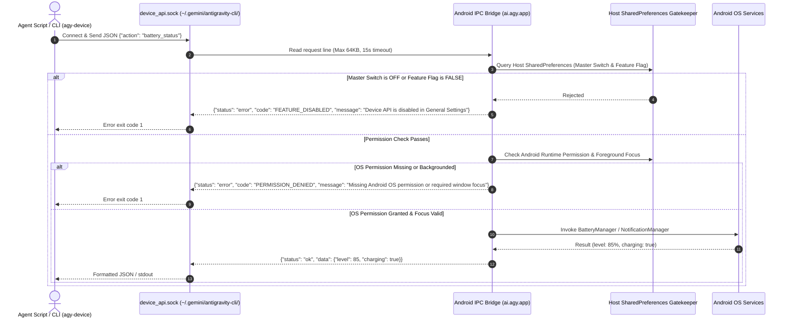

# Module 03: Native Device APIs & General Settings Hub

## 1. Motivation & Architectural Boundary

Allowing the agent to query device hardware (battery state, screen brightness, orientation) and trigger user-facing interactions (system notifications, haptics, clipboard, location, photo capture) significantly expands its utility.

### Why Termux:API is Strictly Avoided
1. **Package Visibility Restrictions (`<queries>`)**: On Android 11+ (API 30+), apps cannot discover or send implicit broadcasts to packages outside their manifest query set.
2. **UID Isolation & Signature Permissions**: `com.termux.api` restricts its service bindings and broadcast receivers via signature-level permissions (`com.termux.permission.RUN_COMMAND`). Because `ai.agy.app` possesses a completely distinct UID and keystore signature, calls to Termux:API are rejected by the Android OS.
3. **Zero-Dependency Directive**: Requiring the user to install secondary third-party APKs compromises the standalone, self-contained design of Antigravity Studio.

**The Solution**: An in-process **Native Device API Bridge** hosted entirely within `ai.agy.app`, communicating directly with the Android SDK via a local UNIX domain socket.

---

## 2. Settings Hub: "General Settings" Subview Architecture

To ensure device capabilities are strictly opt-in and provide an extensible home for future preferences, a new **General Settings** subview is introduced in the Settings Hub.

### 2.1 Menu Item Integration (`index.html`)
Added to `#viewSettingsMenu` inside the main Settings Hub overlay:

```html
<!-- General Settings -->
<div class="settings-menu-item" data-target="viewGeneralSettings">
  <div class="settings-menu-icon">
    <svg class="fa-icon" viewBox="0 0 512 512" aria-hidden="true" focusable="false">
      <!-- Sliders / Gear icon -->
      <path fill="currentColor" d="M0 416c0-17.7 14.3-32 32-32l54.7 0c12.3-28.3 40.5-48 73.3-48s61 19.7 73.3 48L480 384c17.7 0 32 14.3 32 32s-14.3 32-32 32l-246.7 0c-12.3 28.3-40.5 48-73.3 48s-61-19.7-73.3-48L32 448c-17.7 0-32-14.3-32-32zm192 0a32 32 0 1 0 -64 0 32 32 0 1 0 64 0z..."/>
    </svg>
  </div>
  <div class="settings-menu-info">
    <div class="settings-menu-title">General Settings</div>
    <div class="settings-menu-desc">Preferences, device APIs & hardware access</div>
  </div>
  <svg class="settings-menu-chevron fa-icon" viewBox="0 0 320 512"><path fill="currentColor" d="..."/></svg>
</div>
```

### 2.2 Subview Layout (`viewGeneralSettings`)
Inside `viewGeneralSettings`, device permissions are structured with a Master Switch and granular sub-toggles:

```
┌─────────────────────────────────────────────────────────────┐
│ ←  General Settings                                         │
├─────────────────────────────────────────────────────────────┤
│ Configure general application preferences and device hardware│
│ capabilities available to the agent runtime.                │
├─────────────────────────────────────────────────────────────┤
│ AGENT DEVICE CAPABILITIES                                   │
│                                                             │
│ Master Device API Bridge                      [   OFF   ]   │
│ Allow the agent to interact with device hardware.           │
├─────────────────────────────────────────────────────────────┤
│ (Sub-toggles disabled and dimmed when Master is OFF)        │
│                                                             │
│ [ ] Battery & Device Info (Level, charging state, temp)     │
│ [ ] Notifications & Vibrate (Alerts & haptic feedback)      │
│ [ ] System Clipboard (Read & write device clipboard)        │
│ [ ] Geolocation (GPS coordinates — Prompts OS permission)   │
│ [ ] Camera Capture (Photos — Prompts OS permission)         │
│ [ ] Text-to-Speech (TTS voice announcements)                │
│ [ ] System Share Sheet (Open URLs & share files)            │
└─────────────────────────────────────────────────────────────┘
```

* **Host-Authoritative Persistence (ARCH-V19-08)**: To prevent same-UID privilege escalation (where an autonomous agent edits `~/.gemini/app_settings.json` to enable device APIs), device permissions are stored **exclusively** in the host Android layer (`SharedPreferences` in `/data/data/ai.agy.app/shared_prefs/`). They can **only** be modified via native `@JavascriptInterface` calls (`AndroidApp.setDeviceApiToggle(key, enabled)`) triggered by direct user touch events in the Settings UI. Configuration files inside `~/.gemini/` are strictly non-authoritative.
* **OS Permission Prompts**: When the user activates toggles requiring Android dangerous permissions (e.g. Location or Camera), the Android app immediately calls `ActivityCompat.requestPermissions()`. If denied, the toggle automatically reverts to unchecked.

---

## 3. Native IPC Bridge Architecture

Communication between the guest Alpine container and the Android host uses a secure UNIX domain socket, mirroring the proven architecture of `ask_question.sock`.



### 3.1 Socket Specification & Storage Invariant
* **Path**: `/data/data/ai.agy.app/files/home/.gemini/antigravity-cli/device_api.sock`.
* **VFS Invariant (ARCH-V19-06)**: Must be hosted strictly on internal ext4 storage (`~/.gemini/antigravity-cli/`). Creating UNIX domain sockets on Android FUSE shared storage (`/storage/emulated/0/...`) is strictly prohibited as FUSE does not support AF_UNIX sockets or POSIX `0600` permissions.
* **File Permissions**: `0600` (restricted strictly to the app UID).
* **Protocol & Framing Guard**: Line-delimited JSON (`\n`). Handlers enforce a maximum line length of 64KB (`BufferedReader` bounded) with a 15-second read timeout per connection to prevent thread exhaustion.

### 3.2 Android Security & Input Validation Invariants
1. **Clipboard Foreground Focus (ARCH-V19-05)**:
   Under Android 10+ (API 29+), `ClipboardManager.getPrimaryClip()` is blocked by the OS unless the requesting application currently holds active window focus. 
   * If `clipboard_get` is requested while the app is backgrounded, the bridge returns:
     `{"status": "error", "code": "CLIPBOARD_UNFOCUSED", "message": "Clipboard read requires active app window focus on Android 10+"}`.
   * `clipboard_set` remains permitted in the background with user-facing notification feedback.
2. **`open_url` Scheme Validation (ARCH-V19-09)**:
   The `open_url` action parses the target URI and strictly enforces `http` or `https` schemes. Schemes such as `file://`, `content://`, `intent://`, or `market://` are rejected with `INVALID_URI_SCHEME` to prevent local file leaking or internal component hijacking.
3. **`take_photo` Canonical Path Containment & Foreground Focus (ARCH-V19-10)**:
   * **Path Containment**: The `dest_path` parameter is resolved to its `canonicalFile` and must reside strictly within the workspace directory or home directory (`~`). Paths escaping these bounds are rejected with `PATH_VIOLATION`.
   * **Foreground State**: Under Android 9–14+ (targetSdk 35), camera hardware access from a backgrounded UID triggers a `SecurityException`. The bridge verifies that `MainActivity` is in the foreground (`Lifecycle.State.RESUMED`) before opening Camera2; if backgrounded, it returns `CAMERA_REQUIRES_FOREGROUND`.

### 3.3 Supported Subcommands & Actions

| Action | Required Permission | Payload Parameters | Return Data |
| :--- | :--- | :--- | :--- |
| `battery_status` | None | `{}` | `{"level": int, "charging": bool, "temperature": float}` |
| `send_notification` | `POST_NOTIFICATIONS` | `{"title": str, "body": str, "channelId": str}` | `{"notification_id": int}` |
| `vibrate` | `VIBRATE` | `{"duration_ms": int}` | `{"status": "ok"}` |
| `clipboard_get` | Focus / User Consent | `{}` | `{"text": str}` |
| `clipboard_set` | None | `{"text": str}` | `{"status": "ok"}` |
| `get_location` | `ACCESS_FINE_LOCATION` | `{"accuracy": "balanced\|high"}` | `{"latitude": float, "longitude": float, "altitude": float}` |
| `tts_speak` | None | `{"text": str, "pitch": float, "rate": float}` | `{"status": "ok"}` |
| `take_photo` | `CAMERA` (Foreground) | `{"camera": "front\|back", "dest_path": str}` | `{"path": str, "bytes": int}` |
| `open_url` | None (`http/https` only) | `{"url": str}` | `{"status": "ok"}` |

---

## 4. Agent & Shell Interfaces

### 4.1 CLI Bridge: `agy-device`
A lightweight Python CLI bridge is installed in `$PREFIX/bin/agy-device`:

```bash
# Get battery status
agy-device battery

# Post a system notification
agy-device notify --title "Build Complete" --body "APK built successfully in 42s"

# Copy or read clipboard
agy-device clipboard get
agy-device clipboard set "Hello from Antigravity"

# Query GPS coordinates
agy-device location
```

### 4.2 Dynamic MCP Server: `device-mcp`
When Device APIs are enabled in General Settings, `server.py` automatically registers the virtual `device-mcp` server in the active ACP session, exposing native tools directly to the agent:
* `device_battery_status()`
* `device_send_notification(title, body)`
* `device_clipboard_get()` / `device_clipboard_set(text)`
* `device_get_location()`
* `device_tts_speak(text)`

When Device APIs are toggled OFF in Settings, `device-mcp` is immediately unregistered and stripped from the agent's toolset.

---

## 5. Implementation Acceptance Criteria

- [ ] **AC-DEV-01**: "General Settings" menu item renders cleanly in the Settings Hub sidebar and navigates to `viewGeneralSettings`.
- [ ] **AC-DEV-02**: The Master Switch defaults to **OFF** on fresh installations.
- [ ] **AC-DEV-03**: When Master Switch is OFF, invoking `agy-device` immediately exits with an error indicating device APIs are disabled in Settings.
- [ ] **AC-DEV-04**: Toggling Location or Camera activates Android's native `ActivityCompat.requestPermissions()` dialog.
- [ ] **AC-DEV-05**: Battery and notification commands communicate seamlessly over `device_api.sock` with zero Termux dependencies.
- [ ] **AC-DEV-06**: Toggling Device APIs OFF unregisters `device-mcp` tools from the agent's active ACP capabilities.
- [ ] **AC-DEV-07**: Device API Master Switch and sub-toggles are stored exclusively in host Android `SharedPreferences` and cannot be mutated by editing `~/.gemini/app_settings.json`.
- [ ] **AC-DEV-08**: `open_url` rejects non-http/https schemes (`file://`, `intent://`), and `take_photo` enforces canonical workspace path containment.
- [ ] **AC-DEV-09**: `take_photo` verifies `MainActivity` foreground lifecycle state (`RESUMED`) on Android 14+ (targetSdk 35) before accessing Camera2.
