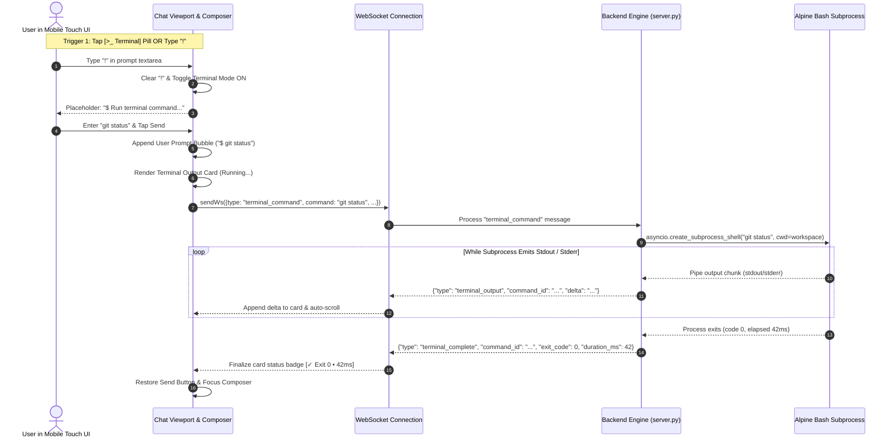

# Module 05: Direct Chat Terminal Execution Architecture

## 1. Vulnerability Analysis & Motivation

In Antigravity Studio, running common developer commands (such as `git status`, `git diff`, `npm test`, `cargo check`, `python3 script.py`, or `apk add <pkg>`) currently requires dispatching a natural language prompt to the AI agent.

### The Operational Friction
1. **Token & Latency Inefficiency**: Asking the agent *"run git status"* triggers an entire Agent Client Protocol (ACP) turn: prompt ingestion, model reasoning tokens, thinking time, tool schema validation, and tool execution callbacks. A command that takes 15ms in a shell takes 5 to 15 seconds over an LLM roundtrip and burns quota tokens.
2. **Loss of Determinism**: When developers know the exact CLI command to run, agent translation can introduce unwanted flags, misinterpret parameters, or generate conversational prose instead of raw stdout.
3. **Upstream Parity with `agy` CLI**: In the upstream Antigravity CLI terminal interface, developers can prefix any line with `!` (e.g., `!git status`) to execute shell commands directly in the local workspace without agent processing.
4. **Mobile No-Terminal Directives**: Because the mobile Android UI operates without a separate physical terminal emulator or command-line shell, providing a zero-friction, direct terminal execution channel directly inside the chat interface is essential.

---

## 2. Direct Terminal Execution Architecture

Direct terminal command execution is mediated through the backend process (`server.py`) at `127.0.0.1:8081`, bypassing the `agy acp` agent daemon entirely.



---

## 3. Touch UI & Pill Strip Architecture

### 3.1 Pill Placement & Layout (`index.html`)
A new dedicated toggle pill `#pillTerminal` is placed in the composer pill strip directly between **Attach** (`#btnUpload`) and **/ Commands** (`#pillSlash`):

```html
<div class="pill-strip">
  <!-- 1. Attach Button -->
  <button class="config-pill" id="btnUpload" type="button" title="Attach file or photo">
    <svg width="13" height="13" viewBox="0 0 24 24" fill="none" stroke="currentColor" stroke-width="2.3">
      <path d="M21.44 11.05l-9.19 9.19a6 6 0 0 1-8.49-8.49l9.19-9.19a4 4 0 0 1 5.66 5.66l-9.2 9.19a2 2 0 0 1-2.83-2.83l8.49-8.48"></path>
    </svg>
    <span id="labelUpload">Attach</span>
  </button>

  <!-- 2. Direct Terminal Mode Toggle Pill (NEW) -->
  <button class="config-pill terminal-toggle" id="pillTerminal" type="button" title="Toggle direct terminal command mode">
    <span class="pill-icon">
      <svg class="fa-icon" viewBox="0 0 512 512" aria-hidden="true" focusable="false">
        <path fill="currentColor" d="M24 32C10.7 32 0 42.7 0 56L0 456c0 13.3 10.7 24 24 24l464 0c13.3 0 24-10.7 24-24l0-400c0-13.3-10.7-24-24-24L24 32zM128 152c-4.4 0-8.6 1.8-11.7 4.9s-4.9 7.3-4.9 11.7l0 16c0 4.4 1.8 8.6 4.9 11.7s7.3 4.9 11.7 4.9l48 0c4.4 0 8.6-1.8 11.7-4.9s4.9-7.3 4.9-11.7l0-16c0-4.4-1.8-8.6-4.9-11.7s-7.3-4.9-11.7-4.9l-48 0zm-3.3 124.7l64-64c6.2-6.2 16.4-6.2 22.6 0s6.2 16.4 0 22.6L158.6 288l52.7 52.7c6.2 6.2 6.2 16.4 0 22.6s-16.4 6.2-22.6 0l-64-64c-6.2-6.2-6.2-16.4 0-22.6zm131.3 67.3l96 0c8.8 0 16 7.2 16 16s-7.2 16-16 16l-96 0c-8.8 0-16-7.2-16-16s7.2-16 16-16z"/>
      </svg>
    </span>
    <span id="labelTerminal">Terminal</span>
  </button>

  <!-- 3. Slash Commands Button -->
  <button class="config-pill accent" id="pillSlash" type="button">
    <span>/ Commands</span>
  </button>
  ...
</div>
```

### 3.2 Visual Styling & States
* **Inactive State**: Neutral border and text, identical to other standard pills.
* **Active State (`.active`)**:
  * Glowing border and accent background (`background: rgba(16, 185, 129, 0.15); border-color: rgba(16, 185, 129, 0.6); color: #10B981;`).
  * Icon pulses gently or displays an active status dot.
* **Touch Target**: Strict compliance with mobile standards (min height 36px, min width 48px, `touch-action: manipulation`, `z-index: 10`).

### 3.3 Dynamic Textarea & Typing Interactivity
1. **The "!" Auto-Toggle Interceptor**:
   * When the user types `!` into an empty prompt textarea (or when input starts with `!`):
     - The event is intercepted before rendering.
     - The `!` character is **automatically cleared** from the textarea.
     - `state.terminalMode` is switched to **`true`**.
     - `#pillTerminal` receives the `.active` class.
     - The placeholder immediately updates to:  
       `$ Run terminal command in ~/workspace...`
     - Provides instant visual confirmation without requiring the user to manually erase the exclamation mark.
2. **Auto-Exit on Empty Backspace**:
   * If `state.terminalMode` is `true` and the user presses `Backspace` while the textarea is completely empty:
     - `state.terminalMode` is toggled to **`false`**.
     - `#pillTerminal` loses the `.active` class.
     - The placeholder reverts to:  
       `Ask Antigravity or type / for commands...`
3. **Hardware Keyboard Escape**:
   * Pressing `Escape` while focused in the textarea exits Terminal Mode.
4. **Direct "!" Prefix Fallback**:
   * If the user pastes or enters a command beginning with `!` (e.g. `!git status`) while Terminal Mode is OFF:
     - The application automatically strips `!` and routes it through the direct terminal pipeline.

---

## 4. WebSocket Protocol Specification

All communication occurs over the existing persistent WebSocket between the browser and `server.py`.

### 4.1 Client Request: `terminal_command`
Sent when the user executes a terminal command:

```json
{
  "type": "terminal_command",
  "command": "git status",
  "command_id": "term-5a9e3f1c",
  "conversation_id": "d468a5b3-c652-42dc-a1ac-3c9c58077acc",
  "workspace": "/storage/emulated/0/Documents/AgyStudio"
}
```

### 4.2 Server Streaming Output: `terminal_output`
Broadcast as stdout/stderr bytes are read from the subprocess:

```json
{
  "type": "terminal_output",
  "command_id": "term-5a9e3f1c",
  "conversation_id": "d468a5b3-c652-42dc-a1ac-3c9c58077acc",
  "delta": "On branch v1.9.0\nYour branch is up to date with 'origin/v1.9.0'.\n"
}
```

### 4.3 Server Completion: `terminal_complete`
Broadcast when the process exits:

```json
{
  "type": "terminal_complete",
  "command_id": "term-5a9e3f1c",
  "conversation_id": "d468a5b3-c652-42dc-a1ac-3c9c58077acc",
  "exit_code": 0,
  "duration_ms": 38,
  "workspace": "/storage/emulated/0/Documents/AgyStudio"
}
```

### 4.4 Client Abort Request: `abort_terminal_command`
Sent when the user taps the Stop button while a command is running:

```json
{
  "type": "abort_terminal_command",
  "command_id": "term-5a9e3f1c",
  "conversation_id": "d468a5b3-c652-42dc-a1ac-3c9c58077acc"
}
```

---

## 5. Subprocess Execution Engine (`server.py`)

### 5.1 Subprocess Spawning & Streaming Logic
In `AgyProcessOrchestrator` inside `server.py`:

```python
import asyncio
import os
import signal
import time

class TerminalExecutionManager:
    def __init__(self, orchestrator):
        self.orchestrator = orchestrator
        self.active_processes: dict[str, asyncio.subprocess.Process] = {}

    async def run_command(self, command_id: str, command: str, cid: str, workspace: str, websocket):
        cmd_str = command.strip()
        if not cmd_str:
            return

        # Handle directory changes: 'cd <path>'
        if cmd_str == "cd" or cmd_str.startswith("cd "):
            await self._handle_cd(command_id, cmd_str, cid, workspace, websocket)
            return

        start_time = time.monotonic()
        ws_dir = os.path.expanduser(workspace or self.orchestrator.default_workspace)
        if not os.path.isdir(ws_dir):
            ws_dir = os.path.expanduser("~")

        # Sanitize environment: scrub internal Keystore tokens
        env = dict(os.environ)
        env.pop("AGY_MASTER_KEY", None)
        env.pop("AGY_INTERNAL_VAULT_TOKEN", None)
        env["TERM"] = "xterm-256color"

        try:
            # Spawn in dedicated process group to allow clean SIGINT / SIGTERM termination
            proc = await asyncio.create_subprocess_shell(
                cmd_str,
                stdout=asyncio.subprocess.PIPE,
                stderr=asyncio.subprocess.STDOUT,
                cwd=ws_dir,
                env=env,
                preexec_fn=os.setsid if hasattr(os, "setsid") else None,
            )
            self.active_processes[command_id] = proc

            # Stream stdout / stderr in chunks
            while True:
                chunk = await proc.stdout.read(1024)
                if not chunk:
                    break
                delta_text = chunk.decode("utf-8", errors="replace")
                await websocket.send(json.dumps({
                    "type": "terminal_output",
                    "command_id": command_id,
                    "conversation_id": cid,
                    "delta": delta_text,
                }))

            exit_code = await proc.wait()
            duration_ms = int((time.monotonic() - start_time) * 1000)

            await websocket.send(json.dumps({
                "type": "terminal_complete",
                "command_id": command_id,
                "conversation_id": cid,
                "exit_code": exit_code,
                "duration_ms": duration_ms,
                "workspace": ws_dir,
            }))
        except asyncio.CancelledError:
            self.abort_command(command_id)
            raise
        except Exception as exc:
            duration_ms = int((time.monotonic() - start_time) * 1000)
            await websocket.send(json.dumps({
                "type": "terminal_output",
                "command_id": command_id,
                "conversation_id": cid,
                "delta": f"\nExecution failed: {exc}\n",
            }))
            await websocket.send(json.dumps({
                "type": "terminal_complete",
                "command_id": command_id,
                "conversation_id": cid,
                "exit_code": 1,
                "duration_ms": duration_ms,
                "workspace": ws_dir,
            }))
        finally:
            self.active_processes.pop(command_id, None)

    def abort_command(self, command_id: str):
        proc = self.active_processes.get(command_id)
        if proc and proc.returncode is None:
            try:
                # Terminate entire process group
                if hasattr(os, "killpg"):
                    os.killpg(os.getpgid(proc.pid), signal.SIGTERM)
                else:
                    proc.terminate()
            except Exception:
                pass
```

### 5.2 Intelligent Workspace Directory Tracking (`cd`)
When developers run `cd <dir>`, executing it in a subshell normally exits without changing the parent process's working directory. To provide intuitive terminal behavior:
1. `_handle_cd` parses target path: e.g. `cd /storage/emulated/0/Documents/AgyStudio` or `cd ..`.
2. Resolves path relative to the current workspace directory.
3. If target is a valid directory:
   - Updates `ctx.workspace = new_path`.
   - Broadcasts `config_updated` with updated workspace path and git branch.
   - Streams confirmation: `Changed workspace to /storage/...`.
   - The workspace status bar above the input row automatically updates in real time.
4. If target directory does not exist:
   - Returns exit code 1 with `cd: <dir>: No such file or directory`.

---

## 6. Chat Stream & Card UX Specification

### 6.1 Prompt Bubble
Rendered immediately upon submission:
```html
<div class="msg-row user terminal-prompt-row">
  <div class="user-bubble terminal-user-bubble">
    <span class="terminal-prompt-badge">$</span>
    <span class="terminal-prompt-text">git status</span>
  </div>
</div>
```

### 6.2 Terminal Output Card
```html
<div class="msg-row assistant terminal-card-row" id="term-card-term-5a9e3f1c">
  <div class="assistant-card terminal-card">
    <!-- Header -->
    <div class="terminal-card-header">
      <div class="terminal-card-title">
        <svg class="fa-icon" viewBox="0 0 512 512"><path fill="currentColor" d="..."/></svg>
        <span>Terminal: git status</span>
      </div>
      <div class="terminal-card-status running">
        <span class="status-indicator"></span>
        <span class="status-label">Running...</span>
      </div>
    </div>

    <!-- Monospace Terminal Output Window -->
    <pre class="terminal-output-viewport"><code>...streaming stdout/stderr...</code></pre>

    <!-- Card Action Footer -->
    <div class="terminal-card-footer">
      <button class="btn-copy-terminal" title="Copy output">
        <svg class="fa-icon" viewBox="0 0 448 512"><path fill="currentColor" d="..."/></svg>
        <span>Copy Output</span>
      </button>
      <span class="terminal-card-timing">42ms</span>
    </div>
  </div>
</div>
```

### 6.3 Monospace Terminal Styling
* **Theme**: Deep dark slate `#0F172A` with subtle border `#334155`.
* **Font**: Monospace system font stack (`ui-monospace, SFMono-Regular, Menlo, Monaco, Consolas, monospace`).
* **Auto-Scroll Behavior**: While the command is running, the viewport scrolls smoothly to the latest line. If the user scrolls up manually to inspect previous lines, auto-scrolling pauses until scrolled back to the bottom.
* **ANSI Stripping / Color Rendering**: Standard ANSI 16-color codes (e.g. green for git changes, red for errors) are converted to clean inline CSS spans or safely sanitized.

---

## 7. Session History & Persistence Invariant

1. **Zero LLM Token Usage**: Direct terminal commands bypass model inference completely. No system prompts, user turns, or reasoning tokens are consumed.
2. **Session Persistence**: Terminal command records are appended to the active session's message list:
   ```json
   {
     "role": "terminal",
     "command": "git status",
     "output": "On branch v1.9.0\n...",
     "exit_code": 0,
     "duration_ms": 38,
     "timestamp": 1792320000
   }
   ```
   Switching sessions or reloading the app restores previous terminal runs seamlessly in the chat history.

---

## 8. Implementation Acceptance Criteria

- [ ] **AC-TERM-01**: `#pillTerminal` is placed in the composer dock directly between `#btnUpload` and `#pillSlash`.
- [ ] **AC-TERM-02**: Tapping `#pillTerminal` toggles `state.terminalMode` between `true` and `false`, with clear visual activation (green accent border/glow).
- [ ] **AC-TERM-03**: Typing `!` into an empty prompt textarea automatically clears the `!` character and toggles Terminal Mode to **ON**.
- [ ] **AC-TERM-04**: Pressing `Backspace` on an empty textarea while Terminal Mode is ON toggles it **OFF** and restores default placeholder.
- [ ] **AC-TERM-05**: Commands submitted in Terminal Mode dispatch `terminal_command` over WebSocket and execute directly in `ctx.workspace`.
- [ ] **AC-TERM-06**: Output streams in real-time chunk-by-chunk inside a monospace terminal card with auto-scroll.
- [ ] **AC-TERM-07**: Tapping Stop while a command is running cleanly terminates the process via process-group signal (`SIGTERM`).
- [ ] **AC-TERM-08**: Running `cd <path>` updates the active workspace directory in `server.py` and refreshes the workspace status bar in the UI.
- [ ] **AC-TERM-09**: Output card displays exit code badges (`Exit 0` in green, `Exit <code>` in red) and execution duration.
- [ ] **AC-TERM-10**: Terminal commands consume zero LLM agent tokens and are persisted cleanly in session history.