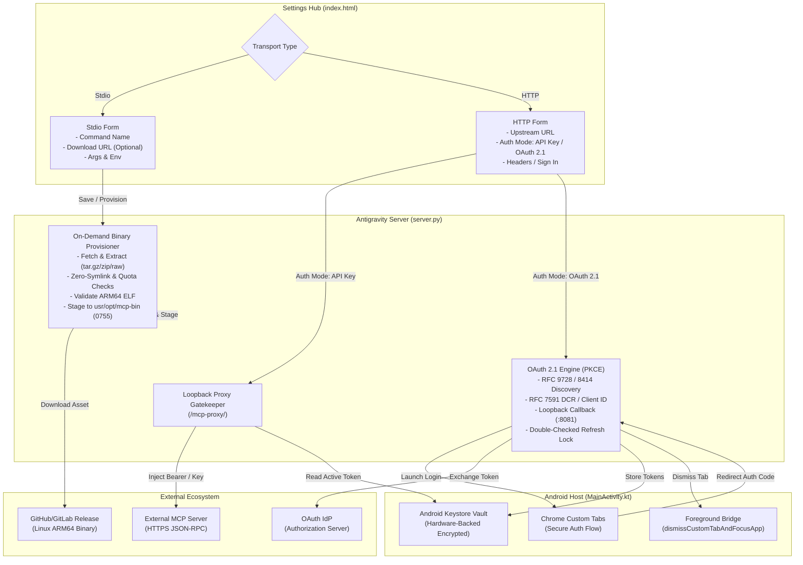
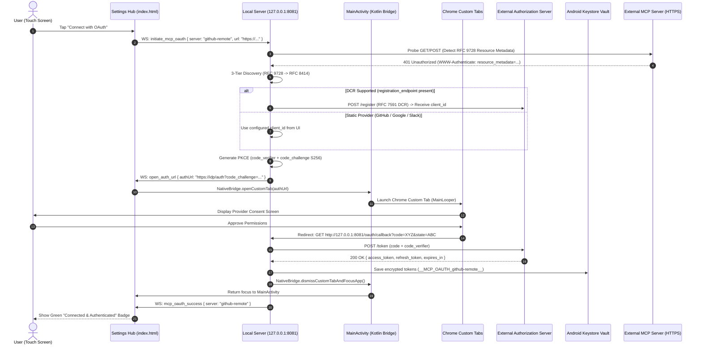

# Module 06: Standardized Stdio Binary Provisioning & Dual-Mode OAuth 2.1 HTTP MCP Architecture

## 1. Executive Summary & Problem Statement

### 1.1 Context & Historical Defects
In Antigravity Studio v1.8.x and v1.9.0, Model Context Protocol (MCP) server management suffers from two critical architectural gaps:

1. **Fragile Stdio Implementations & Broken Migrations**:
   - When users configured Stdio MCP servers (e.g. `github-mcp`), previous agent sessions implemented ad-hoc Python scripts placed in untracked internal paths (`~/.gemini/scripts/github_mcp.py`).
   - The backup export engine (`generate_config_export_bundle`) serializes only the JSON definition from `mcp_config.json` without bundling arbitrary script files.
   - Upon restoring on a new device, the configuration references a non-existent file, causing instantaneous `FileNotFoundError` crashes upon MCP process spawning.
   - While the UI allows selecting "Stdio", there is currently no standardized, self-contained mechanism to provision or download native ARM64 binaries (e.g. Go, Rust, C++) on demand.

2. **HTTP Authentication Rigidity (API Keys vs. OAuth 2.1)**:
   - Antigravity Studio's HTTP MCP loopback proxy currently supports only static header injection (e.g., `Authorization: Bearer $KEY_NAME`).
   - While ideal for Personal Access Tokens (PATs) and static API keys, enterprise and modern cloud MCP endpoints (such as GitHub Copilot's hosted endpoint `https://api.githubcopilot.com/mcp/`, Google, Slack, and Jira) mandate interactive **OAuth 2.1 with PKCE** (`RFC 9728`, `RFC 8414`).
   - Attempting to connect to these services without an OAuth loop yields `401 Unauthorized` with `resource_metadata` challenges that cannot currently be completed inside the application.

### 1.2 Core Design Principles
- **API Key Flow Remains 100% Functional**: The existing static header/API key injection mechanism remains the primary, zero-friction default for all HTTP MCP servers.
- **Zero Prebundled Bloat**: Native binaries (such as `github-mcp-server`) are **never prebundled in the APK**. They are fetched on demand to keep the application footprint compact (~35MB) and decouple MCP server updates from APK releases.
- **Self-Contained Export & Restore**: Any Stdio binary download metadata is preserved in encrypted export bundles, enabling new devices to autonomously re-provision dependencies without manual user intervention.
- **Hardware-Backed Secret Vaulting**: All OAuth access/refresh tokens and API keys reside exclusively in the Android Keystore Vault, never in plaintext configuration files.
- **Hardened Subsystem Execution**: Downloaded binaries run through containerized wrappers (`agy-sh`) with `/etc/resolv.conf` (DNS) and CA roots to satisfy Android 15 SELinux `W^X` and Go/Rust runtime invariants.

---

## 2. Architecture Overview



---

## 3. Subsystem 1: Generic On-Demand Stdio Binary Provisioning

### 3.1 Settings UI Specification
In **Settings → MCP Servers → Add Server (Stdio)**, the modal is augmented with non-breaking, optional provisioning inputs:

| Field Name | DOM Element ID | Type | Description |
| :--- | :--- | :--- | :--- |
| **Server Name** | `inputMCPName` | Text | Unique identifier (e.g. `github`). |
| **Command** | `inputMCPCommand` | Text | Executable name in `$PATH` (e.g. `github-mcp-server`, `npx`, `python3`). |
| **Download URL** | `inputMCPDownloadUrl` | URL (Optional) | HTTPS link to a compiled Linux ARM64 binary or archive (`.tar.gz`, `.zip`). |
| **SHA-256 Checksum** | `inputMCPChecksum` | Text (Optional) | Hexadecimal digest (auto-pinned via TOFU if omitted). |
| **Arguments** | `inputMCPArgs` | Text | Positional command-line arguments (e.g. `stdio` or `-y @pkg`). |
| **Environment** | `txtMCPEnv` | JSON | Key-value environment variables with `$KEY_NAME` injection. |

### 3.2 Isolated Staging & Containerized Execution Security
- **Isolated Staging Target**: Downloaded third-party binaries are installed strictly into an isolated path:
  ```text
  /data/data/ai.agy.app/files/usr/opt/mcp-bin/<sanitized_server_name>/<sanitized_command>
  ```
  - *System Binary Protection*: A reserved system binaries denylist (`agy`, `agy-sh`, `sh`, `bash`, `python`, `python3`, `node`, `npm`, `npx`, `git`, `curl`, `tar`, `zstd`, `patchelf`) prevents third-party packages from clobbering core toolchains in `$usr/bin/`.
  - *Execution Security & Android 15 W^X*: Pure Linux ARM64 binaries (Go/Rust/C++) are invoked via the `agy-sh` container bridge:
    `agy-sh -c "exec /data/data/ai.agy.app/files/usr/opt/mcp-bin/<server_name>/<command> \"\$@\""`
    This satisfies Android 15 SELinux `W^X` policies and ensures `/etc/resolv.conf` (DNS) and `/etc/ssl/certs` (CA root certificates) are present.
  - *Permissions*: Automatically set to `0755` (`-rwxr-xr-x`).

### 3.3 Safe Archive Extraction (Zero-Symlink & Quota Bounds)
- **Quota Enforcements**: Enforce a strict 150 MB download cap (`MAX_MCP_DOWNLOAD_BYTES`) and 300 MB uncompressed cap (`MAX_MCP_UNCOMPRESSED_BYTES`).
- **Zero-Symlink Policy**: Never call `tar.extractall()` or `zip.extractall()`. All archive entries are inspected in memory prior to extracting:
  - Reject symlinks (`issym()`), hardlinks (`islnk()`), named pipes/FIFOs (`isfifo()`), and device nodes (`isdev()`).
- **Binary Resolution Algorithm**:
  1. Enumerate all regular file members (`isreg()`).
  2. Filter out documentation/metadata files (`.md`, `.txt`, `.json`, `.yaml`, `LICENSE*`, `NOTICE*`).
  3. Match exact basename against `<command>`. If not found and exactly one candidate regular ELF file remains, select it.
  4. Stream target member directly to staging path without filesystem directory traversal.

### 3.4 Comprehensive ELF Validation Gate
Before committing a staged binary, inspect ELF headers and Program Headers:
1. **OS Check**: Reject macOS Mach-O (`0xFEEDFACF`, `0xCAFEBABE`) with actionable user error: *"macOS binary detected. Please select the Linux ARM64 release URL."* Reject Windows PE (`MZ`).
2. **Architecture Check**: Verify `EI_CLASS == 2` (64-bit), `EI_DATA == 1` (Little-Endian), and `e_machine == 0xB7` (`EM_AARCH64`). Reject `x86_64` (`0x3E`) and 32-bit ARM (`0x28`).
3. **Executable Type Check**: Verify `e_type in (2, 3)` (`ET_EXEC` or `ET_DYN` PIE).
4. **Android 15 16KB Page Alignment**: On 16KB page-size kernels (`SC_PAGESIZE >= 16384`), verify `PT_LOAD` segments declare `p_align >= 0x4000`.

### 3.5 Export, Import, and TOFU Pinning for Stdio Provisioning
- **Trust On First Use (TOFU)**: If `inputMCPChecksum` is left blank during setup, the provisioner computes the SHA-256 of the downloaded artifact and automatically pins `"checksum": "<hash>"` in `mcp_config.json`.
- **Deterministic Export**: Backups include `downloadUrl` and `checksum`. When imported on a new device, the binary is automatically retrieved and strictly validated against the pinned hash.

---

## 4. Subsystem 2: Dual-Mode HTTP MCP Architecture (API Keys + OAuth 2.1 PKCE)

### 4.1 Guaranteed Continuity of Static API Key Flow
The standard API Key / Personal Access Token flow remains the default:
- Users select **Authentication: API Key / Headers**.
- The headers field (`{"Authorization": "Bearer $KEY"}` or `{"X-MCP-Key": "$KEY"}`) is retained verbatim.
- In-flight header resolution via Android Keystore Vault functions exactly as designed in Module 01.

### 4.2 OAuth 2.1 PKCE Flow Specification (`auth_mode: "oauth2"`)

When connecting to OAuth-protected MCP servers, Antigravity Studio operates as an **OAuth 2.1 Public Client** adhering to `RFC 9728`, `RFC 8414`, `RFC 7591`, and `RFC 7636`:



### 4.3 Native Android WebView Bridge & Auto-Dismiss (ARGON-07)
Under Android WebView security rules, JavaScript cannot reliably manage multi-window OAuth popups.
- **Directive**: The OAuth launch routes through `MainActivity.kt`:
  ```kotlin
  @JavascriptInterface
  fun openCustomTab(url: String) {
      runOnUiThread {
          try {
              val uri = Uri.parse(url)
              if (uri.scheme != "https" && uri.scheme != "http") return@runOnUiThread
              val customTabsIntent = CustomTabsIntent.Builder()
                  .setShowTitle(true)
                  .setShareState(CustomTabsIntent.SHARE_STATE_OFF)
                  .build()
              customTabsIntent.launchUrl(this@MainActivity, uri)
          } catch (e: Exception) {
              startActivity(Intent(Intent.ACTION_VIEW, Uri.parse(url)))
          }
      }
  }

  @JavascriptInterface
  fun dismissCustomTabAndFocusApp() {
      runOnUiThread {
          val intent = Intent(this@MainActivity, MainActivity::class.java).apply {
              addFlags(Intent.FLAG_ACTIVITY_CLEAR_TOP or Intent.FLAG_ACTIVITY_SINGLE_TOP)
          }
          startActivity(intent)
      }
  }
  ```
- **Auto-Dismiss UX**: When `/oauth/callback` completes token exchange, calling `dismissCustomTabAndFocusApp()` pops the Chrome Custom Tab off the stack and returns the user directly to the app without stranding them on a static browser page.

### 4.4 Double-Checked Locked Token Refresh
To eliminate **Refresh Token Rotation Stampedes** (where concurrent parallel tool calls trigger duplicate refreshes, tripping RFC 6819 reuse detection and invalidating user sessions):
1. Use an asynchronous double-checked lock pattern (`asyncio.Lock` per `server_name`).
2. Coroutines check `expires_at` outside the lock (fast path).
3. If expired, coroutines acquire the lock and **re-check `expires_at`**. If another task already refreshed the token, return immediately without network calls.
4. Outbound refresh requests are executed via `aiohttp` with non-blocking timeouts.

### 4.5 Export, Import, and Re-Auth Strategy for OAuth 2.1 Servers (Device-Isolated Sessions)
Under OAuth 2.1 with Refresh Token Rotation (`RFC 6819` §5.2.2.3), refresh tokens are single-use credentials tied to a single active client stream. If multiple devices share and attempt to refresh the exact same refresh token concurrently, the Authorization Server detects token reuse, invalidates the entire token family, and terminates the user session across all devices.

To completely prevent token rotation collisions, multi-device desynchronization, and silent session invalidation:
1. **Config-Only Export**:
   - For HTTP servers operating in OAuth 2.1 mode (`auth_mode: "oauth2"`), the backup export bundle serializes only the server configuration parameters:
     - `upstreamUrl` (or `serverUrl`)
     - `auth_mode: "oauth2"`
     - `client_id` (if configured)
     - `scopes` (if configured)
     - `disabled` state
   - Active bearer tokens and refresh tokens in Android Keystore (`__MCP_OAUTH_<server>__`) are **explicitly excluded** from the export bundle.
2. **Device-Isolated Import & Re-Authentication**:
   - When importing an OAuth 2.1 server, the target device registers the server configuration in `mcp_config.json` and `mcp_vault.json` with `authenticated: false`.
   - The UI immediately renders a distinct yellow **"Re-Authenticate"** button in Settings → MCP Servers.
   - When the user taps "Re-Authenticate", an independent OAuth 2.1 PKCE exchange is executed for the new device, obtaining an isolated refresh token family without interfering with any other device.

---

## 5. Architectural Invariants & Threat Hardening Matrix

| Invariant ID | Severity | Constraint Description | Technical Mitigation |
| :--- | :--- | :--- | :--- |
| **SYS-01** | CRITICAL | Android 15 SELinux `W^X` & Go/Rust DNS/TLS | Stage to isolated `/usr/opt/mcp-bin/<server>/<cmd>` and execute via `agy-sh` container bridge with `/etc/resolv.conf` and CA certificates mounted. |
| **SYS-02** | HIGH | System binary overwrite in `$usr/bin` | Enforce reserved system binaries denylist (`agy`, `python3`, `git`, `sh`, etc.) and isolate third-party executables. |
| **SYS-03** | CRITICAL | ZipSlip, symlink poisoning, archive bombs | Block symlinks, hardlinks, FIFOs; enforce 150MB download / 300MB uncompressed quotas; extract target binary directly. |
| **SYS-04** | HIGH | Token refresh stampede & session revocation | Double-checked locking via per-server `asyncio.Lock` during token rotation. |
| **SYS-05** | CRITICAL | CSRF / Token Interception during OAuth redirect | Enforce PKCE `S256` hashing and cryptographically random `state` parameter bound to session secret. |
| **SYS-06** | MEDIUM | Android 15 16KB memory page size compatibility | Verify ELF Program Header `PT_LOAD` segments declare `p_align >= 0x4000` on 16KB kernels. |
| **SYS-07** | HIGH | Chrome Custom Tab stranded or blocked popup | Route browser auth through native `openCustomTab` and auto-dismiss via `dismissCustomTabAndFocusApp` upon callback completion. |
| **SYS-08** | HIGH | Class scoping integrity in `server.py` | Encapsulate provisioner and OAuth routines inside `AgyWebServer` or `AgyProcessOrchestrator` to pass pre-build AST gates. |
| **SYS-09** | MEDIUM | Mobile touch targets in MCP modal | Ensure segmented toggles and action buttons maintain 44px × 44px min touch targets with `touch-action: manipulation`. |
| **SYS-10** | HIGH | Refresh token reuse invalidation across devices | Config-only export for OAuth 2.1; exclude active tokens from backup; require single-tap re-auth on target device. |

---

## 6. Implementation Acceptance Criteria

- [ ] **AC-06.1 (Dual-Mode UI)**: The MCP configuration modal provides a seamless radio/tab toggle between **API Key / Headers** (default) and **OAuth 2.1 (PKCE)**.
- [ ] **AC-06.2 (Stdio Download On Demand)**: Specifying a valid Linux ARM64 `.tar.gz` URL downloads, unpacks, validates the ELF `0xB7` machine header, and executes the binary without user shell intervention.
- [ ] **AC-06.3 (Export/Import Portability)**: Exporting an MCP server with a download URL produces a valid encrypted `.agy.md` bundle that restores and auto-provisions the binary on a fresh device.
- [ ] **AC-06.4 (OAuth 2.1 Discovery & Login)**: Initiating OAuth discovers RFC 9728 metadata, launches Android Chrome Custom Tabs, completes loopback callback on `127.0.0.1:8081`, and stores credentials in Keystore Vault.
- [ ] **AC-06.5 (In-Flight Auto Refresh)**: The reverse proxy automatically refreshes expired OAuth tokens in the background without dropping or failing in-flight tool calls.
- [ ] **AC-06.6 (Zero-Script Cleanup)**: Existing `github-mcp` installations can be smoothly migrated to either the official Go binary (`github-mcp-server`) or `npx`, completely retiring `~/.gemini/scripts/github_mcp.py`.
- [ ] **AC-06.7 (Containerized Execution & Isolated Staging)**: Provisioned Stdio binaries are staged to `/data/data/ai.agy.app/files/usr/opt/mcp-bin/<server_name>/<command>` (never overwriting `$usr/bin` system binaries) and executed via the `agy-sh` container bridge (with `/etc/resolv.conf` and `SSL_CERT_FILE` mounted) to satisfy Android 15 SELinux `W^X` and Go/Rust DNS/TLS requirements.
- [ ] **AC-06.8 (Zero-Symlink & Quota-Bounded Extraction)**: Archive decompression inspects headers prior to extraction, blocks symlinks/hardlinks/FIFOs/devices, enforces a 150 MB download / 300 MB uncompressed quota, and automatically pins the SHA-256 checksum in `mcp_config.json` (TOFU) for deterministic export verification.
- [ ] **AC-06.9 (OAuth 2.1 DCR + Manual `client_id` Fallback)**: The OAuth 2.1 engine automatically executes RFC 7591 Dynamic Client Registration when `registration_endpoint` is advertised, and exposes an optional `Client ID` and `Scopes` input in the UI for static providers (GitHub, Google, Slack).
- [ ] **AC-06.10 (Double-Checked Refresh Locking & Custom Tab Auto-Dismiss)**: Concurrent requests hitting an expired OAuth token serialize through a per-server `asyncio.Lock` to prevent OAuth 2.1 refresh token reuse revocation, and completing `/oauth/callback` automatically returns `MainActivity` to the foreground without stranding the user in Chrome Custom Tabs.
- [ ] **AC-06.11 (Device-Isolated OAuth Export/Import)**: Backups export OAuth 2.1 configuration metadata (`auth_mode`, `client_id`, `scopes`) without leaking or sharing active tokens; restored servers prompt clean single-tap re-authentication to prevent RFC 6819 token reuse revocation across devices.
