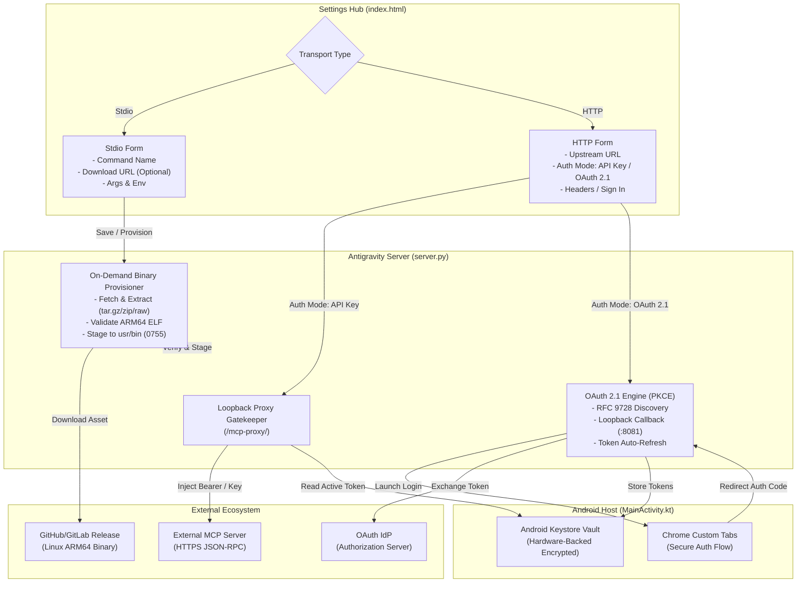
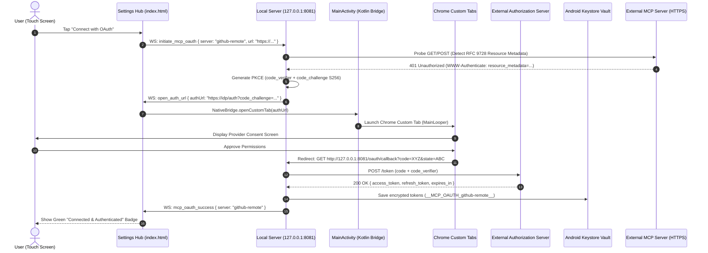

# Module 06: Standardized Stdio Binary Provisioning & Dual-Mode OAuth 2.1 HTTP MCP Architecture

## 1. Executive Summary & Problem Statement

### 1.1 Context & Historical Defects
In Antigravity Studio v1.8.x and v1.9.0, Model Context Protocol (MCP) server management suffers from two critical architectural gaps:

1. **Fragile Stdio Implementations & Broken Migrations**:
   - When users configured Stdio MCP servers (e.g. `github-mcp`), previous agent sessions implemented ad-hoc Python scripts placed in untracked internal paths (`~/.gemini/scripts/github_mcp.py`).
   - The backup export engine (`generate_config_export_bundle`) serializes only the JSON definition from `mcp_config.json` without bundling arbitrary script files.
   - Upon restoring on a new device, the configuration references a non-existent file, causing instantaneous `FileNotFoundError` crashes upon MCP process spawning.
   - While the UI allows selecting "Stdio", there is currently no standardized, self-contained mechanism to provision or download native ARM64 binaries (e.g. Go, Rust, C++) on demand.

2. **HTTP Authentication Rigidity (API Keys vs. OAuth 2.1)**:
   - Antigravity Studio's HTTP MCP loopback proxy currently supports only static header injection (e.g., `Authorization: Bearer $KEY_NAME`).
   - While ideal for Personal Access Tokens (PATs) and static API keys, enterprise and modern cloud MCP endpoints (such as GitHub Copilot's hosted endpoint `https://api.githubcopilot.com/mcp/`, Google, Slack, and Jira) mandate interactive **OAuth 2.1 with PKCE** (`RFC 9728`, `RFC 8414`).
   - Attempting to connect to these services without an OAuth loop yields `401 Unauthorized` with `resource_metadata` challenges that cannot currently be completed inside the application.

### 1.2 Core Design Principles
- **API Key Flow Remains 100% Functional**: The existing static header/API key injection mechanism remains the primary, zero-friction default for all HTTP MCP servers.
- **Zero Prebundled Bloat**: Native binaries (such as `github-mcp-server`) are **never prebundled in the APK**. They are fetched on demand to keep the application footprint compact (~35MB) and decouple MCP server updates from APK releases.
- **Self-Contained Export & Restore**: Any Stdio binary download metadata is preserved in encrypted export bundles, enabling new devices to autonomously re-provision dependencies without manual user intervention.
- **Hardware-Backed Secret Vaulting**: All OAuth access/refresh tokens and API keys reside exclusively in the Android Keystore Vault, never in plaintext configuration files.

---

## 2. Architecture Overview



---

## 3. Subsystem 1: Generic On-Demand Stdio Binary Provisioning

### 3.1 Settings UI Specification
In **Settings → MCP Servers → Add Server (Stdio)**, the modal is augmented with non-breaking, optional provisioning inputs:

| Field Name | DOM Element ID | Type | Description |
| :--- | :--- | :--- | :--- |
| **Server Name** | `inputMCPName` | Text | Unique identifier (e.g. `github`). |
| **Command** | `inputMCPCommand` | Text | Executable name in `$PATH` (e.g. `github-mcp-server`, `npx`, `python3`). |
| **Download URL** | `inputMCPDownloadUrl` | URL (Optional) | HTTPS link to a compiled Linux ARM64 binary or archive (`.tar.gz`, `.zip`). |
| **SHA-256 Checksum** | `inputMCPChecksum` | Text (Optional) | Hexadecimal digest for cryptographic validation. |
| **Arguments** | `inputMCPArgs` | Text | Positional command-line arguments (e.g. `stdio` or `-y @pkg`). |
| **Environment** | `txtMCPEnv` | JSON | Key-value environment variables with `$KEY_NAME` injection. |

### 3.2 Binary Staging & Execution Security
- **Staging Target**: Binaries are installed to `/data/data/ai.agy.app/files/usr/bin/<command>`.
  - *Storage Invariant*: Internal ext4 storage is mandatory. Shared storage (`/storage/emulated/0/`) is mounted `noexec` by Android and will fail execution with `EACCES`.
  - *Permissions*: Automatically set to `0755` (`-rwxr-xr-x`).
- **Archive Extraction Protocol**:
  - Supports `.tar.gz`, `.tgz`, and `.zip` archives or raw ELF binaries.
  - Path Traversal Guard: Any archive entry containing leading slashes (`/`), parent traversal (`../`), or attempting to write outside the staging directory is rejected immediately.
- **ARM64 ELF Validation Gate**:
  - Before moving a downloaded file into `$usr/bin/`, the backend reads the initial 20 bytes to verify:
    1. Magic Bytes: `\x7fELF` (ELF header).
    2. Class: `0x02` (64-bit ELF).
    3. Data: `0x01` (2's complement, little endian).
    4. Machine: `0xB7` (`EM_AARCH64`, ARM64 architecture).
  - If a user inadvertently points to an `x86_64` or `Darwin` binary, provisioning aborts with a user-friendly error card rather than failing silently at runtime.

### 3.3 Export and Import Lifecycle
1. **Export Serialization**:
   - `generate_config_export_bundle()` embeds `downloadUrl` and optional `checksum` into the server's JSON payload in the encrypted bundle.
2. **Autonomous Restoration**:
   - During `import_config_bundle()`, the backend checks whether `command` exists in `$PATH`.
   - If missing and `downloadUrl` is provided, a non-blocking background task fetches, verifies, and stages the binary before marking the server as ready.

---

## 4. Subsystem 2: Dual-Mode HTTP MCP Architecture (API Keys + OAuth 2.1 PKCE)

### 4.1 Guaranteed Continuity of Static API Key Flow
The standard API Key / Personal Access Token flow remains the default:
- Users select **Authentication: API Key / Headers**.
- The headers field (`{"Authorization": "Bearer $KEY"}` or `{"X-MCP-Key": "$KEY"}`) is retained verbatim.
- In-flight header resolution via Android Keystore Vault functions exactly as designed in Module 01.

### 4.2 OAuth 2.1 PKCE Flow Specification (`auth_mode: "oauth2"`)

When connecting to OAuth-protected MCP servers, Antigravity Studio operates as an **OAuth 2.1 Public Client** adhering to `RFC 9728`, `RFC 8414`, and `RFC 7636`:



### 4.3 Native Android WebView Bridge Invariant (ARGON-07)
Under Android WebView security rules, JavaScript cannot reliably manage multi-window OAuth popups or handle loopback navigation without sandbox corruption.
- **Directive**: The OAuth launch must route through `MainActivity.kt`:
  ```kotlin
  @JavascriptInterface
  fun openCustomTab(url: String) {
      mainHandler.post {
          val customTabsIntent = CustomTabsIntent.Builder()
              .setShowTitle(true)
              .build()
          customTabsIntent.launchUrl(this, Uri.parse(url))
      }
  }
  ```
- **Loopback Handling**: The local server listens on `http://127.0.0.1:8081/oauth/callback`. Upon receiving the redirect, it displays an HTML success card instructing the user to return to the app, while closing the tab or letting the user swipe it down.

### 4.4 Automated Token Refresh in the Reverse Proxy Gatekeeper
When the loopback proxy (`/mcp-proxy/<server_name>`) receives a JSON-RPC request:
1. It queries the Keystore Vault for `__MCP_OAUTH_<server_name>__`.
2. It evaluates `expires_at`:
   - If `current_time + 60s >= expires_at`: It executes a synchronous background refresh using `refresh_token` against the provider's token endpoint.
   - The newly minted `access_token` and updated expiration are committed to the Keystore Vault.
3. The proxy injects `Authorization: Bearer <valid_access_token>` into the outbound HTTPS request.
4. Upstream requests never fail due to token expiration.

---

## 5. Architectural Invariants & Threat Hardening Matrix

| Invariant ID | Severity | Constraint Description | Technical Mitigation |
| :--- | :--- | :--- | :--- |
| **SYS-01** | CRITICAL | Malicious or corrupt binary execution in container | Validate ARM64 ELF magic bytes (`0xB7`) and verify SHA-256 before `chmod 0755`. Staging path restricted to internal ext4 `$usr/bin/`. |
| **SYS-03** | HIGH | Broken symlinks or missing files across device backups | Self-contained download metadata transferred in encrypted export; automated on-demand fetch on import. |
| **SYS-05** | CRITICAL | CSRF / Token Interception during OAuth redirect | Enforce PKCE with `S256` hashing and cryptographically random `state` parameter bound to session secret. |
| **SYS-07** | HIGH | WebView popup crash or navigation interception | Route all OAuth browser authorizations through native `CustomTabsIntent` on Android `MainLooper`. |
| **SYS-08** | HIGH | Class scoping integrity in `server.py` | All new provisioner and OAuth methods must be encapsulated inside `AgyWebServer` or `AgyProcessOrchestrator` to pass AST verification. |
| **SYS-09** | MEDIUM | Mobile touch targets in MCP modal | Ensure "Connect with OAuth" and "Download" buttons maintain at least 44px × 44px touch boundaries with `touch-action: manipulation`. |

---

## 6. Implementation Acceptance Criteria

- [ ] **AC-06.1 (Dual-Mode UI)**: The MCP configuration modal provides a seamless radio/tab toggle between **API Key / Headers** (default) and **OAuth 2.1 (PKCE)**.
- [ ] **AC-06.2 (Stdio Download On Demand)**: Specifying a valid Linux ARM64 `.tar.gz` URL downloads, unpacks, validates the ELF `0xB7` machine header, and executes the binary without user shell intervention.
- [ ] **AC-06.3 (Export/Import Portability)**: Exporting an MCP server with a download URL produces a valid encrypted `.agy.md` bundle that restores and auto-provisions the binary on a fresh device.
- [ ] **AC-06.4 (OAuth 2.1 Discovery & Login)**: Initiating OAuth discovers RFC 9728 metadata, launches Android Chrome Custom Tabs, completes loopback callback on `127.0.0.1:8081`, and stores credentials in Keystore Vault.
- [ ] **AC-06.5 (In-Flight Auto Refresh)**: The reverse proxy automatically refreshes expired OAuth tokens in the background without dropping or failing in-flight tool calls.
- [ ] **AC-06.6 (Zero-Script Cleanup)**: Existing `github-mcp` installations can be smoothly migrated to either the official Go binary (`github-mcp-server`) or `npx`, completely retiring `~/.gemini/scripts/github_mcp.py`.
