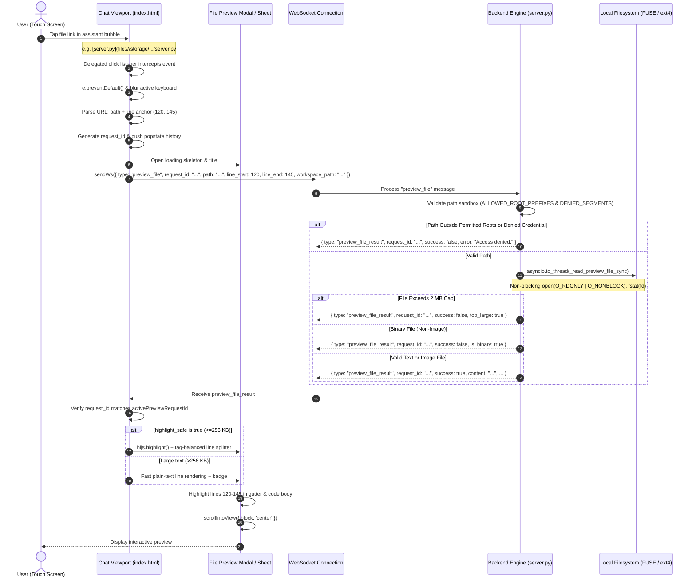

# Module 07: In-App Read-Only File Preview & Line Navigation Architecture

## 1. Executive Summary & Problem Statement

### 1.1 Context & Operational Defect
When the Antigravity AI agent analyzes codebases, generates diffs, or answers developer questions, it follows the standard Antigravity Markdown specification by referencing files and symbols using clickable links:
```markdown
[`server.py`](file:///storage/emulated/0/Documents/AgyStudio/agy-ui/server.py#L8867-L8950)
[AgyForegroundService.kt](file:///storage/emulated/0/Documents/AgyStudio/app/src/main/java/ai/agy/app/AgyForegroundService.kt#L120)
[README.md](file:///storage/emulated/0/Documents/AgyStudio/README.md)
```

In Antigravity Studio's mobile Android touch environment, tapping these links currently results in complete operational failure:
1. **Chromium / Android WebView Cross-Scheme Blocking**: The web interface is hosted on local loopback (`http://127.0.0.1:8080`). Modern Chromium security policies strictly prohibit web applications loaded via HTTP/HTTPS from navigating to or fetching resources from local `file://` schemes (`Not allowed to load local resource: file:///...`).
2. **Android Intent Security & `FileUriExposedException`**: Even when the click cascades to native `MainActivity.kt`'s `WebViewClient.shouldOverrideUrlLoading()`, passing raw `file://` URIs to external applications or Chrome Custom Tabs triggers an immediate crash or silent failure (`FileUriExposedException` on Android 7.0+ API 24+, or unsupported URI scheme).
3. **Severe Mobile Workflow Friction**: Because mobile devices lack multi-window desktop tiling, developers are forced to manually minimize the app, open a third-party file manager or mobile code editor, navigate deep nested directory trees, and manually count down hundreds of lines to inspect the snippet referenced by the agent.

### 1.2 Core Design Principles
- **Read-Only Non-Destructive Viewing**: The previewer is strictly read-only. It provides zero editing capabilities, completely eliminating race conditions, accidental workspace mutations, and conflicting state with running agent turns.
- **Zero New Dependencies**: The system leverages libraries already bundled and operational in the frontend: `highlight.js` (for syntax coloring) and the pre-existing mobile bottom-sheet / modal UI framework.
- **Precise Line Anchoring & Range Highlighting**: Clicking links with line anchors (e.g. `#L42` or `#L100-L125`) instantly jumps and smoothly scrolls to the target line, visually spotlighting the targeted block with an accent gutter and subtle background highlight.
- **Universal Local Path Resolution & Sandbox Isolation**: Intelligently handles `file:///` URIs, absolute POSIX paths (`/storage/emulated/0/...`, `/data/data/ai.agy.app/...`), and workspace-relative paths (`specs/v1.9.0/...`) resolved against the active conversation's workspace, while strictly walling off protected credential directories (`~/.ssh`, `~/.gemini`, `.env`) and Linux pseudo-filesystems (`/proc`, `/sys`).
- **Robust Resource & IPC Boundaries**: Enforces a 2 MB text file size cap, a 256 KB syntax-highlighting threshold to eliminate mobile WebView thread stalls, a 512 KB Android Binder clipboard truncation guard, and non-blocking background file I/O.

---

## 2. Architecture Overview



---

## 3. Detailed Component Specifications

### 3.1 Frontend Link Interception (`index.html`)

#### 3.1.1 Event Delegation Architecture & Link Classifier
Clicks on links are captured globally across `#chatViewport` and auxiliary Markdown containers using event delegation with a strict classifier that excludes web schemes and non-local anchors:

```javascript
const NON_FILE_SCHEMES = /^(https?:|mailto:|tel:|javascript:|data:|blob:|about:|intent:|market:|ws:|wss:)/i;
const KNOWN_FILE_EXT = /\.(py|js|ts|tsx|jsx|kt|java|c|cpp|h|hpp|rs|go|rb|php|sh|bash|zsh|json|yaml|yml|toml|xml|html|css|scss|md|txt|log|sql|gradle|properties|pro|mk|cmake|dockerfile|gitignore|svg|png|jpg|jpeg|webp|gif)$/i;

function isLocalFileLink(rawHref) {
  if (!rawHref || typeof rawHref !== 'string') return false;
  const href = rawHref.trim();
  if (!href || href.startsWith('#')) return false; // Ignore in-page anchors
  if (NON_FILE_SCHEMES.test(href)) return false;   // Ignore web & system schemes
  if (/^file:\/\//i.test(href)) return true;       // Explicit file:// URI
  if (href.startsWith('/storage/') || href.startsWith('/sdcard/') || href.startsWith('/data/data/ai.agy.app/')) {
    return true;                                   // Explicit Android POSIX path
  }
  // Relative path with known file extension or #L line anchor
  const [pathPart, frag] = href.split('#');
  const cleanPath = pathPart.replace(/:(\d+)(?:[-:](\d+))?$/, '');
  if (KNOWN_FILE_EXT.test(cleanPath) || (frag && /^L?\d+(?:[-:]L?\d+)?$/i.test(frag))) {
    return true;
  }
  return false;
}

// Global delegated click interceptor on chat container
chatViewport.addEventListener('click', (e) => {
  const anchor = e.target.closest('a');
  if (!anchor) return;

  const href = (anchor.getAttribute('href') || '').trim();
  if (isLocalFileLink(href)) {
    e.preventDefault();
    e.stopPropagation();
    // Dismiss soft keyboard if focused
    if (document.activeElement && typeof document.activeElement.blur === 'function') {
      document.activeElement.blur();
    }
    openFilePreviewFromLink(href, anchor.textContent);
  }
});
```

#### 3.1.2 Link Parsing & Target Extraction
The parser extracts path and line anchors, handling literal percent signs without `URIError` and supporting colon-separated range syntax (`file.py:40-60`):

```javascript
function parseFileLink(rawHref) {
  let [rawPath, fragment] = (rawHref || '').trim().split('#');
  let cleanPath = rawPath.replace(/^file:\/\/(localhost)?/i, '');
  try {
    cleanPath = decodeURIComponent(cleanPath);
  } catch (_) {
    // Preserve raw cleanPath if literal '%' exists without valid percent-encoding
  }

  let lineStart = null;
  let lineEnd = null;

  if (fragment) {
    const rangeMatch = fragment.match(/^L?(\d+)(?:[-:]L?(\d+))?$/i);
    if (rangeMatch) {
      lineStart = parseInt(rangeMatch[1], 10);
      lineEnd = rangeMatch[2] ? parseInt(rangeMatch[2], 10) : lineStart;
    }
  }

  // Support trailing colon syntax: /path/file.py:42, /path/file.py:42:10, or /path/file.py:42-60
  if (!lineStart) {
    const colonMatch = cleanPath.match(/:(\d+)(?:[-:]L?(\d+))?$/i);
    if (colonMatch) {
      lineStart = parseInt(colonMatch[1], 10);
      lineEnd = colonMatch[2] ? parseInt(colonMatch[2], 10) : lineStart;
      cleanPath = cleanPath.slice(0, colonMatch.index);
    }
  }

  if (lineStart && lineEnd && lineEnd < lineStart) {
    [lineStart, lineEnd] = [lineEnd, lineStart];
  }

  return { path: cleanPath, lineStart, lineEnd };
}
```

---

### 3.2 Backend Service Specification (`server.py`)

#### 3.2.1 Correlated WebSocket Protocol Schema
Client initiates request:
```json
{
  "type": "preview_file",
  "request_id": "prev_1711829400123_1",
  "path": "/storage/emulated/0/Documents/AgyStudio/specs/v1.9.0/06-standardized-stdio-and-oauth-mcp-architecture.md",
  "workspace_path": "/storage/emulated/0/Documents/AgyStudio",
  "line_start": 40,
  "line_end": 75
}
```

Server replies:
```json
{
  "type": "preview_file_result",
  "request_id": "prev_1711829400123_1",
  "success": true,
  "path": "/storage/emulated/0/Documents/AgyStudio/specs/v1.9.0/06-standardized-stdio-and-oauth-mcp-architecture.md",
  "filename": "06-standardized-stdio-and-oauth-mcp-architecture.md",
  "file_size": 17722,
  "total_lines": 245,
  "line_start": 40,
  "line_end": 75,
  "language": "markdown",
  "is_image": false,
  "content": "# Module 06: Standardized Stdio Binary Provisioning...",
  "highlight_safe": true,
  "clipboard_safe": true
}
```

Error response:
```json
{
  "type": "preview_file_result",
  "request_id": "prev_1711829400123_1",
  "success": false,
  "path": "/storage/emulated/0/Documents/AgyStudio/.env",
  "error": "Access to sensitive environment secret files is denied."
}
```

#### 3.2.2 Backend Path Sandbox & Non-Blocking File Reader
To satisfy `SYS-08`, all preview methods are strictly placed inside `AgyProcessOrchestrator` in `server.py`. File I/O executes off the event loop via `asyncio.to_thread` with non-blocking POSIX flags and path traversal barriers:

```python
    # Strictly indented inside AgyProcessOrchestrator (SYS-08 compliant)
    MAX_PREVIEW_BYTES = 2 * 1024 * 1024        # 2 MB hard cap for file read
    MAX_HIGHLIGHT_BYTES = 256 * 1024           # 256 KB cap for client syntax highlighting
    MAX_CLIPBOARD_BYTES = 512 * 1024           # 512 KB cap for Android Binder clipboard

    ALLOWED_ROOT_PREFIXES = (
        "/storage/emulated/0",
        "/data/media/0",
        "/data/data/ai.agy.app/files",
    )

    DENIED_PATH_SEGMENTS = {
        ".ssh", ".gnupg", ".gemini", ".aws", ".kube",
        "shared_prefs", "databases", "keystore",
    }
    DENIED_FILENAMES = {
        ".env", ".env.local", ".env.production", ".netrc", ".git-credentials",
    }

    IMAGE_MIME_MAP = {
        ".png": "image/png",
        ".jpg": "image/jpeg",
        ".jpeg": "image/jpeg",
        ".webp": "image/webp",
        ".gif": "image/gif",
        ".svg": "image/svg+xml",
    }

    def _resolve_and_validate_preview_path(self, raw_path: str, client_workspace: str = None) -> tuple[bool, str, str]:
        """Returns (is_valid, resolved_path, error_message)."""
        if not raw_path or not isinstance(raw_path, str):
            return False, "", "Empty or invalid file path."

        clean = raw_path.strip()
        if clean.lower().startswith("file://"):
            clean = clean[7:]
            if clean.startswith("localhost/"):
                clean = clean[9:]

        # Normalize Android /sdcard symlink aliases before realpath
        if clean.startswith("/sdcard/"):
            clean = "/storage/emulated/0/" + clean[8:]
        elif clean.startswith("/storage/self/primary/"):
            clean = "/storage/emulated/0/" + clean[22:]

        clean = os.path.expanduser(clean)
        if not os.path.isabs(clean):
            base_ws = client_workspace or getattr(self, "active_workspace", None) or os.getcwd()
            clean = os.path.join(base_ws, clean)

        real_path = os.path.realpath(clean)

        # 1. Block pseudo-filesystems (/proc, /sys, /dev) unconditionally
        if real_path.startswith(("/proc/", "/sys/", "/dev/")):
            return False, real_path, "Access to system pseudo-filesystems is restricted."

        # 2. Enforce allowed root prefixes using os.path.commonpath
        allowed = False
        for prefix in self.ALLOWED_ROOT_PREFIXES:
            real_prefix = os.path.realpath(prefix)
            try:
                if os.path.commonpath([real_path, real_prefix]) == real_prefix:
                    allowed = True
                    break
            except ValueError:
                continue

        if not allowed:
            return False, real_path, "Path is outside permitted workspace and storage roots."

        # 3. Block sensitive credential directories & secret files
        parts = set(real_path.split(os.sep))
        if parts.intersection(self.DENIED_PATH_SEGMENTS):
            return False, real_path, "Access to protected credential or configuration directories is denied."

        basename = os.path.basename(real_path)
        if basename in self.DENIED_FILENAMES or basename.startswith(".env."):
            return False, real_path, "Access to sensitive environment secret files is denied."

        return True, real_path, ""

    def _read_preview_file_sync(self, real_path: str, has_line_anchor: bool = False) -> dict:
        """Executes in worker thread via asyncio.to_thread to avoid blocking event loop on FUSE."""
        import stat
        import base64

        fd = None
        try:
            fd = os.open(real_path, os.O_RDONLY | getattr(os, "O_NONBLOCK", 0))
            st = os.fstat(fd)
            if not stat.S_ISREG(st.st_mode):
                return {"success": False, "error": "Target is not a regular file (directory or special device)."}
            if st.st_size > self.MAX_PREVIEW_BYTES:
                return {
                    "success": False,
                    "error": f"File size ({st.st_size / (1024*1024):.2f} MB) exceeds the 2.00 MB preview limit.",
                    "too_large": True,
                    "file_size": st.st_size,
                }

            with os.fdopen(fd, "rb") as f:
                fd = None  # fdopen takes ownership
                raw_bytes = f.read(self.MAX_PREVIEW_BYTES + 1)

            if len(raw_bytes) > self.MAX_PREVIEW_BYTES:
                return {
                    "success": False,
                    "error": "File stream exceeds the 2.00 MB preview limit.",
                    "too_large": True,
                    "file_size": len(raw_bytes),
                }

            ext = os.path.splitext(real_path)[1].lower()
            # Render SVG as source code if a line anchor (#L10) was explicitly requested
            if ext in self.IMAGE_MIME_MAP and not (ext == ".svg" and has_line_anchor):
                mime = self.IMAGE_MIME_MAP[ext]
                b64 = base64.b64encode(raw_bytes).decode("ascii")
                return {
                    "success": True,
                    "is_image": True,
                    "is_svg": ext == ".svg",
                    "content": f"data:{mime};base64,{b64}",
                    "svg_source": raw_bytes.decode("utf-8", errors="replace") if ext == ".svg" else None,
                    "file_size": len(raw_bytes),
                    "total_lines": 0,
                    "language": "image",
                }

            # Check first 4KB for null bytes (binary detection)
            if b"\x00" in raw_bytes[:4096]:
                return {
                    "success": False,
                    "is_binary": True,
                    "file_size": len(raw_bytes),
                    "error": "Binary file cannot be previewed as text.",
                }

            text = raw_bytes.decode("utf-8", errors="replace")
            total_lines = text.count("\n") + 1 if text else 0
            return {
                "success": True,
                "is_image": False,
                "content": text,
                "file_size": len(raw_bytes),
                "total_lines": total_lines,
                "highlight_safe": len(raw_bytes) <= self.MAX_HIGHLIGHT_BYTES and total_lines <= 5000,
                "clipboard_safe": len(raw_bytes) <= self.MAX_CLIPBOARD_BYTES,
            }
        except FileNotFoundError:
            return {"success": False, "error": "File does not exist or cannot be accessed."}
        except PermissionError:
            return {"success": False, "error": "Permission denied reading file."}
        except Exception as e:
            return {"success": False, "error": f"Failed to read file: {str(e)}"}
        finally:
            if fd is not None:
                try:
                    os.close(fd)
                except OSError:
                    pass
```

---

### 3.3 Touch UI & Modal Design Specification

#### 3.3.1 Modal Layout & DOM Hierarchy (`index.html`)
The preview container is added as a dedicated full-featured dialog (`#modalFilePreview`):

```html
<div class="modal-dialog file-preview-dialog" id="modalFilePreview" style="display:none;" aria-hidden="true">
  <div class="modal-card file-preview-card">
    <!-- Header -->
    <div class="file-preview-header">
      <div class="file-preview-title-group">
        <span class="file-preview-icon" id="previewFileIcon"></span>
        <div class="file-preview-meta">
          <span class="file-preview-name" id="previewFileName">filename.py</span>
          <span class="file-preview-path" id="previewFilePath">/storage/emulated/0/.../filename.py</span>
        </div>
      </div>
      <div class="file-preview-actions">
        <button class="preview-action-btn" id="btnPreviewCopyPath" title="Copy Path" aria-label="Copy Path">
          <svg class="fa-icon" viewBox="0 0 512 512"><path fill="currentColor" d="..."/></svg>
        </button>
        <button class="preview-action-btn" id="btnPreviewCopyContent" title="Copy Content" aria-label="Copy Content">
          <svg class="fa-icon" viewBox="0 0 512 512"><path fill="currentColor" d="..."/></svg>
        </button>
        <button class="preview-action-btn close" id="btnCloseFilePreview" title="Close" aria-label="Close">
          <svg class="fa-icon" viewBox="0 0 384 512"><path fill="currentColor" d="..."/></svg>
        </button>
      </div>
    </div>

    <!-- Subheader Status Bar -->
    <div class="file-preview-status-bar" id="previewStatusBar">
      <span class="preview-badge" id="previewBadgeLang">Python</span>
      <span class="preview-badge" id="previewBadgeLines">245 lines</span>
      <span class="preview-badge" id="previewBadgeSize">12.4 KB</span>
      <span class="preview-badge target-range" id="previewBadgeRange" style="display:none;">Lines 40–75</span>
    </div>

    <!-- Body Viewport -->
    <div class="file-preview-body" id="previewBody">
      <!-- Loading Skeleton -->
      <div class="preview-loading-spinner" id="previewLoading">
        <span class="fa-spin">...</span> Loading file...
      </div>

      <!-- Code View with Synchronized Gutter -->
      <div class="preview-code-container" id="previewCodeContainer" style="display:none;">
        <div class="code-gutter" id="previewGutter"></div>
        <pre class="code-viewport" id="previewCodeViewport"><code id="previewCodeElement"></code></pre>
      </div>

      <!-- Image View -->
      <div class="preview-image-container" id="previewImageContainer" style="display:none;">
        
      </div>

      <!-- Error / Binary Notice -->
      <div class="preview-notice-box" id="previewNoticeBox" style="display:none;">
        <div class="notice-icon" id="previewNoticeIcon"></div>
        <div class="notice-text" id="previewNoticeText"></div>
      </div>
    </div>
  </div>
</div>
```

#### 3.3.2 Multi-Line Safe `highlight.js` Line Splitter & Gutter Synchronization
To prevent DOM corruption when multi-line tokens (e.g. comments, docstrings) span across newlines, the renderer parses the HTML generated by `hljs.highlight()` and balances `<span class="hljs-...">` tags across lines:

```javascript
function splitHighlightedHtmlIntoLines(highlightedHtml) {
  const rawLines = highlightedHtml.split('\n');
  const openTags = [];
  return rawLines.map((lineHtml) => {
    const prefix = openTags.join('');
    const tagRegex = /<\/?span[^>]*>/gi;
    let match;
    while ((match = tagRegex.exec(lineHtml)) !== null) {
      if (match[0].startsWith('</')) {
        openTags.pop();
      } else if (!match[0].endsWith('/>')) {
        openTags.push(match[0]);
      }
    }
    const suffix = '</span>'.repeat(openTags.length);
    return prefix + (lineHtml || ' ') + suffix;
  });
}
```

#### 3.3.3 Synchronized Sticky Gutter & Line Highlighting CSS
To prevent line number and highlight drift during horizontal or vertical scrolling, the gutter is anchored with `position: sticky; left: 0; z-index: 5` inside the shared scrolling container:

```css
.preview-code-container {
  display: flex;
  overflow: auto;
  height: 100%;
  font-family: 'JetBrains Mono', monospace;
  font-size: 12.5px;
  line-height: 20px;
  -webkit-overflow-scrolling: touch;
}
.code-gutter {
  position: sticky;
  left: 0;
  z-index: 5;
  flex-shrink: 0;
  user-select: none;
  background: #141720;
  border-right: 1px solid rgba(255, 255, 255, 0.08);
  padding: 12px 0;
  text-align: right;
}
.gutter-line {
  height: 20px;
  line-height: 20px;
  padding: 0 10px 0 12px;
  color: rgba(148, 163, 184, 0.55);
}
.gutter-line.gutter-highlight {
  color: #c7d2fe;
  font-weight: 700;
  background: rgba(99, 102, 241, 0.18);
}
.code-viewport {
  margin: 0;
  padding: 12px 0;
  flex-grow: 1;
  overflow: visible;
}
.code-line {
  display: block;
  height: 20px;
  line-height: 20px;
  padding: 0 16px 0 12px;
  white-space: pre;
}
.code-line.line-highlight {
  background: rgba(99, 102, 241, 0.24);
  box-shadow: inset 3px 0 0 #818cf8;
}
```

---

### 3.4 Native Bridge Hardening (`MainActivity.kt` & Touch Lifecycle)

1. **Android Binder IPC Clipboard Protection**:
   In `MainActivity.kt`, guard `setClipboardText(text: String)` against `TransactionTooLargeException` by capping at 512 KB:
   ```kotlin
   @JavascriptInterface
   fun setClipboardText(text: String): Boolean {
       val safeText = if (text.length > 524288) text.substring(0, 524288) else text
       runOnUiThread {
           try {
               val clipboard = getSystemService(Context.CLIPBOARD_SERVICE) as ClipboardManager
               val clip = ClipData.newPlainText("Antigravity Studio", safeText)
               clipboard.setPrimaryClip(clip)
           } catch (e: Exception) {
               Log.e("AgyStudio", "Clipboard write failed (Binder limit)", e)
           }
       }
       return text.length <= 524288
   }
   ```
2. **Defense-in-Depth `shouldOverrideUrlLoading`**:
   If a `file://` link is ever dispatched directly to the WebView from outside the delegated chat viewport (e.g. within an unexpected popover), intercept it in Kotlin before it reaches the OS:
   ```kotlin
   if (url.startsWith("file://", ignoreCase = true)) {
       val escaped = org.json.JSONObject.quote(url)
       view?.post {
           view.evaluateJavascript("if(window.openFilePreviewFromLink) window.openFilePreviewFromLink($escaped);", null)
       }
       return true
   }
   ```
3. **Android Hardware Back Gesture Integration**:
   When opening `#modalFilePreview`, push a history state (`history.pushState({ modal: 'filePreview' }, '')`) and listen to `popstate` to close the modal seamlessly when the user swipes the Android back gesture, without reloading or leaving the active conversation.

---

## 4. Threat Modeling & Architectural Invariants (SYS-01 to SYS-09)

| Audit ID | Subsystem | Threat / Pitfall | Spec 07 Architectural Hardening |
| :--- | :--- | :--- | :--- |
| **SYS-01** | SELinux W^X | Subprocess execution of arbitrary binary files | File preview operates purely through Python `os.open()` with `O_RDONLY \| O_NONBLOCK`. Zero child processes or scripts are spawned. |
| **SYS-03** | Path Stability | Hardcoded `/data/app/` paths | Resolves relative paths dynamically against session `workspacePath`. Never hardcodes ephemeral installation paths. |
| **SYS-05** | IPC Security | Intent leakage via `file://` | All file reading is performed internally via WebSocket loopback. Zero raw `file://` Intents are broadcast to the Android OS. |
| **SYS-07** | Native WebView Bridge | Binder crash or unhandled navigation | Clipboard capped at 512 KB to prevent `TransactionTooLargeException`. Intercepts `file://` in WebViewClient fallback. |
| **SYS-08** | AST Class Scope | Server methods inserted at module level | All preview request handlers in `server.py` are strictly defined inside `AgyProcessOrchestrator` class. Verified by pre-build AST gate. |
| **SYS-09** | Touch Stacking | Small or unresponsive touch targets | Action buttons adhere to 44px × 44px minimum touch targets, `z-index: 10+`, `touch-action: manipulation`, and deduplicated touch handlers. |

---

## 5. Acceptance Criteria

- **AC-PREV-01**: Tapping any Markdown link starting with `file://` in chat messages intercepts the event without navigating away, opening the in-app preview modal.
- **AC-PREV-02**: Relative file links (e.g. `specs/v1.9.0/06.md`) resolve accurately against the active session's workspace directory.
- **AC-PREV-03**: Links containing line anchors (e.g. `#L42` or `#L42-L60`, or `file.py:42-60`) automatically scroll to line 42 and apply visual highlighting to lines 42 through 60 in both gutter and code body.
- **AC-PREV-04**: Files matching supported programming languages and markup formats <= 256 KB are syntax-highlighted via `highlight.js` with tag-balanced line spans.
- **AC-PREV-05**: Image files (`.png`, `.jpg`, `.svg`, `.webp`) are rendered visually in an image container; SVG files requested with line anchors (e.g. `icon.svg#L10`) render as syntax-highlighted XML markup.
- **AC-PREV-06**: Files exceeding 2 MB are rejected with an informative banner without freezing the browser thread or crashing the mobile container.
- **AC-PREV-07**: Non-image binary files (e.g., ELF binaries, `.zip`, `.tar.gz`) display a *"Binary file cannot be previewed as text"* warning banner.
- **AC-PREV-08**: Missing files or invalid paths display a *"File not found"* banner with the full resolved path.
- **AC-PREV-09**: Tapping "Copy Path" copies the resolved absolute path to the system clipboard via `AndroidApp.setClipboardText()`.
- **AC-PREV-10**: Tapping "Copy Content" copies file text to the clipboard, safely capped at 512 KB to protect the Android Binder buffer.
- **AC-PREV-11**: The modal closes cleanly on tapping the close button `✕`, tapping the backdrop, or executing the Android hardware Back gesture.
- **AC-PREV-12**: The preview modal is strictly read-only; no input fields, save buttons, or file modification routines are exposed.
- **AC-PREV-13 (Sandbox Credential Isolation)**: Attempting to preview files in protected credential directories (`~/.ssh/`, `~/.gemini/`, `shared_prefs`), `.env` files, or kernel pseudo-files (`/proc/*`, `/sys/*`) is rejected by the backend with an access-denied notice.
- **AC-PREV-14 (Large File & Binder Clipboard Stability)**: Files between 256 KB and 2 MB render in fast plain-text mode with full line numbers and line-jumping without freezing the WebView UI thread, and tapping "Copy Content" on files > 512 KB safely truncates without throwing `TransactionTooLargeException`.
- **AC-PREV-15 (Correlated Async & Back-Gesture Lifecycle)**: Opening a preview automatically dismisses any active soft keyboard, ignores stale out-of-order WebSocket responses via `request_id`, and intercepts the Android hardware Back gesture via `popstate` to close the modal without navigating away from the active chat session.
