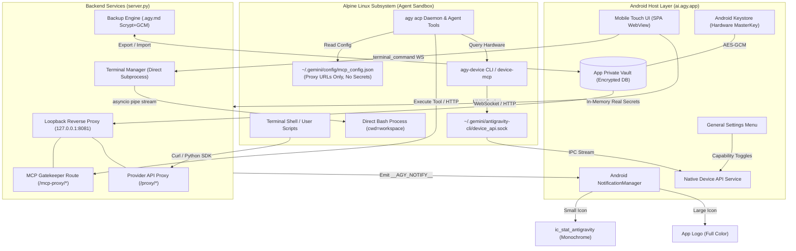
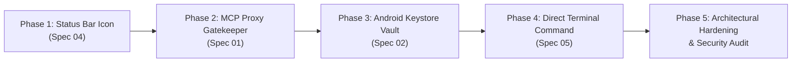

# Antigravity Studio v1.9.0 — Architecture & Implementation Guide

## Executive Summary

**Antigravity Studio v1.9.0** delivers a major security, privacy, and capability hardening milestone for the mobile development environment. While v1.8.0 modernized the execution engine to a persistent Agent Client Protocol (`agy acp`) daemon, v1.9.0 establishes hard security perimeters around secrets, external integrations, and system notifications.

This release addresses four core architectural objectives:
1. **MCP Hard Disabling & Loopback Proxy Gatekeeper (Option A)**: Eliminates the capability of autonomous agent scripts or terminal commands to bypass disabled Model Context Protocol (MCP) servers by routing all MCP HTTP traffic through a local gatekeeper proxy that withholds upstream URLs and authentication headers, returning `403 Forbidden` whenever an MCP is disabled.
2. **Android Keystore Vault & API Key Reverse Proxy Pattern**: Replaces plaintext on-disk secrets (`api_keys.json`, `os.environ` secret dumping) with hardware-backed encryption (Android Keystore AES-256-GCM Master Key). API requests route through a local reverse proxy that injects credentials in-flight, while preserving mandatory password-encrypted `.agy.md` backup export/import compatibility and UI clipboard copying.
3. **Monochrome Status Bar Notification Icon**: Replaces the generic "A" status bar placeholder with an Android-compliant monochrome silhouette Vector Drawable (`ic_stat_antigravity.xml`), resolving Android 5.0+ alpha mask rendering requirements while retaining the full-color expanded notification logo.
4. **Direct Chat Terminal Execution**: Introduces a dedicated `[>_ Terminal]` toggle pill in the composer bar, a `/terminal` slash command, and an automatic `!` typing trigger that clears the character and toggles Terminal Mode to ON, executing raw developer commands (`git`, `npm`, `apk`, `cargo`) directly in the workspace with streaming monospace output and zero LLM token consumption.

---

## 1. System Requirements & Platform Constraints

* **Host Platform**: Android ARM64 (API 26+ minimum, API 34/35 target).
* **Container Subsystem**: W^X-compliant Alpine Linux (PRoot + Anonymous ELF Loader).
* **Engine Baseline**: `agy >= 1.5.1` (persistent ACP daemon).
* **Cryptographic Foundation**:
  * Hardware-backed `AndroidKeyStore` provider (`androidx.security.crypto.MasterKey`).
  * AES-256-GCM authenticated encryption for stored credentials.
  * Scrypt KDF + AES-256-GCM for exported `.agy.md` backup archives (v1.6.3 Spec 03 compatibility).
* **Network & IPC Boundaries**:
  * All proxy endpoints strictly bind to loopback (`127.0.0.1`).
  * Device IPC communicates over UNIX domain socket `~/.gemini/antigravity-cli/device_api.sock`.
  * Zero external app dependencies (e.g., no Termux or Termux:API dependency).

---

## 2. Global Architecture Diagram

---

## 3. Four Core Architectural Pillars

### Pillar 1: MCP Loopback Proxy & Hard Disabling (Spec 01)
* **Problem**: In v1.8.0, disabling an MCP merely flags `"disabled": true` in `mcp_config.json`. The agent reads the JSON, extracts the plaintext `serverUrl` and `headers` (`Authorization: Bearer ...`), and invokes the service directly via Python `requests` or `curl`.
* **Solution**: 
  * Real target URLs and authentication headers are stripped from `mcp_config.json` and held exclusively in the app's secure internal memory.
  * In `mcp_config.json`, the URL points to `http://127.0.0.1:8081/mcp-proxy/<server_name>`.
  * If the server is enabled: the proxy forwards the request to the upstream target, injecting real headers.
  * If the server is disabled: the proxy immediately rejects requests with `403 Forbidden`. The agent has neither the upstream URL nor the auth token.

### Pillar 2: Android Keystore Vault & API Key Proxy (Spec 02)
* **Problem**: Plaintext `~/.gemini/config/api_keys.json` and `api_keys_manifest.md` sit exposed in the user's home directory. Any shell command, npm/pip dependency, or prompt injection can dump all API keys.
* **Solution**:
  * Plaintext key files on disk are eliminated.
  * Secrets are encrypted at rest with an `AndroidKeyStore` hardware Master Key (AES-256-GCM).
  * Outbound LLM API calls route through loopback endpoints (`OPENAI_BASE_URL="http://127.0.0.1:8081/proxy/openai"`) with opaque dummy tokens.
  * Existing encrypted `.agy.md` backup bundles (Scrypt KDF + AES-256-GCM with mandatory user password) remain 100% supported for export and import.
  * In-memory clipboard copy and view remain responsive in Settings UI.

### Pillar 3: Monochrome Status Bar Notification Icon (Spec 04)
* **Problem**: Notifications posted by `AgyForegroundService` display a generic fallback "A" icon in the Android status bar.
* **Solution**:
  * Android API 21+ requires status bar small icons to be monochrome alpha masks (white on transparent). Full-color launcher bitmaps fail or render as generic boxes.
  * Generated vector drawable `ic_stat_antigravity.xml` and vector silhouette `ic_stat_antigravity.svg` (centered 15.6 × 14.5 dp shape within 24 × 24 dp canvas with 10% safe padding).
  * `AgyForegroundService` notification builder updated with `setSmallIcon(R.drawable.ic_stat_antigravity)`, while preserving the full-color logo as the expanded notification's `setLargeIcon`.

### Pillar 4: Direct Chat Terminal Execution (Spec 05)
* **Problem**: Running simple CLI tasks (`git status`, `npm test`, `apk add`) requires querying the LLM agent, waiting for reasoning tokens and tool schemas, which is slow and consumes API quota.
* **Solution**:
  * Introduce a dedicated `[>_ Terminal]` toggle pill located directly between **Attach** and **/ Commands**.
  * Typing `!` into an empty textarea automatically clears the character and toggles Terminal Mode **ON**, providing instant visual clarity.
  * In Terminal Mode, submitted commands execute directly in the active workspace via `server.py`, bypassing the LLM agent (0 token usage).
  * Stdout and stderr stream in real-time chunk-by-chunk into a monospace terminal card with exit badges and duration.
  * Supports directory changes (`cd <path>`) with live workspace status bar synchronization.

---

## 4. Specification Module Map

The v1.9.0 specification is partitioned into 4 modular specifications:

| Module File | Title | Primary Scope |
| :--- | :--- | :--- |
| [`01-mcp-loopback-proxy-and-hard-disabling.md`](file:///storage/emulated/0/Documents/AgyStudio/specs/v1.9.0/01-mcp-loopback-proxy-and-hard-disabling.md) | MCP Loopback Proxy & Hard Disabling | Reverse proxy gatekeeper, header redaction, stdio neutralization, export/import integration. |
| [`02-android-keystore-vault-and-api-key-proxy.md`](file:///storage/emulated/0/Documents/AgyStudio/specs/v1.9.0/02-android-keystore-vault-and-api-key-proxy.md) | Android Keystore Vault & API Key Proxy | Hardware MasterKey, credential database, proxy route injection, `.agy.md` backup compatibility. |
| [`04-monochrome-status-bar-notification-icon.md`](file:///storage/emulated/0/Documents/AgyStudio/specs/v1.9.0/04-monochrome-status-bar-notification-icon.md) | Monochrome Status Bar Notification Icon | VectorDrawable specs, `AgyForegroundService` builder integration, density scaling, design rules. |
| [`05-direct-chat-terminal-execution.md`](file:///storage/emulated/0/Documents/AgyStudio/specs/v1.9.0/05-direct-chat-terminal-execution.md) | Direct Chat Terminal Execution | Composer toggle pill, `!` auto-clearing trigger, monospace streaming output card, `cd` workspace sync. |

---

## 5. Security Threat Matrix & Mitigations

| Threat ID | Threat Vector | Target | v1.8.0 Vulnerability | v1.9.0 Architectural Mitigation |
| :--- | :--- | :--- | :--- | :--- |
| **THREAT-01** | Agent Tool Bypass | Disabled MCP Servers | Disabled MCP credentials and endpoint remain in `mcp_config.json`; agent calls directly. | Real target and headers redacted to secure vault; proxy drops disabled routes with `403 Forbidden`. |
| **THREAT-02** | Credential Exfiltration | Plaintext `api_keys.json` | Shell scripts or dependencies read `~/.gemini/config/api_keys.json` or inspect `env`. | File eliminated; secrets sealed in Keystore; virtual base URLs injected into environment; `prctl(PR_SET_DUMPABLE, 0)` active. |
| **THREAT-03** | Backup Snooping | Exported Configuration | Unencrypted backup bundles expose keys and server credentials. | Mandatory Scrypt + AES-256-GCM encryption on all `.agy.md` backup exports preserved. |
| **THREAT-04** | Notification Glitch | Status Bar Notification Icon | Full-color bitmap in `setSmallIcon` results in white square or fallback generic "A". | Pure monochrome Vector Drawable with transparent background and safe padding; Canvas conversion for adaptive icons. |
| **THREAT-05** | Open Redirect SSRF | MCP Proxy Gatekeeper | Upstream server redirects to internal `127.0.0.1` endpoints or alternative IP encodings. | Enforced `allow_redirects=False` and DNS resolution + `ipaddress` validation blocking loopback and non-canonical IPs. |
| **THREAT-06** | SDK Authentication Failure | Provider Reverse Proxy | SDKs use provider-specific headers (`x-api-key`, `x-goog-api-key`, body keys) rather than standard Bearer token. | Multi-provider dispatch table injecting proper headers and JSON body parameters per provider. |
| **THREAT-07** | Subprocess Environment Leak | Direct Terminal Command | Child process inherits internal Keystore or secret master tokens. | Environment explicitly scrubbed of internal keys before subprocess spawn; process-group signal aborts supported. |

---

## 6. Implementation Sequence & Verification Gates

1. **Phase 1: Notification Asset & Service Integration**:
   - Add `res/drawable/ic_stat_antigravity.xml`.
   - Update `AgyForegroundService.kt` to call `setSmallIcon(R.drawable.ic_stat_antigravity)`.
2. **Phase 2: MCP Loopback Proxy**:
   - Add `/mcp-proxy/{name}` route in `server.py`.
   - Redact upstream URLs and headers from `mcp_config.json`.
   - Implement `403 Forbidden` response for disabled servers.
3. **Phase 3: Android Keystore Vault**:
   - Initialize `MasterKey` in Android host.
   - Build local loopback proxy routes for LLM providers.
   - Update `.agy.md` export/import engine to pull from and write to the Keystore vault.
4. **Phase 4: Direct Terminal Command Execution**:
   - Add `#pillTerminal` between `#btnUpload` and `#pillSlash`.
   - Wire `!` auto-clearing toggle trigger, `/terminal` slash command, and Backspace exit handler.
   - Implement WebSocket `terminal_command` handler and live streaming in `server.py`.
   - Build monospace terminal output card with exit code badges and `cd` directory tracking.
5. **Phase 5: Architectural Hardening & System Audit**:
   - Execute automated review heuristics and deep reasoning threat model.
   - Verify zero regressions against Android W^X and AST structural gates.
